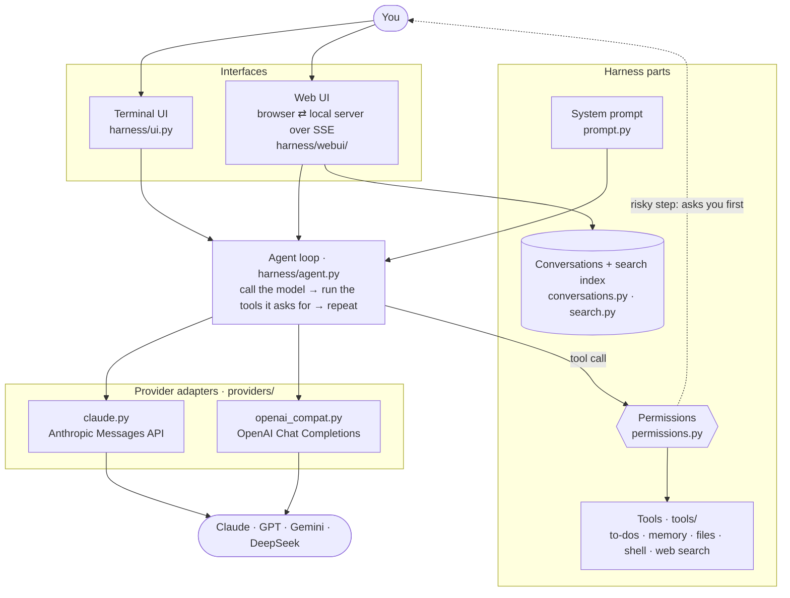
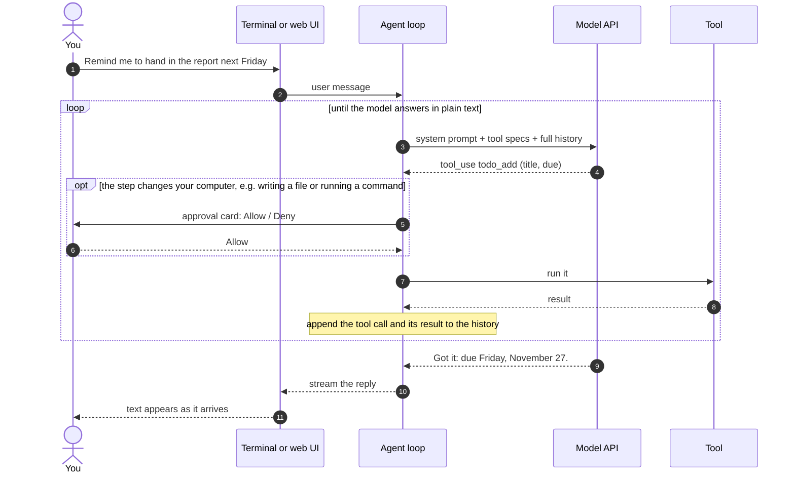

<div align="center">


# ZhiFox · 智狐

**A hand-written AI agent harness: your own personal assistant, running on your computer.**

[](https://github.com/Akxan/zhifox-agent-harness/actions/workflows/tests.yml)
[](LICENSE)
[](https://www.python.org/)
[](#how-it-works)
[](#supported-models)
[](#web-ui)
[](#three-interface-languages)
[](https://github.com/Akxan/zhifox-agent-harness/stargazers)
[](https://github.com/Akxan/zhifox-agent-harness/commits/main)

**English** | [简体中文](README.zh-CN.md)

</div>

<p align="center">
  <picture>
    <source media="(prefers-color-scheme: dark)" srcset="docs/assets/screenshot-dark-en.webp">
    
  </picture>
</p>

ZhiFox is an AI agent harness built from scratch in Python, with no agent framework: a local-first personal assistant
that runs on your own computer, with a terminal UI and a web UI. It works with Claude, GPT, Gemini and DeepSeek, and uses
tool use (function calling) to manage to-dos, remember things across conversations, read and write files, run shell
commands and search the web, with a permission prompt before anything that changes your computer. It is also a teaching
project: every part of this LLM agent, from the loop to the provider adapters, is hand-written and lives in its own file.

"ZhiFox" is the English name; in the app itself the name stays "智狐" in every interface language. The repository is
`zhifox-agent-harness`, but the Python package and the command are still called `harness`, because the project is about
what a harness is. Web search is available with Claude only. Every web UI conversation is saved automatically on your
computer, and you can reopen it from the sidebar or search it by title and content.

## Highlights

- 🦊 **No agent framework.** The loop that turns a model into an agent is one file of about 180 lines,
  [harness/agent.py](harness/agent.py). Tool dispatch, permissions, provider adapters, storage and search are plain
  Python on top of the official `anthropic` and `openai` SDKs.
- 🔌 **Four providers, two adapters.** Claude goes through the native Anthropic Messages API; GPT, Gemini and DeepSeek
  share one OpenAI Chat Completions adapter.
- 🛠️ **Tools that do real work:** to-dos, long-term memory shared by all conversations, reading and writing files,
  shell commands, and web search (Claude only).
- 🛡️ **Permission prompts.** Every shell command and every file write waits for your approval, and when you deny one
  you can tell the model why. Looser modes last only until the next restart, and `.env` is always off-limits.
- 💾 **Local-first.** Conversations, memory, to-dos and settings are plain files on your disk. The web server listens
  on 127.0.0.1 only, and the page loads no external resources.
- 🔎 **Search across past conversations**, by title and content, tolerant of typos and skipped characters, without a
  search library.
- 🖥️ **One loop, two interfaces.** The terminal UI and the web UI drive the same loop. The web UI streams over SSE,
  has light and dark themes, and respects reduced-motion settings.
- 🌐 **Interface in English, 中文 and Español**, switchable mid-conversation without a page reload.
- 💸 **Cost you can see:** token usage and an estimated cost after every model call, prompt caching, and per-message
  caps on web search.
- 🧪 **Tests without API keys.** The test suite drives the real SDKs against local fake servers, so running it is free.

## Quick start

You need macOS or Linux and [uv](https://docs.astral.sh/uv/).

```bash
uv sync                 # install dependencies
uv run harness --web    # start the web UI; it opens in your browser
```

The first time, the middle of the page tells you there is no API key yet. Click **Open settings** in that notice (or
the button at the top right), enter a key for at least one provider, and start chatting. For the terminal UI, run
`uv run harness` once a key is set.

### Supported models

| Provider | Where to get an API key | Variable in `.env` | Tested |
|---|---|---|---|
| Claude (Anthropic) | [platform.claude.com](https://platform.claude.com) | `ANTHROPIC_API_KEY` | Yes, against the real API |
| GPT (OpenAI) | [platform.openai.com](https://platform.openai.com) | `OPENAI_API_KEY` | Not with a real key |
| Gemini (Google) | [aistudio.google.com](https://aistudio.google.com) | `GEMINI_API_KEY` | Not with a real key |
| DeepSeek | [platform.deepseek.com](https://platform.deepseek.com) | `DEEPSEEK_API_KEY` | Key saving and model sync tested with a real key; chat not yet |

The last three were written against each provider's official documentation and tested with local fake servers, but have
not been used for a chat with a real key yet (DeepSeek's key saving and model sync have been run with a real key). If one of them fails the first time you use it, the likely cause is a detail of that
provider's API that its documentation doesn't mention.

Every provider bills API usage by volume, separately from its chat-app subscription, and usually needs prepaid credit.
You can enter keys in the web UI's Settings, or copy [.env.example](.env.example) to `.env` and write them there. Both
end up in the same place.

## Architecture

A model does one thing: it reads text and writes the next piece of text. It doesn't remember your last conversation,
and it can't take any action. A **harness** is the code wrapped around the model that makes up for this.
**Agent = model + harness.**

How the parts connect:



What happens during one turn, using a to-do request as the example:



### Which file does what

Each part of the harness has its own file or directory:

| Part | File | The problem it solves |
|---|---|---|
| Loop | [harness/agent.py](harness/agent.py) | A model replies once per call. The loop keeps calling it until the task is done |
| Tools | [harness/tools/](harness/tools/) | A model can't act. Tools act for it and report the result back |
| Provider adapters | [harness/providers/](harness/providers/) | Every provider's API has its own format. The adapters hide the differences, so the loop doesn't care which provider is behind it |
| Conversation history | Inside the adapters (the format differs per provider) | A model has no memory. Every request resends the whole conversation |
| Conversation storage | [harness/conversations.py](harness/conversations.py) | History in memory is gone once the program closes. Saving it to a file lets you pick up where you left off |
| Conversation search | [harness/search.py](harness/search.py) | Once there are many conversations, you can't find anything. The text of every conversation is kept in memory and searched by title and content, allowing near matches |
| Long-term memory | [harness/tools/memory.py](harness/tools/memory.py) | Conversations can't see each other. Memory is shared by all of them, and the assistant decides what to write there |
| System prompt | [harness/prompt.py](harness/prompt.py) | A model doesn't know who it is or what environment it is running in |
| Permissions | [harness/permissions.py](harness/permissions.py) | A model can make mistakes or be misled. Risky actions need your approval |
| Interfaces | [harness/ui.py](harness/ui.py) (terminal), [harness/webui/](harness/webui/) (web) | Show you what is happening and pass your input to the loop |
| Settings and pricing | [harness/settings.py](harness/settings.py), [harness/pricing.py](harness/pricing.py) | Remember the model you chose and the keys you entered; turn tokens into money |
| Interface languages | [harness/i18n.py](harness/i18n.py), [harness/locales/](harness/locales/) | Interface text in Chinese, English and Spanish, from one translation table shared by the web and terminal UIs |
| Assembly | [harness/app.py](harness/app.py), [harness/cli.py](harness/cli.py), [harness/config.py](harness/config.py) | Wire everything together and read the configuration |

Suggested reading order: `agent.py` → `tools/base.py` → `tools/todo.py` → `permissions.py` → `providers/base.py`.
Read the rest as your interest takes you.

## How it works

### The loop

```
You say something
  └─► send [system prompt + tool specs + full conversation history] to the model
        ├─ the model replies with text           → show it to you; the turn ends
        └─ the model says "I want to call tool X" → check permissions → run it → append the result
                                                     to the history → send it all again (loop)
```

The model decides what happens next, every time; the loop just carries it out. That is the difference between an agent
and an ordinary program: an ordinary program's steps are fixed in code, while an agent's steps are chosen by the model as
it goes.

After you tell Claude "Remind me to hand in the report next Friday", the conversation history looks like this
(abridged). The model doesn't actually "call" anything. It outputs a block in a fixed format saying it wants to call
`todo_add`; the harness sees that, runs the tool, and puts the result back into the history as a new message:

```json
[
  {"role": "user", "content": [
    {"type": "text", "text": "<context>Current time: 2026-11-20 14:03 Friday</context>"},
    {"type": "text", "text": "Remind me to hand in the report next Friday"}
  ]},
  {"role": "assistant", "content": [
    {"type": "thinking", "thinking": "Next Friday is November 27…", "signature": "..."},
    {"type": "tool_use", "id": "toolu_1", "name": "todo_add",
     "input": {"title": "Hand in the report", "due": "2026-11-27"}}
  ]},
  {"role": "user", "content": [
    {"type": "tool_result", "tool_use_id": "toolu_1", "content": "{\"id\": 1, \"title\": \"Hand in the report\", ...}"}
  ]},
  {"role": "assistant", "content": [
    {"type": "text", "text": "Got it: due Friday, November 27."}
  ]}
]
```

The example is translated for this page. Text written for the model stays in Chinese in the code, so the real context
note reads `<context>当前时间：2026-11-20 14:03 星期五</context>`. The current time travels with each user message rather
than in the system prompt, because it changes every time, and a changing system prompt would break the cache.

One rule holds throughout: **the history is only ever appended to; nothing earlier is changed.** The reasons are in the
comment in `AnthropicBackend.__init__` in [harness/providers/claude.py](harness/providers/claude.py). In short, changing
earlier content invalidates the cache (so requests cost more), and it makes the model's earlier thinking fail the API's
validation (so requests are rejected).

### One loop, many models

The history above is in Claude's format. Other providers use different formats, but the loop (`agent.py`) doesn't care.
It only requires each adapter to do the following, as defined in [harness/providers/base.py](harness/providers/base.py):

| Method | What it does |
|---|---|
| `add_user` | Append a user message to the history |
| `step` | Call the model once, display the output as it streams in, append the reply to the history, and tell the loop which tools the model wants to call |
| `add_tool_results` | Append tool results to the history |
| `mark` / `rollback` | Remember a position in the history / go back to it (to undo a turn after an error or a refusal) |

There are only two adapters. [claude.py](harness/providers/claude.py) uses Anthropic's native API.
[openai_compat.py](harness/providers/openai_compat.py) uses the Chat Completions format that OpenAI defined; GPT, Gemini
and DeepSeek all support it at different server addresses, so one piece of code serves all three. The main differences:

| | Claude | GPT, Gemini, DeepSeek |
|---|---|---|
| System prompt | A separate parameter | The first message in the history |
| Tool calls | A "content block" in the reply | A `tool_calls` field on the assistant message; the arguments are a JSON string |
| Tool results | All results in one message | One message per result |
| Web search | Yes, run on Anthropic's servers | No |
| Very long conversations | Earlier content is automatically condensed into a summary | Not handled |
| Caching | We mark it in the request | Each provider handles it automatically |

To add another provider that supports the OpenAI format, add one entry to `PROVIDERS` in
[`harness/providers/__init__.py`](harness/providers/__init__.py).

### How conversations are saved and restored

The model remembers nothing, so "continuing where you left off" is entirely the harness's job: it saves the last
conversation's history and sends it along with the next request. Each conversation is one JSON file in
`data/conversations/`, holding two copies of the content:

| Field | Used by | Notes |
|---|---|---|
| `messages` | The model | The history sent to the model, stored exactly in that provider's format. Handed back to the adapter (`restore`) when you open the conversation |
| `events` | The page | What the interface showed. Sent to the browser again when you open the conversation, so the page can redraw it |

There are two copies because they differ. The model's history contains thinking signatures, an ID for every tool call
and each provider's own message structure. The page has no use for these, but they must go back to the API exactly as
they were. The page, in turn, shows things the model never sees: approval cards (and whether you clicked Allow or Deny)
and notices such as "Stopped".

Claude's history must be sent back exactly as it was, or its earlier thinking fails validation. The system prompt
includes the working directory, so if you start ZhiFox in a different directory and reopen an old conversation, the
system prompt has changed and that thinking no longer matches. The request includes a parameter telling the API to drop
mismatched thinking instead of rejecting the request. The old conversation still continues; the model just can't see how
it reasoned at the time.

### Three interface languages

Every piece of interface text is written in Chinese where it appears and wrapped in `t()`. The Chinese sentence doubles
as its key in the translation table. The tables live in [harness/locales/](harness/locales/), one JSON file per language,
shaped like `{"Chinese original": "translation"}`:

```python
t("已中断。")                                                        # "Stopped." in the English UI
t("已换成 {provider} · {model}。对话继续。", provider="DeepSeek", model="deepseek-flash")
# → "Switched to DeepSeek · deepseek-flash. The conversation continues."
```

A sentence with no translation is shown in the original Chinese, so a missing translation never breaks anything; the
Chinese just shows through in that one place. [tests/test_i18n.py](tests/test_i18n.py) finds every string passed to
`t()` in the page and the program, and checks that each has an English and a Spanish translation with no placeholder
such as `{provider}` missing. Add a sentence without translating it and the test fails, listing the sentences.

The web UI and the program share the same table: when the program serves the page, it embeds the table in it, and the
page translates its own text. Switching language doesn't reload the page, because every string drawn on the page
remembers its original. On a switch, the page looks each one up again and replaces it in place. Text the program sends
to the page (approval card descriptions, notices) works the same way: besides the translated text, it carries the
original and the values filled into it. So text already on screen switches too, and so does a saved conversation you
reopen later in another language.

What is not translated: the model's answers (it answers in whatever language you write to it), your own messages,
conversation titles, and tool output (such as what a command prints). Tool specs and the text tools return to the model
also stay in Chinese; they are written for the model, which reads them fine. The name "智狐" is the same in all three
languages.

### Search

Search has two jobs: find things fast, and find them at all. The code is all in
[harness/search.py](harness/search.py), with no search library.

**Fast.** Search can't reread every conversation file on each keystroke. The web UI already reads every conversation
file once to list the titles (the first time the list or search is needed), and while doing so it extracts the
searchable text and keeps it in memory. That is the index. From then on, saving, renaming and deleting a conversation
updates the index, and searches run purely in memory.

The index holds: titles, your messages, the assistant's replies, its thinking, the one-line summary of each tool call
(the command that ran, the file path read or written, the web search query), and the first 600 characters of each tool
result. It leaves out the contents the assistant wrote into files, and error notices and notices such as "Stopped".

**At all.** People often remember only roughly what was said, so matching has three tiers, and stricter matches rank
higher:

| Tier | Rule | Example |
|---|---|---|
| Exact | The keyword appears as typed. Case-insensitive; full-width and half-width characters count as the same | `HARNESS` finds `harness` |
| Similar word | An English word of 5 or more letters may have a letter or two wrong. Used only when the word doesn't appear exactly anywhere | `hraness` finds `harness` |
| Characters in order | Every character of the keyword appears in order, with a few others in between. English keywords need at least 4 letters and must stay within one word; Chinese keywords need at least 2 characters | `周五报告` finds "周五下午交报告" |

Separate keywords with spaces. All of them must match, in any order, and they may match in different places. Ranking
looks at the tier first: conversations where every keyword matched exactly come first, then those that needed a similar
word, then those that needed characters in order. Within a tier, matches in the title rank above matches in the content,
and matches in your messages rank above matches in tool output. When relevance is equal, newer conversations come first.

The server computes where to highlight the matches in the results, and there is a trap here. Browser strings count in
UTF-16, where an emoji takes two units; Python counts it as one. So the server converts the positions before sending
them, or every highlight after an emoji would be off.

### One loop, two interfaces

The terminal UI and the web UI also drive the same loop. The loop only needs the interface to provide these methods:

| Method | When it's called |
|---|---|
| `thinking` / `text` | Each time the model produces a piece of thinking or of its answer |
| `tool_call` / `tool_result` | A tool starts / finishes |
| `confirm` | Your approval is needed; the loop waits here for the answer |
| `info` / `notice` | There is a message for you |

The terminal UI ([harness/ui.py](harness/ui.py)) turns these calls straight into text on screen. The web UI takes one
more step, because the loop and the browser are not in the same program:

```
agent loop ──calls──► WebUI ──events──► local server ──pushes──► page in the browser
                   (webui/ui.py)     (webui/server.py)          (webui/index.html)
```

`WebUI` records each call as an event in a log, the server pushes the events to the browser as a Server-Sent Events
(SSE) stream, and the page draws each one. When you click Allow or Stop, the browser sends a request to the server, which
passes it on to `WebUI`. The page keeps no copy of the conversation; after a refresh the server resends the log and the
page redraws from it.

Only content that is happening right now animates. New messages fade in, but content replayed after a refresh or when
opening an old conversation appears directly, rather than playing hundreds of entrance animations one by one. How does
the page tell the two apart? After resending the existing events, the server sends one extra marker named `synced`, and
everything after it is live. When you open an old conversation, everything from the "clear the page" event (`reset`) to
the next "state" event counts as replay.

Everything that moves on the page changes only two properties: position and scale (`transform`) and transparency
(`opacity`). The browser can hand these to its compositor thread without redoing layout, so animations stay smooth even
while the script is busy handling the model's streaming text.

When motion should be reduced (your system asks for reduced motion, or you chose Reduced in the appearance panel), all
animations are off and content simply appears. The page doesn't query the system setting directly. Before the page is
first painted, it combines the system setting with your choice once and writes the result to `<html data-motion>`; the
styles and scripts look only there. That is what lets your Full choice override the system setting, and it keeps a
refresh from starting an animation and then cutting it off. Light and dark themes work the same way
(`<html data-theme>`).

### Three kinds of tools

The difference is who writes the spec and who runs the tool:

| Kind | Spec written by | Runs on | Examples here |
|---|---|---|---|
| Custom tools | Us | Your computer | To-dos ([todo.py](harness/tools/todo.py)), running commands ([shell.py](harness/tools/shell.py)) |
| Anthropic-defined tools | Anthropic | Your computer | Reading and writing files ([files.py](harness/tools/files.py)), memory ([memory.py](harness/tools/memory.py)) |
| Server tools | Anthropic | Anthropic's servers | Web search ([web.py](harness/tools/web.py)) |

Claude learned the specs of the second kind during training, so for Claude a one-line declaration is enough. Other
providers' models haven't, so `files.py` and `memory.py` also carry a hand-written spec (`PORTABLE`) for them; the code
that runs is the same. Tools of the third kind live on Anthropic's servers, so other providers' models can't use them.

### Permissions

| Action | Handling |
|---|---|
| To-dos, memory | Runs directly (only touches the assistant's own files in `data/`) |
| Reading files in the working directory | Runs directly |
| Reading files outside the working directory | Asks you first |
| Reading files in `data/` (saved conversations, settings) | Asks you first, even when `data/` is inside the working directory |
| Creating or changing any file | Asks you first, and shows what will be written |
| Running any shell command | Asks you first, and shows the full command |
| Web search | Runs directly (on Anthropic's servers, without touching your computer), with a cap on the number of searches |

Reading `data/` always asks because otherwise the model could quietly read every past conversation and send it to the
provider you're using now, whether because you asked "what files are in this folder?" or because a web page misled it.

When you deny a step, you can type a sentence (for example, "Don't delete it, move it to the Trash instead"), and it is
passed on to the model.

If you'd rather not approve every step, you can loosen when ZhiFox asks. In the web UI, use the **Ask every time** button
below the input box; in the terminal, use `/auto`:

| Option | Terminal command | Effect |
|---|---|---|
| Ask every time (default) | `/auto ask` | Everything marked "Asks you first" above asks, every time |
| Allow file edits | `/auto edits` | Creating and changing files in the working directory no longer asks. Running commands, reading or writing outside the working directory, and reading `data/` still ask |
| Allow everything | `/auto all` | Nothing asks |

This only changes whether ZhiFox asks. Steps that ran without asking are marked **Allowed automatically** on their tool card in
the web UI, and noted as "(allowed automatically)" in the terminal. The choice isn't saved: every launch starts again at Ask
every time, so you can't turn it on and forget about it.

Two hard limits apply regardless of any prompt: the assistant can't read or write `.env` (which holds your API keys),
and the commands it runs can't see those keys either.

A risk to understand: the approval prompt is the only checkpoint between you and the model. Before approving a command,
check what it does, especially right after the assistant has read a web page or an unfamiliar file, because that
content may contain text designed to mislead the model.

## Using ZhiFox

### Web UI

```bash
uv run harness --web
```

This starts a small server on your computer and opens the chat page in your browser. The page has:

- **Sidebar (left).** All conversations, grouped by date. Click one to continue it. Hovering over a conversation shows
  three buttons: **Show in Finder** (**Show in folder** on Linux), which points straight at that conversation's file on
  your computer, **Rename** and **Delete**. Conversations save automatically at the end of every turn, with nothing to
  do by hand. The button at the top left hides the sidebar; clicking the bottom row opens the folder where conversations
  are saved.
- **Search** (top of the sidebar, ⌘K or Ctrl+K). Searches all saved conversations, titles and content, without needing
  an exact match. Separate keywords with spaces. Each result shows the passage that matched; open it (or press Enter to
  open the first) and the page scrolls straight to that spot.
- **Empty state.** Before there is any content, a greeting, the input box and a few clickable examples sit in the middle
  of the page.
- **Conversation.** Replies stream in as they're written. You can expand the model's thinking. Each tool call is a card
  you can open to see its parameters and result. Hovering over a reply shows a **Copy** button. When you scroll up to
  read earlier content, new output doesn't pull you back to the bottom.
- **Approval card.** Appears when the assistant wants to write a file or run a command, with **Allow** and **Deny**
  buttons. When you deny, you can add a reason.
- **Input box.** Enter sends; Shift+Enter starts a new line. While the assistant works, the send button becomes
  **Stop**, which interrupts the reply and ends any command that is running. The estimated cost of this run is always
  shown below the input.
- **Attachments.** Click the paper clip left of the input, drop files anywhere on the page, or paste a screenshot
  straight into the input (⌘V / Ctrl+V). Before you send, attachments sit above the input as small cards you can
  remove; a message can carry up to 10, and you can send attachments without any text.
  - Images (PNG, JPEG, GIF, WebP): the model sees them. Anything with a long edge over 2,576 px is scaled down in the
    browser first; each image can be up to about 7 MB.
  - PDFs (up to 25 MB): Claude only. It reads both the text and what's drawn on the pages.
  - Text and code files (up to 400,000 characters): sent to the model as text; works with every provider.

  Claude, GPT and Gemini can see images; DeepSeek takes text only. If the current model can't take an attachment,
  ZhiFox tells you when you add it. Attachments are saved with the conversation, so their thumbnails come back when
  you reopen it. Click a thumbnail to view the image full size (Esc or a click outside closes it).
- **Settings** (the button at the top right that shows the current model). Add or delete each provider's API key, sync
  each provider's model list, choose and switch models, and enter model prices.
- **Info panel** (opened and closed by the right-most button at the top right). Estimated cost, the split across the four
  kinds of tokens (uncached input, cache hits, cache writes, output), open to-dos, and the tools the model can use. It
  updates after every model call.
- **Appearance and motion** (the sun/moon button at the top right). A small panel with two rows:
  - **Appearance:** Light by default. You can switch to Dark, or to Match system.
  - **Motion:** follows your system setting by default (on macOS, System Settings → Accessibility → Display → Reduce
    motion; on Windows, Settings → Accessibility → Visual effects → Animation effects). You can also choose **Reduced**
    (no sliding, fading or pulsing; content simply appears) or **Full** (every animation plays, even if your system asks
    for reduced motion).

  Click outside the panel, press Esc or click the button again to close it.
- **Language** (the globe button at the top right): 中文, English, Español. Switching doesn't reload the page: the
  conversation in progress, your scroll position and a half-written message all stay as they were, and the interface
  text changes in place. The choice is saved, and the terminal UI uses it too.

Appearance, motion, and whether the two side panels are open are remembered by your browser, not stored in `data/`.

**Switching models.** Within the same provider, the conversation continues. Switching to another provider starts a new
conversation, because providers' conversation formats aren't compatible. The model you choose is saved, and the next
launch (terminal included) uses it again.

**Lifecycle.** Refreshing the page doesn't lose the current conversation. Closing the page leaves the program running;
press Ctrl-C in the terminal to quit. If the assistant is in the middle of a reply, ZhiFox stops it and saves the turn
first (waiting at most 5 seconds), then exits. Only one web UI can run per data directory: if one is already running,
starting another tells you to use the one that's open.

After a restart you start in a new conversation; earlier ones are in the sidebar. Opening an old conversation switches
back to the provider and model it used, and from then on that model is your chosen model: new conversations and the next
launch use it until you change it in Settings. While the assistant is replying, you can't open, rename or delete
conversations; wait for the turn to finish or click **Stop**. Conversation titles keep at most 40 characters.

**Options.** `--port 9000` sets the port. Without it, ZhiFox uses 8765, or lets the system pick a free port if 8765 is
taken; a port you name explicitly must be free. `--no-browser` skips opening the browser.

The address shown in the terminal contains a `token`, a password for this run that changes on every launch. Don't send
the address to anyone, and don't post screenshots that show the address bar: whoever has it can use the page to make the
assistant run commands on your computer. The server only accepts connections from your own machine.

### Terminal UI

```bash
uv run harness
```

Once it starts, type to chat:

```
You> Remind me to hand in the report next Friday
🔧 todo_add {"title": "Hand in the report", "due": "2026-11-27"}
   ↳ {"id": 1, "title": "Hand in the report", "due": "2026-11-27", ...}
Got it: due Friday, November 27.

You> Which Python files are in this folder?
🔧 run_command $ find . -name "*.py"

⚠️  The assistant wants to run a command:

    $ find . -name "*.py"
Allow? y to allow, Enter to deny, or type a reason to deny >
```

| Command | What it does |
|---|---|
| `/help` | Show the list of commands |
| `/new` | Start a new conversation (memory and to-dos are kept) |
| `/todos` | Show open to-dos |
| `/tools` | Show the tools the model can use |
| `/usage` | Show this run's token usage and estimated cost |
| `/model` | Show the model in use (switch models in the web UI's Settings) |
| `/auto` | Show or change when the assistant asks first: `/auto ask`, `/auto edits` or `/auto all` (see [Permissions](#permissions)) |
| `/exit` | Quit (`/quit` and Ctrl-D also work) |

Press Ctrl-C while the model is replying to interrupt it.

### Using it in another folder

The assistant's working directory is the directory you start it from. To have it work somewhere else, `cd` there first,
then run:

```bash
uv run --project "/full/path/to/this/project" harness
```

The keys and data still come from the project's own `.env` and `data/`.

## Data and privacy

| Path | Contents |
|---|---|
| `.env` | Your API keys. When you save a key from the web UI, the file is made readable by your account only |
| `data/conversations/` | Every web UI conversation, one JSON file each |
| `data/memories/` | The assistant's long-term memory and notes. You can edit or delete them by hand |
| `data/todos.json` | To-dos |
| `data/settings.json` | The model you chose, the synced model lists, prices you entered, and the interface language. No keys |
| `data/backups/` | The previous version of any file the assistant overwrote completely |
| `data/input_history` | What you typed in the terminal UI (press the up arrow to bring it back) |

These are all ordinary files you can open. Both `data/` and `.env` are listed in `.gitignore`, so they never get
committed to git. The folders and conversation files in `data/` are readable and writable by your account only, so other
accounts on the same computer can't see them. After you save a key in the web UI, only its last 4 characters are shown;
the full key is never sent back to the browser.

Conversation content is sent to the API of the provider you chose, so the model can process it, and saved in
`data/conversations/` on your own computer. It is not uploaded anywhere else. Deleting a conversation in the sidebar
deletes its file too.

To look at a conversation's file directly, click **Show in Finder** on its row in the sidebar. This is the only button
on the page that makes your computer launch another program (the file manager), so the server is extra careful with it:
the page can only tell the server *which conversation*, the server works out where the file is itself, and the page has
no way to make it open any other path. Linux has no standard way to select a file in the file manager, so there it opens
the folder containing the file.

## Cost

APIs bill by the token (a Chinese character is roughly 1 to 2 tokens). Because every request resends the whole
conversation history, each step costs more the longer the conversation and the more steps it has taken. A task where
the assistant researches something on its own can take dozens of steps and cost much more than ordinary chat.

What the program does to keep cost under control:

- **Estimated cost.** The web UI's info panel and the terminal's `/usage` convert usage into US dollars. It's only an
  estimate; each provider's bill is what counts, and bills usually lag.
- **Search caps.** For each message you send, Claude can search the web at most 5 times and fetch at most 5 pages; past
  that, it answers with what it has. The API enforces this cap. Each web search costs $0.01 on top of tokens.
- **Caching.** Parts that are sent again and again cost far less once they hit the cache (for Claude, about a twentieth
  of the normal input price). The cache lasts only a few minutes, so when you come back to a long old conversation after
  a while, the first message is billed at the full price for the whole history. Opening an old conversation of more than
  30,000 tokens shows a notice about this.
- **Automatic compaction.** In very long conversations with Claude, earlier content is condensed into a summary.
- **Attachments.** Images are billed by size: every 28×28-pixel patch is one token, so a full-size screenshot costs at
  most about 4,800 tokens (about $0.02 on Opus 5.5). A PDF page costs roughly 1,500–3,000 tokens. Like the rest of the
  history, attachments are resent on every turn, and caching is what keeps that cheap.
- You can click **Stop** at any time, or start a **New conversation** to clear the history.

Built-in prices cover only these Claude models (public prices at the time of writing, in USD per million tokens):

| Model | Input | Cached input | Output |
|---|---|---|---|
| `claude-opus-5-5` | 4 | 0.2 | 20 |
| `claude-sonnet-5-5` | 2 | 0.1 | 10 |
| `claude-fable-5-2` | 8 | 0.2 | 40 |

For other models, enter prices yourself in Settings. Models without a price show token counts only, and the page notes
that they aren't included in the estimate.

## Configuration

Set these in `.env`. All of them are optional:

| Variable | Default | Meaning |
|---|---|---|
| `HARNESS_MAX_SEARCHES` | `5` | Maximum web searches per message; `0` means no limit |
| `HARNESS_WEB` | `1` | Set to `0` to turn off web search completely |
| `HARNESS_EFFORT` | `medium` | How hard Claude thinks: `low` / `medium` / `high` / `xhigh` / `max` |
| `HARNESS_DATA_DIR` | The project's `data/` | Where memory, to-dos, settings and other data are stored |
| `HARNESS_PROVIDER`, `HARNESS_MODEL` | `anthropic`, `claude-opus-5-5` | Which model to use before you've chosen one in the interface. Once you have, your choice takes precedence |

## Build your own tool

Create `harness/tools/dice.py`:

```python
import random

from .base import Tool, function_tool


def make_dice_tool() -> Tool:
    def roll_dice(sides: int = 6) -> str:
        return f"Rolled a {random.randint(1, sides)}"

    return function_tool(
        name="roll_dice",
        description="Roll a die once and return the result. Use it when the user wants a random number, a coin flip or a random pick.",
        properties={"sides": {"type": "integer", "description": "How many sides the die has; defaults to 6"}},
        required=[],
        function=roll_dice,
    )
```

Then import it in [`harness/tools/__init__.py`](harness/tools/__init__.py) and add a line `make_dice_tool(),` to the list
in `build_registry`. Restart, and ask the assistant to roll a die for you. Tools created with `function_tool` work with
all four providers' models. (The built-in tools write their specs in Chinese; yours can be in any language the model
reads.)

A few notes:

- The `description` is the only thing the model has to decide whether to call the tool. Besides what it does, say
  **when it should be used**.
- What a tool returns is text for the model to read. On failure, raise `ToolError("reason")` (also importable from
  `.base`); the model sees the reason and adjusts.
- If the new tool changes anything on your computer, add a rule for it in `review` in
  [harness/permissions.py](harness/permissions.py) so that it asks you first.

## Testing

```bash
uv run pytest
```

The tests need no API key and cost nothing. [tests/fake_api.py](tests/fake_api.py) and
[tests/fake_openai.py](tests/fake_openai.py) are two local fake servers that replay prepared replies in Claude's and
OpenAI's formats. That lets the real SDKs run the whole loop, and the tests check that the requests sent out are correct.
To see how the loop behaves in different situations (a tool fails, you deny a step, you interrupt, the model refuses),
read [tests/test_agent.py](tests/test_agent.py). The web UI tests are in [tests/test_webui.py](tests/test_webui.py),
where the test code plays the browser. Saving conversations and searching them are covered in
[tests/test_conversations.py](tests/test_conversations.py) and [tests/test_search.py](tests/test_search.py).

The page itself (the styles and scripts in `index.html`) has no automated tests. After every change it is checked by hand
in a real browser against the fake servers.

To click around and look at the interface without spending anything, run `uv run python tests/demo_web.py`. It starts
the real server and page backed by a local fake model with prepared replies, keeps its data in a temporary directory, and
doesn't touch your keys or `data/`.

Every push to GitHub and every pull request runs the tests and the linter (ruff) on Ubuntu and macOS with Python 3.11
and 3.13 ([.github/workflows/tests.yml](.github/workflows/tests.yml)). The result is the Tests badge at the top of this
page.

## Limitations

- macOS and Linux only (running commands depends on bash).
- GPT, Gemini and DeepSeek have not been tested with real keys (see [Supported models](#supported-models)).
- With GPT, Gemini and DeepSeek there is no web search, and long conversations are not compacted automatically.
- Attachments work in the web UI only, not in the terminal. Image input with GPT and Gemini has not been tested with
  real keys, and only Claude can read PDFs.
- GPT goes through the Chat Completions API. A new OpenAI model that only supports OpenAI's other API won't work here.
- Only the three Claude models the program has been adapted to are listed; other Anthropic models accept slightly
  different parameters.
- Each command runs in a fresh shell, so `cd` and environment variables don't carry over to the next command.
- Conversations are saved only in the web UI. Terminal conversations are gone when you close the program.
- Search doesn't support pinyin (typing `baogao` won't find "报告"). It keeps the text of every conversation in memory,
  so a very large number of conversations (thousands of long ones) takes more memory. The conversation in progress isn't
  searchable until it has been saved.
- One conversation at a time: while one is replying, you can't switch to another, rename one or delete one.
- Both interfaces show plain text only and don't render Markdown (the system prompt also tells the model not to use
  Markdown).
- With the interface in English or Spanish, messages returned by tools (such as "没有编号为 9 的待办", "there is no to-do
  #9") and the tool descriptions in the terminal's `/tools` stay in Chinese, because they are written for the model.
  Conversations saved before you switched language keep the program's notices in the language used at the time.
- **Stop** in the web UI takes effect the next time the model produces output: during the few seconds when the model is
  still thinking and has produced nothing, it won't stop immediately.
- Three Claude features use beta API features: automatic retry with another model after a refusal, automatic history
  compaction, and dropping mismatched thinking when you continue an old conversation. The third is included in every
  Claude request. If every request fails with a 400 error, you can turn them off in [harness/config.py](harness/config.py)
  (one switch each).

## Roadmap

- Let the terminal UI save and open conversations too.
- Add a "don't ask again this session" option for common read-only commands (`ls`, `git status`).
- Add a locally run search tool for models that don't support web search.
- Connect calendars, email and other external services through MCP.
- Tick off to-dos directly in the web sidebar, or render Markdown in the page.
- Add pinyin matching to search.
- Add another interface language: write a file in `harness/locales/` modeled on `en.json`, then add it to `LANGUAGES` in
  `harness/i18n.py`.

## FAQ

### How is ZhiFox different from LangChain, LangGraph and other agent frameworks?

ZhiFox is not a framework or a library to build on. It is a small, complete assistant whose whole harness you can read.
Its only runtime dependencies are the official `anthropic` and `openai` SDKs and `prompt-toolkit` for the terminal; the
agent loop, tool dispatch, permission checks, provider adapters, storage and search are written by hand, one concern per
file. Use it to learn how an LLM agent works, or as a starting point you understand completely.

### Does my data leave my computer?

Only what the model needs to answer. Your messages, the conversation history and tool results (for example, the contents
of a file the assistant reads) go to the API of the provider you chose; with Claude, web searches also run on Anthropic's
servers. Saved conversations, memory, to-dos, settings and keys stay in plain files on your disk and are not uploaded
anywhere else. The web UI's server accepts connections from your own machine only. See
[Data and privacy](#data-and-privacy).

### Which models does it support?

Claude (`claude-opus-5-5`, `claude-sonnet-5-5`, `claude-fable-5-2`) through Anthropic's native API, and GPT, Gemini and
DeepSeek through the OpenAI-compatible Chat Completions API, using the model lists you sync in Settings. Only Claude has
been tested in real chats so far, and web search and automatic compaction are Claude-only. Any other provider that speaks the
OpenAI format can be added with one entry in `PROVIDERS`.

### Can it run commands without asking me?

Not by default. Every shell command and every file write waits for your approval. You can loosen this for the current
session with `/auto edits` or `/auto all` in the terminal, or the **Ask every time** button in the web UI; it resets on
every launch, and steps that ran without asking are marked as allowed automatically. In every mode the assistant can't touch
`.env`, and the commands it runs can't see your API keys. See [Permissions](#permissions).

### What does it cost to run?

ZhiFox itself is free and MIT-licensed. You pay each provider for API usage by the token, separately from any chat
subscription. Cost grows with conversation length and the number of steps, because each request resends the history.
The web UI and `/usage` show an estimated cost as you go; Claude's web search adds $0.01 per search. The tests and the
demo cost nothing. See [Cost](#cost).

### Does it run on Windows?

No. ZhiFox supports macOS and Linux only, because running commands depends on bash.

## Keywords

AI agent · agent harness · AI agent from scratch · AI agent without a framework · personal AI assistant · local-first AI
assistant · Claude API · Anthropic SDK · OpenAI-compatible API · GPT · Gemini · DeepSeek · tool use · function calling ·
prompt caching · human-in-the-loop approval · agent loop · Python · terminal chat · web UI

## License

[MIT](LICENSE). You can use, modify and distribute it freely, as long as you keep the copyright notice.

## Star History

<a href="https://www.star-history.com/#Akxan/zhifox-agent-harness&Date">
  <picture>
    <source media="(prefers-color-scheme: dark)" srcset="https://api.star-history.com/svg?repos=Akxan/zhifox-agent-harness&type=Date&theme=dark" />
    <source media="(prefers-color-scheme: light)" srcset="https://api.star-history.com/svg?repos=Akxan/zhifox-agent-harness&type=Date" />
    
  </picture>
</a>
