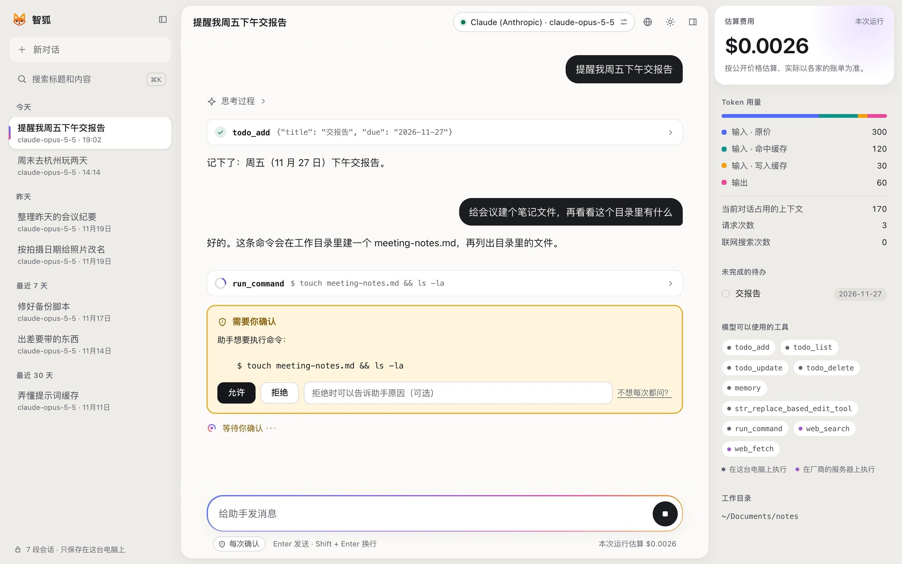

<div align="center">


# 智狐 · ZhiFox

**一个手写的 AI agent harness：运行在你自己电脑上的个人助手。**

[](https://github.com/Akxan/zhifox-agent-harness/actions/workflows/tests.yml)
[](https://github.com/Akxan/zhifox-agent-harness/releases)
[](LICENSE)
[](https://www.python.org/)
[](docs/zh-CN/architecture.md)
[](docs/zh-CN/models.md#支持的模型)
[](docs/zh-CN/web-ui.md)
[](docs/zh-CN/web-ui.md#界面是怎么做成三种语言的)
[](https://github.com/Akxan/zhifox-agent-harness/stargazers)
[](https://github.com/Akxan/zhifox-agent-harness/commits/main)

[English](README.md) | **简体中文**

</div>

<p align="center">
  <picture>
    <source media="(prefers-color-scheme: dark)" srcset="docs/assets/screenshot-dark-zh.webp">
    
  </picture>
</p>

智狐是一个运行在你自己电脑上的个人助手，有终端和网页两种界面，可以使用 Claude、GPT、Gemini、DeepSeek 四家的模型。
两种界面把会话存在同一个地方：在终端里聊的，网页上接着聊；网页上聊的，终端里也打得开。
它同时也是一个用来学习的项目：没有用任何 agent 框架，让模型变成"助手"的那层代码（harness）全部是手写的，
每一部分都能在一个文件里看到。

"智狐"是它给人看的名字，英文名叫 ZhiFox，仓库名是 `zhifox-agent-harness`。代码里的包名和命令仍然叫 harness，
因为这个项目讲的就是 harness 是怎么回事。

助手能做这些事：管理待办、跨会话记住事情、读写文件和执行命令、联网搜索（只有 Claude 能用；别家的模型能读你给的网址，见[读网页](docs/zh-CN/browser-and-computer-use.md#读网页不用浏览器web_fetch)）、
在它自己的浏览器里打开和操作网页、到了时间提醒你或者定时替你做一件事（定时任务），还能看懂你发来的截图、图片、PDF 和 Word、Excel、PowerPoint 文件
（模型收不了的格式先转换，比如 SVG 画成图片、Office 文件取出文字；转不了的会说明可以怎么办）。
它用文件工具打开电脑上的图片（PNG、JPEG、GIF、WebP）时，交给模型的是图片本身，所以它能看自己刚存下的截图。
记忆、待办、定时任务、系统提示词都可以在网页里直接查看和修改，每一样也都能在访达里找到对应的文件。
它用文件工具改过的文件，每一轮都能一键撤回、再重做（命令改动的文件撤不回来，界面上明说，见[撤回一轮改的文件](docs/zh-CN/conversations.md#撤回一轮改的文件)）。
网页上可以几段对话同时进行：一段正在跑（或者等你点"允许"）的时候，打开别的会话、开新对话接着聊，原来那段在后台接着跑；
会话栏上标着每一段在做什么（正在进行、等你确认、出错了、有新回复），旁边能停下它，后台那段等你确认时页面顶上和系统通知都会告诉你。
最多同时三段（见[几段对话同时进行](docs/zh-CN/web-ui.md#几段对话同时进行)）。
费用随时看得到：每调用一次模型就更新估算，Claude 和 DeepSeek 的价格是内置的（对照两家官方核对过，
包括 DeepSeek 闲时的半价），各家的长对话都会自动压缩。
还可以装 Skill，教它按你的方法做某一类事（格式是开放的 [Agent Skills](https://agentskills.io) 标准，见[Skill 是怎么工作的](docs/zh-CN/extensions.md#skill-是怎么工作的)）。
还可以通过 MCP 接上别人写好的工具（本地的程序或者网址），每次调用之前默认先问你。在 Claude Code、Cursor、VS Code、Codex、
Gemini CLI 这些工具里已经配好的 MCP 服务器、写好的 Skill 和 Agent，点几下就能导入（见[从其他工具导入](docs/zh-CN/extensions.md#从其他工具导入)）。
还可以挂上你自己的钩子（照着 Claude Code 的 hooks 做的）：工具执行之前（确认之后）、执行之后、你发消息时、一轮答完时运行你的脚本，
它能拦下一步、要你再确认一次，但不能放宽任何确认（见[你的钩子：在固定的时刻运行你自己的脚本](docs/zh-CN/sandbox-and-hooks.md#你的钩子在固定的时刻运行你自己的脚本)）。
还可以让它用浏览器（browser use）：在设置里打开以后，助手在一个智狐自己启动的 Chrome 里打开网页、读、点、输入、截图。
这个 Chrome 用的是智狐自己的配置文件夹，和你平时用的浏览器完全分开，看不到你的任何登录；和它说话的是手写的 DevTools 协议客户端，
走管道、不开端口，别的程序连不上。看网页直接做；输入文字、提交表单、去一个新的网站先问你，往密码框、银行卡里输入不管选了哪一档都要问。
Claude 用 Anthropic 的浏览器工具包，GPT、Gemini、DeepSeek 用智狐自己写的一套浏览器工具（见[浏览器：智狐自己的一个 Chrome](docs/zh-CN/browser-and-computer-use.md#浏览器智狐自己的一个-chrome)）。
作为进阶选项，还可以让它操作整台电脑（computer use）：默认关着，在设置里讲清楚风险、你确认以后才打开。助手看你的整个屏幕，
替你点鼠标、打字、按键（macOS 上用系统自带的 `screencapture` 和通过 `ctypes` 调用的 CoreGraphics，Linux 的 X11 桌面上用 `xdotool`
和 ImageMagick，不装任何新的依赖）。默认每一个动作都先问你；在网页的对话里，确认卡片上可以选这段对话里截图不再问、
或者点击和打字不再问；选了"全部自动允许"的话，操作电脑也不再问；危险的组合键（Mac 上的 ⌘Q，别的系统上的 Alt+F4、Ctrl+Alt+Del）
照样每次都问，不许碰的程序永远不碰。截图先缩小到模型收得下的大小，模型说的坐标再换算回屏幕上
真正的位置（Retina 屏幕也算对）。Claude 用 Anthropic 的电脑工具包，GPT、Gemini 用智狐自己写的替身工具（见[操作整台电脑](docs/zh-CN/browser-and-computer-use.md#操作整台电脑)）。
还可以接上你自己的机器人：Telegram、Discord、Slack、飞书、钉钉或者 QQ（网页上一个四步的向导，或者用命令行），
在手机上和它聊天，照片和文件也能发；反过来也行：要一张截图、一份报告，你批准以后它就以照片或文件的样子出现在聊天里。
在 Telegram 里还可以直接按住说话：语音先转成文字，再像打字一样回答你。不需要公网地址，也不用开端口：是智狐主动去问 Telegram 有没有新消息（长轮询），
对别的平台是智狐自己连出去、一直开着一条 WebSocket（手写的 RFC 6455 客户端；飞书和钉钉用官方的 SDK，想用才装）。
只有用 6 位配对码配对过的那个账号能用；要执行命令、改文件时，聊天里会先问你：有按钮的平台带着"允许 / 拒绝"按钮，
没有按钮的平台请你回复"允许"或"拒绝"（在网页上答复也行，先到的算数）。WhatsApp 和企业微信要公网地址，以后再做。
它也能在服务器上一直运行：`harness serve` 不开浏览器，照样运行聊天通道和定时任务，日志按 journald 的习惯写，
收到 SIGTERM 时干净地退出，还附带一份 systemd 的配置；用 `harness channels setup` / `pair` 设置、配对好，
之后在聊天软件里让它做服务器上的杂事。
还可以给命令加一道沙箱（可选，默认关着），作为"要不要先问你"之外的第二道关卡：打开以后，每条命令都关在操作系统的沙箱里运行
（macOS 上是 `sandbox-exec` 加一份现写的配置，Linux 上是 bubblewrap），能读写工作目录，看不到家目录里别的东西、智狐的数据和 `.env`，
最严的那一档连网络（包括 `127.0.0.1`）都连不上。就算一条命令被放行了、写它的模型被网页带偏了，它自己也出不了沙箱；
要在沙箱之外运行一条命令，不管选了哪一档都要问你。定时任务和聊天通道可以各选各的；这台电脑上用不了时（Windows、没装 `bwrap`），
命令一律拒绝执行，不会悄悄在沙箱之外运行（见[命令的沙箱：命令只碰得到该碰的地方](docs/zh-CN/sandbox-and-hooks.md#命令的沙箱命令只碰得到该碰的地方)）。
在自己的电脑上，`harness service install` 把它交给 launchd（macOS）或者 systemd（Linux）当后台服务：登录时自动启动、
出错退出后自己重启，不用开着终端，网页和聊天机器人也一直在；`harness service open` 打开网页，口令重启前后不变，开着的标签页更新以后也能接着用（见[在后台一直运行](docs/zh-CN/background-and-servers.md#在后台一直运行)）。
还可以定制自己的 Agent：一个 Markdown 文件（和 Claude Code 的 subagent 是同一种格式）写着它擅长什么、能用哪些工具和模型、
怎么做事。主助手可以把一项任务交给它（子 Agent：它在自己的一段新对话里做，只把结论交回来），你也可以直接用它开始一段对话
（角色）。它能用的工具永远不会比叫它的那一方多，它要执行的命令照样先问你（见[自定义 Agent：子 Agent 和角色](docs/zh-CN/extensions.md#自定义-agent子-agent-和角色)）。
网页界面里的每段会话都会自动保存在你自己的电脑上，随时可以从左侧的列表里打开接着聊，
也可以按标题和内容搜索。

## 快速开始

需要 macOS、Linux 或 Windows。有两种装法：

- **一行命令装上**：只是想用它的话选这种。不用 clone，没有项目文件夹，装好以后在哪个文件夹里都能用 `harness` 这个命令。
- **把仓库 clone 下来**：想读代码、改代码、跑测试和评测的话选这种（见[从仓库里运行](#从仓库里运行开发和学习用)）。

### 一行命令装上

先装 [uv](https://docs.astral.sh/uv/getting-started/installation/)，再装智狐。电脑上没有 3.11 以上的 Python 的话，uv 会自己下载一个，
并且把智狐装在它自己的一个环境里，不碰系统的 Python。

```bash
# macOS 和 Linux
curl -LsSf https://astral.sh/uv/install.sh | sh                   # 装 uv，装好后另开一个终端
uv tool install git+https://github.com/Akxan/zhifox-agent-harness
harness --web                                                     # 启动网页界面，会自动在浏览器里打开
```

```powershell
# Windows（PowerShell）
powershell -ExecutionPolicy ByPass -c "irm https://astral.sh/uv/install.ps1 | iex"   # 装 uv，装好后另开一个窗口
uv tool install git+https://github.com/Akxan/zhifox-agent-harness
harness --web
```

从 `git+https://` 这样的地址装，电脑上要有 Git（uv 用它下载代码，你自己不用会）。macOS 第一次用到时会提示你安装；
Linux 一般自带。刚装好的 Windows 没有：先装 [Git for Windows](https://git-scm.com/download/win)（或者 `winget install --id Git.Git -e`），
或者改从 GitHub 打包好的 zip 装，不需要 Git：

```powershell
uv tool install https://github.com/Akxan/zhifox-agent-harness/archive/refs/heads/main.zip
```

从 zip 装的，要更新时把这一行再运行一次，加上 `--reinstall`。

装好以后终端说找不到 `harness` 的话，运行 `uv tool update-shell`，再另开一个终端：它把 uv 放命令的文件夹（`~/.local/bin`）加进 `PATH`。

更新和卸载、装某一个发布版、数据和密钥在哪儿，见[安装和更新](docs/zh-CN/installation.md)。

### 从仓库里运行（开发和学习用）

```bash
git clone https://github.com/Akxan/zhifox-agent-harness.git
cd zhifox-agent-harness
uv sync                 # 安装依赖
uv run harness --web    # 启动网页界面，会自动在浏览器里打开
```

这时所有东西都在项目里：数据在 `data/`，密钥在 `.env`，git 都不会提交它们。Windows 上的 PowerShell 写法见[在 Windows 上使用](docs/zh-CN/windows.md)。
智狐是看自己的包在哪儿来分这两种的：旁边有它自己的 `pyproject.toml`，就是从仓库里运行；在某个 `site-packages` 文件夹里，就是装上的
（见 [harness/install.py](harness/install.py)）。

不管哪种装法，第一次打开时页面中间都会提示还没有 API 密钥。点提示里的“去设置”（或右上角的按钮），填写至少一家的密钥，就可以开始对话了。
想用终端界面的话，填好密钥后运行 `harness`（从仓库里运行是 `uv run harness`）。

## 文档

其余的内容按主题分成了几页，放在 [docs/zh-CN/](docs/zh-CN/) 里，按下面的顺序读（[docs/en/](docs/en/) 里的英文页面是同样的几页）：

1. [安装和更新](docs/zh-CN/installation.md)：一行命令装上的怎么更新和卸载、装某一个发布版、数据和密钥放在哪儿、检查新版本、在别的目录里启动
2. [网页界面](docs/zh-CN/web-ui.md)：页面上的每一样东西（会话栏、附件、设置、记忆、扩展、功能清单）、几段对话同时进行，以及页面是怎么做的
3. [终端界面](docs/zh-CN/terminal-ui.md)：终端里的同一个助手，用斜杠命令
4. [模型和厂商](docs/zh-CN/models.md)：四家模型和密钥、本地模型和自己的网关、各家的差别、长对话的压缩、备用模型
5. [会话](docs/zh-CN/conversations.md)：保存和重新打开、编辑最后一条消息、从某一轮分叉、撤回一轮改的文件、会话搜索
6. [工具和权限](docs/zh-CN/tools-and-permissions.md)：三类工具、一起跑的读取、命令记住的目录、问不问你的几档和只读命令的判断、加一个自己的工具
7. [沙箱、遮密钥和钩子](docs/zh-CN/sandbox-and-hooks.md)：命令的沙箱（可选，macOS、Linux）、遮住工具结果里的密钥、你自己的钩子
8. [扩展：MCP、Skill 和自定义 Agent](docs/zh-CN/extensions.md)：MCP 服务器、Skill、自定义 Agent（子 Agent 和角色），以及从别的工具导入
9. [浏览器和操作整台电脑](docs/zh-CN/browser-and-computer-use.md)：用 `web_fetch` 读网页、在智狐自己的 Chrome 里用浏览器、操作整台电脑（进阶，默认关着）
10. [定时任务和重复任务](docs/zh-CN/scheduled-tasks.md)：提醒和助手到时间自己去做的任务，以及没人看着的时候一次运行是怎么进行的
11. [聊天通道](docs/zh-CN/chat-channels.md)：在 Telegram、Discord、Slack、飞书、钉钉、QQ 里和智狐说话，包括设置向导、配对、在聊天里确认和语音消息
12. [后台服务和服务器](docs/zh-CN/background-and-servers.md)：用 launchd、systemd 或任务计划程序让智狐一直开着，以及在服务器上用 `harness serve`
13. [在 Windows 上使用](docs/zh-CN/windows.md)：Windows 上不一样的地方（PowerShell、Ctrl 快捷键、文件资源管理器）和暂时不支持的功能
14. [数据存在哪里](docs/zh-CN/data-and-privacy.md)：智狐存下的每一个文件和谁读得到、网页能让你的电脑做哪些事、导出、备份和恢复
15. [费用](docs/zh-CN/cost.md)：钱花在哪儿、花费账本和每月预算，以及怎么省钱
16. [配置和排查问题](docs/zh-CN/configuration.md)：`.env` 里可选的设置，以及出了问题时先运行的 `harness doctor`
17. [Harness 是什么](docs/zh-CN/architecture.md)：harness 由哪几部分组成、每个文件管什么、agent 循环和运行记录
18. [测试](docs/zh-CN/testing.md)：对着本地假服务器、不花钱的测试，无界面 Chrome 里的页面测试，三个系统上的 CI，以及发布
19. [评测：助手到底好不好用](docs/zh-CN/evals.md)：量一量真的模型做得对不对，包括演习、真跑和任务文件的格式
20. [局限和可以接着做的方向](docs/zh-CN/limitations.md)：还做不到的、没用真实的密钥测过的，以及接下来可以做的方向

## 关键词

AI agent · agent harness · 从零手写 agent · 不用框架的 agent · 个人 AI 助手 · 本地运行的 AI 助手 · Claude API ·
Anthropic SDK · OpenAI 兼容接口 · GPT · Gemini · DeepSeek · 工具调用（tool use / function calling） · 提示词缓存 ·
执行前确认（human-in-the-loop） · agent 循环 · 浏览器操作（browser use） · 操作整台电脑（computer use） · Chrome DevTools Protocol ·
Python · 终端聊天 · 网页界面

## 参与贡献

欢迎报告 bug、提建议和提 pull request。[CONTRIBUTING.md](CONTRIBUTING.md)（英文在前，后面是完整的中文）写了怎么准备环境、怎么不花钱地跑测试
（假服务器，不需要 API 密钥），以及改动要守住的规矩：每个改动都带测试、三种界面语言、两份 README 和 docs/ 下中英两份页面一起改、macOS、Windows 和 Linux 都要想到。
报告 bug 请用 [bug 报告表单](https://github.com/Akxan/zhifox-agent-harness/issues/new?template=bug_report.yml)。

## 安全

发现了安全问题，请私下报告，不要开公开的 issue：[SECURITY.md](SECURITY.md) 写了怎么报告、智狐的安全模型简述，以及哪些不算漏洞。

## 许可证

[MIT](LICENSE)。可以自由使用、修改和分发，保留版权声明即可。

### 第三方数据

会话搜索用的拼音表（[harness/search_pinyin.txt](harness/search_pinyin.txt)）由 [tests/make_pinyin.py](tests/make_pinyin.py)
从 Unicode 的汉字数据库 [Unihan](https://www.unicode.org/reports/tr38/)（Unicode 18.0.0，© Unicode, Inc.）生成，
按 [Unicode License v3](https://www.unicode.org/license.txt) 分发，许可声明的全文写在这个文件的开头。

## Star History

<a href="https://www.star-history.com/#Akxan/zhifox-agent-harness&Date">
  <picture>
    <source media="(prefers-color-scheme: dark)" srcset="https://api.star-history.com/svg?repos=Akxan/zhifox-agent-harness&type=Date&theme=dark" />
    <source media="(prefers-color-scheme: light)" srcset="https://api.star-history.com/svg?repos=Akxan/zhifox-agent-harness&type=Date" />
    
  </picture>
</a>
