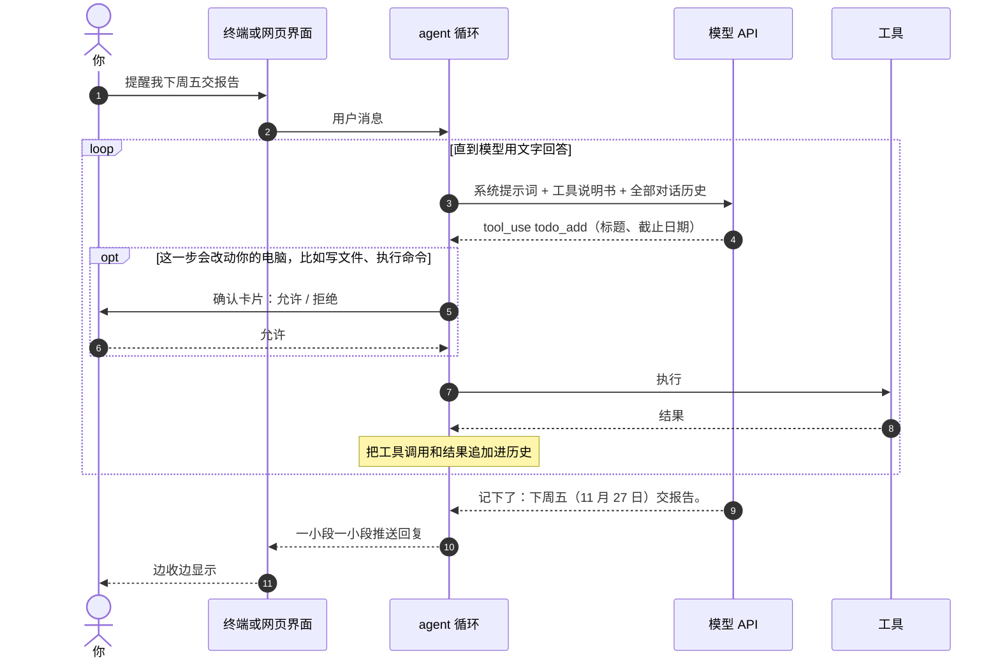

<div align="center">


# 智狐 · ZhiFox

**一个手写的 AI agent harness：运行在你自己电脑上的个人助手。**

[](https://github.com/Akxan/zhifox-agent-harness/actions/workflows/tests.yml)
[](LICENSE)
[](https://www.python.org/)
[](#harness-是什么)
[](#支持的模型)
[](#网页界面)
[](#界面是怎么做成三种语言的)
[](https://github.com/Akxan/zhifox-agent-harness/stargazers)
[](https://github.com/Akxan/zhifox-agent-harness/commits/main)

[English](README.md) | **简体中文**

</div>

<p align="center">
  <picture>
    <source media="(prefers-color-scheme: dark)" srcset="docs/assets/screenshot-dark-zh.webp">
    
  </picture>
</p>

智狐是一个运行在你自己电脑上的个人助手，有终端和网页两种界面，可以使用 Claude、GPT、Gemini、DeepSeek 四家的模型。
它同时也是一个用来学习的项目：没有用任何 agent 框架，让模型变成"助手"的那层代码（harness）全部是手写的，
每一部分都能在一个文件里看到。

"智狐"是它给人看的名字，英文名叫 ZhiFox，仓库名是 `zhifox-agent-harness`。代码里的包名和命令仍然叫 harness，
因为这个项目讲的就是 harness 是怎么回事。

助手能做五件事：管理待办、跨会话记住事情、读写文件和执行命令、联网搜索（联网搜索只有 Claude 能用），
以及到了时间提醒你、或者定时替你做一件事（定时任务）。
网页界面里的每段会话都会自动保存在你自己的电脑上，随时可以从左侧的列表里打开接着聊，
也可以按标题和内容搜索。

## 快速开始

需要 macOS 或 Linux，以及 [uv](https://docs.astral.sh/uv/)。

```bash
uv sync                 # 安装依赖
uv run harness --web    # 启动网页界面，会自动在浏览器里打开
```

第一次打开时，页面中间会提示还没有 API 密钥。点提示里的“去设置”（或右上角的按钮），填写至少一家的密钥，就可以开始对话了。
想用终端界面的话，填好密钥后运行 `uv run harness`。

### 支持的模型

| 厂商 | 在哪里申请 API 密钥 | `.env` 里的变量名 | 验证情况 |
|---|---|---|---|
| Claude (Anthropic) | [platform.claude.com](https://platform.claude.com) | `ANTHROPIC_API_KEY` | 用真实 API 实测过 |
| GPT (OpenAI) | [platform.openai.com](https://platform.openai.com) | `OPENAI_API_KEY` | 没有实测 |
| Gemini (Google) | [aistudio.google.com](https://aistudio.google.com) | `GEMINI_API_KEY` | 没有实测 |
| DeepSeek | [platform.deepseek.com](https://platform.deepseek.com) | `DEEPSEEK_API_KEY` | 实测过：保存密钥、同步模型、带文本附件的对话 |

GPT 和 Gemini 是对照各自的官方文档写的，并用本地的假服务器测试过，但还没有用真实的密钥测过。
第一次使用时如果报错，多半是那一家的接口有文档里没写到的细节。

各家的 API 都按用量计费，和它们聊天产品的订阅是分开的，一般需要先充值。
密钥可以在网页界面的设置里填，也可以把 `.env.example` 复制成 `.env` 后直接写在里面，两种方式存的是同一个地方。

### 网页界面

```bash
uv run harness --web
```

程序会在本机启动一个小型服务器，并在浏览器里打开聊天页面。页面上有：

- 会话栏（左侧）：所有会话按时间分组列出，点一下就能打开接着聊。鼠标移到一段会话上会出现三个按钮：
  在访达中显示（直接定位到这段会话在你电脑上的文件）、重命名、删除。
  每一轮对话结束时自动保存，不需要手动操作。左上角的按钮可以把它收起来；
  最下面那一行点一下，会打开保存会话的文件夹。
- 搜索（会话栏顶部，快捷键 ⌘F 或 Ctrl+F；⌘K、Ctrl+K 也可以。光标已经在搜索框里时再按一次 ⌘F，
  就是浏览器自带的"在页面里查找"）：在所有保存过的会话里找，标题和内容都找，不要求一字不差。
  多个关键词用空格隔开。结果里会显示命中的那段文字，点开（或按回车打开第一条）后页面直接滚到那个位置。
- 空白页：还没有内容时，问候语、输入框和几个可以直接点的例子摆在页面中间。
- 对话区：回复逐字显示；模型的思考过程可以点开查看；每次工具调用是一张卡片，点开能看到参数和结果；
  鼠标移到助手的回复上会出现"复制"按钮。往上翻看旧内容时，新内容不会把你拽回底部。
- 确认卡片：助手要写文件或执行命令时出现，带"允许"和"拒绝"两个按钮。拒绝时可以顺便写一句原因。
- 输入框：Enter 发送，Shift+Enter 换行。助手工作时，发送按钮变成"停止"，可以打断正在进行的回复，
  正在运行的命令也会一起结束。输入框下面一直显示本次运行的估算费用。
- 附件：点输入框左边的回形针选文件，或者把文件拖到页面上，截图可以直接在输入框里粘贴（⌘V / Ctrl+V）。
  发送前，附件以小卡片的样子排在输入框上方，可以删掉某一个；一条消息最多 10 个，只带附件、不写字也能发。
  各家模型的接口只收几种图片、PDF 和文字，别的格式要先转换：

  | 文件 | 发出去的是什么 | Claude | GPT | Gemini | DeepSeek |
  |---|---|:-:|:-:|:-:|:-:|
  | PNG、JPEG、WebP | 图片本身。长边超过 2576 像素的先在浏览器里缩小，单张最大约 7 MB | ✅ | ✅ | ✅ | ❌ |
  | GIF、BMP、AVIF、HEIC、TIFF | 在浏览器里重新存成 PNG 或 JPEG（GIF 取第一帧）。HEIC 和 TIFF 要浏览器打得开才行，比如 Safari | ✅ | ✅ | ✅ | ❌ |
  | SVG | 画成 PNG。当前的模型看不了图的话，把 SVG 的源码当文字发 | ✅ | ✅ | ✅ | ✅ 发源码 |
  | PDF（最大 25 MB，不能有密码） | PDF 本身：文字和页面上的图都看得到 | ✅ | ✅ | ❌ | ❌ |
  | Word、Excel、PowerPoint（.docx、.xlsx、.pptx，最大 25 MB） | 智狐取出来的文字：Word 保留标题、列表和表格；Excel 每张工作表一节，格子之间用制表符隔开，日期还原成日期；PowerPoint 按播放顺序一张一张，带演讲者备注。图片和排版没有了，也会告诉模型这一点 | ✅ | ✅ | ✅ | ✅ |
  | 文本和代码（最多 40 万字） | 文字。认得 UTF-8、UTF-16 和 GBK 编码；扩展名不认识的，看内容是文字也收 | ✅ | ✅ | ✅ | ✅ |

  别的文件（压缩包、音频视频、.doc 这类旧版 Office、Pages、WPS、设了密码的文件）加的时候就会退回，并说明可以怎么转换。
  当前的模型收不了的附件，加的时候就会提示，并说可以换成哪几家。GPT 和 Gemini 两列是对照官方文档写的，用本地的假服务器测过，
  没有用真实的密钥测过。附件存在这段会话里，打开旧会话时缩略图还在。点缩略图可以看大图（Esc 或点图片外面关闭）。
- 设置（右上角显示当前模型的按钮）：填写或删除各家的 API 密钥、同步每家可用的模型列表、选择和切换模型、
  填写模型的价格，以及**编辑提示词**（告诉助手"你是谁、怎么做事"的那段话）。编辑框里可以预览实际发给模型的内容，
  下面列着可以用的占位符（比如 `{name}`、`{workspace}`），发送之前换成实际的值，别的花括号原样保留。
  改过的版本存在 `data/prompt.md`（也可以直接打开这个文件改），从下一段新对话开始生效：一段对话里途中换提示词，
  Claude 的缓存会失效、之前的思考内容也通不过校验；还没开始聊的这一段会马上换上。"恢复默认"回到内置的版本，
  程序升级后想用新的内置提示词，也是点它。
- 信息栏（右上角最右边的按钮展开或收起）：估算费用、四类 token 各占多少、未完成的待办、
  模型可以使用的工具。每调用一次模型就更新一次。点待办前面的圆圈就是完成；鼠标移上去，右边是和别的行一样的三个按钮
  （在访达中显示待办的文件、就地改内容和截止日期、删除前在原地确认）。定时任务的每一行、提示词的编辑框里，
  也有"在访达中显示"。
- 记忆（固定在会话栏顶部，后面是条数；点开是左右两栏的窗口：左边是列表，可以按名字搜，右边是选中的那一条；
  窄屏上一次只显示一边）：助手长期记忆里的每一个文件（`data/memories/`），写着所在的文件夹、大小和最后修改的时间。
  点一条可以看内容。鼠标移上去（或者用 Tab 移到它上面），右边会出现和会话行一样的三个按钮：
  "在访达中显示"会在文件管理器里选中这个文件；铅笔打开编辑，文件名和内容都能改（⌘Enter / Ctrl+Enter 保存，
  Esc 退出编辑，有没保存的修改会先提醒）；垃圾桶删除，删之前在原地确认一次。
  对话进行中不能改、不能删（助手可能正在改这一条）；你编辑的时候文件被别处改过了，保存前会先问要不要覆盖；
  太长读不全的、不是 UTF-8 的文件只能在文件夹里改。
  最下面的"在访达中打开记忆文件夹"（Linux 上是"打开记忆文件夹"）会在文件管理器里打开整个文件夹。
  列表自己会跟着变：助手在这一轮里记下的，这一轮还没结束就会出现；你在访达里改的、删的，切回这个页面时就会更新。
  助手工作时不能删，要等这一轮结束：它可能正在改的就是这一条。
- 外观和动效（右上角的太阳/月亮按钮）：点开是一个小面板，上下两排。
  - 外观：默认是浅色，可以换成深色，或者跟随系统的深浅色。
  - 动效：默认跟随系统设置（macOS 是"系统设置 → 辅助功能 → 显示 → 减弱动态效果"，Windows 是
    "设置 → 辅助功能 → 视觉效果 → 动画效果"）。也可以直接在这里选"减少"（不播放滑动、淡入和闪烁，内容直接出现），
    或者"完整"（即使系统要求减少动画，这个页面也播放全部动画）。
  点面板外面、按 Esc 或者再点一下按钮就收起来。
- 语言（右上角的地球按钮）：中文、English、Español。换语言不刷新页面，正在进行的对话、滚动的位置、
  写了一半的消息都原样留着，界面上的文字在原地换掉。选择会保存下来，终端版也跟着用。

外观、动效、两边的栏是展开还是收起，这几样选择记在浏览器里，不在 `data/` 里。

换模型的规则：同一家之内换模型，对话可以接着进行；换到另一家会开始新对话，因为各家的对话格式不通用。
选好的模型会保存下来，下次启动（包括终端版）还是它。

刷新页面不会丢失当前对话。关闭页面后程序仍在运行，回到终端按 Ctrl-C 才会退出；
如果这时助手正在回复，程序会先停下它、把这一轮存好（最多等 5 秒）再退出。
同一个数据目录同时只能开一个网页版：已经有一个在运行时，再启动会提示你去用已经打开的那个。
重新启动后看到的是一段新对话，之前的会话都在左侧的列表里。打开一段旧会话时，
会自动换回它当时用的那家模型，而且这个模型从此就是"选好的模型"：之后新开的对话、下次启动用的都是它，
直到你在设置里换掉。助手正在回复的时候，不能打开、改名或删除会话，要等这一轮结束或者点"停止"。
会话的标题最长保留 40 个字。

可选参数：`--port 9000` 指定端口（不指定时用 8765，它被占用就自动换一个；指定的端口被占用则直接报错），`--no-browser` 不自动打开浏览器。

终端里显示的地址带有一段 `token`，它是这次运行的口令，每次启动都会换。不要把这个地址发给别人，
也不要把带地址栏的截图发到公开的地方：拿到它的人可以通过这个页面让助手在你的电脑上执行命令。
服务器只接受本机的连接。

### 定时任务和重复任务

对助手说"每天早上 9 点提醒我喝水"或者"每个工作日 9 点看看我的待办，写一份今天的安排"，或者在网页界面里自己添加。
任务有两种：

| 种类 | 到时间之后 | 费用 |
|---|---|---|
| 提醒（reminder） | 页面上弹出一条提醒，写着任务的名称和内容。不调用模型 | 不花钱 |
| 让助手去做（agent） | 助手自己执行任务的指令，就像你把它当成一条消息发过来一样：调用模型，使用工具 | 每次运行都要花 API 费用，和平常的一轮对话一样 |

时间表都按你电脑的本地时间：某个日期和时间只运行一次、每天、每周选定的几天、每月的某一天（31 号在小月里落到最后一天）、
每隔多少分钟（5 分钟到 7 天，从创建或者上一次运行的时刻算起）。夏令时按日历处理："每天 9 点"始终是墙上的 9 点；
春天拨快时被跳过的那个时刻，顺延到跳过之后运行；秋天拨回时走两遍的那个时刻，只运行一次。
保存之前，表单上会先列出接下来的三次运行时间。

让助手去做的任务是这样运行的：

- **和你轮流来。** 任务和你的对话用的是同一套工具（同一个 shell、同样的文件和待办），所以不会在你的这一轮里同时运行。
  你正在对话时到了时间的任务，等你这一轮结束再开始。任务运行期间，发消息、换模型、打开会话都会被拦下，
  并告诉你是哪个任务、怎么停下它。提醒不用等。
- **不动你正在进行的对话。** 每次运行都从空的历史开始，用的是那一刻设置里选中的那家模型，跑完存成一段普通的会话，
  标题是任务名加时间（比如"每日安排 · 2026-11-21 09:00"）。它出现在会话栏里，标着来自定时任务，
  可以打开、重放、搜索，也可以接着聊。
- **停下来等你批准。** 在对话里会问你的操作（执行命令、写文件……），任务运行时一律停下来等你答复，
  **即使你选了"全部自动允许"也一样**。正在等的确认显示在任务那里，可以允许或者拒绝。
  在你答复之前，这一轮一直由任务占着，所以要先答复（或者停下它）才能接着聊天。
- **能看到进度，能停下。** 任务运行时能看到它在做什么（思考、写回答、调用哪个工具）、调用了几次模型、
  到目前为止花了多少钱、调用过哪些工具。"停止"和对话里的"停止"一样，正在运行的命令也会一起结束；
  还在排队等的那一次直接取消。
- **错过了就补一次。** 到时间时智狐没有开着（或者电脑在睡眠），下一次智狐看到时补跑一次，不管错过了几次都只补一次。
  这次运行标着"补跑"，记着错过了几次，也会告诉助手原定是什么时候。
- **每次运行都有记录。** 每个任务保留最近 20 次运行：开始和结束的时间、结果、调用了几次模型、估算费用、
  最后回答的开头，失败时还有原因。不设花费上限。

**定时任务只在网页界面（`uv run harness --web`）开着的时候运行。** 终端界面不运行它们；在终端里也可以让助手添加或删除任务，
等下次打开网页界面时运行。"立即运行"会马上运行一次，不改变原来的时间表。助手替你添加或删除"让助手去做"的任务时，
会先问你，因为这个任务以后会自己花钱；提醒不用问。

### 终端界面

```bash
uv run harness
```

启动后直接打字就可以对话：

```
你> 提醒我下周五交报告
🔧 todo_add {"title": "交报告", "due": "2026-11-27"}
   ↳ {"id": 1, "title": "交报告", "due": "2026-11-27", ...}
记下了：下周五（11 月 27 日）交报告。

你> 这个目录里有哪些 Python 文件？
🔧 run_command $ find . -name "*.py"

⚠️  助手想要执行命令：

    $ find . -name "*.py"
允许吗？y 允许；回车拒绝；也可以直接输入你的意见来拒绝 >
```

| 命令 | 作用 |
|---|---|
| `/help` | 显示命令列表 |
| `/new` | 开始一段新对话（记忆和待办不受影响） |
| `/todos` | 查看未完成的待办 |
| `/tools` | 查看模型可以使用的工具 |
| `/usage` | 查看本次运行的 token 用量和估算费用 |
| `/model` | 查看当前使用的模型（换模型在网页界面的设置里进行） |
| `/auto` | 查看或更改"要不要每次都问"：`/auto ask`、`/auto edits`、`/auto all`（见下面的"权限规则"） |
| `/exit` | 退出（也可以用 `/quit`，或者按 Ctrl-D） |

模型回复到一半时按 Ctrl-C 可以打断它。

终端界面不运行定时任务。在这里也可以让助手添加或删除任务，它们在网页界面开着的时候运行。

### 在别的目录里使用

助手的"工作目录"是你启动它时所在的目录。想让它在别的目录里工作，先 `cd` 到那里，再运行：

```bash
uv run --project "/这个项目的完整路径" harness
```

## Harness 是什么

模型只会一件事：读入一段文字，写出下一段文字。它不记得上一次对话，也执行不了任何操作。

**Harness** 就是包在模型外面、弥补这些不足的代码。**Agent = 模型 + harness**。
这个项目里 harness 的每个组成部分各占一个文件或目录：

| 组成部分 | 文件 | 它解决什么问题 |
|---|---|---|
| 循环 | [harness/agent.py](harness/agent.py) | 模型一次只能回复一段。循环反复调用它，直到任务做完 |
| 工具 | [harness/tools/](harness/tools/) | 模型不能执行操作。工具替它执行，再把结果告诉它 |
| 模型适配层 | [harness/providers/](harness/providers/) | 各家 API 的格式不一样。适配层把差别包起来，循环不用关心背后是哪一家 |
| 对话历史 | 适配层里（各家格式不同） | 模型没有记忆。每次请求都把完整的对话重新发一遍 |
| 会话存档 | [harness/conversations.py](harness/conversations.py) | 程序关掉后内存里的对话历史就没了。把它存成文件，下次读回来就能接着聊 |
| 会话搜索 | [harness/search.py](harness/search.py) | 会话多了以后找不到。把每段会话里的文字放进内存，按标题和内容搜，允许不完全一样 |
| 附件 | [harness/attachments.py](harness/attachments.py)、[harness/documents.py](harness/documents.py) | 模型只收几种文件。每个附件发出去之前都检查一遍，Word、Excel、PowerPoint 先变成文字 |
| 长期记忆 | [harness/tools/memory.py](harness/tools/memory.py) | 每段会话互相看不到对方的内容。记忆是所有会话共用的，助手自己决定往里写什么 |
| 记忆一栏 | [harness/memories.py](harness/memories.py) | 你看不到助手记住了什么。网页界面把记忆文件列出来、可以打开看、改、删，浏览器送来的路径出不了记忆文件夹 |
| 定时任务 | [harness/tasks.py](harness/tasks.py)、[harness/webui/scheduler.py](harness/webui/scheduler.py)、[harness/tools/tasks.py](harness/tools/tasks.py) | 模型只在你跟它说话时才动。定时任务让它到了时间自己动：时间表和保存、和你轮流用工具并且停下来等你批准的执行部分、一句话就能定下任务的工具 |
| 系统提示词 | [harness/prompt.py](harness/prompt.py) | 模型不知道自己是谁、在什么环境里。内置的提示词可以换成你自己写的；"可以联网"那一行只写给有联网搜索的那一家 |
| 权限 | [harness/permissions.py](harness/permissions.py) | 模型可能出错或被误导。危险操作要你点头 |
| 界面 | [harness/ui.py](harness/ui.py)（终端）、[harness/webui/](harness/webui/)（网页） | 把过程显示给你，把你的输入交给循环 |
| 设置和计价 | [harness/settings.py](harness/settings.py)、[harness/pricing.py](harness/pricing.py) | 记住你选的模型和填的密钥，把 token 换算成钱 |
| 多语言 | [harness/i18n.py](harness/i18n.py)、[harness/locales/](harness/locales/) | 界面上的话有中文、英文、西班牙语三种，网页和终端共用一份翻译表 |
| 组装 | [harness/app.py](harness/app.py)、[harness/cli.py](harness/cli.py)、[harness/config.py](harness/config.py) | 把上面这些拼起来，读取配置 |

建议的阅读顺序：`agent.py` → `tools/base.py` → `tools/todo.py` → `permissions.py` → `providers/base.py`，其余的按兴趣看。

这些部分是这样连起来的：


### 循环

```
你说了一句话
  └─► 把【系统提示词 + 工具说明书 + 全部对话历史】发给模型
        ├─ 模型回复文字            → 显示给你，这一轮结束
        └─ 模型说"我要调用工具 X"  → 检查权限 → 执行 → 把结果追加进历史 → 再发给模型（循环）
```

"下一步做什么"每次都由模型决定，循环只负责照办。这是 agent 和普通程序的区别：
普通程序的步骤是写死的，agent 的步骤是模型临场决定的。

一轮对话里，各方之间是这样来回的：



你对 Claude 说"提醒我下周五交报告"之后，对话历史会变成下面这样（有删减）。
模型并没有真的"调用"什么，它只是输出了一段格式固定的内容，说自己想调用 `todo_add`；
harness 看到后去执行，再把结果作为一条新消息放回历史里：

```json
[
  {"role": "user", "content": [
    {"type": "text", "text": "<context>当前时间：2026-11-20 14:03 星期五</context>"},
    {"type": "text", "text": "提醒我下周五交报告"}
  ]},
  {"role": "assistant", "content": [
    {"type": "thinking", "thinking": "下周五是 11 月 27 日……", "signature": "..."},
    {"type": "tool_use", "id": "toolu_1", "name": "todo_add",
     "input": {"title": "交报告", "due": "2026-11-27"}}
  ]},
  {"role": "user", "content": [
    {"type": "tool_result", "tool_use_id": "toolu_1", "content": "{\"id\": 1, \"title\": \"交报告\", ...}"}
  ]},
  {"role": "assistant", "content": [
    {"type": "text", "text": "记下了：下周五（11 月 27 日）交报告。"}
  ]}
]
```

有一条规矩贯穿始终：**历史只在末尾追加，前面的内容从不修改**。
原因写在 [harness/providers/claude.py](harness/providers/claude.py) 里 `AnthropicBackend.__init__` 的注释中，简单说就是改了前面会让缓存失效（变贵），
还会让模型之前的思考内容无法通过 API 的校验（请求被拒绝）。

### 一个循环，多家模型

上面那段历史是 Claude 的格式。别家的格式不一样，但循环（`agent.py`）并不关心，
它只要求每一家的适配层都能做这几件事（定义在 [harness/providers/base.py](harness/providers/base.py)）：

| 方法 | 作用 |
|---|---|
| `add_user` | 往历史里追加一条用户消息 |
| `step` | 调用一次模型，边收边显示，把回复追加进历史，并告诉循环模型想调用哪些工具 |
| `add_tool_results` | 把工具的执行结果追加进历史 |
| `mark` / `rollback` | 记下历史的位置 / 退回到那个位置（出错或被拒绝时撤销这一轮） |

适配层只有两个：[claude.py](harness/providers/claude.py) 用 Anthropic 的原生接口；
[openai_compat.py](harness/providers/openai_compat.py) 用 OpenAI 定下的 Chat Completions 格式，
GPT、Gemini、DeepSeek 都支持这套格式，只是服务器地址不同，所以一份代码服务三家。两者的主要差别：

| | Claude | GPT、Gemini、DeepSeek |
|---|---|---|
| 系统提示词 | 单独的参数 | 历史里的第一条消息 |
| 工具调用 | 回复里的一个"内容块" | 助手消息上的 `tool_calls` 字段，参数是一段 JSON 文本 |
| 工具结果 | 所有结果合在一条消息里 | 每个结果单独一条消息 |
| 联网搜索 | 有，在 Anthropic 的服务器上执行 | 没有 |
| 对话太长时 | 自动把较早的内容压缩成摘要 | 不处理 |
| 缓存 | 由我们在请求里标记 | 各家自动处理 |

要接入另一家支持 OpenAI 格式的厂商，在 [harness/providers/\_\_init\_\_.py](harness/providers/__init__.py) 的 `PROVIDERS` 里加一项就够了。

### 会话是怎么保存和恢复的

模型自己什么都不记得，"接着上次聊"靠的全是 harness：把上次的对话历史存下来，下次请求时一起发过去。
每段会话是 `data/conversations/` 里的一个 JSON 文件，里面有两份内容：

| 内容 | 给谁用 | 说明 |
|---|---|---|
| `messages` | 模型 | 发给模型的对话历史，按那一家的格式原样保存。打开会话时交还给适配层（`restore`） |
| `events` | 页面 | 界面上显示过的内容。打开会话时重新发给浏览器，页面照着画出来 |

存两份是因为它们不一样：模型看到的历史里有思考内容的签名、每个工具调用的编号、厂商各自的消息结构，
这些页面用不上，但发回给 API 时一个字都不能差；页面上显示的确认卡片（你点了允许还是拒绝）、
"已中断"这样的提示文字，又是模型看不到的。

Claude 的历史必须和当初一字不差地发回去，否则它之前的思考内容通不过校验。如果你换了工作目录再打开旧会话，
系统提示词已经变了，那些思考内容就对不上了。程序在请求里带了一个参数，让 API 遇到这种情况时丢掉对不上的思考内容，
而不是拒绝请求，所以旧会话仍然能接着聊，只是模型看不到自己当时是怎么想的。

### 界面是怎么做成三种语言的

界面上的每一句话都用中文写在它出现的地方，外面包一层 `t()`，这句中文同时就是翻译表里的"键"。
翻译表在 [harness/locales/](harness/locales/) 下，一种语言一个 JSON 文件，内容是 `{"中文原文": "译文"}`：

```python
t("已中断。")                                                        # 英文界面下是 "Stopped."
t("已换成 {provider} · {model}。对话继续。", provider="DeepSeek", model="deepseek-flash")
```

查不到译文的照原样显示中文，所以漏翻一句不会出错，只会在那一处露出中文。
[tests/test_i18n.py](tests/test_i18n.py) 会把页面和程序里所有交给 `t()` 的话找出来，检查每一句都有英文和西班牙语的译文、
`{provider}` 这类要填的空一个不少。新加了一句话却没有翻译，测试就会失败，并列出是哪几句。

网页和程序用的是同一份表：助手程序发出页面时把表塞进页面里，页面自己的话由页面翻译。
换语言时页面不刷新，因为每一句画在页面上的话都记着自己的原文，换语言时照着原文重新查一遍、就地换掉。
程序发给页面的话（确认卡片上的说明、各种提示）也一样：除了译好的文字，还带着原文和填进去的值，
所以已经显示出来的这些话也能跟着换，保存下来的会话以后换了语言再打开也是。

哪些不翻译：模型的回答（它用什么语言回答，取决于你用什么语言和它说话）、你说的话、会话的标题、
工具的输出（比如命令打印出来的内容）。工具的说明书和工具返回给模型的话也保持中文，那些是写给模型看的，它都读得懂。
品牌名"智狐"在三种语言里都不变。

### 会话搜索是怎么做的

搜索要解决两个问题：找得快，找得到。代码都在 [harness/search.py](harness/search.py) 里，没有用任何搜索库。

找得快：不能每敲一个字就把所有会话文件重新读一遍。第一次用到会话列表或搜索时，程序要把每个会话文件读一遍来列出标题，
这时顺便把里面值得搜的文字抽出来放在内存里，这就是"索引"（终端版用不到会话列表，所以从来不建）。之后会话保存、改名、删除时索引跟着更新，
搜索只在内存里进行。

收进索引的有：标题、你说的话、助手的回复、思考过程、每次工具调用的那一行摘要（运行的命令、读写的文件路径、
联网搜索的关键词）、每个工具结果开头的 600 个字符。没有收的：助手写进文件的具体内容、出错和"已中断"这类提示。

找得到：人记得的往往只是个大概，所以匹配分三档，越严格的排得越靠前：

| 档 | 规则 | 例子 |
|---|---|---|
| 原样包含 | 关键词原样出现。不分大小写，全角半角算一样 | `HARNESS` 找到 `harness` |
| 相近的词 | 5 个字母以上的英文单词允许敲错一两个字母。只在这个词哪儿都原样找不到时才启用 | `hraness` 找到 `harness` |
| 隔字包含 | 每个字按顺序都出现，中间可以隔几个字。英文要 4 个字母以上，而且不跨单词 | `周五报告` 找到"周五下午交报告" |

多个关键词要全部满足，先后顺序不限，也可以分别出现在不同的地方。排序时先看档：每个关键词都原样找到的排最前，
其次是靠"相近的词"找到的，用到"隔字包含"的排最后。同一档里，标题里的命中排在内容里的前面，
你说的话排在工具输出前面；一样相关时新的会话在前。

页面上的搜索结果里标出来的位置是服务器算好的。这里有个容易踩的坑：浏览器里的字符串按 UTF-16 计数，
一个表情符号占两格，而 Python 里只占一格，所以服务器发给页面之前要把位置换算一遍，否则文字里一有表情，
后面标的位置就全偏了。

### 一个循环，两种界面

终端版和网页版用的也是同一个循环。循环只要求界面提供这几个方法：

| 方法 | 什么时候被调用 |
|---|---|
| `thinking` / `text` | 模型每生成一小段思考或回答 |
| `tool_call` / `tool_result` | 一个工具开始执行 / 执行完毕 |
| `confirm` | 需要用户点头，循环停在这里等答复 |
| `info` / `notice` | 有一句提示要告诉用户 |

终端版（`ui.py`）把这些调用直接变成屏幕上的文字。网页版多绕一步，因为循环和浏览器不在同一个程序里：

```
agent 循环 ──调用──► WebUI ──事件──► 本地服务器 ──推送──► 浏览器里的页面
                    (webui/ui.py)   (webui/server.py)     (webui/index.html)
```

`WebUI` 把每次调用记成一条"事件"存进日志，服务器把事件推送给浏览器，页面收到后画出对应的内容。
你在页面上点"允许"或"停止"，则是浏览器向服务器发一个请求，服务器再转告 `WebUI`。
页面自己不保存对话，所以刷新后服务器把日志重发一遍，页面就能照着重新画出来。

页面上的动画只给"此刻正在发生"的内容：新来的消息会浮现出来，而刷新页面、打开旧会话时重放出来的内容直接显示，
不会把几百条消息的入场动画挨个播一遍。页面怎么分辨这两种内容？服务器在补发完已有的事件之后，会多发一个名叫
`synced` 的标记，标记之后的才是实时的事件；打开旧会话时，则是从"清空页面"的事件到下一个"状态"事件之间算重放。

页面里所有会动的东西都只改两样属性：位置和缩放（`transform`）、透明度（`opacity`）。浏览器可以把这两样交给
专门的合成线程去做，不用重新排版，所以即使脚本正忙着处理模型不断吐出来的文字，动画也不会卡。

要减少动画的时候（系统开了"减少动态效果"，或者你在外观面板里选了"减少"），所有动画都会关掉，内容直接出现。
页面不是直接去查系统设置，而是在画出页面之前，把系统设置和你的选择合在一起算一次，结果写在 `<html data-motion>`
上，样式和脚本都只看这一处。这样你选的"完整"才能盖过系统设置，而且刷新页面时不会先播一段动画、再突然停下。
深浅色也是同样的做法（`<html data-theme>`）。

### 定时任务：没人看着的时候怎么运行

一个定时任务就是存下来的一条指令加一个时间表（[harness/tasks.py](harness/tasks.py)）。运行它用的还是同一个循环，
只有三件事另外处理（[harness/webui/scheduler.py](harness/webui/scheduler.py)）：

1. **什么时候。** 调度线程睡到下一个任务该运行的时候，但一次最多睡 30 秒，这样改了系统时间、电脑从睡眠中醒来，
   都能很快发现；任务一有变化也会把它叫醒。下一次的时刻是按本地时间在日历上算出来的，而不是加上 24 小时，
   所以夏令时前后"每天 9 点"仍然是墙上的 9 点。每个任务的下一次时刻存在 `data/tasks.json` 里，
   下次启动时发现它已经过去了，就知道错过了。
2. **轮流来。** 循环和它的工具默认一次只进行一轮：一个 shell（"停止"要结束的是它正在运行的那条命令），一份文件和待办。
   所以任务运行时要拿你对话时用的同一把锁，你这一轮没结束它就等着。提醒不调用模型，不用这把锁。
3. **没人看着。** 每次运行用一个单独的 `Agent`，适配层是新建的，历史是空的（`App.unattended_agent`），
   事件也记在它自己的日志里（另一个不推给页面的 `WebUI`），所以它写不进你正在看的那段对话。它用的权限是一份
   "永远要问"的副本（`Permissions.unattended`）。走到需要批准的一步时，循环和平常一样停在 `confirm` 上等，
   这个正在等的确认放进页面的状态里，你可以在任务那里答复它。

进度和别的东西一样，通过同一个 `state` 事件送到页面上：文字逐字输出时最多每秒四次，开始运行、停下来等你批准、
运行结束时马上发一次。被停下的运行照样给每个工具调用补上结果（还是 `Agent._run_tools` 里的那个 `finally`），
所以它存下来的会话和别的会话一样可以接着聊。

### 三类工具

区别在于"说明书谁写"和"谁来执行"：

| 类别 | 说明书 | 执行 | 这个项目里的例子 |
|---|---|---|---|
| 自定义工具 | 我们写 | 我们的电脑 | 待办（[todo.py](harness/tools/todo.py)）、定时任务（[tasks.py](harness/tools/tasks.py)）、执行命令（[shell.py](harness/tools/shell.py)） |
| Anthropic 定义的工具 | Anthropic | 我们的电脑 | 读写文件（[files.py](harness/tools/files.py)）、记忆（[memory.py](harness/tools/memory.py)） |
| 服务器工具 | Anthropic | Anthropic 的服务器 | 联网搜索（[web.py](harness/tools/web.py)） |

第二类工具的说明书 Claude 在训练时就学过，所以给 Claude 只需要一行声明。别家的模型没学过，
所以 `files.py` 和 `memory.py` 里另有一份手写的说明书（`PORTABLE`）给它们用，执行的代码是同一份。
第三类工具在 Anthropic 的服务器上，别家的模型用不了。

### 权限规则

| 操作 | 处理 |
|---|---|
| 待办、记忆 | 直接执行（只动 `data/` 里助手自己的文件） |
| 添加、删除提醒 | 直接执行（到时间只弹出一条提醒：不调用模型，不花钱） |
| 添加、删除让助手自己去做的定时任务 | 先问你，并显示时间表和指令（它以后会在没人看着的时候自己花钱） |
| 读取工作目录里的文件 | 直接执行 |
| 读取工作目录之外的文件 | 先问你 |
| 读取 `data/` 里的文件（保存的会话、设置） | 先问你，即使 `data/` 就在工作目录里 |
| 创建、修改任何文件 | 先问你，并显示要写入的内容 |
| 执行任何 shell 命令 | 先问你，并显示完整的命令 |
| 联网搜索 | 直接执行（在 Anthropic 的服务器上进行，不碰你的电脑），次数有上限 |

拒绝时可以直接输入一句话（比如"不要删，改成移到废纸篓"），这句话会转告给模型。

不想每次都点"允许"的话，可以放宽"问不问"（网页：输入框下面的"每次确认"按钮；终端：`/auto` 命令）：

| 选项 | 终端命令 | 效果 |
|---|---|---|
| 每次确认（默认） | `/auto ask` | 上表里写着"先问你"的，每一次都问 |
| 自动允许改文件 | `/auto edits` | 创建、修改工作目录里的文件不再问；执行命令、读写工作目录之外的文件、读 `data/` 照常问 |
| 全部自动允许 | `/auto all` | 都不再问 |

放宽的只是"问不问"，没有问你就执行的那些，网页上的工具卡片会标"自动允许"，终端里也会注明。
这个选择不会保存，每次启动都回到"每次确认"，免得开了忘记关。

定时任务是例外。它自己运行的时候，上表里写着"先问你"的操作一律停下来等你答复，不管你选的是哪一档：
放宽确认的意思是"我在旁边看着，你做吧"，半夜三点它自己跑的时候，这句话并不成立（见下面的"定时任务和重复任务"）。

另外有两条不经过询问的硬性限制：助手不能读写 `.env`（里面是各家的 API 密钥），
执行命令时也看不到这些密钥。

需要了解的风险：确认提示是你和模型之间唯一的关卡。批准一条命令之前请看清楚它要做什么，
尤其是在助手刚读过网页或陌生文件之后，因为那些内容里可能藏着误导模型的话。

## 数据存在哪里

| 路径 | 内容 |
|---|---|
| `.env` | 各家的 API 密钥。通过网页界面保存时，会把它设成只有你的账号能读 |
| `data/conversations/` | 网页界面里的每段会话，一段一个 JSON 文件 |
| `data/memories/` | 助手的长期记忆和笔记。可以在网页的信息栏里查看、修改和删除，也可以手动编辑 |
| `data/todos.json` | 待办事项 |
| `data/tasks.json` | 定时任务，每个任务最近 20 次运行的记录，以及还没关掉的提醒。读不出来时原文件改名为 `tasks.broken.json` 留着，从空的任务列表开始 |
| `data/settings.json` | 你选的模型、同步到的模型列表、自己填的价格、界面语言。不含密钥 |
| `data/backups/` | 助手整个覆盖某个文件之前，旧版本的备份 |
| `data/input_history` | 你在终端版里输入过的话（按上方向键可以找回） |

这些都是可以直接打开的普通文件。`data/` 和 `.env` 都写进了 `.gitignore`，不会被提交到 git。
`data/` 里的文件夹和会话文件都设成只有你的账号能读写，同一台电脑上的其他账号看不到。
网页界面保存密钥之后只显示最后 4 位，不会把完整的密钥发回浏览器。

对话内容会发送给你所选厂商的 API 处理，同时保存在你自己电脑上的 `data/conversations/` 里，
不会上传到别处。在会话栏里删除一段会话，对应的文件也会被删掉。

想直接看某段会话的文件，点会话栏里它那一行上的"在访达中显示"。它和记忆一栏里的两个文件夹按钮，
是页面上仅有的会让电脑启动别的程序（文件管理器）的按钮，所以服务器对它们格外小心：页面只能告诉服务器
"哪一段会话""哪一条记忆"（列表里给它的名字，按下面说的办法检查），或者打开记忆文件夹时什么都不用说；
路径由服务器自己算，页面没有办法让它打开别的路径。
Linux 上没有通用的"选中某个文件"的办法，打开的是文件所在的文件夹。

在信息栏里查看、修改、删除一条记忆也是同样的防法：页面送回来的是列表里给它的名字（比如 `projects/zhifox.md`），
服务器从记忆文件夹出发一层一层地走到这个文件，凡是会走出这个文件夹的都不认：`..`、绝对路径、指向别处的符号链接。
它只删普通的文件；删完之后空下来的子文件夹也一起删掉。编辑时给的新名字只能是一段名字（不能带 `/`，不能以 `.` 开头），
所以记忆可以改名，但挪不出它所在的文件夹；新内容先写进临时文件再一步换上去，保存失败也不会留下半个文件。

## 费用

API 按 token 计费（一个汉字大约 1 到 2 个 token）。因为每次请求都要重发整个对话历史，
对话越长、步骤越多，每一步越贵。一次让助手自己查资料的任务可能要走几十步，费用会比普通聊天高很多。

程序里控制费用的几样东西：

- **估算费用**：网页侧栏和终端的 `/usage` 会把用量换算成美元。这只是估算，实际以各家的账单为准，
  账单通常有延迟。
- **搜索次数上限**：用户每发一条消息，Claude 最多搜索 5 次、读取网页 5 次，超过后它会根据已有的信息回答。
  这个上限由 API 强制执行。联网搜索除了 token 之外每次另收 1 美分。
- **缓存**：重复发送的部分命中缓存后便宜很多（Claude 约为原价的二十分之一）。
  缓存只保留几分钟，所以隔了一阵再接着聊一段很长的旧会话时，第一条消息要按整段历史的原价计费。
  打开超过 3 万 token 的旧会话时，页面会提示一下。
- **自动压缩**：和 Claude 的对话特别长时，较早的内容会被压缩成摘要。
- **附件**：图片按大小计费，每 28×28 像素算一个 token，一张满尺寸的截图最多约 4800 个 token（用 Opus 5.5 约 2 美分）；
  PDF 每页大约 1500 到 3000 个 token；Word、Excel、PowerPoint 按取出来的文字计费。附件和其他历史一样，每一轮都会重新发给模型，靠缓存才便宜。
- **定时任务**：让助手去做的任务每运行一次，费用和把它的指令当成一条消息发出去差不多，而且不管你在不在都会运行。
  不设花费上限：每 5 分钟一次的任务，一天就是 288 次。每次运行的估算费用都记在任务上。提醒不花钱。
- 随时可以点"停止"，或者用"新对话"把历史清零。

内置的价格（2026-11-20 对照两家官方的定价页核对过，单位是美元 / 每百万 token）：

| 模型 | 输入 | 写入缓存 | 命中缓存 | 输出 |
|---|---|---|---|---|
| `claude-opus-5-5` | 4 | 5 | 0.2 | 20 |
| `claude-sonnet-5-5` | 2 | 2.5 | 0.1 | 10 |
| `claude-fable-5-2` | 8 | 10 | 0.2 | 40 |
| `deepseek-flash`（高峰 / 闲时） | 0.30 / 0.15 | 不收 | 0.006 / 0.003 | 1.20 / 0.60 |
| `deepseek-v4-pro`（高峰 / 闲时） | 1.32 / 0.66 | 不收 | 0.044 / 0.022 | 3.96 / 1.98 |

Claude 的写入缓存是 5 分钟那一档（智狐用的就是它）；联网搜索另外每 1000 次 10 美元。
DeepSeek 分时段计价：北京时间工作日 9:00–12:00、14:00–18:00 是高峰，其余时间（包括周末）半价。
智狐每调用一次模型就看一下当时是高峰还是闲时，闲时的用量单独记，所以一段对话跨过了时段的分界也算得对。
DeepSeek 把中国法定节假日也算作闲时，这些日子没有内置，落在工作日的节假日会按高峰价估算（估高一点，不会估低）。
旧名字 `deepseek-v4-flash` 按 `deepseek-flash` 的价格算。

其他模型的价格需要你在设置里自己填（自己填的价格全天都按它算）。没有价格的模型只显示 token 数，页面会提示它没有计入估算。

## 配置

写在 `.env` 里，都是可选的：

| 变量 | 默认值 | 说明 |
|---|---|---|
| `HARNESS_MAX_SEARCHES` | `5` | 每条消息最多联网搜索几次，`0` 表示不限制 |
| `HARNESS_WEB` | `1` | 设为 `0` 完全关闭联网搜索 |
| `HARNESS_EFFORT` | `medium` | Claude 思考的力度：`low` / `medium` / `high` / `xhigh` / `max` |
| `HARNESS_DATA_DIR` | 项目里的 `data/` | 记忆、待办、设置等数据存放的目录 |
| `HARNESS_PROVIDER`、`HARNESS_MODEL` | `anthropic`、`claude-opus-5-5` | 还没在界面上选过模型时用哪一个。选过之后以界面上的选择为准 |

## 动手试试：加一个自己的工具

新建 `harness/tools/dice.py`：

```python
import random

from .base import Tool, function_tool


def make_dice_tool() -> Tool:
    def roll_dice(sides: int = 6) -> str:
        return f"掷出了 {random.randint(1, sides)} 点"

    return function_tool(
        name="roll_dice",
        description="掷一次骰子，返回点数。用户想要随机数、抛硬币或抽签时使用。",
        properties={"sides": {"type": "integer", "description": "骰子有几个面，默认 6"}},
        required=[],
        function=roll_dice,
    )
```

然后在 [harness/tools/\_\_init\_\_.py](harness/tools/__init__.py) 里导入它，并在 `build_registry` 的列表中加一行 `make_dice_tool(),`。
重新启动，对助手说"帮我掷个骰子"。用 `function_tool` 创建的工具，四家的模型都能用。

几点说明：

- `description` 是模型决定要不要调用这个工具的唯一依据。除了写它做什么，也要写**什么时候该用**。
- 工具返回的是给模型看的文字。出错时抛出 `ToolError("原因")`，模型会看到原因并自己调整。
- 如果新工具会改动电脑上的东西，在 [harness/permissions.py](harness/permissions.py) 的 `review` 里给它加一条规则，让它先问你。

## 测试

```bash
uv run pytest
```

测试不需要 API 密钥，也不花钱。[tests/fake_api.py](tests/fake_api.py) 和 [tests/fake_openai.py](tests/fake_openai.py)
是两个本地的假服务器，分别按 Claude 和 OpenAI 的格式回放事先写好的回复，这样就能让真正的 SDK 把整个循环跑一遍，
并检查发出去的请求是否正确。想知道循环在各种情况下的行为（工具出错、用户拒绝、被打断、模型拒绝回答），
可以读 [tests/test_agent.py](tests/test_agent.py)。网页界面的测试在 [tests/test_webui.py](tests/test_webui.py)，由测试代码扮演浏览器；
会话的保存和搜索分别在 [tests/test_conversations.py](tests/test_conversations.py) 和 [tests/test_search.py](tests/test_search.py)。
定时任务的测试在 [tests/test_tasks.py](tests/test_tasks.py)（时间表，包括月底和夏令时；保存；工具和它们的权限）和
[tests/test_task_runs.py](tests/test_task_runs.py)（通过真实的服务器运行任务，用的是假的钟，所以没有哪个测试要等到早上 9 点）。

页面本身（`index.html` 里的样式和脚本）没有自动化测试，每次改动后是在真实的浏览器里对着假服务器手动操作检查的。

想不花钱地到处点点、看看界面，可以运行 `uv run python tests/demo_web.py`：它启动的是真实的服务器和页面，
后面接的是本地的假模型，回复都是预设的，数据写在临时目录里，不碰你的密钥和 `data/`。

每次推送到 GitHub、每个 pull request，都会在 Ubuntu 和 macOS 上用 Python 3.11 和 3.13 自动跑一遍测试和代码检查
（[.github/workflows/tests.yml](.github/workflows/tests.yml)），结果就是页面顶上的 Tests 徽章。

## 局限

- 只支持 macOS 和 Linux（执行命令的部分依赖 bash）。
- GPT 和 Gemini 没有用真实的密钥实测过（见上面"支持的模型"）。
- 用 GPT、Gemini、DeepSeek 时没有联网搜索，对话太长时也不会自动压缩。
- 附件只能在网页界面里发，终端界面不行。GPT 和 Gemini 看图片、GPT 读 PDF 没有用真实的密钥测过；Gemini 和 DeepSeek 读不了 PDF。
- GPT 走的是 Chat Completions 接口。OpenAI 的个别新模型如果只支持它的另一套接口，在这里用不了。
- Claude 的模型只列出程序适配过的三个，Anthropic 的其他模型接受的参数不完全一样。
- 每条命令都在全新的 shell 里运行，`cd` 和环境变量不会保留到下一条命令。
- 会话只在网页界面里保存，终端界面的对话关掉程序后不保留。
- 搜索不支持拼音（比如输入 `baogao` 找不到"报告"）。它把所有会话的文字放在内存里，
  会话非常多（几千段长对话）时会多占一些内存。正在进行、还没保存过的那一段搜不到。
- 一次只能进行一段对话：一段会话正在回复时，不能切换到另一段，也不能给会话改名或删除会话。
- 定时任务只在网页界面开着的时候运行，一次一个，和你的对话轮流来。停下来等你批准的任务，在你答复或者停下它之前一直占着这一轮。
  提醒只显示在页面上，不会弹出系统通知。
- 两种界面都只显示纯文本，不渲染 Markdown（系统提示词里也让模型不要用 Markdown）。
- 换成英文或西班牙语之后，工具返回的提示（比如"没有编号为 9 的待办"）和终端 `/tools` 里工具的说明仍然是中文：
  这些是写给模型看的。换语言之前保存的会话里，程序发出的提示也还是当时的语言。
- 网页界面的"停止"在模型下一次有输出时生效：模型还在思考、没有任何输出的那几秒里，按了不会立刻停。
- Claude 的"拒绝后自动换模型重试"、"自动压缩历史"和"接着聊旧会话时丢掉对不上的思考内容"用的是 API 的
  beta 功能，其中第三个每个 Claude 请求都会带上。如果每个请求都报 400，可以在
  [harness/config.py](harness/config.py) 里把它们关掉（三个开关各管一个）。

## 可以接着做的方向

- 让终端界面也能保存和打开会话。
- 给常用的只读命令（`ls`、`git status`）加一个"本次会话不再询问"的选项。
- 给不支持联网搜索的模型接一个本地执行的搜索工具。
- 通过 MCP 接入日历、邮件等外部服务。
- 在网页的侧栏里直接勾选完成待办，或者让页面渲染 Markdown。
- 给搜索加上拼音匹配。
- 再加一种界面语言：在 `harness/locales/` 下照着 `en.json` 写一份，再在 `harness/i18n.py` 的 `LANGUAGES` 里加上它。

## 关键词

AI agent · agent harness · 从零手写 agent · 不用框架的 agent · 个人 AI 助手 · 本地运行的 AI 助手 · Claude API ·
Anthropic SDK · OpenAI 兼容接口 · GPT · Gemini · DeepSeek · 工具调用（tool use / function calling） · 提示词缓存 ·
执行前确认（human-in-the-loop） · agent 循环 · Python · 终端聊天 · 网页界面

## 许可证

[MIT](LICENSE)。可以自由使用、修改和分发，保留版权声明即可。

## Star History

<a href="https://www.star-history.com/#Akxan/zhifox-agent-harness&Date">
  <picture>
    <source media="(prefers-color-scheme: dark)" srcset="https://api.star-history.com/svg?repos=Akxan/zhifox-agent-harness&type=Date&theme=dark" />
    <source media="(prefers-color-scheme: light)" srcset="https://api.star-history.com/svg?repos=Akxan/zhifox-agent-harness&type=Date" />
    
  </picture>
</a>
