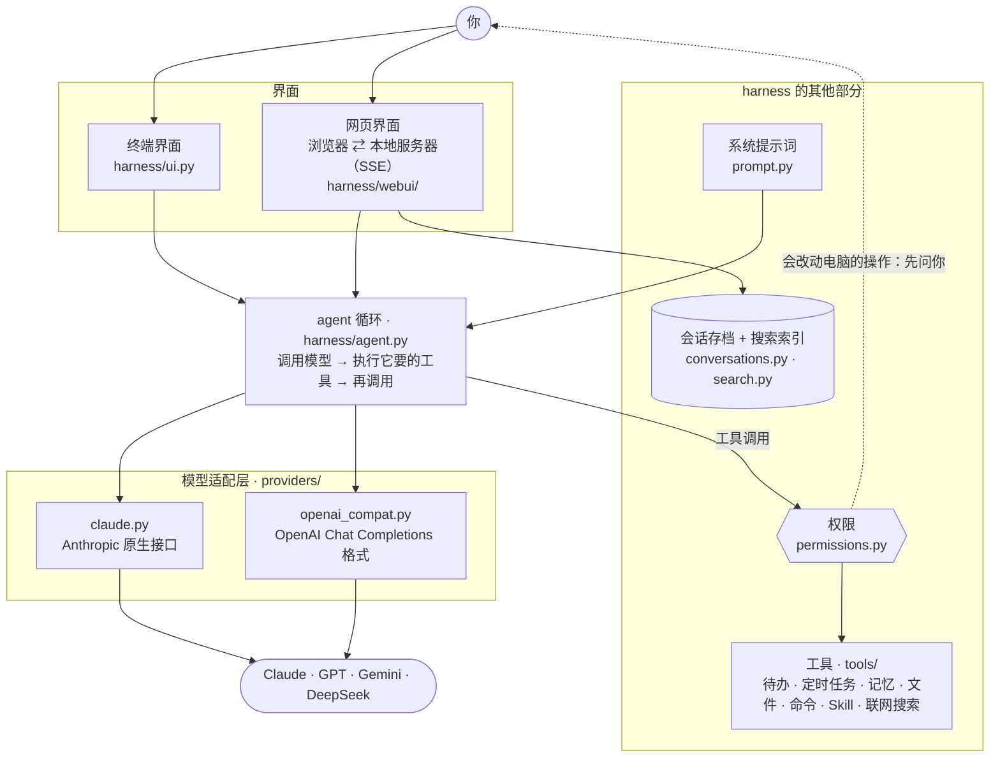
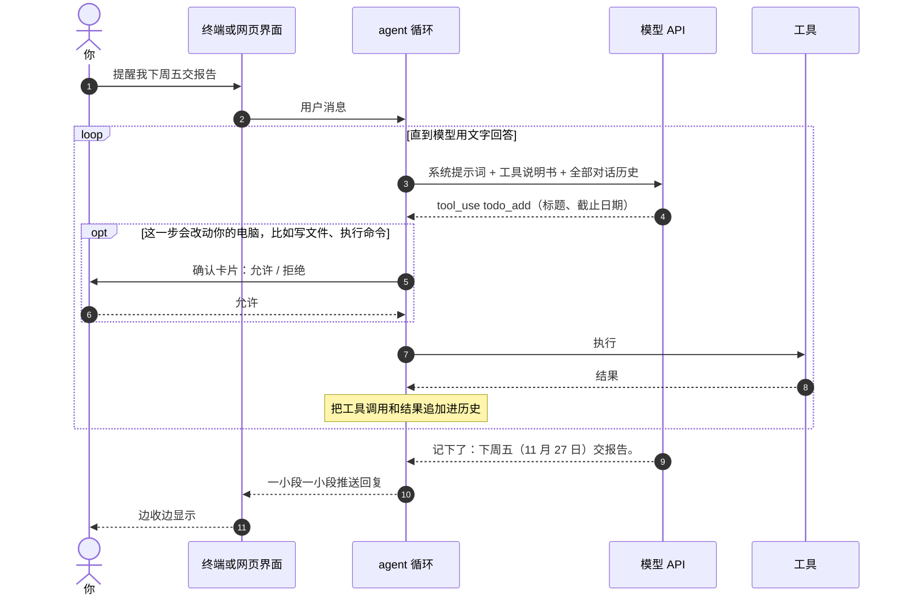

<div align="center">


# 智狐 · ZhiFox

**一个手写的 AI agent harness：运行在你自己电脑上的个人助手。**

[](https://github.com/Akxan/zhifox-agent-harness/actions/workflows/tests.yml)
[](LICENSE)
[](https://www.python.org/)
[](#harness-是什么)
[](#支持的模型)
[](#网页界面)
[](#界面是怎么做成三种语言的)
[](https://github.com/Akxan/zhifox-agent-harness/stargazers)
[](https://github.com/Akxan/zhifox-agent-harness/commits/main)

[English](README.md) | **简体中文**

</div>

<p align="center">
  <picture>
    <source media="(prefers-color-scheme: dark)" srcset="docs/assets/screenshot-dark-zh.webp">
    
  </picture>
</p>

智狐是一个运行在你自己电脑上的个人助手，有终端和网页两种界面，可以使用 Claude、GPT、Gemini、DeepSeek 四家的模型。
它同时也是一个用来学习的项目：没有用任何 agent 框架，让模型变成"助手"的那层代码（harness）全部是手写的，
每一部分都能在一个文件里看到。

"智狐"是它给人看的名字，英文名叫 ZhiFox，仓库名是 `zhifox-agent-harness`。代码里的包名和命令仍然叫 harness，
因为这个项目讲的就是 harness 是怎么回事。

助手能做这些事：管理待办、跨会话记住事情、读写文件和执行命令、联网搜索（只有 Claude 能用）、
到了时间提醒你或者定时替你做一件事（定时任务），还能看懂你发来的截图、图片、PDF 和 Word、Excel、PowerPoint 文件
（模型收不了的格式先转换，比如 SVG 画成图片、Office 文件取出文字；转不了的会说明可以怎么办）。
记忆、待办、定时任务、系统提示词都可以在网页里直接查看和修改，每一样也都能在访达里找到对应的文件。
费用随时看得到：每调用一次模型就更新估算，Claude 和 DeepSeek 的价格是内置的（对照两家官方核对过，
包括 DeepSeek 闲时的半价），各家的长对话都会自动压缩。
还可以装 Skill，教它按你的方法做某一类事（格式是开放的 [Agent Skills](https://agentskills.io) 标准，见下面的"Skill 是怎么工作的"）。
还可以通过 MCP 接上别人写好的工具（本地的程序或者网址），每次调用之前默认先问你。
还可以接上你自己的 Telegram 机器人（网页上一个四步的向导，或者用命令行），在手机上和它聊天，照片和文件也能发。
不需要公网地址，也不用开端口：是智狐去问 Telegram 有没有新消息（长轮询）。只有用 6 位配对码配对过的那个账号能用；
要执行命令、改文件时，聊天里会带着"允许 / 拒绝"按钮先问你（在网页上答复也行，先到的算数）。飞书、QQ、钉钉、Discord、Slack 是下一批。
它也能在服务器上一直运行：`harness serve` 不开浏览器，照样运行聊天通道和定时任务，日志按 journald 的习惯写，
收到 SIGTERM 时干净地退出，还附带一份 systemd 的配置；用 `harness channels setup` / `pair` 设置、配对好，
之后在 Telegram 里让它做服务器上的杂事。
还可以定制自己的 Agent：一个 Markdown 文件（和 Claude Code 的 subagent 是同一种格式）写着它擅长什么、能用哪些工具和模型、
怎么做事。主助手可以把一项任务交给它（子 Agent：它在自己的一段新对话里做，只把结论交回来），你也可以直接用它开始一段对话
（角色）。它能用的工具永远不会比叫它的那一方多，它要执行的命令照样先问你（见下面的"自定义 Agent：子 Agent 和角色"）。
网页界面里的每段会话都会自动保存在你自己的电脑上，随时可以从左侧的列表里打开接着聊，
也可以按标题和内容搜索。

## 快速开始

需要 macOS 或 Linux，以及 [uv](https://docs.astral.sh/uv/)。

```bash
uv sync                 # 安装依赖
uv run harness --web    # 启动网页界面，会自动在浏览器里打开
```

第一次打开时，页面中间会提示还没有 API 密钥。点提示里的“去设置”（或右上角的按钮），填写至少一家的密钥，就可以开始对话了。
想用终端界面的话，填好密钥后运行 `uv run harness`。

### 支持的模型

| 厂商 | 在哪里申请 API 密钥 | `.env` 里的变量名 | 验证情况 |
|---|---|---|---|
| Claude (Anthropic) | [platform.claude.com](https://platform.claude.com) | `ANTHROPIC_API_KEY` | 用真实 API 实测过 |
| GPT (OpenAI) | [platform.openai.com](https://platform.openai.com) | `OPENAI_API_KEY` | 没有实测 |
| Gemini (Google) | [aistudio.google.com](https://aistudio.google.com) | `GEMINI_API_KEY` | 没有实测 |
| DeepSeek | [platform.deepseek.com](https://platform.deepseek.com) | `DEEPSEEK_API_KEY` | 实测过：保存密钥、同步模型、带文本附件的对话 |

GPT 和 Gemini 是对照各自的官方文档写的，并用本地的假服务器测试过，但还没有用真实的密钥测过。
第一次使用时如果报错，多半是那一家的接口有文档里没写到的细节。

各家的 API 都按用量计费，和它们聊天产品的订阅是分开的，一般需要先充值。
密钥可以在网页界面的设置里填，也可以把 `.env.example` 复制成 `.env` 后直接写在里面，两种方式存的是同一个地方。

### 网页界面

```bash
uv run harness --web
```

程序会在本机启动一个小型服务器，并在浏览器里打开聊天页面。页面上有：

- 会话栏（左侧）：所有会话按时间分组列出，点一下就能打开接着聊。鼠标移到一段会话上会出现三个按钮：
  在访达中显示（直接定位到这段会话在你电脑上的文件）、重命名、删除。
  每一轮对话结束时自动保存，不需要手动操作。左上角的按钮可以把它收起来；
  最下面那一行点一下，会打开保存会话的文件夹。
- 搜索（会话栏顶部，快捷键 ⌘F 或 Ctrl+F；⌘K、Ctrl+K 也可以。光标已经在搜索框里时再按一次 ⌘F，
  就是浏览器自带的"在页面里查找"）：在所有保存过的会话里找，标题和内容都找，不要求一字不差。
  多个关键词用空格隔开。结果里会显示命中的那段文字，点开（或按回车打开第一条）后页面直接滚到那个位置。
- 空白页：还没有内容时，问候语、输入框和几个可以直接点的例子摆在页面中间。
- 对话区：回复逐字显示，并按 Markdown 画出来：标题、粗体斜体、列表和任务列表、引用、表格（太宽时在自己的框里
  横向滚动）、代码块（标着语言，有简单的着色和"复制代码"按钮）。链接在新标签页里打开；图片不加载，只显示说明文字和网址。
  模型的思考过程可以点开查看；每次工具调用是一张卡片，点开能看到参数和结果；鼠标移到助手的回复上会出现"复制"按钮，
  复制的是这条回复的 Markdown 原文。往上翻看旧内容时，新内容不会把你拽回底部。
- 确认卡片：助手要写文件或执行命令时出现，带"允许"和"拒绝"两个按钮。拒绝时可以顺便写一句原因。
- 输入框：Enter 发送，Shift+Enter 换行。助手工作时，发送按钮变成"停止"，可以打断正在进行的回复，
  正在运行的命令也会一起结束。输入框下面一直显示本次运行的估算费用。
- 附件：点输入框左边的回形针选文件，或者把文件拖到页面上，截图可以直接在输入框里粘贴（⌘V / Ctrl+V）。
  发送前，附件以小卡片的样子排在输入框上方，可以删掉某一个；一条消息最多 10 个，只带附件、不写字也能发。
  各家模型的接口只收几种图片、PDF 和文字，别的格式要先转换：

  | 文件 | 发出去的是什么 | Claude | GPT | Gemini | DeepSeek |
  |---|---|:-:|:-:|:-:|:-:|
  | PNG、JPEG、WebP | 图片本身。长边超过 2576 像素的先在浏览器里缩小，单张最大约 7 MB | ✅ | ✅ | ✅ | ❌ |
  | GIF、BMP、AVIF、HEIC、TIFF | 在浏览器里重新存成 PNG 或 JPEG（GIF 取第一帧）。HEIC 和 TIFF 要浏览器打得开才行，比如 Safari | ✅ | ✅ | ✅ | ❌ |
  | SVG | 画成 PNG。当前的模型看不了图的话，把 SVG 的源码当文字发 | ✅ | ✅ | ✅ | ✅ 发源码 |
  | PDF（最大 25 MB，不能有密码） | PDF 本身：文字和页面上的图都看得到 | ✅ | ✅ | ❌ | ❌ |
  | Word、Excel、PowerPoint（.docx、.xlsx、.pptx，最大 25 MB） | 智狐取出来的文字：Word 保留标题、列表和表格；Excel 每张工作表一节，格子之间用制表符隔开，日期还原成日期；PowerPoint 按播放顺序一张一张，带演讲者备注。图片和排版没有了，也会告诉模型这一点 | ✅ | ✅ | ✅ | ✅ |
  | 文本和代码（最多 40 万字） | 文字。认得 UTF-8、UTF-16 和 GBK 编码；扩展名不认识的，看内容是文字也收 | ✅ | ✅ | ✅ | ✅ |

  别的文件（压缩包、音频视频、.doc 这类旧版 Office、Pages、WPS、设了密码的文件）加的时候就会退回，并说明可以怎么转换。
  当前的模型收不了的附件，加的时候就会提示，并说可以换成哪几家。GPT 和 Gemini 两列是对照官方文档写的，用本地的假服务器测过，
  没有用真实的密钥测过。附件存在这段会话里，打开旧会话时缩略图还在。点对话里的任何一个附件，都会在下面"多媒体"一条说的查看器里打开。
- 多媒体（会话栏里"会话""任务"后面的第三个标签）：所有会话里发过的截图、图片、PDF、Word / Excel / PowerPoint
  和文本文件，最新的在前，按天分组。图片排成正方形的缩略图方格，文件一行一个，写着类型、大小和所在的会话。
  可以按种类筛选（按钮上是每一类的个数），按文件名和会话标题搜索，往下翻会接着读。刚发出去的附件马上就出现在这里。
  鼠标移到一项上，出现"在访达中显示""定位到会话""下载"三个按钮。
  点开是查看器（对话里的缩略图点开也是它）：用按钮、⌘/Ctrl 加 + − 0、触控板捏合或 ⌘/Ctrl 加滚轮放大缩小；
  放大以后拖动（或者滚动）来移动；双击在"适合屏幕"和"原始大小"之间切换；←/→ 在当前筛选的结果里（从对话里点开的，
  在这条消息的附件里）前后翻，手机上可以左右划。查看器里可以复制图片、下载原件、在访达中显示，或者"定位到会话"：
  打开那段会话（正在进行一轮的时候不行），滚到那个附件上，让它亮一下。文本和代码用等宽字体显示，可以复制。
  PDF 和 Office 文件显示一张说明卡片和下载按钮：页面的安全策略不允许嵌入 PDF，下载以后用系统自带的阅读器看。
  原件存在 `data/media/` 里，所以 Word、Excel、PowerPoint 留下的是原文件，不只是取出的文字。有多媒体库之前发的附件，
  从会话的对话历史里找回来（图片、PDF、文本）；旧的 Office 文件只剩当时取出的文字，多媒体里会注明。
  单个附件不能删除：它是对话记录的一部分。删除它所在的会话时，原件会一起删掉（别的会话也用到同一个文件的除外）。
- 设置（右上角显示当前模型的按钮）：填写或删除各家的 API 密钥、同步每家可用的模型列表、选择和切换模型、
  填写模型的价格，以及**编辑提示词**（告诉助手"你是谁、怎么做事"的那段话）。编辑框里可以预览实际发给模型的内容，
  下面列着可以用的占位符（比如 `{name}`、`{workspace}`），发送之前换成实际的值，别的花括号原样保留。
  改过的版本存在 `data/prompt.md`（也可以直接打开这个文件改），从下一段新对话开始生效：一段对话里途中换提示词，
  Claude 的缓存会失效、之前的思考内容也通不过校验；还没开始聊的这一段会马上换上。"恢复默认"回到内置的版本，
  程序升级后想用新的内置提示词，也是点它。最下面还有两栏：
  - 每月预算（美元，可以不填）：这个月的花费超过它时提醒你一次（页面上弹一句；页面在后台、又允许了系统通知的话，
    再弹一个系统通知），不会拦住任何操作。调高以后又超过了新的数，会再提醒一次；提醒过的会记下来，重启也不会重复。
    填的数比这个月已经花的还少，面板上当场就会说。
  - 导出全部数据：把整个数据文件夹打成一个 zip 下载下来。导出前显示文件夹有多大，导出后显示压缩包有多大。
    见下面的"备份和恢复"。
- 信息栏（右上角最右边的按钮展开或收起）：估算费用、四类 token 各占多少、未完成的待办、
  模型可以使用的工具。每调用一次模型就更新一次。费用卡片上"本次运行"的数字下面，是**今天**和**本月**一共花了多少
  （来自花费账本，重启不清零）、每月预算还剩多少；超过预算后会有一行红字（输入框下面的费用前面也会多一个红点）。
  点"花费明细"打开一个窗口：最近 30 天每天花了多少的柱状图（鼠标移上去、点一下，或者用左右方向键和 Home / End
  看某一天）、每个月的合计，以及按模型、按来源（对话还是定时任务）分开的数，可以选本月、最近 30 天或全部。
  没有价格的模型单独列出来，只有 token 数。点待办前面的圆圈就是完成；鼠标移上去，右边是和别的行一样的三个按钮
  （在访达中显示待办的文件、就地改内容和截止日期、删除前在原地确认）。定时任务的每一行、提示词的编辑框里，
  也有"在访达中显示"。
- 记忆（固定在会话栏顶部，后面是条数；点开是左右两栏的窗口：左边是列表，可以按名字搜，右边是选中的那一条；
  窄屏上一次只显示一边）：助手长期记忆里的每一个文件（`data/memories/`），写着所在的文件夹、大小和最后修改的时间。
  点一条可以看内容。鼠标移上去（或者用 Tab 移到它上面），右边会出现和会话行一样的三个按钮：
  "在访达中显示"会在文件管理器里选中这个文件；铅笔打开编辑，文件名和内容都能改（⌘Enter / Ctrl+Enter 保存，
  Esc 退出编辑，有没保存的修改会先提醒）；垃圾桶删除，删之前在原地确认一次。
  对话进行中不能改、不能删（助手可能正在改这一条）；你编辑的时候文件被别处改过了，保存前会先问要不要覆盖；
  太长读不全的、不是 UTF-8 的文件只能在文件夹里改。
  最下面的"在访达中打开记忆文件夹"（Linux 上是"打开记忆文件夹"）会在文件管理器里打开整个文件夹。
  列表自己会跟着变：助手在这一轮里记下的，这一轮还没结束就会出现；你在访达里改的、删的，切回这个页面时就会更新。
  助手工作时不能删，要等这一轮结束：它可能正在改的就是这一条。
- 扩展 → Skill（右上角的拼图按钮）：装好的 Skill，每一个写着说明、有几个文件、从哪儿来的。
  每一行有一个开关，可以启用或停用；鼠标移上去（或者用 Tab 移到它上面），右边出现和会话行一样的三个按钮：
  "在访达中显示"（这个 Skill 的文件夹）、铅笔（编辑 SKILL.md，保存时检查 frontmatter；改了 name，文件夹也跟着改名；
  有没保存的修改会先提醒，和编辑记忆一样）、垃圾桶（删除，先在原地确认一次）。
  点一行打开它：说明和各项信息、让它用不了的问题，以及文件夹里的每一个文件，都能点开当纯文本看。列表上面是四个入口：
  - 新建：按表单写一个（名字、说明、做法），名字边打边检查。
  - 从网址添加：GitHub 上的文件夹或整个仓库的链接、一个 `SKILL.md` 的链接，或者 `.zip` / `.skill` 文件的链接。
    一个仓库里有好几个 Skill 时，由你挑装哪几个。
  - 上传：`.zip` 或 `.skill` 文件、一个 `SKILL.md`，或者整个文件夹；也可以直接拖进来。
  - 从 Claude Code 导入：列出 `~/.claude/skills/` 和项目里 `.claude/skills/` 下的 Skill，勾上要复制过来的。
  装之前都会先给你看一眼，并提醒你：Skill 里的说明会被助手照着做，只装你信任的来源。
  改动从下一条消息起生效。和编辑记忆一样，改、删、装 Skill 都要等这一轮对话结束。
- 扩展 → Agent（右上角的拼图按钮）：你定制的 Agent，每一个写着颜色、名字、说明、用哪个模型、能用几样工具。
  鼠标移上去（或者用 Tab 移到它上面），右边出现"用它开始新对话"和与会话行一样的三个按钮：
  "在访达中显示"（它的 `.md` 文件）、编辑、删除（在原地确认一次）。点一行打开它：模型、工具和它的设定。
  编辑有两种写法："表单"和"原文"（整个文件）；两者之间切换时由智狐换算（把表单写成文件、把文件读回表单），规矩只写在程序里一处。
  有没保存的修改会先提醒，和编辑记忆一样。列表上面是"新建""示例"（资料研究员、代码审查员、写作助手）和"从 Claude Code 导入"；
  一个都还没有时，这一页讲清楚两种用法，并摆出这三个示例。改 Agent 不用等这一轮对话结束：正在进行的对话和子 Agent
  用的是开始时读到的那一份（见"自定义 Agent：子 Agent 和角色"）。
- 用 Agent 开始对话："新对话"右边的小箭头点开是你的 Agent 列表（方向键、回车、Esc 都能用），选一个就用它当角色开始一段新对话。
  顶上的标题前面写着它的名字（点一下打开这个 Agent），左边会话列表里这一段带一个小标记。主助手把任务交给子 Agent 时，
  对话里出现一张"交给「某某」……"的卡片：写着它此刻在做什么（在想、在写、在调用哪个工具、等你确认），
  点开能看到它调用过的每个工具、按 Markdown 画出来的回答，以及用的模型、调用了几次、花了多少。
- 扩展 → MCP（右上角的拼图按钮）：智狐接入的 MCP 服务器，每一个写着状态（连接中、已连接、失败及原因和服务器最后说的一句、
  已停用）、有几个工具，还有一个启用开关。鼠标移上去（或者用 Tab 移到它上面），会出现"重启"和与会话行一样的三个按钮：
  "在访达中显示"（`data/mcp.json`）、编辑、删除（在原地确认一次）。点开一个服务器，能看到它是怎么连的、说的是哪一代协议、
  每一个工具和它的说明（每个工具都有一个"不用问"的开关），还有它的日志。"添加服务器"打开一张表单：本地程序
  （命令、每行一个参数、工作目录、环境变量）或者网址（加上 `Authorization` 这类请求头）。密钥填在密码框里，
  保存之后页面上只显示最后 4 位；编辑时留空表示不变。"粘贴 JSON"收从 Claude Desktop、Claude Code、Cursor、
  VS Code 的配置里复制来的内容；"从 Claude 导入"列出 Claude Desktop 和 Claude Code 里配好的服务器（只在你打开这一页时读），
  勾选要复制过来的。改动从下一段新对话开始生效（原因见"MCP：别人写好的工具"）。
- 外观和动效（右上角的太阳/月亮按钮）：点开是一个小面板，上下两排。
  - 外观：默认是浅色，可以换成深色，或者跟随系统的深浅色。
  - 动效：默认跟随系统设置（macOS 是"系统设置 → 辅助功能 → 显示 → 减弱动态效果"，Windows 是
    "设置 → 辅助功能 → 视觉效果 → 动画效果"）。也可以直接在这里选"减少"（不播放滑动、淡入和闪烁，内容直接出现），
    或者"完整"（即使系统要求减少动画，这个页面也播放全部动画）。
  点面板外面、按 Esc 或者再点一下按钮就收起来。
- 语言（右上角的地球按钮）：中文、English、Español。换语言不刷新页面，正在进行的对话、滚动的位置、
  写了一半的消息都原样留着，界面上的文字在原地换掉。选择会保存下来，终端版也跟着用。

外观、动效、两边的栏是展开还是收起，这几样选择记在浏览器里，不在 `data/` 里。

换模型的规则：同一家之内换模型，对话可以接着进行；换到另一家会开始新对话，因为各家的对话格式不通用。
选好的模型会保存下来，下次启动（包括终端版）还是它。

刷新页面不会丢失当前对话。关闭页面后程序仍在运行，回到终端按 Ctrl-C 才会退出；
如果这时助手正在回复，程序会先停下它、把这一轮存好（最多等 5 秒）再退出。
同一个数据目录同时只能开一个网页版：已经有一个在运行时，再启动会提示你去用已经打开的那个。
重新启动后看到的是一段新对话，之前的会话都在左侧的列表里。打开一段旧会话时，
会自动换回它当时用的那家模型，而且这个模型从此就是"选好的模型"：之后新开的对话、下次启动用的都是它，
直到你在设置里换掉。助手正在回复的时候，不能打开、改名或删除会话，要等这一轮结束或者点"停止"。
会话的标题最长保留 40 个字。

可选参数：`--port 9000` 指定端口（不指定时用 8765，它被占用就自动换一个；指定的端口被占用则直接报错），`--no-browser` 不自动打开浏览器。

终端里显示的地址带有一段 `token`，它是这次运行的口令，每次启动都会换。不要把这个地址发给别人，
也不要把带地址栏的截图发到公开的地方：拿到它的人可以通过这个页面让助手在你的电脑上执行命令。
服务器只接受本机的连接。

### 定时任务和重复任务

对助手说"每天早上 9 点提醒我喝水"或者"每个工作日 9 点看看我的待办，写一份今天的安排"，或者在网页界面里自己添加。
任务有两种：

| 种类 | 到时间之后 | 费用 |
|---|---|---|
| 提醒（reminder） | 页面上弹出一条提醒，写着任务的名称和内容。不调用模型 | 不花钱 |
| 让助手去做（agent） | 助手自己执行任务的指令，就像你把它当成一条消息发过来一样：调用模型，使用工具 | 每次运行都要花 API 费用，和平常的一轮对话一样 |

时间表都按你电脑的本地时间：某个日期和时间只运行一次、每天、每周选定的几天、每月的某一天（31 号在小月里落到最后一天）、
每隔多少分钟（5 分钟到 7 天，从创建或者上一次运行的时刻算起）。夏令时按日历处理："每天 9 点"始终是墙上的 9 点；
春天拨快时被跳过的那个时刻，顺延到跳过之后运行；秋天拨回时走两遍的那个时刻，只运行一次。
保存之前，表单上会先列出接下来的三次运行时间。

让助手去做的任务是这样运行的：

- **和你的对话同时进行。** 你正在聊天时到了时间的任务马上开始；它跑的时候你照常发消息、换模型、打开会话，
  好几个任务也可以一起跑。每次运行都有自己的 shell，停下一个任务只结束它自己的命令，对话里的"停止"也碰不到任务。
  最多同时跑三个，再多的排队等着（显示"排队中"），前面的跑完一个就开始。换模型、改任务的设置，只影响以后的运行。
- **不动你正在进行的对话。** 每次运行都从空的历史开始，用的是它开始那一刻设置里选中的那家模型，跑完存成一段普通的会话，
  标题是任务名加时间（比如"每日安排 · 2026-11-21 09:00"）。它出现在会话栏里，标着来自定时任务，
  可以打开、重放、搜索，也可以接着聊。
- **要不要问你，每个任务自己定。** 编辑任务时，"让助手去做"的任务可以选和对话里一样的三档：**每次确认**（默认）、
  **自动允许改文件**、**全部自动允许**；选最后一档时会提醒你：任务多半在没人看着的时候运行。不是"每次确认"的任务，
  列表里那一行会带一个小标签，任务详情里也写着它是哪一档。还要你批准的操作，任务会停下来等你答复：
  正在等的确认显示在任务那里，可以允许或者拒绝，这期间你照常聊天。没问你就做了的那几步，进度里和存下来的会话里都标着"自动允许"。
  对话里选的那一档管不到任务；助手替你添加的任务一律是"每次确认"，只有你自己能改。
- **能看到进度，能停下。** 任务运行时能看到它在做什么（思考、写回答、调用哪个工具）、调用了几次模型、
  到目前为止花了多少钱、调用过哪些工具。"停止"和对话里的"停止"一样，这次运行正在运行的命令也会一起结束；
  还在排队等的那一次直接取消。好几个任务一起跑的时候，页面顶上那条提示会数一数（"定时任务：2 个在运行、1 个在等你确认"），
  点一下打开任务列表，停在第一个等你的任务上。
- **错过了就补一次。** 到时间时智狐没有开着（或者电脑在睡眠），下一次智狐看到时补跑一次，不管错过了几次都只补一次。
  这次运行标着"补跑"，记着错过了几次，也会告诉助手原定是什么时候。
- **每次运行都有记录。** 每个任务保留最近 20 次运行：开始和结束的时间、结果、调用了几次模型、估算费用、
  最后回答的开头，失败时还有原因。不设花费上限。

**定时任务只在网页界面（`uv run harness --web`）或者服务器模式（`uv run harness serve`）开着的时候运行。**
终端界面不运行它们；在终端里也可以让助手添加或删除任务，等下次网页界面或者服务器模式开着时运行。"立即运行"会马上运行一次，不改变原来的时间表。助手替你添加或删除"让助手去做"的任务时，
会先问你，因为这个任务以后会自己花钱；提醒不用问。

### 聊天通道（Telegram）

打开 **扩展 → 通道**，点 **连接 Telegram**。一个四步的向导会带你做完：

1. **建一个机器人。** 在 Telegram 里打开 [@BotFather](https://t.me/BotFather)，发送 `/newbot`，起一个名字和一个以 `bot`
   结尾的用户名，把它给你的 token 复制下来（`123456789:AAH…`）。
2. **粘贴 token。** 智狐拿它问一次 Telegram（`getMe`），显示出机器人的 @用户名。token 只存在 `data/channels.json` 里
   （只有你的账号能读），之后页面上只显示它的最后 4 位。
3. **配对。** 页面上出现一个 6 位数字和倒计时。用你自己的 Telegram 账号把它发给你的机器人（或者点 **在 Telegram 里打开**，
   在 Telegram 里点 Start（开始）时它会替你发过去）。配对好了，页面自己会进到下一步。
4. **确认方式。** 每次确认（默认）、自动允许改文件，或者全部自动允许，只管这一个通道。选全部自动允许时会提醒你：
   选了它，聊天里的一句话就能让助手执行任何命令。

之后直接给你的机器人发消息就行。照片和文件经过的检查和页面上的附件一样（Word、Excel、PowerPoint 变成文字；
语音和视频暂时还不支持）。聊天里可以用这几个命令：

| 命令 | 作用 |
|---|---|
| `/new` | 开始一段新对话（之前那段还在会话栏里） |
| `/stop` | 停下正在进行的这一轮，连同正在运行的命令；排着的消息也不再处理 |
| `/status` | 模型、确认方式、当前的会话、现在在做什么、今天和本月花了多少 |
| `/help` | 怎么用 |

接上的通道那一行写着它的状态（在线、连接中、出错了以及原因）、绑定的账号、最后一次有人和它说话的时间，
以及每个聊天正在做什么（带一个"停止"按钮）。和每一样存在你电脑上的东西一样，它有 **在访达中显示**（`channels.json`）、
**编辑** 和 **删除**（在原地确认），另外还有一个启用开关和 **重新配对**（换一个账号配对；原来那个账号不再理会）。
其他平台也列在那里，写着各自需要什么：飞书、QQ、钉钉、Discord、Slack 是下一批（它们的官方接口也不需要公网地址）；
WhatsApp 和企业微信需要公网地址，以后再做；个人微信没有官方的机器人接口（别的办法都是冒充你登录，违反微信的使用条款，
账号可能被封），所以不支持。

通道在智狐作为一个长期运行的程序开着的时候工作：网页界面（`harness --web`），或者服务器模式
（`harness serve`，见下面的[部署到服务器](#部署到服务器)）。终端界面不运行它们。

### 终端界面

```bash
uv run harness
```

启动后直接打字就可以对话：

```
你> 提醒我下周五交报告
🔧 todo_add {"title": "交报告", "due": "2026-11-27"}
   ↳ {"id": 1, "title": "交报告", "due": "2026-11-27", ...}
记下了：下周五（11 月 27 日）交报告。

你> 这个目录里有哪些 Python 文件？
🔧 run_command $ find . -name "*.py"

⚠️  助手想要执行命令：

    $ find . -name "*.py"
允许吗？y 允许；回车拒绝；也可以直接输入你的意见来拒绝 >
```

| 命令 | 作用 |
|---|---|
| `/help` | 显示命令列表 |
| `/new` | 开始一段新对话（记忆和待办不受影响） |
| `/todos` | 查看未完成的待办 |
| `/tools` | 查看模型可以使用的工具 |
| `/usage` | 查看本次运行的 token 用量和估算费用，以及今天、本月一共花了多少（设了每月预算的话也会显示） |
| `/model` | 查看当前使用的模型（换模型在网页界面的设置里进行） |
| `/mcp` | 查看接入的 MCP 服务器和它们的状态（添加和管理在网页界面里） |
| `/auto` | 查看或更改"要不要每次都问"：`/auto ask`、`/auto edits`、`/auto all`（见下面的"权限规则"） |
| `/exit` | 退出（也可以用 `/quit`，或者按 Ctrl-D） |

模型回复到一半时按 Ctrl-C 可以打断它。

终端界面不运行定时任务和聊天通道。在这里也可以让助手添加或删除任务，它们在网页界面或者 `harness serve` 开着的时候运行。

### 在别的目录里使用

助手的"工作目录"是你启动它时所在的目录。想让它在别的目录里工作，先 `cd` 到那里，再运行：

```bash
uv run --project "/这个项目的完整路径" harness
```

## Harness 是什么

模型只会一件事：读入一段文字，写出下一段文字。它不记得上一次对话，也执行不了任何操作。

**Harness** 就是包在模型外面、弥补这些不足的代码。**Agent = 模型 + harness**。
这个项目里 harness 的每个组成部分各占一个文件或目录：

| 组成部分 | 文件 | 它解决什么问题 |
|---|---|---|
| 循环 | [harness/agent.py](harness/agent.py) | 模型一次只能回复一段。循环反复调用它，直到任务做完 |
| 工具 | [harness/tools/](harness/tools/) | 模型不能执行操作。工具替它执行，再把结果告诉它 |
| 模型适配层 | [harness/providers/](harness/providers/) | 各家 API 的格式不一样。适配层把差别包起来，循环不用关心背后是哪一家 |
| 对话历史 | 适配层里（各家格式不同） | 模型没有记忆。每次请求都把完整的对话重新发一遍 |
| 压缩历史 | [harness/providers/compaction.py](harness/providers/compaction.py) | 历史每轮整段重发，越聊越贵，最后超出模型的上限。GPT、Gemini、DeepSeek 的对话太长时，请模型把较早的部分写成摘要（Claude 由 API 自己压缩） |
| 会话存档 | [harness/conversations.py](harness/conversations.py) | 程序关掉后内存里的对话历史就没了。把它存成文件，下次读回来就能接着聊 |
| 会话搜索 | [harness/search.py](harness/search.py) | 会话多了以后找不到。把每段会话里的文字放进内存，按标题和内容搜，允许不完全一样 |
| 附件 | [harness/attachments.py](harness/attachments.py)、[harness/documents.py](harness/documents.py) | 模型只收几种文件。每个附件发出去之前都检查一遍，Word、Excel、PowerPoint 先变成文字 |
| 多媒体库 | [harness/media.py](harness/media.py) | 每个附件的原件按内容存一份；记下它来自哪段会话的哪条消息；旧会话里的附件从对话历史里找回来 |
| 长期记忆 | [harness/tools/memory.py](harness/tools/memory.py) | 每段会话互相看不到对方的内容。记忆是所有会话共用的，助手自己决定往里写什么 |
| MCP | [harness/mcp/](harness/mcp/) | 别人写好的工具在另外的程序里。手写的 MCP 客户端启动或连上它们，列出工具，替模型调用，并让一段对话里的工具保持不变（见下面的"MCP：别人写好的工具"） |
| 记忆一栏 | [harness/memories.py](harness/memories.py) | 你看不到助手记住了什么。网页界面把记忆文件列出来、可以打开看、改、删，浏览器送来的路径出不了记忆文件夹 |
| Skill | [harness/skills/](harness/skills/)、[harness/tools/skill.py](harness/tools/skill.py) | 模型不知道你希望某一类事怎么做。Skill 是一个写着做法（可能还带着脚本）的文件夹，事情对得上时模型才去读它 |
| 自定义 Agent | [harness/agents/](harness/agents/)、[harness/tools/agent.py](harness/tools/agent.py) | 一个助手不可能什么都擅长；一件要查很多资料的事，又会把几十页原文塞进对话。Agent 是一个写着自己的设定、工具和模型的文件：主助手把任务交给它、只拿回结论（子 Agent），或者你直接和它对话（角色） |
| 共用的目录 | [harness/catalog.py](harness/catalog.py) | 有哪些 Skill、哪些 Agent 随时会变，系统提示词却不能变。两份列表都放在用户消息里，变了才再附一次 |
| 定时任务 | [harness/tasks.py](harness/tasks.py)、[harness/webui/scheduler.py](harness/webui/scheduler.py)、[harness/tools/tasks.py](harness/tools/tasks.py) | 模型只在你跟它说话时才动。定时任务让它到了时间自己动：时间表和保存、和你的对话同时运行并且停下来等你批准的执行部分、一句话就能定下任务的工具 |
| 系统提示词 | [harness/prompt.py](harness/prompt.py) | 模型不知道自己是谁、在什么环境里。内置的提示词可以换成你自己写的；"可以联网"那一行只写给有联网搜索的那一家 |
| 聊天通道 | [harness/channels/](harness/channels/) | 只有坐在运行它的那台电脑前才找得到助手。通道把它接到聊天软件上（现在是 Telegram）：手写的 Bot API 客户端、只为你一个人服务的配对、每个聊天一段会话（和网页上的对话同时进行）、带按钮的确认（见[聊天通道：在 Telegram 里和智狐说话](#聊天通道在-telegram-里和智狐说话)） |
| 无界面模式 | [harness/serve.py](harness/serve.py)、[harness/log.py](harness/log.py)、[harness/webui/lifecycle.py](harness/webui/lifecycle.py) | 服务器上没有浏览器。`harness serve` 不开浏览器就启动调度器和通道，日志按 journald 的习惯写、密钥都遮住，收到 SIGTERM 时干净地退出；网页界面和无界面模式在同一个地方启动、停下这些后台的部分 |
| 会话的认领 | [harness/claims.py](harness/claims.py) | 同一段会话可能同时开在网页上和 Telegram 里。每一轮开始前先"认领"这段会话，两边就不会同时往里写、把对方的那一轮冲掉 |
| 权限 | [harness/permissions.py](harness/permissions.py) | 模型可能出错或被误导。危险操作要你点头 |
| 界面 | [harness/ui.py](harness/ui.py)（终端）、[harness/webui/](harness/webui/)（网页） | 把过程显示给你，把你的输入交给循环 |
| 回复里的 Markdown | [harness/webui/markdown.js](harness/webui/markdown.js) | 模型用 Markdown 回答。一个手写的小渲染器在回复逐字输出的同时把它画成标题、列表、表格、代码块，从不把模型的输出当作 HTML |
| 设置和计价 | [harness/settings.py](harness/settings.py)、[harness/pricing.py](harness/pricing.py) | 记住你选的模型和填的密钥，把 token 换算成钱 |
| 花费账本和预算 | [harness/ledger.py](harness/ledger.py)、[harness/budget.py](harness/budget.py) | 内存里的估算一重启就没了。每调用一次模型就按那一刻的价格记一笔，看得到一天、一个月花了多少；定了每月预算的话，超过时提醒一次 |
| 导出 | [harness/export.py](harness/export.py) | 数据都在一台电脑的一个文件夹里。点一下就打成一个 zip，密钥不带出去 |
| 多语言 | [harness/i18n.py](harness/i18n.py)、[harness/locales/](harness/locales/) | 界面上的话有中文、英文、西班牙语三种，网页和终端共用一份翻译表 |
| 组装 | [harness/app.py](harness/app.py)、[harness/cli.py](harness/cli.py)、[harness/config.py](harness/config.py) | 把上面这些拼起来，读取配置 |

建议的阅读顺序：`agent.py` → `tools/base.py` → `tools/todo.py` → `permissions.py` → `providers/base.py`，其余的按兴趣看。

这些部分是这样连起来的：



### 循环

```
你说了一句话
  └─► 把【系统提示词 + 工具说明书 + 全部对话历史】发给模型
        ├─ 模型回复文字            → 显示给你，这一轮结束
        └─ 模型说"我要调用工具 X"  → 检查权限 → 执行 → 把结果追加进历史 → 再发给模型（循环）
```

"下一步做什么"每次都由模型决定，循环只负责照办。这是 agent 和普通程序的区别：
普通程序的步骤是写死的，agent 的步骤是模型临场决定的。

一轮对话里，各方之间是这样来回的：



你对 Claude 说"提醒我下周五交报告"之后，对话历史会变成下面这样（有删减）。
模型并没有真的"调用"什么，它只是输出了一段格式固定的内容，说自己想调用 `todo_add`；
harness 看到后去执行，再把结果作为一条新消息放回历史里：

```json
[
  {"role": "user", "content": [
    {"type": "text", "text": "<context>当前时间：2026-11-20 14:03 星期五</context>"},
    {"type": "text", "text": "提醒我下周五交报告"}
  ]},
  {"role": "assistant", "content": [
    {"type": "thinking", "thinking": "下周五是 11 月 27 日……", "signature": "..."},
    {"type": "tool_use", "id": "toolu_1", "name": "todo_add",
     "input": {"title": "交报告", "due": "2026-11-27"}}
  ]},
  {"role": "user", "content": [
    {"type": "tool_result", "tool_use_id": "toolu_1", "content": "{\"id\": 1, \"title\": \"交报告\", ...}"}
  ]},
  {"role": "assistant", "content": [
    {"type": "text", "text": "记下了：下周五（11 月 27 日）交报告。"}
  ]}
]
```

有一条规矩贯穿始终：**历史只在末尾追加，前面的内容从不修改**。
原因写在 [harness/providers/claude.py](harness/providers/claude.py) 里 `AnthropicBackend.__init__` 的注释中，简单说就是改了前面会让缓存失效（变贵），
还会让模型之前的思考内容无法通过 API 的校验（请求被拒绝）。
唯一的例外是 GPT、Gemini、DeepSeek 的对话太长时的压缩，见[对话太长了怎么办](#对话太长了怎么办压缩历史)。

### 一个循环，多家模型

上面那段历史是 Claude 的格式。别家的格式不一样，但循环（`agent.py`）并不关心，
它只要求每一家的适配层都能做这几件事（定义在 [harness/providers/base.py](harness/providers/base.py)）：

| 方法 | 作用 |
|---|---|
| `add_user` | 往历史里追加一条用户消息 |
| `step` | 调用一次模型，边收边显示，把回复追加进历史，并告诉循环模型想调用哪些工具 |
| `add_tool_results` | 把工具的执行结果追加进历史 |
| `mark` / `rollback` | 记下历史的位置 / 退回到那个位置（出错或被拒绝时撤销这一轮） |

适配层只有两个：[claude.py](harness/providers/claude.py) 用 Anthropic 的原生接口；
[openai_compat.py](harness/providers/openai_compat.py) 用 OpenAI 定下的 Chat Completions 格式，
GPT、Gemini、DeepSeek 都支持这套格式，只是服务器地址不同，所以一份代码服务三家。两者的主要差别：

| | Claude | GPT、Gemini、DeepSeek |
|---|---|---|
| 系统提示词 | 单独的参数 | 历史里的第一条消息 |
| 工具调用 | 回复里的一个"内容块" | 助手消息上的 `tool_calls` 字段，参数是一段 JSON 文本 |
| 工具结果 | 所有结果合在一条消息里 | 每个结果单独一条消息 |
| 联网搜索 | 有，在 Anthropic 的服务器上执行 | 没有 |
| 对话太长时 | 由 API 在服务器上把较早的内容压缩成摘要 | 由智狐请模型写摘要，换掉较早的内容（见下一节） |
| 缓存 | 由我们在请求里标记 | 各家自动处理 |

要接入另一家支持 OpenAI 格式的厂商，在 [harness/providers/\_\_init\_\_.py](harness/providers/__init__.py) 的 `PROVIDERS` 里加一项就够了。

### 对话太长了怎么办：压缩历史

每一轮都要把整段历史重发一遍，所以对话越长，每一轮越贵；长到超过模型一次能读的上限（上下文窗口），
请求就会被拒绝，这段对话就聊不下去了。办法是压缩：把较早的内容换成一份摘要，只留最近几轮的原文。

Claude 的压缩由 Anthropic 的 API 在服务器上完成（请求里带着 `context_management`，见 [claude.py](harness/providers/claude.py)），
我们这边的历史仍然只追加。OpenAI 格式的接口没有这个功能，所以 GPT、Gemini、DeepSeek 的压缩由智狐自己做，
代码在 [harness/providers/compaction.py](harness/providers/compaction.py)：

1. **什么时候压缩。** 每次请求回来，用量里写着这一次输入和输出一共多少 token，也就是这段对话现在占了多大的上下文。
   它超过模型上限的 70%，下一次请求之前就先压缩。剩下的 30% 要装得下下一条消息、工具的结果和模型的回复。
2. **切在哪里。** 切口只落在两轮之间，也就是你的某一条消息前面。工具调用和它的结果总在同一轮里，所以永远在切口的同一边，
   历史里不会出现"有调用、没结果"的情况（API 会拒绝这样的请求）。最近两轮（正在进行的这一轮也算）原样保留。
3. **请谁写摘要。** 就是正在对话的那个模型。切口之前的那一段原样发过去，末尾加一条指令请它写摘要（指令写在 `compaction.py` 里）。
   原样发是为了命中缓存：这一段之前每一轮都发过，开头一字不差，按低得多的缓存价计费。
   这次调用的用量和平时一样记下来，算进估算的费用里。
4. **换成什么。** 系统提示词，一条装着摘要的用户消息和一条助手的确认（这样历史仍然是你一句、它一句；有的模型不接受连着两条用户消息），
   再接上最近几轮的原文。被压缩的那一段里如果有附件，原件不再保留，只留一句话说你发过哪些文件。
   之后又太长时再压缩一次，上一份摘要会被合进新的摘要里。

这是"历史只在末尾追加"这条规矩唯一的例外，所以边界划得很清楚：只有 OpenAI 格式的适配层这样做；
只换切口之前的部分，系统提示词和最近几轮一个字不动；只在两次请求之间做。历史因此变短了，`mark` 记下的位置也跟着换算，
出错时撤回这一轮，撤掉的仍然正好是这一轮。代价是一次缓存失效：压缩之后的第一次请求开头变了，要按原价付一次，
之后新的开头又会被缓存起来。换来的是历史不再无限变长。

界面上会出现两句提示：一句说正在请模型写摘要，做完后另一句告诉你之后每一轮大约少发多少 token。
写摘要失败了（比如网络断了、服务器太忙），提示里会说明原因，这一轮照常进行，下一轮再试。
保存的会话里，`messages`（发给模型的那一份）是压缩过的，重新打开时接着摘要聊；`events`（页面上显示过的那一份）一点不少，
所以重放和搜索看到的仍然是完整的对话。

能调的数都在 [harness/config.py](harness/config.py) 里：`ENABLE_OPENAI_COMPACTION`（改成 `False` 就不压缩）、
`CONTEXT_WINDOWS`（各个模型的上限，DeepSeek 的两个模型是 100 万 token）、`DEFAULT_CONTEXT_WINDOW`
（不在表里的模型按 12.8 万 token 算，宁可早一点压缩）、`COMPACTION_THRESHOLD`（0.7）、`COMPACTION_KEEP_TURNS`（2）。

### 会话是怎么保存和恢复的

模型自己什么都不记得，"接着上次聊"靠的全是 harness：把上次的对话历史存下来，下次请求时一起发过去。
每段会话是 `data/conversations/` 里的一个 JSON 文件，里面有两份内容：

| 内容 | 给谁用 | 说明 |
|---|---|---|
| `messages` | 模型 | 发给模型的对话历史，按那一家的格式原样保存。打开会话时交还给适配层（`restore`） |
| `events` | 页面 | 界面上显示过的内容。打开会话时重新发给浏览器，页面照着画出来 |

附件在 `events` 里只有一份概要：名字、大小、一张小缩略图，和它的原件在 `data/media/` 里的编号（内容的 SHA-256）。
完整的内容在 `messages` 里（模型读的是它），也在多媒体库里。多媒体库的索引和搜索一样，是在读入、保存会话的时候顺手建的，
所以打开"多媒体"不用把所有会话文件再读一遍。

存两份是因为它们不一样：模型看到的历史里有思考内容的签名、每个工具调用的编号、厂商各自的消息结构，
这些页面用不上，但发回给 API 时一个字都不能差；页面上显示的确认卡片（你点了允许还是拒绝）、
"已中断"这样的提示文字，又是模型看不到的。

Claude 的历史必须和当初一字不差地发回去，否则它之前的思考内容通不过校验。如果你换了工作目录再打开旧会话，
系统提示词已经变了，那些思考内容就对不上了。程序在请求里带了一个参数，让 API 遇到这种情况时丢掉对不上的思考内容，
而不是拒绝请求，所以旧会话仍然能接着聊，只是模型看不到自己当时是怎么想的。

### 界面是怎么做成三种语言的

界面上的每一句话都用中文写在它出现的地方，外面包一层 `t()`，这句中文同时就是翻译表里的"键"。
翻译表在 [harness/locales/](harness/locales/) 下，一种语言一个 JSON 文件，内容是 `{"中文原文": "译文"}`：

```python
t("已中断。")                                                        # 英文界面下是 "Stopped."
t("已换成 {provider} · {model}。对话继续。", provider="DeepSeek", model="deepseek-flash")
```

查不到译文的照原样显示中文，所以漏翻一句不会出错，只会在那一处露出中文。
[tests/test_i18n.py](tests/test_i18n.py) 会把页面和程序里所有交给 `t()` 的话找出来，检查每一句都有英文和西班牙语的译文、
`{provider}` 这类要填的空一个不少。新加了一句话却没有翻译，测试就会失败，并列出是哪几句。

网页和程序用的是同一份表：助手程序发出页面时把表塞进页面里，页面自己的话由页面翻译。
换语言时页面不刷新，因为每一句画在页面上的话都记着自己的原文，换语言时照着原文重新查一遍、就地换掉。
程序发给页面的话（确认卡片上的说明、各种提示）也一样：除了译好的文字，还带着原文和填进去的值，
所以已经显示出来的这些话也能跟着换，保存下来的会话以后换了语言再打开也是。

哪些不翻译：模型的回答（它用什么语言回答，取决于你用什么语言和它说话）、你说的话、会话的标题、
工具的输出（比如命令打印出来的内容）。工具的说明书和工具返回给模型的话也保持中文，那些是写给模型看的，它都读得懂。
品牌名"智狐"在三种语言里都不变。

### 会话搜索是怎么做的

搜索要解决两个问题：找得快，找得到。代码都在 [harness/search.py](harness/search.py) 里，没有用任何搜索库。

找得快：不能每敲一个字就把所有会话文件重新读一遍。第一次用到会话列表或搜索时，程序要把每个会话文件读一遍来列出标题，
这时顺便把里面值得搜的文字抽出来放在内存里，这就是"索引"（终端版用不到会话列表，所以从来不建）。之后会话保存、改名、删除时索引跟着更新，
搜索只在内存里进行。

收进索引的有：标题、你说的话、助手的回复、思考过程、每次工具调用的那一行摘要（运行的命令、读写的文件路径、
联网搜索的关键词）、每个工具结果开头的 600 个字符。没有收的：助手写进文件的具体内容、出错和"已中断"这类提示。

找得到：人记得的往往只是个大概，所以匹配分三档，越严格的排得越靠前：

| 档 | 规则 | 例子 |
|---|---|---|
| 原样包含 | 关键词原样出现。不分大小写，全角半角算一样 | `HARNESS` 找到 `harness` |
| 相近的词 | 5 个字母以上的英文单词允许敲错一两个字母。只在这个词哪儿都原样找不到时才启用 | `hraness` 找到 `harness` |
| 隔字包含 | 每个字按顺序都出现，中间可以隔几个字。英文要 4 个字母以上，而且不跨单词 | `周五报告` 找到"周五下午交报告" |

多个关键词要全部满足，先后顺序不限，也可以分别出现在不同的地方。排序时先看档：每个关键词都原样找到的排最前，
其次是靠"相近的词"找到的，用到"隔字包含"的排最后。同一档里，标题里的命中排在内容里的前面，
你说的话排在工具输出前面；一样相关时新的会话在前。

页面上的搜索结果里标出来的位置是服务器算好的。这里有个容易踩的坑：浏览器里的字符串按 UTF-16 计数，
一个表情符号占两格，而 Python 里只占一格，所以服务器发给页面之前要把位置换算一遍，否则文字里一有表情，
后面标的位置就全偏了。

### 一个循环，两种界面

终端版和网页版用的也是同一个循环。循环只要求界面提供这几个方法：

| 方法 | 什么时候被调用 |
|---|---|
| `thinking` / `text` | 模型每生成一小段思考或回答 |
| `tool_call` / `tool_result` | 一个工具开始执行 / 执行完毕 |
| `confirm` | 需要用户点头，循环停在这里等答复 |
| `info` / `notice` | 有一句提示要告诉用户 |

终端版（`ui.py`）把这些调用直接变成屏幕上的文字。网页版多绕一步，因为循环和浏览器不在同一个程序里：

```
agent 循环 ──调用──► WebUI ──事件──► 本地服务器 ──推送──► 浏览器里的页面
                    (webui/ui.py)   (webui/server.py)     (webui/index.html)
```

`WebUI` 把每次调用记成一条"事件"存进日志，服务器把事件推送给浏览器，页面收到后画出对应的内容。
你在页面上点"允许"或"停止"，则是浏览器向服务器发一个请求，服务器再转告 `WebUI`。
页面自己不保存对话，所以刷新后服务器把日志重发一遍，页面就能照着重新画出来。

页面上的动画只给"此刻正在发生"的内容：新来的消息会浮现出来，而刷新页面、打开旧会话时重放出来的内容直接显示，
不会把几百条消息的入场动画挨个播一遍。页面怎么分辨这两种内容？服务器在补发完已有的事件之后，会多发一个名叫
`synced` 的标记，标记之后的才是实时的事件；打开旧会话时，则是从"清空页面"的事件到下一个"状态"事件之间算重放。

页面里所有会动的东西都只改两样属性：位置和缩放（`transform`）、透明度（`opacity`）。浏览器可以把这两样交给
专门的合成线程去做，不用重新排版，所以即使脚本正忙着处理模型不断吐出来的文字，动画也不会卡。

要减少动画的时候（系统开了"减少动态效果"，或者你在外观面板里选了"减少"），所有动画都会关掉，内容直接出现。
页面不是直接去查系统设置，而是在画出页面之前，把系统设置和你的选择合在一起算一次，结果写在 `<html data-motion>`
上，样式和脚本都只看这一处。这样你选的"完整"才能盖过系统设置，而且刷新页面时不会先播一段动画、再突然停下。
深浅色也是同样的做法（`<html data-theme>`）。

### 回复里的 Markdown 是怎么画的

模型喜欢用 Markdown 回答，代码、列表和表格画出来要好读得多。页面不能加载现成的 Markdown 库（它不加载任何外部资源，
离线也要能用），完整的库又有几千行，所以智狐自己写了一个小的：[harness/webui/markdown.js](harness/webui/markdown.js)。
它只做聊天回复里用得到的那部分：CommonMark 的大部分，加上 GitHub 的表格、任务列表和删除线。服务器发页面时把这个文件
原样填进页面，和页面自己的脚本用同一个一次性的 `nonce`，所以安全策略和原来一样严格。

**安全。** 渲染器从头到尾不拼接、也不解析 HTML。它先把文字解析成普通的对象（语法树），再用 `createElement`、
`createTextNode` 一个个建出元素，所以回复里的 `<script>`、`onerror=` 只会显示成文字。链接只认 `http`、`https`、`mailto`，
一律在新标签页里打开、带 `rel="noopener noreferrer"`；别的地址（`javascript:`、`data:`、`file:`、相对路径）按原文显示成文字。
图片一律不加载：只显示说明文字和网址，网址安全的话可以点开。

**为中文做的两处改动。** 段落里的单个换行就是换行（CommonMark 会把它当成空格；以前的回复是纯文本，靠换行排版，
中文句子之间也不该多出空格）。判断 `**` 能不能开始、结束加粗时，汉字和全角标点算作标点，否则中文里最常见的
`**注意：**这一点` 永远加粗不了。

**逐字输出。** 回复是一小段一小段到的，每来一段就把整段回复重新解析一遍，回复越长越慢。所以页面一帧最多画一次，
渲染器把文字分成两部分：已经"定稿"的块（它后面已经开始了一块新内容，而且新内容的第一行已经完整）画好之后再也不碰，
下次解析从它后面开始；只有最后一两块每次重新解析，和已经画好的对照，只重建变了的部分：还没写完的代码块把新来的字接在
后面，还在变长的长列表、长表格只重新解析最后一项、最后一行。最后一行要是只写了一个记号（`-`、`1.`、```` ``` ````、
网址还没写完的链接、可能是表头的那一行），先不画，等看得出它会变成什么再画，免得原始的记号在屏幕上一闪而过。
重放的旧内容（刷新页面、打开旧会话）直接按最终的样子画一次，不播动画。

搜索照样能用：搜索结果来自 Markdown 原文，命中的原文里夹着页面上看不到的记号（`**`、`` ` ``）时，页面先去掉这些记号
再去对；只在原文里有的命中（比如链接的网址）就滚到那条回复。终端界面照原样显示 Markdown 原文。

### 定时任务：没人看着的时候怎么运行

一个定时任务就是存下来的一条指令加一个时间表（[harness/tasks.py](harness/tasks.py)）。运行它用的还是同一个循环，
只有三件事另外处理（[harness/webui/scheduler.py](harness/webui/scheduler.py)）：

1. **什么时候。** 调度线程睡到下一个任务该运行的时候，但一次最多睡 30 秒，这样改了系统时间、电脑从睡眠中醒来，
   都能很快发现；任务一有变化也会把它叫醒。下一次的时刻是按本地时间在日历上算出来的，而不是加上 24 小时，
   所以夏令时前后"每天 9 点"仍然是墙上的 9 点。每个任务的下一次时刻存在 `data/tasks.json` 里，
   下次启动时发现它已经过去了，就知道错过了。
2. **同时进行。** 任务不拿你对话用的那把锁：它跑的时候你照常聊天、换模型、打开会话，几个任务也可以一起跑。
   能这样做，是因为凡是"会被停下"的东西，每次运行都有自己的一份（`App.unattended_agent`）：自己的 shell，
   停下一次运行只结束它自己的命令，对话里的"停止"碰不到任务；自己的 MCP 调用（每次运行的工具快照把调用记在它自己名下，
   "停止"只取消它自己的）；自己的事件日志和确认。共用的只有存在磁盘上的东西（待办、任务、记忆、会话、工作目录里的文件），
   它们各自有锁，每次改动一口气做完，两边同时改也不会互相冲掉。同时最多跑 `MAX_PARALLEL_TASKS` 个
   （3 个，在 [config.py](harness/config.py) 里），再多的排队，显示"排队中"，有空位就开始。同一个任务不会同时跑两次。
3. **没人看着。** 每次运行用一个单独的 `Agent`，适配层是新建的，历史是空的，事件也记在它自己的日志里
   （另一个不推给页面的 `WebUI`），所以它写不进你正在看的那段对话。它用的权限是一份按*这个任务自己的那一档*设好的副本
   （`Permissions.unattended(mode)`），不是你在对话里选的那一档。走到需要批准的一步时，循环和平常一样停在 `confirm` 上等，
   这个正在等的确认放进页面的状态里，你可以在任务那里答复它。

进度和别的东西一样，通过同一个 `state` 事件送到页面上：文字逐字输出时最多每秒四次，开始运行、停下来等你批准、
运行结束时马上发一次。被停下的运行照样给每个工具调用补上结果（还是 `Agent._run_tools` 里的那个 `finally`），
所以它存下来的会话和别的会话一样可以接着聊。

### 聊天通道：在 Telegram 里和智狐说话

聊天通道是进到同一个循环的又一条路。以 Telegram 为例（[harness/channels/](harness/channels/)）：

```
你的手机 ──消息──► Telegram 的服务器 ◄──长轮询（getUpdates）── 智狐（你的电脑或服务器）
                                                                │
       ┌────────────────────────────────────────────────────────┘
       ▼
是主人吗（配对过的那个账号）？  不是 → 不理  ·  是 → 在这个聊天的会话里跑一轮 agent 循环
       │
       ▼
写完一段就发回聊天里；要执行命令、改文件时，先发一条带"允许 / 拒绝"按钮的消息
```

1. **不需要公网地址。** 是智狐去问 Telegram 有没有新消息，而不是等 Telegram 来找它：发一个 HTTPS 请求（`getUpdates`），
   Telegram 把它挂住最多 25 秒，一有消息马上回答。智狐下次带回去的 `offset` 意思是"这之前的都处理完了"，它存在
   `data/channels.json` 里，所以重启以后不会把同一条消息处理两次。家里的电脑、防火墙后面的服务器都能用，不用开端口，
   也不用隧道。（WhatsApp 的 Cloud API 和企业微信只会把消息*推*到一个公网网址，所以要等到第二阶段。）
   客户端是只用标准库手写的（[telegram.py](harness/channels/telegram.py)）：`getMe`、`getUpdates`、`sendMessage`、
   `editMessageText`、`answerCallbackQuery`、`sendChatAction`、`getFile` 和 `setMyCommands`；出错时重试，间隔一次比一次长；
   被 Telegram 限流时就等一等；每一条错误信息里都去掉了机器人的 token。
2. **只认主人。** 机器人的名字谁都能搜到，可这个机器人能在你的电脑上执行命令。所以它像蓝牙耳机一样要先配对
   （[pairing.py](harness/channels/pairing.py)）：页面上（或者 `harness channels pair`）显示一个随机的 6 位数字，
   10 分钟内有效；你用自己的账号把它发给机器人，这个账号的编号就记成主人。别人发来的消息一律不理、也不回，
   机器人看起来就像没开着。配对的那 10 分钟里，陌生人发来别的话最多收到一句中性的提示；猜错 5 次，配对码就作废，
   没法一个一个试过去。群聊一概不理（群里的每个人都能和它说话）。
3. **每个聊天一段会话，和网页上的对话同时进行。** 每个聊天有一个 `Session`（[session.py](harness/channels/session.py)），
   有自己的会话、适配层、shell、MCP 调用和确认方式（`App.channel_agent`，和定时任务每次运行的做法一样），
   还有一个队伍：同一个聊天里一次只跑一轮，后来的消息排着等（最多 5 条）。它不拿网页对话的那把锁，所以在 Telegram 里发
   `/stop` 只停这个聊天，网页上的"停止"也碰不到它。会话和别的会话一样保存（会话栏里标着"Telegram"，花费按来源 `channel`
   记账），重启以后接着聊。同一段会话也在页面上开着的话，每一轮先*认领*它（[claims.py](harness/claims.py)）：
   Telegram 那边跑着一轮的时候，页面上不能在这段会话里发消息，也不能打开、改名或删除它；这一轮结束，页面重新读一遍，
   所以两边谁也不会把对方的那一轮冲掉。
4. **回话。** 循环对着一个 `ChannelUI`（[ui.py](harness/channels/ui.py)）说话。它用的是和网页界面同一种事件日志
   （所以存下来的会话能在页面上重放），每写完一段，就交给这个平台的发送队列（[router.py](harness/channels/router.py)）：
   网络上的发送永远不会卡住循环，先后顺序也不会乱。回复从 Markdown 转成 Telegram 认得的那一小套 HTML
   （只有 `& < >` 要转义，不像 MarkdownV2 那样处处要转义），按 Telegram 一条 4096 个字符的上限拆开：字符按 UTF-16 数，
   和 Telegram 的数法一样；一个代码块被拆开时，前一段补上结尾，后一段重新开头（[markup.py](harness/channels/markup.py)）。
   Telegram 还是不认这个格式的话，这一段改成纯文字重发。一轮进行中，每 4 秒刷新一次"正在输入……"。
5. **确认。** 某一步要你批准时，聊天里会收到一条消息，写着完整的命令（放在代码块里，一个字都不省略）和工作目录，
   下面是两个按钮。命令太长、一条消息装不下时分成几条发，按钮在最后一条上。同一个请求也出现在网页上
   （页面顶上的一条提示，以及 **扩展 → 通道** 里的一张卡片）；哪边的答复先到就算哪边的，聊天里的那条消息随即改成写明
   是谁决定的（"已在网页上允许"）。没有按钮的平台可以回一句"允许"或"拒绝"；打字的答复要等这条请求真的发到了聊天里才算数。
   选了 **自动允许改文件** 或 **全部自动允许** 时，没问你就做了的每一步照样会在聊天里说一声（"已自动允许：run_command $ …"）。

### 三类工具

区别在于"说明书谁写"和"谁来执行"：

| 类别 | 说明书 | 执行 | 这个项目里的例子 |
|---|---|---|---|
| 自定义工具 | 我们写 | 我们的电脑 | 待办（[todo.py](harness/tools/todo.py)）、定时任务（[tasks.py](harness/tools/tasks.py)）、执行命令（[shell.py](harness/tools/shell.py)）、读 Skill（[skill.py](harness/tools/skill.py)） |
| Anthropic 定义的工具 | Anthropic | 我们的电脑 | 读写文件（[files.py](harness/tools/files.py)）、记忆（[memory.py](harness/tools/memory.py)） |
| 服务器工具 | Anthropic | Anthropic 的服务器 | 联网搜索（[web.py](harness/tools/web.py)） |

第二类工具的说明书 Claude 在训练时就学过，所以给 Claude 只需要一行声明。别家的模型没学过，
所以 `files.py` 和 `memory.py` 里另有一份手写的说明书（`PORTABLE`）给它们用，执行的代码是同一份。
第三类工具在 Anthropic 的服务器上，别家的模型用不了。

还有第四类是通过 MCP 接进来的：说明书由写这个 MCP 服务器的人写，工具在他的程序里执行（在你的电脑上，或者在远程的服务上），
哪一家的模型都能用。

### MCP：别人写好的工具

上面这些工具都写在这个程序里。[MCP](https://modelcontextprotocol.io)（Model Context Protocol）是一个公开的协议，
管的是其余的情况：任何人都可以把一组工具（读写 GitHub、查数据库、操作浏览器……）做成一个"MCP 服务器"，
任何支持 MCP 的助手（"客户端"）都能连上它，把这些工具交给自己的模型用。智狐是一个客户端，
在 [harness/mcp/](harness/mcp/) 里手写，没有用官方的 SDK，一个文件管一件事：

| 文件 | 做什么 |
|---|---|
| [jsonrpc.py](harness/mcp/jsonrpc.py) | 消息的信封：请求、回答、通知（JSON-RPC 2.0），以及怎么等一个回答、等多久 |
| [stdio.py](harness/mcp/stdio.py) | 本地服务器：启动那个程序，消息一行一条走它的标准输入和输出，它的 stderr 留着当日志 |
| [http.py](harness/mcp/http.py) | 远程服务器：每条消息是一次 HTTP POST，回答是一个 JSON，或者一串服务器推送事件 |
| [client.py](harness/mcp/client.py) | 协议本身：弄清对面说的是哪一代协议，一页一页列出它的工具，调用它们 |
| [bridge.py](harness/mcp/bridge.py) | MCP 的工具 ↔ 智狐的工具：名字、参数格式、结果 |
| [manager.py](harness/mcp/manager.py) | 服务器的启动、停止、重启和状态，以及"一段对话里工具不变"的快照 |
| [config.py](harness/mcp/config.py)、[importers.py](harness/mcp/importers.py) | `data/mcp.json`、给页面看时遮住密钥、从 Claude Desktop 和 Claude Code 导入 |

一次调用走的路：

```
模型："我要调用 mcp__github__search_issues，参数是 {...}"
  └─► agent.py        和别的工具一样：先过权限这一关（默认每次都问你），再执行
        └─► manager.py      找到 github 这个服务器的连接
              └─► client.py      包成一个 tools/call 请求
                    └─► stdio.py / http.py   写进服务器的 stdin，或者 POST 到它的网址
                    ◄── 服务器的回答
        ◄── bridge.py       把回答里的文字、图片整理成交给模型的结果
```

**两代协议。** 到 2025-11-25 这一版为止，连接要先"握手"：客户端发 `initialize`，带上自己支持的版本；
服务器回答它选定的版本和能力；客户端再发一条 `notifications/initialized` 确认，这一来一回定下的东西在整个连接里都算数。
从 2026-07-28 起，MCP 是"无状态"的：没有握手，每个请求都在 `params._meta` 里自己带着协议版本、客户端是谁、
有哪些能力，服务器不用记得上一个请求。外面两种服务器都有，所以智狐两种都会说：先按新的规矩问一句 `server/discover`。
回答了，或者回了一个只有新一代才有的错误（比如"不支持这个版本"），就是新一代；回了别的错误，或者干脆不理，
就是老一代，改走握手。有的本地服务器启动很慢（`npx` 第一次要下载），所以等几秒没有回音，就把 `initialize` 也发出去，
两个谁先成功按谁来。

**一段对话里工具是"冻结"的。** 每次请求都从工具说明书开始，而 Claude 的缓存认的就是请求的开头：
对话进行到一半改了一个工具，整段对话的缓存就作废了，Claude 之前的思考内容也对不上它前面的内容了。
可是 MCP 服务器随时可能连上、断开、改变它的工具。所以一段对话发出第一条消息的那一刻，
智狐把当时已经连上的服务器的工具拍一张快照，这段对话从头到尾只用这张快照。之后才连上或者有变化的服务器，
从下一段新对话开始才用得上，在那之前，它在 MCP 一页里的那一行标着"新对话生效"。
快照里的某个服务器后来不在了，调用它的工具会得到一个说清楚原因的错误，模型会换个办法。

**名字、参数格式和结果的翻译。** 各家模型要求工具名最长 64 个字符，只能用字母、数字、`_` 和 `-`；
两个服务器还可能都有一个叫 `search` 的工具。所以智狐把它叫做 `mcp__服务器__工具`，别的字符换成 `_`，
太长的截短并加一小段哈希，保证不重名；说明的开头写明它来自哪个服务器。参数格式原样交过去，只去掉各家不接受的：
Claude 不接受最外层的 `anyOf`，Gemini 不认识 `$ref` 和 `$schema`，所以给 OpenAI 格式的几家时把引用就地展开。
结果里，文字交给模型；图片在模型看得懂图片时作为图片交过去；嵌入的资源变成文字；服务器只给了结构化结果、
没给文字时，把它写成 JSON；`isError` 会把这个结果标成出错，模型可以据此自己改正。

**停止、超时和崩溃。** 点"停止"会取消正在进行的调用：stdio 上发一条 `notifications/cancelled`；
HTTP 上挂断那个请求（对老一代的服务器也会发那条通知）。一次调用超过 5 分钟也会这样取消
（可以在 `data/mcp.json` 里按服务器用 `"timeout": 秒数` 改）。本地服务器崩溃了会自动重启，10 分钟内最多 3 次。
服务器通知"工具列表变了"（`notifications/tools/list_changed`）时，智狐在后台重新取一遍。
### Skill 是怎么工作的

模型什么都懂一点，但不知道你希望某一类事怎么做。每次都把要求重新说一遍很累，全写进系统提示词又会让每一次请求
都背着所有的要求。Skill 就是为这个准备的：一个文件夹，里面的 `SKILL.md` 写着做这一类事的步骤，旁边可以带着
脚本、参考资料和模板。格式是开放的 [Agent Skills 标准](https://agentskills.io/specification)，Claude、Claude Code
和越来越多别家的工具都用它，所以在那边写好的 Skill 可以原样装进来：

```
weekly-report/
├── SKILL.md          ---
│                     name: weekly-report          小写字母、数字和连字符，和文件夹同名
│                     description: 整理每周的      做什么、什么时候用（最多 1024 个字符）
│                       工作周报。用户说……时使用
│                     ---
│                     （下面是做法，用 Markdown 写）
├── scripts/          可选：模型可以运行的脚本
└── references/       可选：需要时才读的参考资料
```

分三层、用到才拿（progressive disclosure）：一、每个启用着的 Skill 的名字和说明一直在模型眼前，每个约 100 个 token，
所以装几十个也不会让对话变贵；二、请求和某个说明对得上时，模型用 `skill` 工具读出完整的 `SKILL.md`；
三、别的文件和脚本，只有说明里要求、确实需要时才读、才运行。

这份列表放在哪里，为什么不放系统提示词：一段对话里，系统提示词和工具说明书必须一字不差（缓存靠它；Claude 之前的
思考内容也和它绑在一起），可你随时可能装上、停用一个 Skill。所以列表放在用户消息里，和当前时间一样：
一段对话的第一条消息带着一个 `<skills>` 块，写着当时有哪些 Skill；之后每条消息发出之前，和模型最近一次看到的那份比一比，
变了就把新的一份附在这条消息前面。"模型最近一次看到的那份"直接从对话历史里找，不另外记，所以打开旧会话、
某一轮出错被撤回，都不用额外处理。唯一的例外是 Claude 的自动压缩：压缩之前的内容不再发给模型，那里面的列表也就不算看到过。
Claude Code 也是这样做的：它把 Skill 列表作为附加信息放进消息里，而不是写死在系统提示词里。
"怎么用 Skill"也写在这个块和 `skill` 工具的说明里，而不是系统提示词里：系统提示词你可以在设置里改，
改过的提示词不该一声不响地让 Skill 失效。定时任务每次运行的第一条消息里也带着这份列表。
见 [harness/skills/catalog.py](harness/skills/catalog.py)。

读和运行：`skill` 工具只能读，只能读启用着的 Skill，路径一层一层地检查，出不了那个 Skill 的文件夹，也不跟着链接走，
所以读 Skill 不用问你，和记忆工具一样。Skill 里的脚本由模型用 `run_command` 运行，和别的命令一样每次都问。
Skill 不能替你放开这一关：Claude Code 把 `allowed-tools` 当作"用这些工具不用再问"，智狐只把它显示出来。
Skill 里的 `${CLAUDE_SKILL_DIR}` 会换成这个 Skill 真实的文件夹，所以用到它的 Claude Code Skill 照样能用。
标了 `disable-model-invocation: true` 的 Skill 不列给模型（作者的意思是"只在用户点名时用"），你点名要用它时，模型照样读得到。

安装：装、改、删 Skill 只能由你在网页上做，模型做不了。智狐有自己的文件夹 `data/skills/`，不会自己去读 Claude Code 的：
"从 Claude Code 导入"只有在你点了之后，才去看 `~/.claude/skills/` 和项目里的 `.claude/skills/`，你勾选了的才复制过来，
之后两边各改各的，互不影响。从外面来的东西，写进去之前都先给你看（名字、说明、文件、来源），并且一律当作不可信的：

- 网址只认 https，跳转也只跟到 https；下载有超时，最多 20 MB。GitHub 上的文件夹链接（`…/tree/main/skills/pdf`）
  会从 `codeload.github.com` 下载那个分支的压缩包（一个请求，不占 GitHub API 每小时的额度），再从里面取出那个文件夹；
  `SKILL.md` 的链接装的是它所在的整个文件夹。
- 压缩包里只要有一项是绝对路径、带 `..`、是符号链接、设备文件或管道，或者是加密的，就整个不装；文件个数（1000 个）、
  解开之后的总大小（50 MB）都有上限，只差大小写的同名文件（在 macOS 上会互相覆盖）也不装。文件先写进一个隐藏的文件夹，
  最后一步改名换上去，装到一半出错不会留下半个 Skill。
- 和已有的 Skill 同名时，问你改名（`SKILL.md` 里的 `name` 跟着改成新文件夹的名字）还是替换。

frontmatter 的解析：`SKILL.md` 开头有几行 YAML。没有为此加一个 YAML 库，[harness/skills/frontmatter.py](harness/skills/frontmatter.py)
只认标准用到的那一小部分（普通的、带引号的、多行的值，一层的 `metadata` 表，列表），别的写法都明确报错并给出行号：
锚点和别名（可以拿来做指数膨胀）、标签（有的库会照着它构造任意对象），以及没加引号的值里出现"冒号加空格"
（正规的 YAML 解析器同样会报错，Claude Code 遇到这种文件会当作什么字段都没写）。值一律当作文字，`version: 1.0`
读出来就是 `"1.0"`，不是数字。标准之外的字段（比如 Claude Code 的 `argument-hint`、`hooks`）原样留在文件里。

### 自定义 Agent：子 Agent 和角色

Skill 教的是"某一类事怎么做"。**Agent** 则是另一个助手：有它自己的设定、自己的工具、自己的模型。每个 Agent 是
`data/agents/` 里的一个 Markdown 文件，格式和 [Claude Code 的 subagent](https://code.claude.com/docs/en/sub-agents)
一样，那边写好的可以原样导入：

```markdown
---
name: 资料研究员                  字母（中文也可以）、数字、- 和 _；也是文件名（资料研究员.md）
description: 查资料、读网页，      它擅长什么、什么时候该把事情交给它（最多 1024 个字符）
  交回一份带出处的摘要。
tools: Read, WebSearch, WebFetch  可选；不写就是"叫它的那一方有的都能用"，[] 表示一个都没有
model: inherit                    可选："提供方/模型"（deepseek/deepseek-flash）、inherit，或者 opus / sonnet
color: blue                       可选：red、orange、yellow、green、cyan、blue、purple、pink 之一
---
你是一个细心的研究员……           它的设定（就是它的系统提示词）
```

同一个文件有两种完全不同的用法，分清这两种，就明白了"agent"这个词的要点：

| | 子 Agent | 角色 |
|---|---|---|
| 谁叫它 | 主助手：任务和它的说明对得上时，用 `agent` 工具交给它（你也可以直接说"让资料研究员查一下……"） | 你：在"新对话"旁边的箭头里选它 |
| 它看得到什么 | 只有主助手写给它的任务：看不到你们的对话，也看不到附件 | 整段对话，和平常的助手一样 |
| 历史 | 每次交给它都是一段新的，做完就扔掉；只有它最后的回答回到主助手的对话里 | 它就是这段对话，和别的会话一样保存、打开 |
| 它和谁说话 | 主助手（它没法向你提问；你在一张卡片上看它在做什么） | 直接和你 |
| 适合 | "上下文隔离"：它在自己那边读了二十个网页，主助手的对话里只多一段话 | 一段时间里专门和你做某一类事的助手：写作搭档、代码审查员 |

**子 Agent 是怎么跑起来的**（[harness/agents/runner.py](harness/agents/runner.py)）。模型调用 `agent(name, task)` 时，
智狐建第二个 `Agent`（和主助手同一个循环类），给它：

- **一段新的历史**：第一条用户消息就是任务（和平常一样，前面带着 `<context>` 时间说明）；
- **它自己的系统提示词**：Agent 的设定，后面接一段程序附上的"环境"（工作目录、操作系统、`<context>` 是什么、
  网页和文件里的内容是资料不是指示，以及它的"用户"其实是主助手、主助手只收得到它最后的回答，所以要交回结论、
  缺什么信息就说出来，而不是去提问）。环境那几行和内置提示词用的是同一份文字（[harness/prompt.py](harness/prompt.py)
  把它们分成了几段有名字的常量），"可以联网"那一行只在它真的拿到联网工具时才写；
- **只有放开的工具，而且永远不比叫它的那一方多**：allow-list 是套在叫它的那一方手里的工具上的，所以一个只读的角色
  叫不出一个能改文件的子 Agent，用 DeepSeek 的子 Agent 也拿不到 Claude 的联网搜索。`Read` 拿到的是"只许读"的
  文件工具：改文件的调用在问你之前就被退回（`Tool.check`）。它还有自己的 shell、自己名下的 MCP 调用（重新拍一张快照、
  记在它自己名下，只留叫它的那一方本来就有的工具），和定时任务的每次运行一样；
- **它选的模型**；写 `inherit` 就和叫它的那一方用同一个。

它的每一次工具调用都经过叫它的那一方的同一个 `Permissions` 对象：在你的对话里，就是你在页面上选的那一档；
在定时任务里，就是那个任务自己的那一档。确认卡片照常出现在对话里，写着是哪个 Agent 在问。"停止"也停得了它：
它运行的那一会儿，把自己的"停止"登记在叫它的那一方的界面上，只结束自己的命令、只取消自己的 MCP 调用，别人的不碰；
被打断的那次 `agent` 调用和别的工具调用一样补上结果。它调用模型照样记账，来源写成 `subagent`；它的 token 和费用
也加进叫它的那一方的合计里（不算步数，也不算上下文的大小）。它最多调用 `AGENT_MAX_STEPS` 次模型（25 次）；
子 Agent 默认不能再往下交，除非你把 [harness/config.py](harness/config.py) 里的 `AGENT_MAX_DEPTH`（1）调大。
主助手收到的工具结果，是子 Agent 最后的回答，加上一句"它做了什么"（调用了几次模型、用了哪些工具）。

**为什么主助手的对话又便宜又稳定。** `agent` 工具一直都在（哪怕一个 Agent 都还没有），它的说明书里也不写有哪些 Agent；
Agent 的列表放在用户消息里的 `<agents>` 块中，和 `<skills>` 块的做法一模一样（[harness/agents/catalog.py](harness/agents/catalog.py)，
两者共用 [harness/catalog.py](harness/catalog.py)）。所以主助手的系统提示词和工具说明书在一轮又一轮之间、在交出任务的前后都一字不差，
缓存照样命中。

**角色。** 用一个 Agent 开始一段对话，这段对话换掉三样东西：系统提示词（它的设定，可以用和你自己的提示词一样的
`{workspace}` 这类占位符，后面同样接上程序附上的环境说明）、工具（它的 allow-list 套在平常那一套上）、模型（它写了的话；
这也会成为"现在用的模型"，和打开一段旧会话一样）。会话文件里记着是哪个 Agent，左边的会话列表里有一个带颜色的小标记，
顶上的标题前面写着它的名字。角色在一段对话里不能换（系统提示词和工具不能变），想换就开一段新的；换到另一家的模型时，
新的一段照样是这个角色。重新打开这段会话时，按这个 Agent 现在的文件重新生成提示词（和内置的提示词一样）；
它已经被删掉的话，会用内置的提示词接着聊，并且告诉你一声。

**管理 Agent。** "扩展 → Agent"列出它们；每一个都可以用表单编辑（名字、说明、从同步到的模型列表里选模型、颜色、
按"内置的 / Skill / MCP"分组的工具清单、设定），也可以直接改整个 Markdown 文件，两种写法都由和 `SKILL.md` 同一个解析器检查
（[harness/skills/frontmatter.py](harness/skills/frontmatter.py)）。按表单保存时只改你改过的那几项，注释和智狐不用的字段
（Claude Code 的 `permissionMode`、`hooks`……）原样留着。Claude Code 的工具名照样认：`Write`、`MultiEdit` 算 `Edit`，
`Grep`、`Glob`、`LS` 算 `Read`，`Task` 算 `Agent`；智狐没有的名字原样保留、列出来，但会被忽略。"从 Claude Code 导入"
只在你点它的时候才去读 `~/.claude/agents/` 和项目里的 `.claude/agents/`，只复制你勾选的。三个示例（只读文件加联网搜索的资料研究员、
只读的代码审查员、不用任何工具的写作助手）点一下就能加进来，默认一个都不装。模型没有任何能新建或修改 Agent 的工具。

### 权限规则

| 操作 | 处理 |
|---|---|
| 待办、记忆 | 直接执行（只动 `data/` 里助手自己的文件） |
| 读取启用着的 Skill | 直接执行（只能读，出不了那个 Skill 的文件夹）。Skill 里的脚本要用 `run_command` 运行，照样先问你 |
| 把任务交给子 Agent（`agent`） | 直接执行（它只是调用模型）。子 Agent 自己的每一次工具调用照样按这张表来问，档位跟着叫它的那一方，卡片上写着是哪个 Agent 在问 |
| 添加、删除提醒 | 直接执行（到时间只弹出一条提醒：不调用模型，不花钱） |
| 添加、删除让助手自己去做的定时任务 | 先问你，并显示时间表和指令（它以后会在没人看着的时候自己花钱） |
| 读取工作目录里的文件 | 直接执行 |
| 读取工作目录之外的文件 | 先问你 |
| 读取 `data/` 里的文件（保存的会话、设置） | 先问你，即使 `data/` 就在工作目录里 |
| 创建、修改任何文件 | 先问你，并显示要写入的内容 |
| 执行任何 shell 命令 | 先问你，并显示完整的命令 |
| 联网搜索 | 直接执行（在 Anthropic 的服务器上进行，不碰你的电脑），次数有上限 |
| 调用 MCP 服务器的工具 | 先问你，并显示要发过去的参数；你把这个工具（或整个服务器）设成"不用问"的除外 |

MCP 的工具是别人写的程序，它做什么智狐看不到，它说自己"只读"也没法验证，所以默认每次都问。
在"扩展 → MCP"里可以把某一个工具、或者整个服务器设成"不用问"。这是你对一个具体工具做的决定，
所以记在 `data/mcp.json` 里，在任何模式下都算数；这些调用在对话里照样标着"自动允许"。
唯一的例外是定时任务自己运行的时候：它只按这个任务自己的那一档来，所以除非这个任务选了"全部自动允许"，
MCP 的调用也会停下来等你批准。

拒绝时可以直接输入一句话（比如"不要删，改成移到废纸篓"），这句话会转告给模型。

不想每次都点"允许"的话，可以放宽"问不问"（网页：输入框下面的"每次确认"按钮；终端：`/auto` 命令）：

| 选项 | 终端命令 | 效果 |
|---|---|---|
| 每次确认（默认） | `/auto ask` | 上表里写着"先问你"的，每一次都问 |
| 自动允许改文件 | `/auto edits` | 创建、修改工作目录里的文件不再问；执行命令、读写工作目录之外的文件、读 `data/` 照常问 |
| 全部自动允许 | `/auto all` | 都不再问 |

放宽的只是"问不问"，没有问你就执行的那些，网页上的工具卡片会标"自动允许"，终端里也会注明。
这个选择不会保存，每次启动都回到"每次确认"，免得开了忘记关。

定时任务不跟着这里的选择走。每个"让助手去做"的任务有它自己的一档，也是这三个选项，在编辑任务时选、跟着任务存下来
（默认"每次确认"）：在对话里放宽的意思是"我在旁边看着，你做吧"，半夜三点任务自己跑的时候，这句话并不成立。
助手替你添加的任务一律是"每次确认"，它的工具也没有办法改，只有你自己能在页面上改：不然被网页上一句话带偏的模型，
就能给自己定一个"每天半夜不问就执行任何命令"的任务（见上面的"定时任务和重复任务"）。

另外有两条不经过询问的硬性限制：助手不能读写 `.env`（里面是各家的 API 密钥），
执行命令时也看不到这些密钥。

需要了解的风险：确认提示是你和模型之间唯一的关卡。批准一条命令之前请看清楚它要做什么，
尤其是在助手刚读过网页或陌生文件之后，因为那些内容里可能藏着误导模型的话。

## 部署到服务器

智狐可以住在一台 Linux 服务器上，听你的 Telegram 机器人吩咐（"磁盘还剩多少？""今天早上以来 nginx 的日志里有没有报错？"
"把 worker 重启一下"）。服务器上要有 Python 3.11 以上的版本和 [uv](https://docs.astral.sh/uv/)，能用 HTTPS 访问模型厂商的接口和
`api.telegram.org`；不需要开放任何入站的端口。

```bash
git clone https://github.com/Akxan/zhifox-agent-harness.git ~/zhifox && cd ~/zhifox
uv sync
echo 'ANTHROPIC_API_KEY=sk-ant-…' >> .env && chmod 600 .env    # 或者别家的密钥
uv run harness channels setup telegram     # 粘贴机器人的 token（输入时不显示），或者先设好 TELEGRAM_BOT_TOKEN
uv run harness channels pair telegram      # 打印一个 6 位配对码；把它发给你的机器人，等到显示"配对成功"
uv run harness channels approval telegram ask    # ask | edits | all（默认是 ask）
uv run harness channels status
```

然后把它作为服务运行。systemd 的配置文件 `/etc/systemd/system/zhifox.service`：

```ini
[Unit]
Description=ZhiFox (chat channels and scheduled tasks)
After=network-online.target
Wants=network-online.target

[Service]
User=zhifox
# 工作目录：助手读写文件、执行命令的地方。要想清楚了再选
WorkingDirectory=/srv/app
ExecStart=/home/zhifox/.local/bin/uv run --project /home/zhifox/zhifox harness serve
# 各家的 API 密钥。智狐自己也会读项目里的 .env；机器人的 token 在 channels.json 里，不在这里
EnvironmentFile=/home/zhifox/zhifox/.env
Environment=HARNESS_DATA_DIR=/home/zhifox/zhifox-data
Restart=on-failure
RestartSec=5

[Install]
WantedBy=multi-user.target
```

```bash
sudo systemctl daemon-reload && sudo systemctl enable --now zhifox
journalctl -u zhifox -f        # 看日志；加上 `-p warning` 只看警告和错误
```

- **工作目录。** 助手的文件工具和 shell 命令都从这里开始，所以聊天里说的"这个文件夹"指的就是它。可以用 `WorkingDirectory=` 设，
  也可以先 `cd` 过去，或者用 `harness --workspace /srv/app serve`。
- **数据。** `HARNESS_DATA_DIR`（默认是项目里的 `data/`）里放着会话、记忆、任务和 `channels.json`。
  一个数据文件夹同一时间只能给一个智狐用。服务运行的时候，`harness channels …` 这些命令照样能用：它们在文件锁的保护下改
  `channels.json`，服务两秒之内就会发现。服务开着的时候配对，配对码由服务来收；没开着的话，命令自己连上 Telegram，
  一直等到配对成功。
- **日志。** 写在 stderr 上的普通文字：输出的不是终端时不带颜色代码；在 journald 下每行前面加 `<6>` / `<4>` / `<3>`
  这样的级别标记，`journalctl -p` 才能按级别筛。API 密钥和机器人的 token 都换成 `<hidden>`，消息的内容从来不写进日志。
- **停止。** `systemctl stop` 发出 SIGTERM：智狐不再接收消息，停下正在进行的对话和任务运行（每个工具调用照样补上结果），
  存好会话（以及 Telegram 的消息读到了哪里），以退出码 0 退出。数据文件夹已经有一个智狐在用、或者端口被占用时，退出码是 1；
  `channels.json` 读不出来时是 2（修好或者删掉这个文件；`Restart=on-failure` 只会一遍一遍地重试）。
- **服务器上的网页界面。** `harness serve --web` 会把网页界面也开起来，但仍然只监听 127.0.0.1：它能在这台机器上执行命令，
  所以永远不对外开放。要用的话走 SSH 隧道：`ssh -L 8765:127.0.0.1:8765 你的服务器`，然后打开带口令的那个地址。
  没有终端的时候，这个地址不写进日志（能读日志的人都能拿它来用）；它在 `$HARNESS_DATA_DIR/.web-address` 里，
  只有你的账号能读。服务器上没有文件管理器，所以 **在访达中显示** 按钮改成告诉你文件的完整路径。
- **连不上 Telegram？** 把 `TELEGRAM_API_BASE` 指向一个自己搭的 Bot API 服务器，或者设置 `HTTPS_PROXY`。
- **更新。** `cd ~/zhifox && git pull && uv sync && sudo systemctl restart zhifox`。数据和 `.env` 都不会被动到。

远程运维的安全模型：只为配对过的那个账号服务（陌生人得不到回复，群聊不理，配对码 10 分钟后或者猜错 5 次就作废）；
默认的确认方式是 **每次确认**，每次都先给你看完整的命令和工作目录，你再点"允许"；**全部自动允许** 会先提醒你，
而且要一个通道一个通道地有意去选；同一个聊天里一次只跑一轮，`/stop` 能停下它，连同正在运行的命令；
机器人的 token 只存在 `channels.json` 里（权限 600），从不发给浏览器或模型，导出时遮住，助手的文件工具在任何模式下都打不开这个文件；
shell 命令的环境里看不到 `TELEGRAM_BOT_TOKEN` 和各家的 API 密钥。你的 Telegram 账号成了这台服务器的一把钥匙，
所以要保护好它（开两步验证），并且给这个服务用一个专门的、没有特权的用户。

## 数据存在哪里

| 路径 | 内容 |
|---|---|
| `.env` | 各家的 API 密钥。通过网页界面保存时，会把它设成只有你的账号能读 |
| `data/conversations/` | 网页界面里的每段会话，一段一个 JSON 文件 |
| `data/media/` | 发过的每个附件的原件，文件名是内容的 SHA-256，同一个文件发十次只存一份。删除会话时（以及每次启动时），没有会话再用的原件会被删掉 |
| `data/memories/` | 助手的长期记忆和笔记。可以在网页的信息栏里查看、修改和删除，也可以手动编辑 |
| `data/skills/` | 装好的 Skill，一个一个文件夹。可以在"扩展 → Skill"里管理，也可以手动改 |
| `data/skills.json` | 哪些 Skill 停用了、每一个是从哪儿装来的 |
| `data/agents/` | 你定制的 Agent，一个一个 Markdown 文件（Claude Code 的 subagent 格式）。可以在"扩展 → Agent"里管理，也可以手动改 |
| `data/todos.json` | 待办事项 |
| `data/tasks.json` | 定时任务，每个任务最近 20 次运行的记录，以及还没关掉的提醒。读不出来时原文件改名为 `tasks.broken.json` 留着，从空的任务列表开始 |
| `data/settings.json` | 你选的模型、同步到的模型列表、自己填的价格、界面语言、每月预算。不含密钥 |
| `data/ledger.jsonl` | 花费账本：每调用一次模型一行（日期、哪一家、哪个模型、对话还是定时任务还是子 Agent、token 数、估算的金额）。超过 90 天的明细合并成每天、每个模型、每种来源一行 |
| `data/mcp.json` | 你接入的 MCP 服务器，格式和 Claude Desktop 的一样，另外有几项智狐自己的（`enabled`、`approval`、`timeout`）。里面可能有服务器的密钥，所以只有你的账号能读，助手的文件工具也打不开它 |
| `data/channels.json` | 聊天通道：机器人的 token（这是密钥）、机器人的 @用户名、配对的主人的账号编号和名字、确认方式、正在用的配对码、每个聊天接着的是哪一段会话，以及 Telegram 的消息读到了哪里。只有你的账号能读；助手的文件工具打不开它；导出时遮住 |
| `data/backups/` | 助手整个覆盖某个文件之前，旧版本的备份 |
| `data/input_history` | 你在终端版里输入过的话（按上方向键可以找回） |

这些都是可以直接打开的普通文件。`data/` 和 `.env` 都写进了 `.gitignore`，不会被提交到 git。
`data/` 里的文件夹和会话文件都设成只有你的账号能读写，同一台电脑上的其他账号看不到。
网页界面保存密钥之后只显示最后 4 位，不会把完整的密钥发回浏览器。

对话内容会发送给你所选厂商的 API 处理，同时保存在你自己电脑上的 `data/conversations/` 里，
不会上传到别处。接了 MCP 服务器的话，你允许的每一次 MCP 工具调用，参数会发给那个服务器。
在会话栏里删除一段会话，对应的文件也会被删掉。

想直接看某段会话的文件，点会话栏里它那一行上的"在访达中显示"。这些"在访达中显示"按钮（会话、记忆、定时任务、待办、
提示词、MCP 服务器、Skill、多媒体里每一项上的，以及记忆和 Skill 的文件夹按钮），是页面上仅有的会让电脑启动别的程序
（文件管理器）的按钮，所以服务器对它们格外小心：页面只能告诉服务器"哪一段会话""哪一条记忆"（列表里给它的名字，
按下面说的办法检查）、"哪一个 Skill"（只能是一段名字，而且必须是 `data/skills/` 里真实存在的一个文件夹）、
"哪一个附件"（"会话/第几条消息/第几个"这样的编号，在索引里查过；文件名由内容的 SHA-256 定）、
助手自己的哪一个数据文件（`tasks`、`todos` 或 `prompt`），或者打开记忆、Skill 的文件夹和 `data/mcp.json` 时什么都不用说；
路径由服务器自己算，页面没有办法让它打开别的路径。下载附件也是这样：页面只给编号，文件以下载的方式回来
（`Content-Disposition: attachment`、`X-Content-Type-Options: nosniff`），写着 HTML 的文本文件也只当成文字。
Linux 上没有通用的"选中某个文件"的办法，打开的是文件所在的文件夹。

保存一个本地的 MCP 服务器，就是让智狐在你的电脑上运行这个命令（现在，以及之后每次启动）。所以守着这几条：
只有带着这次运行的口令的页面能保存；命令用参数列表启动，不经过 shell，参数里有什么字符都不会被当成命令的一部分；
模型没有任何能添加或修改服务器的工具，它的文件工具在任何模式下都碰不了 `data/mcp.json`；
这些程序拿不到各家模型的 API 密钥，配置里想把密钥转交出去（`${ANTHROPIC_API_KEY}`）会被拒绝；
环境变量和请求头的值不会发到浏览器，只有最后 4 位；Claude 的配置文件只在你打开导入页的时候读，只复制你勾选的服务器。
MCP 工具调用的参数会发给那个服务器（它可能在网上），所以在确认卡片上看清楚再允许。

在信息栏里查看、修改、删除一条记忆也是同样的防法：页面送回来的是列表里给它的名字（比如 `projects/zhifox.md`），
服务器从记忆文件夹出发一层一层地走到这个文件，凡是会走出这个文件夹的都不认：`..`、绝对路径、指向别处的符号链接。
它只删普通的文件；删完之后空下来的子文件夹也一起删掉。编辑时给的新名字只能是一段名字（不能带 `/`，不能以 `.` 开头），
所以记忆可以改名，但挪不出它所在的文件夹；新内容先写进临时文件再一步换上去，保存失败也不会留下半个文件。

### 备份和恢复

**设置 → 导出全部数据** 会把数据文件夹打成 `zhifox-backup-日期-时间.zip` 下载下来：会话、记忆、待办、设置、
花费账本，以及以后的功能放在这个文件夹里的东西。里面没有任何 API 密钥：密钥在 `.env` 里，它不在数据文件夹里；
万一在数据文件夹里发现像 `.env` 这样的文件，也会跳过。`data/mcp.json` 存在的话照样导出，但所有密钥都换成
`<removed-from-backup>`：环境变量、请求头、名字像 key、token、password 的字段、`--token` 这类开关后面的值、网址里的密码，
以及长得像 API 密钥的字符串；名字都留着，恢复以后知道要填回哪几项。这个文件不是合法的 JSON 的话，整个不导出，
宁可少导出一份也不冒险带出密钥。`data/channels.json` 里机器人的 token 和正在用的配对码，
导出时也同样换成 `<removed-from-backup>`。符号链接也不导出，因为它可能指向你电脑上的任何地方。压缩包里有一份
`README-backup.txt`，写着导出的时间、怎么恢复、哪些文件做了处理或者没有导出。压缩包在数据文件夹以外的临时文件里生成，
发给浏览器之后就删掉。

恢复的办法：

1. 先退出智狐（在它的终端里按 Ctrl-C）。
2. 把压缩包解压到数据文件夹里（默认是项目里的 `data/`），覆盖同名的文件：`unzip -o zhifox-backup-….zip -d data`
   （用访达双击解压也行：把解压出来的文件夹里的内容拷进 `data/`）。想完全回到备份时的样子，先把现在的 `data/`
   挪到一边，再解压到一个新建的空 `data/` 里。
3. 重新启动智狐。备份里有 MCP 服务器的话，把它们的密钥重新填上；接过聊天通道的话，把机器人的 token 重新粘贴一次
   （"扩展 → 通道 → 编辑"，或者 `harness channels setup telegram`）。

暂时还不能在网页界面里导入。

## 费用

API 按 token 计费（一个汉字大约 1 到 2 个 token）。因为每次请求都要重发整个对话历史，
对话越长、步骤越多，每一步越贵。一次让助手自己查资料的任务可能要走几十步，费用会比普通聊天高很多。

程序里控制费用的几样东西：

- **估算费用**：网页侧栏和终端的 `/usage` 会把用量换算成美元。这只是估算，实际以各家的账单为准，
  账单通常有延迟。
- **花费账本**：每一次模型调用（不管是对话、定时任务还是子 Agent）都按那一刻的价格记进 `data/ledger.jsonl`
  （DeepSeek 的高峰、闲时也按那一刻算），所以今天、本月的合计重启也不会清零。以后改了价格，旧账不跟着变；
  没有价格的模型照记 token 数，在有价格之前按 0 元算。每一次调用往文件末尾追加一行，程序崩溃最多留下半行，
  读的时候会跳过。
- **每月预算**：在设置里填，可以不填。超过时提醒一次，不会拦住任何操作，定时任务也照常运行。
- **搜索次数上限**：用户每发一条消息，Claude 最多搜索 5 次、读取网页 5 次，超过后它会根据已有的信息回答。
  这个上限由 API 强制执行。联网搜索除了 token 之外每次另收 1 美分。
- **缓存**：重复发送的部分命中缓存后便宜很多（Claude 约为原价的二十分之一）。
  缓存只保留几分钟，所以隔了一阵再接着聊一段很长的旧会话时，第一条消息要按整段历史的原价计费。
  打开超过 3 万 token 的旧会话时，页面会提示一下。
- **自动压缩**：对话特别长时，较早的内容会被压缩成摘要，之后每一轮少发很多 token。Claude 由 API 自己压缩；GPT、Gemini、DeepSeek 由智狐请同一个模型写摘要，这次调用也算进估算的费用（见[对话太长了怎么办](#对话太长了怎么办压缩历史)）。
- **附件**：图片按大小计费，每 28×28 像素算一个 token，一张满尺寸的截图最多约 4800 个 token（用 Opus 5.5 约 2 美分）；
  PDF 每页大约 1500 到 3000 个 token；Word、Excel、PowerPoint 按取出来的文字计费。附件和其他历史一样，每一轮都会重新发给模型，靠缓存才便宜。
- **子 Agent**：把一件事交给子 Agent，要花它自己调用模型的钱（每件事最多 25 次），在账本里记成"子 Agent"，
  卡片上也写着。换来的是：它读过的网页留在它自己的历史里，不进主助手的对话，之后的每一轮不用再为它们付钱。
- **定时任务**：让助手去做的任务每运行一次，费用和把它的指令当成一条消息发出去差不多，而且不管你在不在都会运行。
  不设花费上限：每 5 分钟一次的任务，一天就是 288 次。每次运行的估算费用都记在任务上。提醒不花钱。
- 随时可以点"停止"，或者用"新对话"把历史清零。

内置的价格（2026-11-20 对照两家官方的定价页核对过，单位是美元 / 每百万 token）：

| 模型 | 输入 | 写入缓存 | 命中缓存 | 输出 |
|---|---|---|---|---|
| `claude-opus-5-5` | 4 | 5 | 0.2 | 20 |
| `claude-sonnet-5-5` | 2 | 2.5 | 0.1 | 10 |
| `claude-fable-5-2` | 8 | 10 | 0.2 | 40 |
| `deepseek-flash`（高峰 / 闲时） | 0.30 / 0.15 | 不收 | 0.006 / 0.003 | 1.20 / 0.60 |
| `deepseek-v4-pro`（高峰 / 闲时） | 1.32 / 0.66 | 不收 | 0.044 / 0.022 | 3.96 / 1.98 |

Claude 的写入缓存是 5 分钟那一档（智狐用的就是它）；联网搜索另外每 1000 次 10 美元。
DeepSeek 分时段计价：北京时间工作日 9:00–12:00、14:00–18:00 是高峰，其余时间（包括周末）半价。
智狐每调用一次模型就看一下当时是高峰还是闲时，闲时的用量单独记，所以一段对话跨过了时段的分界也算得对。
DeepSeek 把中国法定节假日也算作闲时，这些日子没有内置，落在工作日的节假日会按高峰价估算（估高一点，不会估低）。
旧名字 `deepseek-v4-flash` 按 `deepseek-flash` 的价格算。

其他模型的价格需要你在设置里自己填（自己填的价格全天都按它算）。没有价格的模型只显示 token 数，页面会提示它没有计入估算。

## 配置

写在 `.env` 里，都是可选的：

| 变量 | 默认值 | 说明 |
|---|---|---|
| `HARNESS_MAX_SEARCHES` | `5` | 每条消息最多联网搜索几次，`0` 表示不限制 |
| `HARNESS_WEB` | `1` | 设为 `0` 完全关闭联网搜索 |
| `HARNESS_EFFORT` | `medium` | Claude 思考的力度：`low` / `medium` / `high` / `xhigh` / `max` |
| `HARNESS_DATA_DIR` | 项目里的 `data/` | 记忆、待办、设置等数据存放的目录 |
| `HARNESS_PROVIDER`、`HARNESS_MODEL` | `anthropic`、`claude-opus-5-5` | 还没在界面上选过模型时用哪一个。选过之后以界面上的选择为准 |

## 动手试试：加一个自己的工具

新建 `harness/tools/dice.py`：

```python
import random

from .base import Tool, function_tool


def make_dice_tool() -> Tool:
    def roll_dice(sides: int = 6) -> str:
        return f"掷出了 {random.randint(1, sides)} 点"

    return function_tool(
        name="roll_dice",
        description="掷一次骰子，返回点数。用户想要随机数、抛硬币或抽签时使用。",
        properties={"sides": {"type": "integer", "description": "骰子有几个面，默认 6"}},
        required=[],
        function=roll_dice,
    )
```

然后在 [harness/tools/\_\_init\_\_.py](harness/tools/__init__.py) 里导入它，并在 `build_registry` 的列表中加一行 `make_dice_tool(),`。
重新启动，对助手说"帮我掷个骰子"。用 `function_tool` 创建的工具，四家的模型都能用。

几点说明：

- `description` 是模型决定要不要调用这个工具的唯一依据。除了写它做什么，也要写**什么时候该用**。
- 工具返回的是给模型看的文字。出错时抛出 `ToolError("原因")`，模型会看到原因并自己调整。
- 如果新工具会改动电脑上的东西，在 [harness/permissions.py](harness/permissions.py) 的 `review` 里给它加一条规则，让它先问你。

## 测试

```bash
uv run pytest
```

测试不需要 API 密钥，也不花钱。[tests/fake_api.py](tests/fake_api.py) 和 [tests/fake_openai.py](tests/fake_openai.py)
是两个本地的假服务器，分别按 Claude 和 OpenAI 的格式回放事先写好的回复，这样就能让真正的 SDK 把整个循环跑一遍，
并检查发出去的请求是否正确。想知道循环在各种情况下的行为（工具出错、用户拒绝、被打断、模型拒绝回答），
可以读 [tests/test_agent.py](tests/test_agent.py)。网页界面的测试在 [tests/test_webui.py](tests/test_webui.py)，由测试代码扮演浏览器；
会话的保存和搜索分别在 [tests/test_conversations.py](tests/test_conversations.py) 和 [tests/test_search.py](tests/test_search.py)；GPT、Gemini、DeepSeek 的压缩历史在 [tests/test_compaction.py](tests/test_compaction.py)；
花费账本和预算在 [tests/test_ledger.py](tests/test_ledger.py)（用固定的钟测 DeepSeek 的高峰、闲时价，文件末尾的半行，
旧明细的合并），导出在 [tests/test_export.py](tests/test_export.py)（压缩包里一个密钥都没有），
它们在网页上的接口在 [tests/test_spending_web.py](tests/test_spending_web.py)。
定时任务的测试在 [tests/test_tasks.py](tests/test_tasks.py)（时间表，包括月底和夏令时；保存；工具和它们的权限）和
[tests/test_task_runs.py](tests/test_task_runs.py)（通过真实的服务器运行任务，用的是假的钟，所以没有哪个测试要等到早上 9 点：
任务和你的对话同时进行、两个任务一起跑、超过上限的排队、"停止"只停它自己那一次、三档确认方式；假 API 按每次运行的指令分开回答，
所以几个任务一起跑时结果也是确定的）。
MCP 的测试在 [tests/test_mcp.py](tests/test_mcp.py) 和 [tests/test_mcp_web.py](tests/test_mcp_web.py)，对着的是
[tests/fake_mcp.py](tests/fake_mcp.py)：一个两代协议都会说、stdio 和 HTTP 都能用的假 MCP 服务器。
多媒体库的测试在 [tests/test_media.py](tests/test_media.py)（原件的存储和去重；从 Claude 和 OpenAI 两种格式的旧历史里找回附件；
筛选和翻页；拼不出路径的编号；只在没有会话再用时才删原件）和 `tests/test_webui.py` 里多媒体的那一节（接口和响应头）。
聊天通道的测试对着 [tests/fake_telegram.py](tests/fake_telegram.py)：一个本地的假 Bot API，像 Telegram 一样检查每条消息的 HTML 和长度，
测试代码扮演你的手机。测的有：配对（对的、错的、过期的配对码，陌生人和群聊不理）、重启前后长轮询的 offset、拆开长回复、
照片和文件、用按钮、打字和在网页上答复确认（几边抢着答）、每个通道自己的确认方式、`/new` `/stop` `/status`、
Telegram 上的一轮和网页上的一轮同时进行、按来源 `channel` 记账，以及 token 从不出现在页面、日志和导出里
（[tests/test_channels.py](tests/test_channels.py)、[tests/test_channels_web.py](tests/test_channels_web.py)）。
服务器模式和命令行在 [tests/test_serve.py](tests/test_serve.py)，其中有一个测试启动真实的 `harness serve` 进程，再用 SIGTERM 停下它。
Skill（frontmatter 的解析、做坏了的压缩包、对着本地 HTTPS 服务器的下载、列表怎么交给模型而不改动请求的开头）在 [tests/test_skills.py](tests/test_skills.py)。
自定义 Agent 在 [tests/test_agents.py](tests/test_agents.py)（文件格式和检查、只会变少的工具 allow-list、在假的家目录下存取和从 Claude Code 导入、
提示词、`<agents>` 目录、对着假 API 的委派：新的历史、放开的工具、换模型、确认、"停止"停到子 Agent 自己的 shell 和 MCP 调用、
步数和层数的上限、账本里记成 `subagent`、主助手请求的开头一字不差；还有角色的保存和恢复）和
[tests/test_agents_web.py](tests/test_agents_web.py)（`/api/agent/…` 接口、用 Agent 开始对话、网页里子 Agent 的事件、确认和停止）。

Markdown 渲染器有自己的测试：[tests/markdown.test.mjs](tests/markdown.test.mjs)，用 Node 自带的测试工具跑
（`node --test tests/markdown.test.mjs`，什么都不用装）；电脑上有 Node 时，`uv run pytest` 也会顺带跑它。
测试里用的是一个很小的假文档：`innerHTML` 这类会解析 HTML 的接口一碰就报错，只允许建出固定的几种标签和属性。
它覆盖了每一种支持的写法、嵌套、转义、恶意输入、按随机大小一段段输出（结果必须和一次画完的一样），以及一万行的长输入。

页面的其余部分（`index.html` 里的样式和脚本）没有自动化测试，每次改动后是在真实的浏览器里对着假服务器手动操作检查的。

想不花钱地到处点点、看看界面，可以运行 `uv run python tests/demo_web.py`：它启动的是真实的服务器和页面，
后面接的是本地的假模型，回复都是预设的，数据写在临时目录里，不碰你的密钥和 `data/`。
里面预先装了几个编造的 Skill，"从 Claude Code 导入"看的也是临时目录里一个假的 `~/.claude/skills`。
它还预先接好了几个假的 MCP 服务器（其中一个启动不了、一个停用了）；"从 Claude 导入"读的是临时目录里编造的 Claude 配置，
不是你电脑上的。
全新的演示目录里预先放了一段"有多媒体库之前"的旧会话，"多媒体"里一打开就有东西可看，包括只剩文字的 Word 文件。
演示还会启动一个假的 Telegram：它打印一个编造的机器人 token（粘贴到"通道"的向导里），以及一个简陋的"手机"页面的地址，
在那个页面上可以发配对码、聊天、点"允许 / 拒绝"。

每次推送到 GitHub、每个 pull request，都会在 Ubuntu 和 macOS 上用 Python 3.11 和 3.13 自动跑一遍测试和代码检查
（[.github/workflows/tests.yml](.github/workflows/tests.yml)），结果就是页面顶上的 Tests 徽章。

## 局限

- 只支持 macOS 和 Linux（执行命令的部分依赖 bash）。
- GPT 和 Gemini 没有用真实的密钥实测过（见上面"支持的模型"）。
- 用 GPT、Gemini、DeepSeek 时没有联网搜索。
- GPT、Gemini、DeepSeek 的压缩是智狐自己做的，还没有用真实的密钥测过。摘要难免丢掉细节；切口只能落在两轮之间，
  所以一轮对话自己就超出模型的上限时（比如一轮里读了很多大文件）压缩不了；不在 `config.py` 表里的模型一律按 12.8 万 token 的上限算，
  上限更大的模型会压缩得早一些。打开一段旧会话后，要等第一次请求量出它有多大，才知道要不要压缩。
- 附件只能在网页界面里发，终端界面不行。GPT 和 Gemini 看图片、GPT 读 PDF 没有用真实的密钥测过；Gemini 和 DeepSeek 读不了 PDF。
- GPT 走的是 Chat Completions 接口。OpenAI 的个别新模型如果只支持它的另一套接口，在这里用不了。
- Claude 的模型只列出程序适配过的三个，Anthropic 的其他模型接受的参数不完全一样。
- 每条命令都在全新的 shell 里运行，`cd` 和环境变量不会保留到下一条命令。
- 会话只在网页界面里保存，终端界面的对话关掉程序后不保留。
- 搜索不支持拼音（比如输入 `baogao` 找不到"报告"）。它把所有会话的文字放在内存里，
  会话非常多（几千段长对话）时会多占一些内存。正在进行、还没保存过的那一段搜不到。
- 一次只能进行一段对话：一段会话正在回复时，不能切换到另一段，也不能给会话改名或删除会话。
- 网页界面只画 Markdown 的一部分：CommonMark 加上 GitHub 的表格、任务列表和删除线。图片不加载（只显示说明文字和网址），
  HTML 按原文显示成文字，链接只认 http、https、mailto，不支持缩进四格的代码块、引用式链接和脚注。代码着色只认常见语言的
  注释、字符串、数字和关键字。终端界面照原样显示 Markdown 原文。
- 定时任务和聊天通道只在网页界面或者 `harness serve` 开着的时候运行；定时任务最多同时三个。
  聊天通道目前只有 Telegram，能收文字、图片和文件（还不能收语音和视频）。两次运行（或者一次运行和你的对话）改同一个文件的同一处时不会合并：
  每次改动整个做完，后改的那一边发现原文已经变了就会报错，模型会重新读一遍再改。
  提醒只显示在页面上，不会弹出系统通知。
- 换成英文或西班牙语之后，工具返回的提示（比如"没有编号为 9 的待办"）和终端 `/tools` 里工具的说明仍然是中文：
  这些是写给模型看的。换语言之前保存的会话里，程序发出的提示也还是当时的语言。
- Skill：`allowed-tools` 不会让任何操作免于确认（见上面"Skill 是怎么工作的"）。Claude Code 的参数占位符
  （`$ARGUMENTS`、`$0`）、`!` 命令块、`context: fork`、`hooks` 等只有 Claude Code 用的字段，原样留在文件里但不起作用。
  从网址安装只支持公开的 https 链接，最多 20 MB；私有的 GitHub 仓库请先下载下来再上传。
- MCP 只支持工具，不支持 MCP 的资源（resources）和提示词（prompts）。远程服务器的 OAuth 登录还不支持；
  接受令牌的服务器加一个 `Authorization: Bearer …` 请求头就能用。已经废弃的 HTTP+SSE 连接方式不支持。
  调用到一半要向你提问的工具（elicitation）会失败并说明原因；也不让服务器借用智狐的模型（sampling）。
  MCP 工具返回的图片会交给模型，但页面上不显示。服务器写给模型的说明只给你看，不交给模型。
  对话进行中才连上或有变化的服务器，从下一段新对话开始才用得上。只对着假服务器测过，没有对着真实的第三方服务器测过。
- 网页界面的"停止"在模型下一次有输出时生效：模型还在思考、没有任何输出的那几秒里，按了不会立刻停。
- Claude 的"拒绝后自动换模型重试"、"自动压缩历史"和"接着聊旧会话时丢掉对不上的思考内容"用的是 API 的
  beta 功能，其中第三个每个 Claude 请求都会带上。如果每个请求都报 400，可以在
  [harness/config.py](harness/config.py) 里把它们关掉（三个开关各管一个）。

## 可以接着做的方向

- 让终端界面也能保存和打开会话。
- 给常用的只读命令（`ls`、`git status`）加一个"本次会话不再询问"的选项。
- 给不支持联网搜索的模型接一个本地执行的搜索工具。
- 支持 MCP 的资源和提示词，以及远程 MCP 服务器的 OAuth 登录。
- 给搜索加上拼音匹配。
- 再加一种界面语言：在 `harness/locales/` 下照着 `en.json` 写一份，再在 `harness/i18n.py` 的 `LANGUAGES` 里加上它。

## 关键词

AI agent · agent harness · 从零手写 agent · 不用框架的 agent · 个人 AI 助手 · 本地运行的 AI 助手 · Claude API ·
Anthropic SDK · OpenAI 兼容接口 · GPT · Gemini · DeepSeek · 工具调用（tool use / function calling） · 提示词缓存 ·
执行前确认（human-in-the-loop） · agent 循环 · Python · 终端聊天 · 网页界面

## 许可证

[MIT](LICENSE)。可以自由使用、修改和分发，保留版权声明即可。

## Star History

<a href="https://www.star-history.com/#Akxan/zhifox-agent-harness&Date">
  <picture>
    <source media="(prefers-color-scheme: dark)" srcset="https://api.star-history.com/svg?repos=Akxan/zhifox-agent-harness&type=Date&theme=dark" />
    <source media="(prefers-color-scheme: light)" srcset="https://api.star-history.com/svg?repos=Akxan/zhifox-agent-harness&type=Date" />
    
  </picture>
</a>
