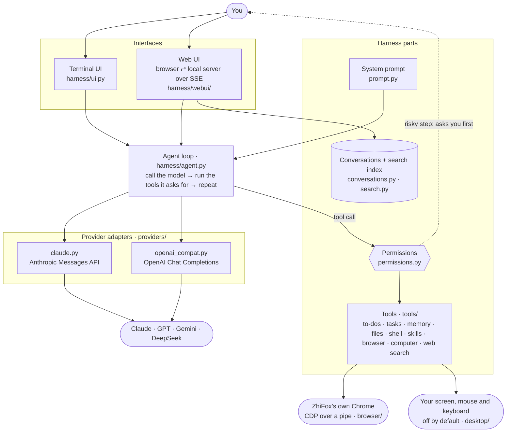
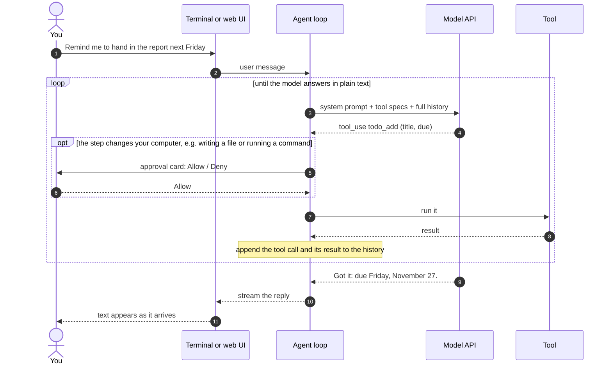

**English** | [简体中文](../zh-CN/architecture.md)

[ZhiFox](../../README.md) › [Documentation](../../README.md#documentation) › Architecture

# Architecture

How ZhiFox is put together: the parts of the harness and the file each one lives in, the loop that drives everything,
and the run trace that shows one turn of it. The page about each feature has a "how it works" part of its own.

A model does one thing: it reads text and writes the next piece of text. It doesn't remember your last conversation,
and it can't take any action. A **harness** is the code wrapped around the model that makes up for this.
**Agent = model + harness.**

How the parts connect:



What happens during one turn, using a to-do request as the example:



## Which file does what

Each part of the harness has its own file or directory:

| Part | File | The problem it solves |
|---|---|---|
| Loop | [harness/agent.py](../../harness/agent.py) | A model replies once per call. The loop keeps calling it until the task is done |
| Tools | [harness/tools/](../../harness/tools/) | A model can't act. Tools act for it and report the result back |
| Reads that run together | [harness/parallel.py](../../harness/parallel.py) | A model often asks for several things in one step ("read these five files"); one after another, you wait for all of them added up. Consecutive calls that only read and don't need asking run at the same time on a small thread pool, while the cards, approvals, hooks and history stay in call order (see [Several reads in one step run at the same time](tools-and-permissions.md#several-reads-in-one-step-run-at-the-same-time)) |
| Commands' current folder | [harness/tools/cwd.py](../../harness/tools/cwd.py) | Every command runs in a new shell, so a forgotten `cd` sends the next command to the wrong place. Each shell remembers the folder the last command ended in and starts the next one there; approval cards, the read-only check and the sandbox follow that folder |
| Provider adapters | [harness/providers/](../../harness/providers/) | Every provider's API has its own format. The adapters hide the differences, so the loop doesn't care which provider is behind it |
| Custom model endpoints | [harness/endpoints/](../../harness/endpoints/), [harness/webui/endpoints_api.py](../../harness/webui/endpoints_api.py) | The built-in providers all live on someone else's servers. An endpoint is any OpenAI-format URL (Ollama, LM Studio, vLLM, llama.cpp, a company gateway): the URL rules (https, or plain http only on your own network), storage with an optional key, a client that never carries other providers' keys or follows redirects, guessing what each model can do, and testing the connection without spending anything (see [Local models](models.md#local-models-and-your-own-gateway-ollama-lm-studio-vllm-llamacpp)) |
| Conversation history | Inside the adapters (the format differs per provider) | A model has no memory. Every request resends the whole conversation |
| History compaction | [harness/providers/compaction.py](../../harness/providers/compaction.py) | Resending the whole history every turn gets more expensive and finally exceeds the model's limit. When a GPT, Gemini or DeepSeek conversation gets too long, the model is asked to summarize the earlier part (Claude's API compacts on its own) |
| Conversation storage | [harness/conversations.py](../../harness/conversations.py) | History in memory is gone once the program closes. Saving it to a file lets you pick up where you left off |
| Conversation search | [harness/search.py](../../harness/search.py), [harness/search_pinyin.py](../../harness/search_pinyin.py), [harness/search_pinyin.txt](../../harness/search_pinyin.txt), [tests/make_pinyin.py](../../tests/make_pinyin.py) | Once there are many conversations, you can't find anything. The text of every conversation is kept in memory and searched by title and content, allowing near matches and pinyin (`baogao` finds 报告); the pinyin table is generated once from Unicode's Unihan database |
| Attachments | [harness/attachments.py](../../harness/attachments.py), [harness/documents.py](../../harness/documents.py) | Models take only a few kinds of files. Every attachment is checked before anything is sent, and Word, Excel and PowerPoint files are turned into text |
| Media library | [harness/media.py](../../harness/media.py) | Keeps the original of every attachment (content-addressed), indexes which conversation and message each one came from, and recovers attachments from older conversations out of their history |
| Long-term memory | [harness/tools/memory.py](../../harness/tools/memory.py) | Conversations can't see each other. Memory is shared by all of them, and the assistant decides what to write there |
| MCP | [harness/mcp/](../../harness/mcp/) | Tools written by other people live in separate programs. A hand-written MCP client starts or connects to them, lists their tools, calls them for the model, and keeps each conversation's tool list fixed (see [MCP](extensions.md#mcp-tools-written-by-someone-else)) |
| Reading web pages | [harness/fetch/](../../harness/fetch/), [harness/tools/fetch.py](../../harness/tools/fetch.py) | Only Claude can go online on its own, and the browser needs Chrome. A small read-only fetcher downloads one public `http(s)` page, refuses this computer, your network and cloud metadata addresses (checked after DNS and on every redirect, connecting to the address it checked), and turns the HTML into readable text with the standard library's `html.parser` (see [Reading a web page](browser-and-computer-use.md#reading-a-web-page-without-a-browser-web_fetch)) |
| Browser | [harness/browser/](../../harness/browser/), [harness/tools/browser.py](../../harness/tools/browser.py), [harness/webui/browser_api.py](../../harness/webui/browser_api.py) | Web search finds pages, but can't use a site: search it, click through it, fill in a form. ZhiFox starts a separate Chrome of its own and drives it with a hand-written DevTools Protocol client over a pipe; the page is turned into numbered lines the model acts on (see [Browser use](browser-and-computer-use.md#browser-use-a-chrome-of-its-own)) |
| Computer use | [harness/desktop/](../../harness/desktop/), [harness/tools/computer.py](../../harness/tools/computer.py), [harness/webui/computer_api.py](../../harness/webui/computer_api.py) | Some jobs aren't in a browser at all: a desktop app, a system dialog, a file to drag from one window to another. As an advanced option that is off by default, the assistant looks at screenshots of your whole screen and moves your mouse and keyboard, asking before each step unless you loosen it (per conversation on the approval card, or Allow everything); screenshots are scaled down and the model's coordinates mapped back to the screen (see [Computer use](browser-and-computer-use.md#computer-use-your-whole-desktop-advanced)) |
| Memory panel | [harness/memories.py](../../harness/memories.py) | You can't see what the assistant remembers. The web UI lists, shows, edits and deletes the memory files, and never lets a path the browser sends leave the memory folder |
| Skills | [harness/skills/](../../harness/skills/), [harness/tools/skill.py](../../harness/tools/skill.py) | A model doesn't know how *you* want a kind of task done. A skill is a folder of instructions (and maybe scripts) that the model reads only when a task matches it |
| Custom agents | [harness/agents/](../../harness/agents/), [harness/tools/agent.py](../../harness/tools/agent.py) | One assistant can't be good at everything, and a long research job floods the conversation with pages of material. An agent is a file with its own instructions, tools and model: the main assistant hands it a task and gets back only the conclusions (a subagent), or you talk to it directly (a persona) |
| Importing from other tools | [harness/imports/](../../harness/imports/) | You already set up MCP servers, skills and agents in other AI tools, each in its own place and format. A registry of where two dozen tools keep them, and small readers that rewrite each format the ZhiFox way before the usual checks (see [Importing from other tools](extensions.md#importing-from-other-tools)) |
| Shared catalog | [harness/catalog.py](../../harness/catalog.py) | The lists of skills and agents change at any time, but the system prompt mustn't. Both lists travel in user messages, attached again only when they change |
| Several conversations at once | [harness/webui/sessions.py](../../harness/webui/sessions.py), [harness/webui/sessions_api.py](../../harness/webui/sessions_api.py) | Waiting for one reply shouldn't stop you from starting the next. Each live conversation is a session with its own agent, shell, event log and lock; the list of sessions, which one you're looking at, the limit, and switching, stopping and finishing one (see [Several conversations at once](web-ui.md#several-conversations-at-once)) |
| Scheduled tasks | [harness/tasks.py](../../harness/tasks.py) and the `tasks_*.py` files next to it, [harness/webui/scheduler.py](../../harness/webui/scheduler.py), [harness/tools/tasks.py](../../harness/tools/tasks.py) | A model only acts when you write to it. Tasks let it act at a set time: the schedules and their storage, the runner that works alongside your conversation and pauses for approval, and the tools that set one up from a sentence. What a task is is split by section: [tasks_check.py](../../harness/tasks_check.py) (checking a task and a schedule), [tasks_schedule.py](../../harness/tasks_schedule.py) (the next time, by the calendar), [tasks_records.py](../../harness/tasks_records.py) (a run's record, a reminder), [tasks_store.py](../../harness/tasks_store.py) (`data/tasks.json`) |
| System prompt | [harness/prompt.py](../../harness/prompt.py) | A model doesn't know who it is or what environment it is running in. The built-in prompt can be replaced by your own, and the line about web search is only given to providers that have it |
| Chat channels | [harness/channels/](../../harness/channels/) | You can only reach the assistant at the computer it runs on. A channel connects it to a chat app (Telegram, Discord, Slack, Feishu, DingTalk, QQ): one small client per platform, pairing so only you are served, one conversation per chat that runs beside the web chat, and approvals with buttons or by reply, and `send_file` ([tools/send.py](../../harness/tools/send.py)) to send photos and files back into the chat (see [Chat channels](chat-channels.md#chat-channels-talking-to-zhifox-from-your-chat-app)) |
| Voice to text | [harness/voice/](../../harness/voice/), [harness/webui/voice_api.py](../../harness/webui/voice_api.py) | Models read text, but on a phone it's quicker to speak. A voice message from a chat (Telegram for now) is sent to a speech-to-text service first: OpenAI's transcription API or a compatible one you run yourself. The settings and their checks, the client, and the whole chat-side process (limits, download, transcribe, record the cost) (see [Voice messages](chat-channels.md#voice-messages-telegram)) |
| WebSocket and HTTP | [harness/net/](../../harness/net/) | Discord, Slack and QQ push messages over a WebSocket the bot opens itself. A small RFC 6455 client on `socket` + `ssl` (masking, fragments, ping/pong, the close handshake, size limits, timeouts, HTTP proxies) and a JSON-over-HTTPS helper that keeps tokens out of errors and redirects, plus a `multipart/form-data` encoder for uploading files ([multipart.py](../../harness/net/multipart.py)) |
| Headless mode | [harness/serve.py](../../harness/serve.py), [harness/log.py](../../harness/log.py), [harness/webui/lifecycle.py](../../harness/webui/lifecycle.py) | A server has no browser. `harness serve` starts the scheduler and the channels without one, logs for journald with secrets hidden, and shuts down cleanly on SIGTERM; the web UI and the headless mode start and stop the background parts in the same place |
| Background service | [harness/service/](../../harness/service/), [harness/instance.py](../../harness/instance.py) | Started from a terminal, ZhiFox stops when the terminal closes. `harness service` hands it to launchd (macOS) or systemd (Linux), so it starts at login and restarts after a crash; the data folder's lock records who holds it, so a second ZhiFox can say what's in the way (see [Run it in the background](background-and-servers.md#run-it-in-the-background)) |
| Edit and regenerate | [harness/rewind.py](../../harness/rewind.py) | You mistype, or the answer misses. The last turn can be rewound and run again: where to rewind to, which steps may have changed something (those need a warning first), and getting the attachments back |
| Fork a conversation | [harness/fork.py](../../harness/fork.py), [harness/webui/fork_api.py](../../harness/webui/fork_api.py) | Rewinding only reaches the last turn. Forking starts a new conversation from any finished turn and leaves the original untouched: where to cut (the same positions rewinding uses), what is copied and what stays behind (see [Forking a conversation from a turn](conversations.md#forking-a-conversation-from-a-turn)) |
| Undo file changes | [harness/undo/](../../harness/undo/) | Rewinding brings back the conversation, not the files. Each turn records what the file tool changed (a copy of each file from before, kept under `data/backups/turns/`), and the files can be undone one by one or all at once, then redone; a content hash catches files that changed since (see [Undoing a turn's file changes](conversations.md#undoing-a-turns-file-changes)) |
| Conversation claims | [harness/claims.py](../../harness/claims.py) | One conversation can be open in the web page and in a chat app at once. A conversation is claimed for each turn, so two sides never write to it at the same time and overwrite each other's turn |
| Permissions | [harness/permissions.py](../../harness/permissions.py) | A model can make mistakes or be misled. Risky actions need your approval |
| Command sandbox | [harness/sandbox/](../../harness/sandbox/), [harness/webui/sandbox_api.py](../../harness/webui/sandbox_api.py) | Approvals get loosened or tapped through, and a misled model writes the commands. An optional second safeguard: the operating system (macOS `sandbox-exec`, Linux bubblewrap) keeps each command to the working folder, away from your home folder, ZhiFox's data and `.env`, and off the network if you like; letting one command out always asks you (see [Sandbox for commands](sandbox-and-hooks.md#sandbox-for-commands-what-a-command-can-reach)) |
| Capability list | [harness/capabilities.py](../../harness/capabilities.py) and the `capabilities_*.py` files next to it, [harness/webui/capabilities_api.py](../../harness/webui/capabilities_api.py) | Tool names mean nothing to you. One catalog turns the conversation's tools into capabilities: in use or off and why, whether each asks you first (worked out by asking `permissions.py`), where it runs, how to turn it on (see [What ZhiFox can do](web-ui.md#what-zhifox-can-do-the-capability-list)). `capabilities.py` puts the list together; [capabilities_kinds.py](../../harness/capabilities_kinds.py) holds its format and the kinds of capability, [capabilities_approval.py](../../harness/capabilities_approval.py) the "does it ask first" part, and [capabilities_builtin.py](../../harness/capabilities_builtin.py), [capabilities_switched.py](../../harness/capabilities_switched.py), [capabilities_mcp.py](../../harness/capabilities_mcp.py) each capability's status |
| Read-only commands | [harness/commands/](../../harness/commands/) | Asking before every `ls` is tiresome, allowing everything is dangerous. A conservative check decides whether a shell command only looks: a tiny lexer that refuses anything with shell meaning, per-program flag rules, and path checks for secrets; plus your own list of commands that don't ask (see [Read-only commands](tools-and-permissions.md#read-only-commands-and-why-the-check-is-conservative)) |
| Interfaces | [harness/ui.py](../../harness/ui.py) (terminal), [harness/webui/](../../harness/webui/) (web) | Show you what is happening and pass your input to the loop. The web UI's local server is [webui/server.py](../../harness/webui/server.py) (the route table, responses, start and stop), with its request handler split by section: [server_gate.py](../../harness/webui/server_gate.py) (token, Host and Origin checks, reading request bodies), [server_page.py](../../harness/webui/server_page.py) (the page and its content security policy, the app manifest and icons), [server_events.py](../../harness/webui/server_events.py) (the event stream) |
| Terminal conversations | [harness/chat_cli.py](../../harness/chat_cli.py), [harness/history_cli.py](../../harness/history_cli.py) | Closing the terminal shouldn't lose the conversation. The terminal keeps the same event log the web UI keeps and saves every turn to the same store, so a conversation from either one can be listed, searched, opened and continued in the other (`/history`, `/open`; see [Terminal UI](terminal-ui.md)) |
| Markdown in replies | [harness/webui/markdown.js](../../harness/webui/markdown.js) | Models answer in Markdown. A small hand-written renderer turns it into headings, lists, tables and code blocks while the reply streams, without ever treating model output as HTML |
| App icon | [harness/webui/manifest.py](../../harness/webui/manifest.py), [harness/webui/icons/](../../harness/webui/icons/), [tests/make_icons.py](../../tests/make_icons.py) | A bookmark, a Chrome shortcut or an installed app needs a large icon and a web app manifest, or it shows a grey letter. The PNGs are drawn once from the logo by headless Chrome and committed; the server hands out only those, behind the token |
| Sources of web-search answers | [harness/citations.py](../../harness/citations.py), [harness/webui/page/scripts/citations.js](../../harness/webui/page/scripts/citations.js) | After a web search, Claude says which page each sentence came from. The citations are numbered per answer, shown as small markers with a list of sources at the end (web page, terminal, chat apps), and saved with the conversation, while the history sent back to the API stays exactly as it came |
| Settings and pricing | [harness/settings.py](../../harness/settings.py), [harness/pricing.py](../../harness/pricing.py) | Remember the model you chose and the keys you entered; turn tokens into money |
| Model catalog | [harness/model_catalog.py](../../harness/model_catalog.py), [harness/webui/models_api.py](../../harness/webui/models_api.py) | A model's name doesn't tell you what it can do or what it costs. One catalog, worked out by the program, lists each provider's key status (last 4 characters only), its models, what each can do, its price (from `pricing.py`) and what switching to it would do; the web UI's model switcher (`POST /api/model/catalog`) and the terminal's `/model` both just draw it |
| Backup models | [harness/fallback.py](../../harness/fallback.py), [harness/webui/fallback_api.py](../../harness/webui/fallback_api.py), [harness/webui/page/scripts/fallback.js](../../harness/webui/page/scripts/fallback.js) | A model that is overloaded (529), failing (5xx) or rate-limiting you (429) stops the turn even after the SDK's own retries. If you picked backup models, the rest of that turn moves to the next one from the same provider; the conversation says so, and the next turn tries your model again (see [When a model is temporarily unavailable](models.md#when-a-model-is-temporarily-unavailable-backup-models)) |
| Spending record and budget | [harness/ledger.py](../../harness/ledger.py), [harness/budget.py](../../harness/budget.py) | The estimate in memory is gone after a restart. Every model call is written down with its price at that moment, so you can see what a day or a month cost; a monthly budget reminds you once when you pass it |
| Hooks | [harness/hooks/](../../harness/hooks/), [harness/webui/hooks_api.py](../../harness/webui/hooks_api.py) | Some rules should apply every time without a card: block a kind of command, format after an edit, log each turn. Your own scripts run at four fixed moments next to the loop's recording points, get a JSON payload on stdin and answer with an exit code, Claude Code style; they can only make things stricter (see [Hooks](sandbox-and-hooks.md#hooks-your-own-scripts-at-fixed-moments)) |
| Run trace | [harness/trace/](../../harness/trace/), [harness/webui/page/scripts/trace.js](../../harness/webui/page/scripts/trace.js), [trace-chart.js](../../harness/webui/page/scripts/trace-chart.js) | You can't see how many rounds the loop ran behind one answer, or what each round cost in time and money. The loop tells a recorder at a few recording points, the turn's record is saved with the conversation, and the web UI draws it as a waterfall (`/trace` in the terminal; see [Reading a turn: the run trace](#reading-a-turn-the-run-trace)) |
| Masking secrets | [harness/redact.py](../../harness/redact.py) | A command's output or a file can carry a key by accident, and once it is in the append-only history it's sent to the provider and saved for good. Results are masked the moment they're created, before the `tool_ended` recording point; known key formats, known values from the environment and `.env`, and random-looking values after `password=` / `token:` (see [Masking secrets in tool results](sandbox-and-hooks.md#masking-secrets-in-tool-results)) |
| Export | [harness/export.py](../../harness/export.py) | Your data lives in one folder on one computer. One click packs it into a zip, with secrets left out |
| Self-check | [harness/doctor/](../../harness/doctor/) | Most problems aren't in the code but on the computer: a key set only in your shell, a data folder others can read, an MCP server that needs `npx` on a machine without Node.js. `harness doctor` looks at all of it on one screen, read-only, with each fix written for your shell (see [Troubleshooting](configuration.md#troubleshooting-harness-doctor)) |
| Restore from a backup | [harness/restore.py](../../harness/restore.py), [harness/restore_check.py](../../harness/restore_check.py), [harness/restore_plan.py](../../harness/restore_plan.py), [harness/restore_keys.py](../../harness/restore_keys.py), [harness/webui/restore_api.py](../../harness/webui/restore_api.py), [harness/restore_cli.py](../../harness/restore_cli.py) | Unzipping a backup over the data folder by hand would overwrite your keys with placeholders and trust whatever is in the zip. The page (or `harness restore`) checks the archive against the export's own list (`restore_check.py`), shows a preview (`restore_plan.py`), backs up the current data, keeps current secrets, and starts again in place (see [Backup and restore](data-and-privacy.md#backup-and-restore)) |
| Evals | [harness/evals/](../../harness/evals/), [evals/tasks/](../../evals/tasks/) | Tests prove the code does what it says; they can't tell you whether the *model* still does the right thing after you change the prompt or switch models. A set of small real tasks run by the real assistant in throwaway folders, graded on what was left behind, with a cost estimate and a confirmation before anything is spent (see [Evals](evals.md)) |
| Interface languages | [harness/i18n.py](../../harness/i18n.py), [harness/locales/](../../harness/locales/) | Interface text in Chinese, English and Spanish, from one translation table shared by the web and terminal UIs |
| Assembly | [harness/app.py](../../harness/app.py) and the `app_*.py` files next to it, [harness/cli.py](../../harness/cli.py), [harness/config.py](../../harness/config.py) | Wire everything together and read the configuration. `app.py` holds App's state, `build_app` and `run_turn`; each group of App's methods is its own file, mixed into App: [app_chat.py](../../harness/app_chat.py) (what a conversation holds and how it is built), [app_conversations.py](../../harness/app_conversations.py) (new, open, fork, save, rename, delete), [app_tools.py](../../harness/app_tools.py) (which tools a conversation has), [app_models.py](../../harness/app_models.py) (switching model, prompt, keys, custom endpoints), [app_prices.py](../../harness/app_prices.py) (prices and spending), [app_runs.py](../../harness/app_runs.py) (one run of a scheduled task or a chat channel) |
| Version and releases | [harness/version.py](../../harness/version.py), [release.yml](../../.github/workflows/release.yml) | Which version this is (`harness --version`, `harness doctor`): read from the installed package, or from `pyproject.toml` plus the git commit in a clone. Pushing a version tag builds the release: checked against `CHANGELOG.md`, smoke-tested on three systems, attached to the GitHub Release (see [Releases](testing.md#releases)) |
| Where it's installed | [harness/install.py](../../harness/install.py) | Running from a clone or installed with `uv tool install`: decided in one place, and with it the default data folder, `.env` and the command ZhiFox tells you to run (`uv run harness` or `harness`) |
| Update check | [harness/updates.py](../../harness/updates.py), [harness/updates_cli.py](../../harness/updates_cli.py), [harness/webui/updates_api.py](../../harness/webui/updates_api.py) | Off by default, because it's the only request ZhiFox sends on its own: once a day, one GET to GitHub's latest-release address, nothing personal in it. Comparing versions as numbers, the cache, and the upgrade commands for each way of installing are in one module; the page, the terminal, `harness doctor` and `harness updates` only show what it says (see [Updates](installation.md#updates)) |
| Platform differences | [filelock.py](../../harness/filelock.py), [pathnames.py](../../harness/pathnames.py), [winacl.py](../../harness/winacl.py), [winjob.py](../../harness/winjob.py), [console.py](../../harness/console.py), [exits.py](../../harness/exits.py), [machine.py](../../harness/machine.py), [tools/shell.py](../../harness/tools/shell.py), [browser/chrome.py](../../harness/browser/chrome.py), [service/windows.py](../../harness/service/windows.py) | macOS, Linux and Windows lock files, name paths, protect files, end process trees, encode output and run shells differently. Each difference lives in one small module (or one function of the module that uses it), and the rest of the code just calls it |

Suggested reading order: `agent.py` → `tools/base.py` → `tools/todo.py` → `permissions.py` → `providers/base.py`.
Read the rest as your interest takes you.

## The loop

```
You say something
  └─► send [system prompt + tool specs + full conversation history] to the model
        ├─ the model replies with text           → show it to you; the turn ends
        └─ the model says "I want to call tool X" → check permissions → run it → append the result
                                                     to the history → send it all again (loop)
```

The model decides what happens next, every time; the loop just carries it out. That is the difference between an agent
and an ordinary program: an ordinary program's steps are fixed in code, while an agent's steps are chosen by the model as
it goes.

After you tell Claude "Remind me to hand in the report next Friday", the conversation history looks like this
(abridged). The model doesn't actually "call" anything. It outputs a block in a fixed format saying it wants to call
`todo_add`; the harness sees that, runs the tool, and puts the result back into the history as a new message:

```json
[
  {"role": "user", "content": [
    {"type": "text", "text": "<context>Current time: 2026-11-20 14:03 Friday</context>"},
    {"type": "text", "text": "Remind me to hand in the report next Friday"}
  ]},
  {"role": "assistant", "content": [
    {"type": "thinking", "thinking": "Next Friday is November 27…", "signature": "..."},
    {"type": "tool_use", "id": "toolu_1", "name": "todo_add",
     "input": {"title": "Hand in the report", "due": "2026-11-27"}}
  ]},
  {"role": "user", "content": [
    {"type": "tool_result", "tool_use_id": "toolu_1", "content": "{\"id\": 1, \"title\": \"Hand in the report\", ...}"}
  ]},
  {"role": "assistant", "content": [
    {"type": "text", "text": "Got it: due Friday, November 27."}
  ]}
]
```

The example is translated for this page. Text written for the model stays in Chinese in the code, so the real context
note reads `<context>当前时间：2026-11-20 14:03 星期五</context>`. The current time travels with each user message rather
than in the system prompt, because it changes every time, and a changing system prompt would break the cache.

One rule holds throughout: **the history is only ever appended to; nothing earlier is changed.** The reasons are in the
comment in `AnthropicBackend.__init__` in [harness/providers/claude.py](../../harness/providers/claude.py). In short, changing
earlier content invalidates the cache (so requests cost more), and it makes the model's earlier thinking fail the API's
validation (so requests are rejected). The one exception is compacting very long GPT, Gemini and DeepSeek
conversations; see [When a conversation gets too long](models.md#when-a-conversation-gets-too-long-compaction).

## Reading a turn: the run trace

On the page you see one question and one answer, but behind it the loop may have gone round several times: a request,
a tool, another request… The **run trace** (运行记录) draws every round of a turn on one time axis, so you can watch the
loop from the previous section actually happen.

**Where to find it.** In the web UI, the row of buttons under a turn's last reply has a **Run trace** button that shows how
long the turn took and what it cost (when a turn didn't end in a reply, for example it failed, the button gets a line of
its own at the end of the turn). Click it and a panel slides in from the right (on a phone it rises from the bottom). In
the terminal, `/trace` prints the same record for the last turn. It survives a page reload and reopening an old
conversation, and every turn of a scheduled task or a chat channel has one too.

**How to read it.** The top of the panel has the totals: how long, how much, how much of the input came from the cache,
how many model calls and tool calls, and a bar in four parts: the model answering, tools running, waiting for you to
approve, and other overhead (saving, building requests); a turn that ran one of your [hooks](sandbox-and-hooks.md#hooks-your-own-scripts-at-fixed-moments)
gets a fifth part for them, and each hook run is its own row (under the tool call for `PreToolUse` and `PostToolUse`). Below it is a waterfall chart with one row per step:

```
                           0          1 s          2 s
Request 1     claude…      ███                          ← the paler start: sent, no first token yet (time to first token)
To-dos                        ▌                         ← a tool on your computer often takes milliseconds
Request 2     claude…         ███
Run commands                     ░░░░░░░░░░▓            ← the hatched part: waiting for you to click Allow
Request 3     claude…                       ██
Handed to Researcher                          ▓▓▓▓▓▓▓    ← a step handed to a subagent…
  │ Request 1     claude…                     ██
  │ Read and edit files                         ▌        ← …with its own requests and tool calls indented under it
  │ Request 2     claude…                       ████
Request 4     claude…                               ███
```

Hover a row (or pick one with Tab and ↑↓) and the line above shows all of its numbers: which model, the time to first
token, input tokens (and how many came from the cache), output tokens, the cost, the API's stop reason (`tool_use`,
`end_turn`…); for a tool call, its real name and arguments, how big the result was, whether it asked you and how long it
waited. Click to jump to that step's details below. **Copy as JSON** in the corner copies the record ZhiFox stored.
Reads that [ran together in one step](tools-and-permissions.md#several-reads-in-one-step-run-at-the-same-time) are drawn with overlapping bars,
joined on the left by a thin line, and say "ran alongside 2 other steps"; in the time split they count once, for the
stretch they covered together, not as the sum of their bars (the `batch` field in the record).

**What it teaches.**

- Every request sends the whole conversation to the model again (the model has no memory; see the previous section), so
  the input grows with every round. But all of the earlier part is byte for byte what was sent last time, so it is read
  from the cache and costs far less; that is where the cache-hit percentage comes from.
- A turn's time often isn't the model's at all: it is you deciding whether to click Allow. The hatched part shows it at a glance.
- The time to first token and the writing time are different things: the first is the wait before the model starts
  (queueing, reading the context), the second grows with the length of the output.
- The rounds handed to a subagent (the indented rows) never enter the main assistant's history; it only gets the
  conclusion back. Their time and money still count toward this turn.

**How it works.** The loop ([harness/agent.py](../../harness/agent.py)) tells a recorder at a handful of moments, one line
each, named after the moment: a turn begins and ends (`turn_began`, `turn_ended`), a request is sent and answered
(`request_began`, `request_ended`), a request fails and is retried on a backup model (`request_failed`, see
[backup models](models.md#when-a-model-is-temporarily-unavailable-backup-models)), a tool call starts and has its result (`tool_began`, `tool_ended`), a question
waits for you and you answer (`approval_asked`, `approval_decided`). The recorder lives in
[harness/trace/](../../harness/trace/): it notes only moments (with `time.monotonic`, which never runs backwards) and numbers,
and at the end of the turn turns them into a record. It also works out the totals (the time split, the total cost, the
cache-hit ratio); the page and the terminal just draw them and never compute them a second time. A few deliberate choices:

- **Money is computed once.** Each request's cost is the entry the [spending record](cost.md) wrote (`Ledger.record`
  returns it); the recorder never prices anything itself.
- **Time to first token without touching the providers.** The loop hands the provider a thin wrapper around the UI
  (`Tracer.watch`) that notes when the first thinking or text arrives and passes everything through unchanged.
- **Subagents hang under the step that started them.** A subagent reads the same clock as its caller; when its turn is
  over, its record goes into the `children` of that `agent` call.
- **It is a `trace` event in the conversation's `events`, not a separate table in the conversation file.** `events` is
  already "what the page showed and must redraw on reload", and the trace's button is exactly that: kept there, it replays
  on reload and when an old conversation opens (without entry animations), reaches every open tab at once, disappears with
  its turn when you rewind the last turn (edit or regenerate) without a second table to keep in step with the events, and
  comes for free in scheduled tasks and chat channels, which already store `events`. The price is a little more data on
  replay, so the record holds only numbers and short notes (tool arguments cut to one line, results only as a size):
  usually a kilobyte or two per turn, less than one tool result. A turn stores at most `config.TRACE_MAX_SPANS` steps;
  the rest only count toward the totals.
- **It never enters `messages`.** What is sent to the model doesn't change by a single byte (a test compares the requests
  with and without tracing), so the cache and the thinking signatures are untouched.

The record format, field by field, is at the top of [harness/trace/\_\_init\_\_.py](../../harness/trace/__init__.py).
