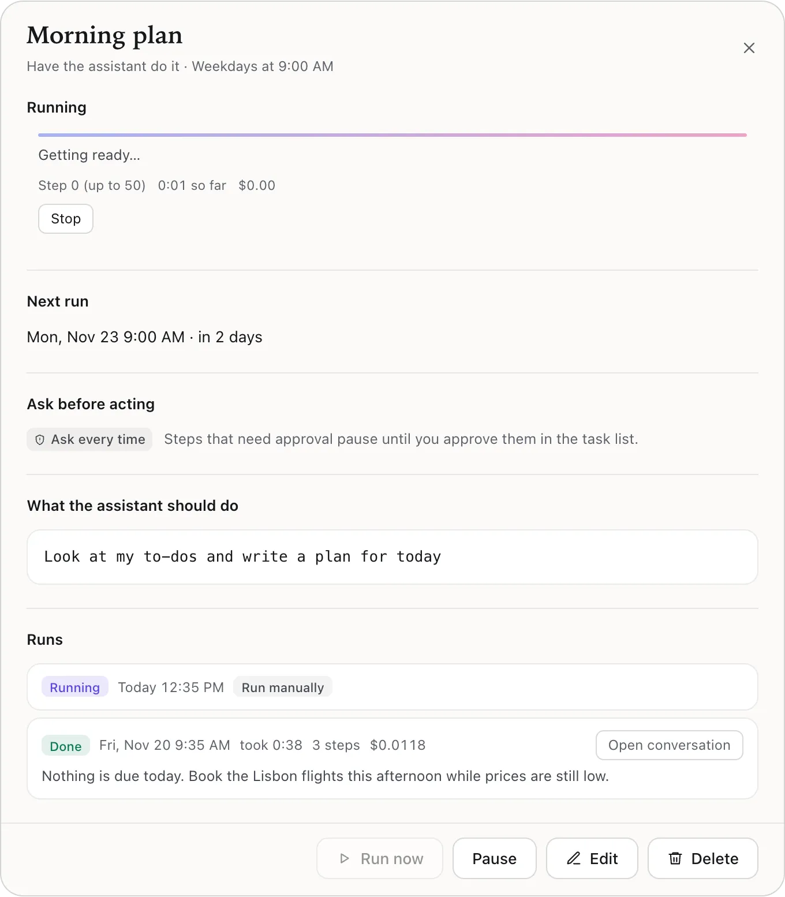

**English** | [简体中文](../zh-CN/scheduled-tasks.md)

[ZhiFox](../../README.md) › [Documentation](../../README.md#documentation) › Scheduled and recurring tasks

# Scheduled and recurring tasks

Tell the assistant "remind me to drink water every morning at 9" or "every weekday at 9, look at my to-dos and write a
plan for the day", or add a task by hand in the web UI. There are two kinds:

| Kind | What happens at the set time | Cost |
|---|---|---|
| **Reminder** | A reminder appears in the page with the task's title and text. No model is called | Free |
| **Agent** | The assistant carries out the task's instruction on its own, as if you had sent it as a message, calling the model and using its tools | Every run costs API credits, like a normal turn |

Schedules use your computer's local time: once at a date and time, every day, on chosen days of the week, on a day of
the month (the 31st means the last day in shorter months), or every N minutes (5 minutes to 7 days, counted from when the
task was created or last ran). Daylight saving is handled on the calendar: "every day at 9:00" stays at 9:00 on the wall
clock, a time skipped when the clocks spring forward runs right after the jump, and a time repeated when they fall back
runs only once. Before you save a task, the form shows the next three times it will run.

How agent tasks behave:

- **They run alongside you.** A task that comes due while you're chatting starts right away; you can keep chatting,
  switch models or open conversations while it runs, and several tasks can run at once. Each run has its own shell, so
  stopping one task ends only its command, and the Stop button in your conversation never touches a task. Up to three
  run at the same time; the rest wait in line, shown as **Queued**, and start as soon as one finishes. Changing the
  model or a task's settings affects only later runs.
- **They leave your conversation alone.** Each run starts with an empty history, uses the provider and model selected
  in Settings at the moment it starts, and is saved as a normal conversation named after the task and the time (for
  example "Daily plan · 2026-11-21 09:00"). It appears in the sidebar marked as coming from a task, and you can open
  it, replay it, search it and keep chatting in it.
- **Each task decides when to ask.** In the task editor, an agent task has the same four options as the chat's
  approval setting: **Ask every time** (the default), **Allow read-only commands**, **Allow file edits** and **Allow everything**, the last with a
  warning, since a task usually runs while nobody is watching. A row shows a small badge when its task is not Ask
  every time, and the task details show the setting. Anything that still needs approval pauses the run until you
  answer: the waiting approval is shown with the task, where you can allow or deny it, while you go on chatting.
  Steps that ran without asking are marked **Allowed automatically** in the run's progress and in its saved
  conversation. The chat's own setting doesn't apply to tasks, and tasks the assistant creates are always Ask every
  time (only you can change that).
- **Each task has its own sandbox level.** Below the approval options, **Command sandbox** chooses **Follow settings**
  (the default), **Off**, **Working folder only** or **Working folder + network** for that task's commands (see
  [Sandbox for commands](sandbox-and-hooks.md#sandbox-for-commands-what-a-command-can-reach)). If the level it ends up with can't work on
  this computer, the editor says the task's commands will be refused. A task set to Allow everything can't ask you to let
  a blocked command out of the sandbox, because nobody is there to answer. Tasks the assistant creates always follow
  Settings.
- **You can watch and stop them.** While a task runs you can see what it is doing (thinking, writing, which tool), how
  many model calls it has made, its cost so far and the tool calls so far. **Stop** works like the Stop button in a
  conversation and ends that run's command; a run still waiting in line is simply dropped. When several tasks are
  running, the pill at the top of the page counts them ("Scheduled tasks: 2 running, 1 waiting for you"); clicking it
  opens the task list at the first one that needs you.
- **Missed runs are caught up once.** If ZhiFox wasn't running at the scheduled time (or the computer was asleep), the
  task runs once the next time ZhiFox notices, however many times it was missed. The run is marked as a catch-up with
  the number of missed times, and the assistant is told when it should have run.
- **Every run is recorded.** Each task keeps its last 20 runs: start and end time, status, number of model calls,
  estimated cost, the beginning of the final answer, and the error if it failed. There is no spending cap.

  

**Tasks run only while the web UI (`uv run harness --web`) or the server mode (`uv run harness serve`) is running.**
The terminal UI doesn't run them; you can still ask the assistant there to add or delete tasks, and they run the next
time the web UI or the server mode is running. **Run now** runs a
task once without changing its schedule. When the assistant adds or deletes an agent task for you, it asks you first,
because that task will spend money later on its own; reminders don't ask.

## Scheduled tasks: running when nobody is watching

A task is a saved instruction plus a schedule ([harness/tasks.py](../../harness/tasks.py)). Running one reuses the same loop,
with three things handled differently ([harness/webui/scheduler.py](../../harness/webui/scheduler.py)):

1. **When.** A scheduler thread sleeps until the next task is due, at most 30 seconds at a time so that a changed clock
   or a computer waking from sleep is noticed soon, and is woken early whenever a task changes. The next time is worked
   out on the calendar in local time rather than by adding 24 hours, which is what keeps "every day at 9:00" at 9:00 on
   the wall clock across daylight saving. Each task's next time is saved in `data/tasks.json`; finding it in the past on
   the next start is how ZhiFox knows a run was missed.
2. **Side by side.** A run doesn't take any of your conversations' locks: you keep chatting, switching models and opening
   conversations while tasks run, and several tasks can run at once. That works because everything that can be
   *stopped* is per run (`App.unattended_agent`): its own shell, so stopping a run ends only that run's command, and
   the chat's Stop never reaches a task; its own MCP calls (each run's tool snapshot files its calls under that run,
   so Stop cancels only those); its own browser tabs (closed when the run ends); its own event log and approval card.
   What runs share is what lives on disk (to-dos, tasks, memory, conversations, files in the working folder), and
   each of those has a lock, so every change is made in one go and two runs can't overwrite each other's edit. At most `MAX_PARALLEL_TASKS` runs (3, in
   [config.py](../../harness/config.py)) go at once; more wait in line, marked "Queued", and start as soon as a slot frees
   up. The same task never runs twice at the same time.
3. **Nobody watching.** The run gets its own `Agent` with a new adapter and an empty history, and its own event log
   (a second `WebUI` whose events aren't pushed to the page), so it can't write into the conversation you're looking
   at. Its permissions are a copy set to *that task's* approval mode (`Permissions.unattended(mode)`), not the one you
   chose for the chat. When it reaches a step that needs approval, the loop waits in `confirm` exactly as it does in a
   conversation, and the waiting approval goes into the page state so you can answer it from the task.

Progress reaches the page in the same `state` event as everything else: at most four times a second while text streams
in, and immediately when a run starts, pauses for approval or ends. A stopped run still gives every tool call its
result (the same `finally` in `Agent._run_tools`), so its saved conversation can be continued like any other.
