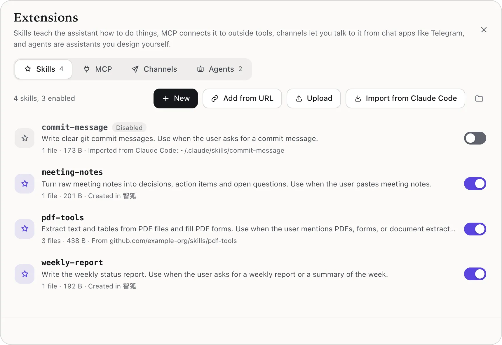

**English** | [简体中文](../zh-CN/web-ui.md)

[ZhiFox](../../README.md) › [Documentation](../../README.md#documentation) › Web UI

# Web UI

Everything on the page comes first. The sections after it explain how the page works: several conversations at once, the
event stream behind it, Markdown, the sources of web-search answers and the three interface languages.

```bash
uv run harness --web
```

This starts a small server on your computer and opens the chat page in your browser. The page has:

- **Sidebar (left).** All conversations, grouped by date. Click one to continue it. Hovering over a conversation shows
  three buttons: **Show in Finder** (**Show in folder** on Linux), which points straight at that conversation's file on
  your computer, **Rename** and **Delete**. Conversations save automatically at the end of every turn, with nothing to
  do by hand. The button at the top left hides the sidebar; clicking the bottom row opens the folder where conversations
  are saved.
- **Several conversations at once.** While a reply is being written or an approval card is waiting, you can click another
  conversation or **New chat** and keep working: the first one carries on in the background. Its row in the sidebar
  says what it's doing: **Running**, **Needs your approval** (the most visible, with a warm stripe on the left), **Failed**
  or **New reply** (it finished while you were elsewhere; the mark goes when you open it). Hovering over a running
  row shows **Stop this conversation** in front of **Show in Finder**; rename and delete wait until it's done. When a
  conversation in the background stops to ask you, a bar at the top of the page says so (click it to go there and
  answer), a short message appears, and with the page in the background you get a system notification, the same as for
  the conversation on screen. Open it and you see everything so far, with the reply still streaming in. Up to three
  conversations can run at the same time; with three going, sending a fourth message tells you to wait or stop one.
- **Search** (top of the sidebar, ⌘F or Ctrl+F; ⌘K and Ctrl+K work too, and pressing ⌘F again while you're in the
  search box hands over to the browser's own find-in-page). Searches all saved conversations, titles and content, without needing
  an exact match; Chinese can also be found by its pinyin (`baogao` or `bao gao` for 报告, `zbmb` for a title 周报模板).
  Separate keywords with spaces. Each result shows the passage that matched; open it (or press Enter to
  open the first) and the page scrolls straight to that spot.
- **Empty state.** Before there is any content, a greeting, the input box and a few clickable examples sit in the middle
  of the page.
- **Conversation.** Replies stream in as they're written and are shown as Markdown: headings, bold and italic, lists
  and task lists, quotes, tables (a wide table scrolls sideways inside its own frame) and code blocks with a language
  label, light syntax colors and a **Copy code** button. Links open in a new tab; images aren't loaded, you see their
  description and address instead. You can expand the model's thinking. Each tool call is a card you can open to see
  its parameters and result; a browser or computer use step also carries a small screenshot you can click to enlarge. Hovering over a reply shows a **Copy** button, which copies the reply's Markdown source.
  An answer written after a web search carries its sources: a small number after each cited sentence (hover it, or
  move to it with the keyboard, to see the site, the page title and the quoted text; click it to open the page in a new
  tab) and a **Sources** list under the answer. **Copy** then writes the numbers as `[1]` and adds the titles and
  addresses at the end (see [Sources of web-search answers](#sources-of-web-search-answers)).
  When you scroll up to read earlier content, new output doesn't pull you back to the bottom.
- **Approval card.** Appears when the assistant wants to write a file or run a command, with **Allow** and **Deny**
  buttons. When you deny, you can add a reason.
- **System notifications.** When you're in another window and ZhiFox stops to wait for your **Allow**, finishes a
  reply or runs into an error, a system notification pops up (the approval one says what it wants to do, the reply one
  shows how the reply starts). Clicking it brings the page back and scrolls to that approval card or reply, which lights
  up briefly. Nothing pops up while the page is in front of you, nor for what's replayed when you reload the page or
  open an old conversation; with ZhiFox open in two tabs, the one you're looking at keeps the other one quiet.
  The tab title gets a dot in front ("● Needs your approval ·" while it waits for you) and the tab icon a small dot
  (red for approvals and errors); installed as an app, its Dock or taskbar icon gets a dot too. All of it clears when
  you come back. Scheduled-task reminders and going over budget use the same notifications.
  **Turning it on:** the switch is on by default, but the browser has to allow notifications first. Open
  **Settings → System notifications**, click **Allow notifications** and choose **Allow** when the browser asks
  (browsers only ask after a click, so the page never pops the question by itself; **Turn on notifications** in the
  task list asks the same thing). If you clicked **Block**, the page can't ask again: in Chrome, Edge or Firefox, click
  the site icon at the left of the address bar and set **Notifications** to **Allow**; in Safari, use
  **Settings → Websites → Notifications**; then reload the page. The operating system has to allow the browser too:
  **System Settings → Notifications** on macOS, **Settings → System → Notifications** on Windows, your desktop's
  notification settings on Linux, and nothing shows while Focus or Do Not Disturb is on. Once allowed, **Send a test**
  shows one right away. The same switch turns them off (it's saved in this browser only); the tab markers need no
  permission and don't depend on it.
- **Edit and regenerate.** Hover over your last message for **Edit** (or press ↑ in the empty input box): the message
  turns into an editor in place, with its attachments, which you can remove one by one. Enter sends the edited message
  as a new turn; Esc or **Cancel** warns once before throwing away your changes. Under the last reply, **Regenerate**
  asks the model again with exactly the same message; when a turn ended without a reply (an error, or you stopped it),
  **Regenerate** sits below it on its own. If that turn did something that may have changed your computer (ran a
  command, edited a file, called an MCP tool, operated the whole computer, clicked or typed in the browser), ZhiFox
  first lists those steps and asks once: only the conversation goes back, what was done stays done. Only the last turn can be edited or regenerated
  (why: [Editing the last message and regenerating](conversations.md#editing-the-last-message-and-regenerating)). When that turn changed
  files, the same card offers to undo them too.
- **Fork.** To go another way from an earlier turn, use **Fork** on it: next to **Copy** under a reply (keeps that turn),
  or beside your message on hover (stops before it and puts the message back in the input box). The original stays as
  it was; the new conversation opens at once, with a line at the top that leads back (see
  [Forking a conversation from a turn](conversations.md#forking-a-conversation-from-a-turn)).
- **Run trace.** The row of buttons under the last reply shows how long the turn took and what it cost; click it for a
  waterfall chart of the turn: how many model calls, which tools, when each step started and ended, how long it waited
  for your approval, tokens and cost (see [Reading a turn: the run trace](architecture.md#reading-a-turn-the-run-trace)).
- **Changed files.** A turn in which the file tool changed files ends with **Changed N files**. **Undo** on that line
  undoes the whole turn; expand it to see each file, click a name for a line-by-line preview, and undo or redo single
  files. If a file changed since, the line explains why in place and waits for **Undo anyway**. Files changed by shell
  commands can't be undone automatically (see [Undoing a turn's file changes](conversations.md#undoing-a-turns-file-changes)).
- **Input box.** Enter sends; Shift+Enter starts a new line. While the assistant works, the send button becomes
  **Stop**, which interrupts the reply and ends any command that is running. The estimated cost of this run is always
  shown below the input.
- **Attachments.** Click the paper clip left of the input, drop files anywhere on the page, or paste a screenshot
  straight into the input (⌘V / Ctrl+V). Before you send, attachments sit above the input as small cards you can
  remove; a message can carry up to 10, and you can send attachments without any text. The providers' APIs take only
  a few image types, PDFs and text, so everything else is converted first:

  | File | What is sent | Claude | GPT | Gemini | DeepSeek |
  |---|---|:-:|:-:|:-:|:-:|
  | PNG, JPEG, WebP | The image. A long edge over 2,576 px is scaled down in the browser; up to about 7 MB | ✅ | ✅ | ✅ | ❌ |
  | GIF, BMP, AVIF, HEIC, TIFF | Redrawn as PNG or JPEG in the browser (a GIF becomes its first frame). HEIC and TIFF only where the browser can open them, such as Safari | ✅ | ✅ | ✅ | ❌ |
  | SVG | Drawn as a PNG. With a model that can't see images, its source is sent as text | ✅ | ✅ | ✅ | ✅ as text |
  | PDF (up to 25 MB, no password) | The PDF itself: the model reads the text and what's drawn on the pages | ✅ | ✅ | ❌ | ❌ |
  | Word, Excel, PowerPoint (.docx, .xlsx, .pptx; up to 25 MB) | The text, taken out by ZhiFox: Word keeps headings, lists and tables; Excel gives every sheet as tab-separated rows with dates restored; PowerPoint gives every slide in order with its speaker notes. Pictures and layout are dropped, and the model is told so | ✅ | ✅ | ✅ | ✅ |
  | Text and code (up to 400,000 characters) | The text. UTF-8, UTF-16 and GBK are recognized; a file with an unknown extension is taken if its content is text | ✅ | ✅ | ✅ | ✅ |

  Anything else (archives, audio and video, old Office formats such as .doc, Pages, WPS, password-protected files) is
  turned away when you add it, with a note on how to convert it. If the current model can't take an attachment, ZhiFox
  says so right away and names models that can. The GPT and Gemini columns follow their official documentation and are
  tested against local fake servers, not real keys. Attachments are saved with the conversation, so their thumbnails
  come back when you reopen it. Click any attachment in a message to open it in the viewer described under **Media**.
- **Media** (the third tab in the sidebar, after Conversations and Tasks). Every screenshot, image, PDF,
  Word / Excel / PowerPoint and text file you have sent in any conversation, newest first and grouped by day: images as
  a grid of square thumbnails, files as rows with their type, size and conversation. Filter by type (the chips show how
  many of each), search file names and conversation titles, and keep scrolling to load more. A new attachment shows up
  as soon as you send it. Hovering an item shows **Show in Finder**, **Go to message** and **Download**.
  Clicking it opens the viewer, the same one message thumbnails open: zoom with the buttons, ⌘/Ctrl + / − / 0, a
  trackpad pinch or ⌘/Ctrl + scroll; drag (or scroll) to pan once zoomed in; double-click switches between fit to screen
  and actual size; ← / → step through the current filter (or through the attachments of that message), and on a phone
  you can swipe. From the viewer you can copy an image, download the original, show it in Finder, or **go to the
  message** that carried it: ZhiFox opens that conversation (not while a turn is running) and scrolls to the attachment,
  which lights up briefly. Text and code open in a monospace view you can copy from. PDFs and Office files get a card
  with a download button: the page's security policy blocks embedded PDFs, so they open in your own viewer.
  The originals are kept in `data/media/`, so Word, Excel and PowerPoint files are kept too, not just the text taken from
  them. Attachments sent before the media library existed are recovered from the conversation's history (images, PDFs and
  text); for old Office files only the extracted text is left, and the library says so. A single attachment can't be
  deleted, because it is part of the conversation's record; deleting the conversation deletes its originals unless
  another conversation uses the same file.
- **Switch model** (the button in the middle of the top bar that shows the current model, such as
  "Claude (Anthropic) · claude-opus-5-5", or ⌘. / Ctrl+.). A small panel opens right under the button; on a phone it
  rises from the bottom of the screen. Models are grouped by provider (Claude, GPT, Gemini, DeepSeek), and each group
  says whether its API key is set (showing only the last 4 characters). A provider without a key shows **Add API key →**,
  which opens Settings at that provider's key field. Each model shows its name, what it can do, its price, and a check
  mark on the one in use. What it can do is worked out by the program: **Web search** (Claude only, and only while web
  search is on), **Reads images**, **Reads PDFs**, **Text only** (DeepSeek) and **Peak and off-peak prices** (DeepSeek).
  Prices are US dollars per million tokens, input / output (hover a price for the off-peak one), or **No price**. Each
  provider has a button that syncs its model list; once there are many models a search box stays at the top, and typing
  anywhere in the list filters it. A model of the same provider is switched to at once and the conversation goes on, with
  the result shown inside the panel. Another provider starts a new conversation, and if the current one already has
  content, the panel first asks in place: "Switching to GPT starts a new conversation. This one is saved, and you can
  come back to it any time." A conversation started with a custom agent keeps its persona when you switch, and the panel
  says so. Keyboard: ↑ / ↓ (and Home / End) move, Enter picks, typing filters, Esc closes the panel and puts the focus
  back on the button (while the in-place question is showing, Esc dismisses just the question first), and Tab stays
  inside the panel. The shortcut isn't ⌘⇧M / Ctrl+Shift+M because Chrome uses that for its profile menu and Firefox for
  its responsive design mode.
- **Settings** (the gear at the top right, or ⌘, / Ctrl+,). Add or delete each provider's API key, sync each provider's
  model list, enter model prices, and **edit the system prompt** (the text that tells the assistant who it is and how to
  work). The prompt editor has a preview of exactly what the model receives and a list of placeholders such as `{name}`
  and `{workspace}` that are filled in before sending; other braces are left alone. Your version is saved as `data/prompt.md` (you can edit that file directly too) and applies from the next new
  conversation, because changing the prompt in the middle of one would break Claude's cache and its earlier reasoning;
  a conversation that hasn't started yet switches right away. **Restore default** goes back to the built-in prompt, which
  is also the way to pick up a newer built-in version after an upgrade. Models aren't chosen here: the **Current model**
  section only shows the one in use, with a **Switch model** button that opens the model switcher. Why they're apart:
  switching models is something you do in passing while chatting, entering keys or editing the prompt is something you
  do now and then, and with one entrance for both you had to search a long page of settings just to change models. More
  sections at the bottom:
  - **Monthly budget** (US dollars, optional). When this month's spending passes it, ZhiFox reminds you once (a
    message on the page, and a system notification if the page is in the background and you allowed notifications).
    It never blocks anything. Raise the budget and pass the new amount, and you're reminded again; the reminder is
    remembered across restarts, so it doesn't repeat. If you set a budget below what you've already spent this month,
    the panel says so right away.
  - **System notifications**: whether to notify you while the page is in the background, whether the browser allows
    it, and how to allow it (see **System notifications** above).
  - **Browser** (off by default): let the assistant use ZhiFox's own browser, hide its window, choose which Chrome,
    and the profile folder. See [Browser use](browser-and-computer-use.md#browser-use).
  - **Computer use** (advanced, off by default): let the assistant operate the whole computer, after a risk
    confirmation; whether the permissions or programs it needs are there; scheduled tasks and channels; blocked apps.
    See [Computer use](browser-and-computer-use.md#computer-use).
  - **Export all data** downloads the whole data folder as one zip. It shows the folder's size first and the zip's size
    afterwards. **Restore from backup…** next to it takes such a zip back: a preview first, then overwrite or merge, with
    an automatic backup of the current data and your current secrets kept. See [Backup and restore](data-and-privacy.md#backup-and-restore).
- **Info panel** (opened and closed by the right-most button at the top right). Estimated cost, the split across the four
  kinds of tokens (uncached input, cache hits, cache writes, output), open to-dos, and **What 智狐 can do** (see
  [What ZhiFox can do](#what-zhifox-can-do-the-capability-list) below). It updates after every model call. Under this run's estimate, the cost card shows what you've spent **today** and
  **this month** (from the spending record, so restarts don't reset it), how much of your monthly budget is left, and a
  red note once you're over it (the cost next to the input box gets a red dot too). **Spending** opens a window with
  the last 30 days as a bar chart (hover a bar, click it, or use the arrow keys and Home / End to read a day), a total
  for every month, and a breakdown by model and by source (chat or scheduled task) for this month, the last 30 days or
  all time. Calls to models without a price are listed separately with their tokens. Click a to-do's circle to complete
  it; hover over it for the same three buttons as every other row (**Show in Finder** for the to-do file, **edit** its
  text and due date in place, **delete** after an in-place confirm). Scheduled task rows and the prompt editor have a
  **Show in Finder** button for their files too.
- **Memory** (fixed at the top of the sidebar, with a count; it opens a two-pane window: the list on the left, searchable
  by name, and the selected memory on the right; on a narrow screen it shows one side at a time). Every file the
  assistant keeps in its long-term memory (`data/memories/`), with its
  folder, size and when it last changed. Click one to read it. Hover over a row (or move to it with Tab) for the same
  three buttons as a conversation row: **Show in Finder** selects that file in your file manager, the **pencil** opens
  it for editing (change its name and its text, ⌘Enter / Ctrl+Enter saves, Esc stops editing and warns you first if
  there are unsaved changes), and the **trash can** deletes it after you confirm in place. Editing and deleting wait
  until the current turn ends, since the assistant may be changing that memory. If the file changed while you were
  editing it, saving asks before overwriting. Files that are too long to load in full, or aren't UTF-8 text, can only be
  edited in the folder. **Open the memory folder in Finder** (**Open the memory folder** on Linux) at the bottom opens
  the whole folder. The list keeps
  itself up to date: a memory the assistant writes appears while the turn is still running, and changes you make in
  Finder appear as soon as you switch back to the page. Deleting waits until the assistant has finished its turn,
  because it may be in the middle of editing that very memory.

<p align="center">
  
</p>

- **Extensions → Skill** (the puzzle-piece button at the top right). Your installed skills, each with its description,
  number of files and where it came from. Each row has a switch to enable or disable the skill, and on hover (or Tab) the
  same three buttons as a conversation row: **Show in Finder** (that skill's folder), the **pencil** (edit `SKILL.md`;
  the frontmatter is checked when you save, a changed `name` renames the folder too, and unsaved changes are guarded the
  same way as memory edits) and the **trash can** (delete, after confirming in place). Click a row to open it: the
  description and details, any problems that keep it from being used, and every file in the folder, each viewable as
  plain text. Above the list:
  - **New** writes a skill from a form (name, description, instructions) and checks the name as you type.
  - **Add from URL** takes a GitHub folder or repository link, a link to a `SKILL.md`, or a link to a `.zip` / `.skill`
    file. When a repository holds several skills, you pick which ones to install.
  - **Upload** takes a `.zip` or `.skill` file, a single `SKILL.md`, or a whole folder; you can also drag them onto the
    page.
  - **Import from other tools** lists the skills found in Claude Code, Codex, Cursor, Gemini CLI, GitHub Copilot, the
    shared `.agents/skills` and the [other supported tools](extensions.md#importing-from-other-tools); tick the ones to copy.
  Everything is shown to you before it's installed, with a reminder that the assistant follows a skill's instructions,
  so you should install only from sources you trust. Changes take effect from your next message. Like memory edits,
  changing, deleting or installing a skill waits until the current turn ends.
- **Extensions → Agent** (the puzzle-piece button at the top right). Your custom agents, each with its color, name,
  description, model and number of tools. On hover (or Tab) a row shows **Start a new conversation with it** followed by
  the same three buttons as a conversation row: **Show in Finder** (its `.md` file), **Edit** and **Delete** (confirmed
  in place). Click a row to see its model, tools and instructions. The editor has two modes, **Form** and **Source**
  (the whole file), and switching between them goes through ZhiFox, which writes the form into the file and reads the
  file back into the form, so the rules live in one place. Unsaved changes are guarded like memory edits. Above the
  list: **New**, **Examples** (the researcher, the code reviewer and the writing assistant) and **Import from other
  tools**. When there are no agents yet, the page explains the two ways to use one and shows the examples. Editing an
  agent doesn't have to wait for the current turn: a running conversation or subagent keeps the version it started with
  (see [Custom agents](extensions.md#custom-agents-subagents-and-personas)).
- **Start with an agent.** The arrow next to **New conversation** opens a menu of your agents (arrow keys, Enter and Esc
  work); pick one to start a conversation with it as the persona. The top bar shows its name (click it to open the
  agent), and the conversation's row in the sidebar carries a small badge. When the main assistant hands a task to a
  subagent, the conversation shows a card **Handed to *name*: …** with what the subagent is doing right now (thinking,
  writing, calling a tool, waiting for you), each tool call it made, its answer rendered as Markdown, and its model,
  number of calls and cost.
- **Extensions → MCP** (the puzzle-piece button at the top right). The MCP servers ZhiFox connects to, each with its
  status (connecting, connected, failed with the reason and the last line the server printed, or disabled), its
  number of tools and an on/off switch. Hovering over a row (or moving to it with Tab) shows **Restart** and the same
  three buttons as a conversation row: **Show in Finder** (`data/mcp.json`), **Edit** and **Delete** (confirmed in
  place). Click a server to see how it's connected, which protocol generation it speaks, every tool with its
  description and a **don't ask** switch, and its log. **Add server** opens a form: a local program (command, one
  argument per line, working folder, environment variables) or a URL (with headers such as `Authorization`).
  Secret values are typed into password fields, and afterwards the page shows only their last 4 characters; leave one
  blank when editing to keep it. **Paste JSON** takes a configuration copied from Claude Desktop, Claude Code, Cursor
  or VS Code, and **Import from other tools** lists the servers configured in Claude Desktop, Claude Code, Cursor,
  VS Code, Codex, Gemini CLI, Goose and the [other supported tools](extensions.md#importing-from-other-tools) (read only when you open
  that page) so you can tick the ones to copy; what had to be rewritten is written on each one. Changes apply from the next conversation (see
  [MCP](extensions.md#mcp-tools-written-by-someone-else)).
- **Extensions → Hooks.** Your [hooks](sandbox-and-hooks.md#hooks-your-own-scripts-at-fixed-moments), with a clear warning at the top that
  they run commands on this computer with your account's permissions. Each row shows the event, which tools it matches,
  the command (anything that looks like a token hidden) and its last run (result and duration; kept since ZhiFox started),
  with an on/off switch and **Test run** before the usual **Show in Finder** (`data/hooks.json`), **Edit** and
  **Delete** (confirmed in place). **Add hook** opens a form: name, event, the tools to match (capability chips plus
  names or `*` globs), the program and one argument per line, time limit, what to do when the hook itself fails, and
  where it runs (conversations, scheduled tasks, chat channels); unsaved changes ask before you leave. **Test run**
  shows the sample JSON the hook will get (you can edit it), runs it for real, and tells you the exit code, the output
  and what ZhiFox would do ("would block this call; the model sees…").
- **Appearance and motion** (the sun/moon button at the top right). A small panel with two rows:
  - **Appearance:** Light by default. You can switch to Dark, or to Match system.
  - **Motion:** follows your system setting by default (on macOS, System Settings → Accessibility → Display → Reduce
    motion; on Windows, Settings → Accessibility → Visual effects → Animation effects). You can also choose **Reduced**
    (no sliding, fading or pulsing; content simply appears) or **Full** (every animation plays, even if your system asks
    for reduced motion).

  Click outside the panel, press Esc or click the button again to close it.
- **Language** (the globe button at the top right): 中文, English, Español, in a small panel under the button, the same
  kind as the appearance panel and the model switcher (on a phone it rises from the bottom). Each language is written
  large in its own words, so everyone recognizes theirs, with its name in the current interface language underneath
  (in the Chinese interface, English reads "英语"); the one in use says **Current language** and carries a thin check
  mark. A note that is always fully visible says that this changes the interface text, and that the assistant replies in
  whatever language you write to it in. ↑ / ↓ move, Enter picks, Esc closes. Switching doesn't reload the page: the
  conversation in progress, your scroll position and a half-written message all stay as they were, and the interface
  text changes in place. The choice is saved, and the terminal UI uses it too.

Appearance, motion, whether the two side panels are open, and the system notifications switch are remembered by your
browser, not stored in `data/`.

**Switching models.** Within the same provider, the conversation continues. Switching to another provider starts a new
conversation, because providers' conversation formats aren't compatible; the one you leave is saved, and you can open
it from the sidebar to carry on. The model you choose is saved, and the next launch (terminal included) uses it again.
A conversation started with an agent keeps its persona whichever model you switch to. The switcher can be opened while
the assistant is replying, so you can look, but picking a model then is turned down with a note to wait for the turn to
end or press Stop (the panel says so); and while a chat channel is
running a turn in this conversation, even a switch within the same provider is refused, because the new model has to be
saved into the same conversation file the channel is writing (see [harness/claims.py](../../harness/claims.py)). What a switch
would do (continue, start fresh, or ask first) is worked out by the program in
[harness/model_catalog.py](../../harness/model_catalog.py), by the same rule `App.select_model` follows when it actually
switches; the page only draws the answer.

**Backup models.** **Settings → Backup models** lists, in order, the models of the current provider to use for the rest
of a turn when your model is temporarily unavailable (overloaded, server error, rate-limited). Pick one from the menu to
add it, use the arrow to move it up, × to remove it; each change is saved at once. Empty means off, which is the default.
See [When a model is temporarily unavailable](models.md#when-a-model-is-temporarily-unavailable-backup-models).

**Lifecycle.** Refreshing the page doesn't lose the current conversation. Closing the page leaves the program running;
press Ctrl-C in the terminal to quit. If the assistant is in the middle of a reply, ZhiFox stops it and saves the turn
first (waiting at most 5 seconds), then exits. Only one web UI can run per data directory: if one is already running,
starting another tells you to use the one that's open.

After a restart you start in a new conversation; earlier ones are in the sidebar. Opening an old conversation switches
back to the provider and model it used, and from then on that model is your chosen model: new conversations and the next
launch use it until you switch models again. While the assistant is replying, you can't open, rename or delete
conversations; wait for the turn to finish or click **Stop**. Conversation titles keep at most 40 characters.

**Options.** `--port 9000` sets the port. Without it, ZhiFox uses 8765, or lets the system pick a free port if 8765 is
taken; a port you name explicitly must be free. `--no-browser` skips opening the browser.

The address shown in the terminal contains a `token`, a password for this run that changes on every launch. Don't send
the address to anyone, and don't post screenshots that show the address bar: whoever has it can use the page to make the
assistant run commands on your computer. The server only accepts connections from your own machine.

**Bookmark it, or keep it in the Dock.** The page comes with its own icon and a web app manifest, so the tab, a bookmark
and a shortcut all show the fox. In Chrome, open **⋮ → Cast, save, and share → Create shortcut…** and tick **Open as
window** (or pick the install item in the same menu): ZhiFox then opens in a window of its own and sits in the Dock
(macOS) or the taskbar like any other app. On macOS Sonoma and later the Dock shows the fox on a rounded cream tile.
A bookmark or a shortcut remembers the whole address, token and port included, so make it from the background service
(see [Run it in the background](background-and-servers.md#run-it-in-the-background)), whose token stays the same across restarts. A
`harness --web` started in a terminal gets a new token every time, and an old shortcut then opens to "This link is
invalid or has expired"; make a new one, or switch to the service.

## What ZhiFox can do: the capability list

The info panel doesn't list the model's tools by their internal names (`todo_add`, `str_replace_based_edit_tool`,
`mcp__files__echo`…). It lists **capabilities**: To-dos, Scheduled tasks, Memory, Read and edit files, Run commands,
Web search & reading, Skills, Delegate to agents, Browser, Computer use, one row per MCP server, and Send files to the
chat. Each row says:

- **whether this conversation can use it**: *in use*, *next chat* (turned on in Settings after the conversation
  started: a conversation's tools are fixed when it starts, so it takes effect in the next one), *off* (with the reason
  and a button that opens the right place: the Browser or Computer use section of Settings, the Skills / MCP / Agents
  tab of Extensions, or **Start a new conversation**), or *unavailable here* (only Claude can search the web, and the
  other models show *Read web pages* in that row instead; a model
  that can't see images, like DeepSeek, can't use computer use; this computer has no desktop to control; the persona of
  this conversation doesn't allow it; sending files only exists in chat channels; when another model would do, a
  **Switch model** button opens the model switcher). Unavailable rows are folded away at the bottom.
- **whether it asks you first, in the current approval mode**: a small label (*Direct*, *Asks some*, *Asks first*,
  *Asks always*) and, when you open the row, a sentence such as "Reads files in the working folder without asking;
  asks you before editing files" with a line per kind of action. Change the mode from the bar at the top of the list
  and the labels change with it. Computer use, for example, has three lines (clicking, typing and keys; screenshots;
  dangerous key combinations): its label is *Asks first* in Ask every time, and *Asks some* under Allow everything or
  once you've stopped being asked in the conversation, because dangerous key combinations still ask.
- **where it runs**: on this computer, on Anthropic's servers (web search), or in a third-party MCP server (reading a
  web page with `web_fetch` runs on this computer, connecting straight to the site). With the
  [sandbox](sandbox-and-hooks.md#sandbox-for-commands-what-a-command-can-reach) on, **Run commands** also says which level its commands run
  in, or, in red, that the sandbox can't be used on this computer and commands will be refused, with a **Sandbox**
  button that opens Settings there.
- **Technical details**, folded: the tool names the model actually receives (for Claude, a toolset counts as one,
  such as `browser_toolset_20260801`).

Status is never shown by color alone: every label has an icon and words, and the icon tile changes shape (filled, dashed,
faded). The terminal's `/tools` prints the same list.

Why it is built this way ([harness/capabilities.py](../../harness/capabilities.py) and the `capabilities_*.py` files next to it): it is the only place that maps tools to
capabilities, and the page only draws what it is sent. "Does it ask first?" is not a second copy of the rules: the
catalog takes a few representative actions ("edit a file in the working folder", "`ls`", "type into a password field")
and asks [permissions.py](../../harness/permissions.py) about each one, the same way the loop does before running a tool, so
when a rule changes the list follows by itself. A tool it doesn't recognise still gets a row under its own name rather
than disappearing.

## Several conversations at once

In the web UI you can leave a conversation working and go on in another one. Each conversation that is "alive" is a
**session** ([harness/webui/sessions.py](../../harness/webui/sessions.py)): its own `Agent` with its own adapter and history,
its own shell, browser tabs and computer use session, its own MCP call owner, its own event log (a `WebUI`) and its own
lock. `App.chat` is the one you're looking at; `App.agent`, `App.conversation` and the rest belong to it, so code that
only reads "the current conversation" didn't have to change. A turn that keeps running in the background only ever
uses its own session's things ([harness/webui/chat_api.py](../../harness/webui/chat_api.py)).

- **Switching.** If the conversation you're looking at is in the middle of a turn when you open another one, start a
  new one or fork, it stays in the list and keeps running; you get a fresh session. If it isn't running, it's simply
  reused, exactly as before. Opening a conversation that is running in the background switches to its session: the page
  gets a `reset`, the session's whole log is replayed (a half-written reply, an approval card still waiting) and live
  events continue from there, so streaming picks up where it is. A session that finishes in the background and is saved
  is dropped from memory; the sidebar keeps a "new reply" or "failed" mark until you open it.
- **Locks.** There is no longer one "conversation lock". Each session has its own: sending, regenerating, undoing a
  turn's files, switching models or renaming take *that* session's lock, so the same conversation never runs two turns
  at once, while other conversations stay free. Changing the set of live sessions (open, new, fork, delete) goes one at
  a time. Global changes that a running turn might be using (editing a memory or a skill, restoring a backup) need
  *every* session to be idle; the refusal names the ones still running. The lock order is written at the top of
  `sessions.py`.
- **What stays separate, what is shared.** Approval cards have globally unique numbers, so an answer only reaches the
  session waiting for it. "Don't ask again in this conversation" for screenshots or clicks, the sites you allowed in the
  browser, Stop, the record of a turn's file edits and the run trace are per session. The approval mode you pick at the
  bottom of the chat is one setting for all of them, and the screen is one: when two conversations want to operate the
  computer, the second is told the screen is in use, as with scheduled tasks. A conversation running in the background
  also holds its claim, so a chat channel can't write into it at the same time.
- **Limits.** At most `MAX_PARALLEL_CHATS` conversations (3, in [config.py](../../harness/config.py)) run turns at the same
  time; past that, sending (or regenerating) is refused with the reason, and the page doesn't send. Scheduled tasks and
  chat channels don't count toward it: they have their own rules. Unlike a scheduled task, a background conversation is
  one you started and can watch: it uses your chat's approval mode, its approvals wait for you, and switching to it
  shows everything as it happens.
- **One stream.** The page reads one event stream, always the conversation you're looking at; every open tab sees the
  same one. Event numbers come from one counter shared by all sessions, and each session remembers from which number it
  has been the one on screen, so a reconnecting tab that reports a number from another conversation gets the whole log
  again instead of half of it. On quit, every session is stopped, waited for and saved.

## One loop, two interfaces

The terminal UI and the web UI also drive the same loop. The loop only needs the interface to provide these methods:

| Method | When it's called |
|---|---|
| `thinking` / `text` | Each time the model produces a piece of thinking or of its answer |
| `tool_call` / `tool_result` | A tool starts / finishes |
| `confirm` | Your approval is needed; the loop waits here for the answer |
| `info` / `notice` | There is a message for you |

The terminal UI ([harness/ui.py](../../harness/ui.py)) turns these calls straight into text on screen, and also hands each
one to the same event log the web UI keeps, so its conversations can be saved and opened in the page (see
[How conversations are saved and restored](conversations.md#how-conversations-are-saved-and-restored)). The web UI takes one more step,
because the loop and the browser are not in the same program:

```
agent loop ──calls──► WebUI ──events──► local server ──pushes──► page in the browser
                   (webui/ui.py)     (webui/server.py)          (webui/page/)
```

`WebUI` records each call as an event in a log, the server pushes the events to the browser as a Server-Sent Events
(SSE) stream, and the page draws each one. When you click Allow or Stop, the browser sends a request to the server, which
passes it on to `WebUI`. The page keeps no copy of the conversation; after a refresh the server resends the log and the
page redraws from it.

The page is one self-contained HTML document: its security policy only runs inline `<script>` and `<style>` blocks that
carry a one-time nonce, and it loads nothing from outside. That doesn't mean it has to be written as one file. Its
source lives in [harness/webui/page/](../../harness/webui/page/), one concern per file: `index.html` is the skeleton (the
markup plus a few placeholder lines), `styles/` holds the CSS split by part of the interface (`tokens.css`, `chat.css`,
`memory.css`, `skills.css`…), and `scripts/` holds the page script split by section (`i18n.js`, `motion.js`,
`memory.js`, `tasks.js`, `browser.js`…). A section that grew past a few hundred lines is split along its own
subsections into files sharing a prefix: `skills.js` holds the Skills tab's overview, shared state and helpers, then
come `skills-list.js`, `skills-detail.js`, `skills-add.js` and `skills-review.js` (likewise `agents-*`, `mcp-*`,
`channels-*` and `tasks-*`). A manifest in [page/\_\_init\_\_.py](../../harness/webui/page/__init__.py) lists the
parts in order, and the server joins them into the same single page once at startup (the demo re-assembles it on
every refresh). Order matters: in CSS a later rule beats an equally specific earlier one, so `reduce-motion.css` comes
last; and all the script parts are placed inside one function and share one scope, so the helpers everyone uses
(`t()`, `el()`, `play()`, `calm()`) come first. Adding a part means adding a file and a line to the manifest; a test
fails if a file is missing from it or listed twice.

The assembled page is a little over a megabyte. When the browser says it accepts gzip, the server compresses it to about
a third (`PAGE_GZIP_LEVEL` in [config.py](../../harness/config.py), around a dozen milliseconds per load), which matters when you
open ZhiFox from a phone or another computer through a tunnel. The page holds the web token, and compression attacks
such as BREACH guess secrets from how the compressed size changes when attacker-chosen text is reflected into the same
response. This page reflects nothing from the request (only the nonce, the token, the translations and the Markdown
renderer are filled in), so they don't apply; the comment in `_send_page` says to revisit this if that ever changes.

The app icon is the one thing the browser fetches on its own, outside the page's script: when it decides whether the
page can be installed and when it makes a shortcut, it reads a web app manifest and downloads the icons listed there.
So these are real addresses, `/manifest.webmanifest` and `/icons/<name>`
([harness/webui/manifest.py](../../harness/webui/manifest.py)). Both carry the token and go through the same Host and Origin
checks as the page. An icon name is looked up in a fixed list of six PNGs that ship with ZhiFox, never joined onto a
path, so no request reaches any other file. The security policy lets in exactly those addresses: `manifest-src` names
the manifest's own URL, and `img-src` names each of the six icons next to `data:`. A source with a path matches only
that path (the token after `?` doesn't count), which is narrower than `'self'`. The icons have to be there because Chrome
checks manifest icons against the page's `img-src` too: without them it reports that no suitable icon was found and
won't install the page. The manifest's `start_url` carries the token, so a shortcut opens straight into the page, while
its `id` is a plain `/`, so the browser still sees the same app when the token changes. The PNGs are drawn once from
[docs/assets/logo.svg](../assets/logo.svg) by headless Chrome (`uv run python tests/make_icons.py`; add
`--preview <folder>` for a contact sheet) and committed: transparent ones for tabs, bookmarks and taskbars, and a
maskable one on a cream tile with the fox inside the central safe circle, which Chrome uses for the Dock on macOS Sonoma
and later. The window's title bar takes `<meta name="theme-color">`, which follows the appearance you chose in the page,
not the system.

Only content that is happening right now animates. New messages fade in, but content replayed after a refresh or when
opening an old conversation appears directly, rather than playing hundreds of entrance animations one by one. How does
the page tell the two apart? After resending the existing events, the server sends one extra marker named `synced`, and
everything after it is live. When you open an old conversation, everything from the "clear the page" event (`reset`) to
the next "state" event counts as replay.

Everything that moves on the page changes only two properties: position and scale (`transform`) and transparency
(`opacity`). The browser can hand these to its compositor thread without redoing layout, so animations stay smooth even
while the script is busy handling the model's streaming text.

When motion should be reduced (your system asks for reduced motion, or you chose Reduced in the appearance panel), all
animations are off and content simply appears. The page doesn't query the system setting directly. Before the page is
first painted, it combines the system setting with your choice once and writes the result to `<html data-motion>`; the
styles and scripts look only there. That is what lets your Full choice override the system setting, and it keeps a
refresh from starting an animation and then cutting it off. Light and dark themes work the same way
(`<html data-theme>`).

## Markdown in replies

Models like to answer in Markdown, and code, lists and tables are much easier to read once they're drawn. The page
can't load a Markdown library (it loads nothing from outside, and has to work offline), and a full one is thousands
of lines, so ZhiFox has a small renderer of its own: [harness/webui/markdown.js](../../harness/webui/markdown.js). It covers
what chat replies use: most of CommonMark, plus GitHub's tables, task lists and strikethrough. The server pastes the
file into the page under the same one-time `nonce` as the page's own script, so the security policy stays as strict
as before.

**Safety.** The renderer never builds or parses HTML. It first turns the text into plain objects (a syntax tree),
then creates every element itself with `createElement` and `createTextNode`, so `<script>` or `onerror=` in a reply is
only ever text. Links are made only for `http`, `https` and `mailto` and always open in a new tab with
`rel="noopener noreferrer"`; any other address (`javascript:`, `data:`, `file:`, a relative path) is shown as text.
Images are never loaded: you get their description and address, as a link when the address is safe.

**Two changes for Chinese.** A single line break inside a paragraph stays a line break (CommonMark turns it into a
space; older replies were plain text and relied on line breaks, and Chinese sentences shouldn't gain spaces). And
when deciding whether `**` opens or closes bold, CJK characters count as punctuation, otherwise the very common
`**注意：**这一点` would never turn bold.

**Streaming.** A reply arrives a few characters at a time, and re-parsing the whole reply for every piece would get
slower as it grows. So the page draws at most once per frame, and the renderer splits the text in two. Blocks that
are *settled* (a new block has started after them, on a complete line) are drawn once and never touched again; the
next parse starts after them. Only the last block or two are re-parsed, and compared with what is already drawn, so
only what changed is rebuilt: the next characters of an open code block are appended to its text, and a long list or
table that is still growing re-parses only its last item or row. A half-written marker on the last line (`-`, `1.`,
```` ``` ````, a link whose address is still arriving, a line that may be a table header) is held back until it is
clear what it will become, so raw syntax doesn't flash on screen. Replayed content (a refresh, an old conversation) is
drawn once, in its final form, with no animation.

Search still works: results come from the Markdown source, and when the hit includes syntax that isn't visible
(`**`, `` ` ``), the page drops those marks before looking for it on the page. A hit that only exists in the source
(such as a link's address) scrolls to the reply. The terminal shows the Markdown source as is.

## Sources of web-search answers

When Claude answers from a web search, the API cuts the answer into consecutive `text` blocks at every citation, and
each cited block carries a `citations` list: the page's address, its title, the quoted text (up to 150 characters) and
an `encrypted_index` that must be sent back unchanged. While streaming, each citation is a `citations_delta`; the SDK
collects them on the block, so ZhiFox reads them when the block ends
([harness/providers/claude.py](../../harness/providers/claude.py)). Anthropic asks that answers shown to people keep their
sources, so they are no longer dropped:

- **Two copies, one untouched.** The conversation history (`messages`) keeps the blocks exactly as the API returned
  them, `citations` and all, so the next request is byte-for-byte the same prefix and the cache still hits. The
  display copy is made separately by [harness/citations.py](../../harness/citations.py): only `http` and `https` addresses,
  titles and quotes cleaned and shortened, the same page in one answer given one number, in order of first appearance.
- **One event per cited span.** In the web UI each cited span becomes a `cite` event right after its text:
  `{"type": "cite", "marks": [{"n": 1, "quote": "…"}], "sources": [{"n": 1, "url": "…", "title": "…", "site": "…"}]}`.
  `marks` are the numbers for this spot; `sources` lists only the pages that appear for the first time in this answer.
  The numbers are worked out by the program, and the page only draws them. The events are saved with the conversation,
  so an old conversation shows its sources again when you open it.
- **Drawing.** The page keeps the reply's text as it is (search and Copy use it) and inserts a private marker
  wherever a citation goes when it hands the text to the Markdown renderer, which asks the page to build the element.
  The marker skips trailing spaces and line breaks, and never goes inside code or link text, so it can't break a code
  fence or add a table column. The number is drawn by CSS, not as text, so selecting a sentence or searching for it
  isn't thrown off by stray digits.
- **Copy** copies plain text: `[1]` after each cited sentence and the titles and full addresses at the end, so a
  pasted answer still says where each claim came from.
- **Terminal and chat apps** get the same thing as text: `[1]` after the cited sentence and a short
  "Sources:" list with the title and site (the terminal adds the full address on the next line; chat apps make the
  title a link). The chat message is split by the platform's length limit as usual.
- **Old, fragmented answers.** Before the paragraph fix, every one of those blocks ended with a `block_end`, so saved
  conversations replayed as many tiny paragraphs (". Anuncia", "," on lines of their own, each with its own Copy
  button). Now a `block_end` only pauses a reply: if the next event is more text, it is the same paragraph; anything
  else (a tool call, a notice, your next message, the end of the turn) ends it. Live streaming goes through the same
  code, so a reply that resumes after `pause_turn` looks the same live and after a refresh.

GPT, Gemini and DeepSeek have no web search, so their answers never carry sources (a page read with `web_fetch` isn't
turned into citations either).

## Three interface languages

Every piece of interface text is written in Chinese where it appears and wrapped in `t()`. The Chinese sentence doubles
as its key in the translation table. The tables live in [harness/locales/](../../harness/locales/), one JSON file per language,
shaped like `{"Chinese original": "translation"}`:

```python
t("已中断。")                                                        # "Stopped." in the English UI
t("已换成 {provider} · {model}。对话继续。", provider="DeepSeek", model="deepseek-flash")
# → "Switched to DeepSeek · deepseek-flash. The conversation continues."
```

A sentence with no translation is shown in the original Chinese, so a missing translation never breaks anything; the
Chinese just shows through in that one place. [tests/test_i18n.py](../../tests/test_i18n.py) finds every string passed to
`t()` in the page and the program, and checks that each has an English and a Spanish translation with no placeholder
such as `{provider}` missing. Add a sentence without translating it and the test fails, listing the sentences.

The web UI and the program share the same table: when the program serves the page, it embeds the table in it, and the
page translates its own text. Switching language doesn't reload the page, because every string drawn on the page
remembers its original. On a switch, the page looks each one up again and replaces it in place. Text the program sends
to the page (approval card descriptions, notices) works the same way: besides the translated text, it carries the
original and the values filled into it. So text already on screen switches too, and so does a saved conversation you
reopen later in another language.

What is not translated: the model's answers (it answers in whatever language you write to it), your own messages,
conversation titles, and tool output (such as what a command prints). Tool specs and the text tools return to the model
also stay in Chinese; they are written for the model, which reads them fine. The name "智狐" is the same in all three
languages.
