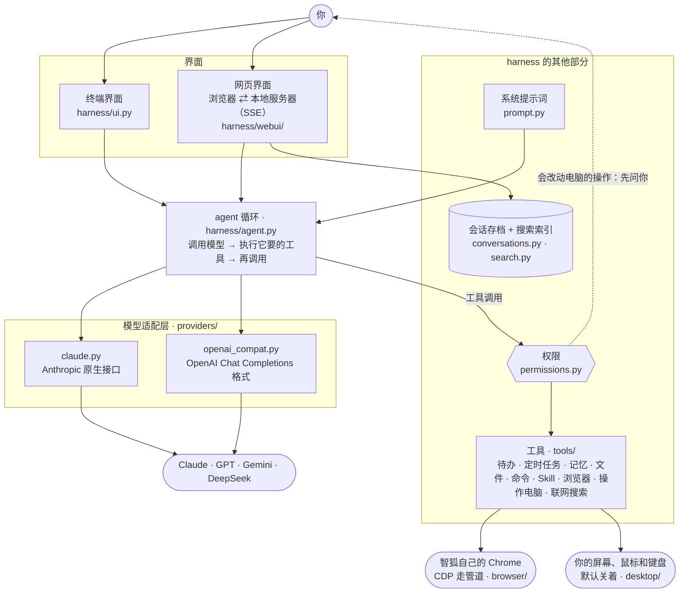
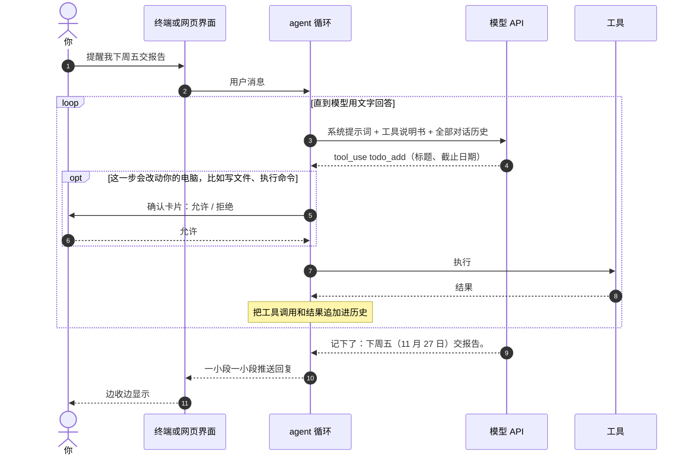

[English](../en/architecture.md) | **简体中文**

[智狐](../../README.zh-CN.md) › [文档](../../README.zh-CN.md#文档) › Harness 是什么

# Harness 是什么

智狐是怎么搭起来的：harness 由哪几部分组成、每一部分在哪个文件里，带动一切的那个循环，以及把一轮画出来的运行记录。每个功能自己的那一页还有讲它是怎么做的部分。

模型只会一件事：读入一段文字，写出下一段文字。它不记得上一次对话，也执行不了任何操作。

**Harness** 就是包在模型外面、弥补这些不足的代码。**Agent = 模型 + harness**。
这个项目里 harness 的每个组成部分各占一个文件或目录：

| 组成部分 | 文件 | 它解决什么问题 |
|---|---|---|
| 循环 | [harness/agent.py](../../harness/agent.py) | 模型一次只能回复一段。循环反复调用它，直到任务做完 |
| 工具 | [harness/tools/](../../harness/tools/) | 模型不能执行操作。工具替它执行，再把结果告诉它 |
| 一起跑的读取 | [harness/parallel.py](../../harness/parallel.py) | 模型一步里常常要好几样东西（"读这五个文件"），一个一个读，要等的是每一次加起来那么久。连着的、只是读又不用问你的调用放进一个小线程池同时跑，卡片、确认、钩子和历史仍然按调用的顺序（见[同一步里的几次读取一起做](tools-and-permissions.md#同一步里的几次读取一起做)） |
| 命令的当前目录 | [harness/tools/cwd.py](../../harness/tools/cwd.py) | 每条命令都在一个新的 shell 里运行，上一条的 `cd` 一忘，下一条就跑错了地方。每个 shell 记着上一条命令停在哪个目录，下一条从那里开始；确认卡片、只读的判断和沙箱都照着这个目录 |
| 模型适配层 | [harness/providers/](../../harness/providers/) | 各家 API 的格式不一样。适配层把差别包起来，循环不用关心背后是哪一家 |
| 自定义模型接口 | [harness/endpoints/](../../harness/endpoints/)、[harness/webui/endpoints_api.py](../../harness/webui/endpoints_api.py) | 内置的几家都在别人的服务器上。接口是任何 OpenAI 格式的地址（Ollama、LM Studio、vLLM、llama.cpp、公司的网关）：地址的规矩（https，明文的 http 只许你自己的网络）、带可选密钥的存储、从不带上别家密钥也不跟重定向的客户端、猜每个模型能做什么、不花钱地测试连接（见[本地模型和自己的网关](models.md#本地模型和自己的网关ollamalm-studiovllmllamacpp)） |
| 对话历史 | 适配层里（各家格式不同） | 模型没有记忆。每次请求都把完整的对话重新发一遍 |
| 压缩历史 | [harness/providers/compaction.py](../../harness/providers/compaction.py) | 历史每轮整段重发，越聊越贵，最后超出模型的上限。GPT、Gemini、DeepSeek 的对话太长时，请模型把较早的部分写成摘要（Claude 由 API 自己压缩） |
| 会话存档 | [harness/conversations.py](../../harness/conversations.py) | 程序关掉后内存里的对话历史就没了。把它存成文件，下次读回来就能接着聊 |
| 会话搜索 | [harness/search.py](../../harness/search.py)、[harness/search_pinyin.py](../../harness/search_pinyin.py)、[harness/search_pinyin.txt](../../harness/search_pinyin.txt)、[tests/make_pinyin.py](../../tests/make_pinyin.py) | 会话多了以后找不到。把每段会话里的文字放进内存，按标题和内容搜，允许不完全一样，也能按拼音找（`baogao` 找到"报告"）；拼音表从 Unicode 的 Unihan 数据库生成一次 |
| 附件 | [harness/attachments.py](../../harness/attachments.py)、[harness/documents.py](../../harness/documents.py) | 模型只收几种文件。每个附件发出去之前都检查一遍，Word、Excel、PowerPoint 先变成文字 |
| 多媒体库 | [harness/media.py](../../harness/media.py) | 每个附件的原件按内容存一份；记下它来自哪段会话的哪条消息；旧会话里的附件从对话历史里找回来 |
| 长期记忆 | [harness/tools/memory.py](../../harness/tools/memory.py) | 每段会话互相看不到对方的内容。记忆是所有会话共用的，助手自己决定往里写什么 |
| MCP | [harness/mcp/](../../harness/mcp/) | 别人写好的工具在另外的程序里。手写的 MCP 客户端启动或连上它们，列出工具，替模型调用，并让一段对话里的工具保持不变（见[MCP：别人写好的工具](extensions.md#mcp别人写好的工具)） |
| 读网页 | [harness/fetch/](../../harness/fetch/)、[harness/tools/fetch.py](../../harness/tools/fetch.py) | 只有 Claude 自己能联网，浏览器又要装 Chrome。一个只读的小工具取回一个公网上的 `http(s)` 网页：这台电脑、局域网、云服务器的元数据地址一律不去（解析域名以后查、每一次跳转再查，连的就是查过的那个地址），HTML 用标准库的 `html.parser` 整理成能读的文字（见[读网页](browser-and-computer-use.md#读网页不用浏览器web_fetch)） |
| 浏览器 | [harness/browser/](../../harness/browser/)、[harness/tools/browser.py](../../harness/tools/browser.py)、[harness/webui/browser_api.py](../../harness/webui/browser_api.py) | 联网搜索找得到网页，却用不了网站：在站内搜索、一页一页点进去、填表单。智狐自己启动一个单独的 Chrome，用手写的 DevTools 协议客户端走管道操作它；网页被整理成带编号的一行一行，模型按编号动手（见[浏览器：智狐自己的一个 Chrome](browser-and-computer-use.md#浏览器智狐自己的一个-chrome)） |
| 操作整台电脑 | [harness/desktop/](../../harness/desktop/)、[harness/tools/computer.py](../../harness/tools/computer.py)、[harness/webui/computer_api.py](../../harness/webui/computer_api.py) | 有些事根本不在浏览器里：一个桌面程序、一个系统的对话框、把文件从一个窗口拖到另一个窗口。作为默认关着的进阶选项，助手看你整个屏幕的截图，替你动鼠标和键盘，每一步先问你，除非你放宽了（在确认卡片上按一段对话放宽，或者选"全部自动允许"）；截图先缩小，模型说的坐标再换算回屏幕上（见[操作整台电脑：看你的屏幕、动你的鼠标键盘](browser-and-computer-use.md#操作整台电脑看你的屏幕动你的鼠标键盘进阶)） |
| 记忆一栏 | [harness/memories.py](../../harness/memories.py) | 你看不到助手记住了什么。网页界面把记忆文件列出来、可以打开看、改、删，浏览器送来的路径出不了记忆文件夹 |
| Skill | [harness/skills/](../../harness/skills/)、[harness/tools/skill.py](../../harness/tools/skill.py) | 模型不知道你希望某一类事怎么做。Skill 是一个写着做法（可能还带着脚本）的文件夹，事情对得上时模型才去读它 |
| 自定义 Agent | [harness/agents/](../../harness/agents/)、[harness/tools/agent.py](../../harness/tools/agent.py) | 一个助手不可能什么都擅长；一件要查很多资料的事，又会把几十页原文塞进对话。Agent 是一个写着自己的设定、工具和模型的文件：主助手把任务交给它、只拿回结论（子 Agent），或者你直接和它对话（角色） |
| 从其他工具导入 | [harness/imports/](../../harness/imports/) | 你在别的 AI 工具里已经配好了 MCP 服务器、写好了 Skill 和 Agent，各家放的地方、写法都不一样。一张登记表记着二十几个工具把它们放在哪儿，几个小的读法把各家的写法换成智狐的，再照常检查（见[从其他工具导入](extensions.md#从其他工具导入)） |
| 共用的目录 | [harness/catalog.py](../../harness/catalog.py) | 有哪些 Skill、哪些 Agent 随时会变，系统提示词却不能变。两份列表都放在用户消息里，变了才再附一次 |
| 几段对话同时进行 | [harness/webui/sessions.py](../../harness/webui/sessions.py)、[harness/webui/sessions_api.py](../../harness/webui/sessions_api.py) | 等一段回复不该耽误你开始下一段。每段活着的对话是一个 Session，有它自己的助手、shell、事件日志和锁：几段的名单、正看着哪一段、上限，换着看、停下一段、一段收尾（见[几段对话同时进行](web-ui.md#几段对话同时进行)） |
| 定时任务 | [harness/tasks.py](../../harness/tasks.py)、[harness/webui/scheduler.py](../../harness/webui/scheduler.py)、[harness/tools/tasks.py](../../harness/tools/tasks.py) | 模型只在你跟它说话时才动。定时任务让它到了时间自己动：时间表和保存、和你的对话同时运行并且停下来等你批准的执行部分、一句话就能定下任务的工具 |
| 系统提示词 | [harness/prompt.py](../../harness/prompt.py) | 模型不知道自己是谁、在什么环境里。内置的提示词可以换成你自己写的；"可以联网"那一行只写给有联网搜索的那一家 |
| 聊天通道 | [harness/channels/](../../harness/channels/) | 只有坐在运行它的那台电脑前才找得到助手。通道把它接到聊天软件上（Telegram、Discord、Slack、飞书、钉钉、QQ）：每个平台一个小小的客户端、只为你一个人服务的配对、每个聊天一段会话（和网页上的对话同时进行）、用按钮或者回复文字答复的确认，还有把照片和文件发回聊天里的 `send_file`（[tools/send.py](../../harness/tools/send.py)；见[聊天通道：在聊天软件里和智狐说话](chat-channels.md#聊天通道在聊天软件里和智狐说话)） |
| 语音转文字 | [harness/voice/](../../harness/voice/)、[harness/webui/voice_api.py](../../harness/webui/voice_api.py) | 模型读的是文字，可在手机上说一句话比打字快。聊天里发来的语音（暂时只有 Telegram）先交给一个语音转文字的服务：OpenAI 的转写接口，或者你自己运行的兼容服务。设置和检查、发出去转的客户端、聊天这边的整个过程（上限、下载、转、记账）都在这里（见[语音消息（Telegram）](chat-channels.md#语音消息telegram)） |
| WebSocket 和 HTTP | [harness/net/](../../harness/net/) | Discord、Slack、QQ 的消息顺着机器人自己连出去的一条 WebSocket 推过来。一个用 `socket` + `ssl` 写的小小的 RFC 6455 客户端（掩码、分片、ping/pong、关闭握手、大小上限、超时、HTTP 代理），和一个"发 JSON、收 JSON"的 HTTPS 帮手（出错信息和重定向里都不带 token），还有上传文件用的 `multipart/form-data` 编码（[multipart.py](../../harness/net/multipart.py)） |
| 无界面模式 | [harness/serve.py](../../harness/serve.py)、[harness/log.py](../../harness/log.py)、[harness/webui/lifecycle.py](../../harness/webui/lifecycle.py) | 服务器上没有浏览器。`harness serve` 不开浏览器就启动调度器和通道，日志按 journald 的习惯写、密钥都遮住，收到 SIGTERM 时干净地退出；网页界面和无界面模式在同一个地方启动、停下这些后台的部分 |
| 后台服务 | [harness/service/](../../harness/service/)、[harness/instance.py](../../harness/instance.py) | 在终端里开的智狐，终端一关它也停了。`harness service` 把它交给 launchd（macOS）或者 systemd（Linux）：登录时自动启动、出错退出后自己重启；数据目录的锁上记着是谁占着，再开一个的时候能说清楚是谁挡着（见[在后台一直运行](background-and-servers.md#在后台一直运行)） |
| 编辑和重新生成 | [harness/rewind.py](../../harness/rewind.py) | 你打错了字，或者回答不对。最后一轮可以倒回去再跑一遍：倒到哪儿、这一轮哪些事可能改动了东西（要先提醒）、附件怎么原样取回来 |
| 分叉 | [harness/fork.py](../../harness/fork.py)、[harness/webui/fork_api.py](../../harness/webui/fork_api.py) | 倒回只能倒最后一轮。分叉从任意一轮结束了的地方开一段新对话，原来那段一字不动：切在哪儿（和倒回用的是同一套位置）、复制什么、什么留在原会话（见[从某一轮分叉](conversations.md#从某一轮分叉)） |
| 撤回改动 | [harness/undo/](../../harness/undo/) | 倒回对话撤回的是对话，不是文件。每一轮记下文件工具改了哪些文件（每个文件改之前的样子留一份底，在 `data/backups/turns/` 里），可以一个个撤回、整轮撤回，再重做；后来又被改过的文件靠内容的哈希认出来（见[撤回一轮改的文件](conversations.md#撤回一轮改的文件)） |
| 会话的认领 | [harness/claims.py](../../harness/claims.py) | 同一段会话可能同时开在网页上和聊天软件里。每一轮开始前先"认领"这段会话，两边就不会同时往里写、把对方的那一轮冲掉 |
| 权限 | [harness/permissions.py](../../harness/permissions.py) | 模型可能出错或被误导。危险操作要你点头 |
| 命令的沙箱 | [harness/sandbox/](../../harness/sandbox/)、[harness/webui/sandbox_api.py](../../harness/webui/sandbox_api.py) | "问不问"会被放宽、会被匆匆点过去，写命令的又是可能被带偏的模型。一道可选的第二关卡：由操作系统（macOS 的 `sandbox-exec`、Linux 的 bubblewrap）把每条命令关在工作目录里，碰不到家目录、智狐的数据和 `.env`，想的话也连不上网；放行一条命令每次都问你（见[命令的沙箱](sandbox-and-hooks.md#命令的沙箱命令只碰得到该碰的地方)） |
| 功能清单 | [harness/capabilities.py](../../harness/capabilities.py)、[harness/webui/capabilities_api.py](../../harness/webui/capabilities_api.py) | 工具的名字对你没有意义。一份清单把这段对话的工具换成功能：在不在用、为什么关着、问不问你（拿去问 `permissions.py` 得来的）、在哪儿执行、怎么打开（见[智狐能做的事](web-ui.md#智狐能做的事功能清单)） |
| 只读的命令 | [harness/commands/](../../harness/commands/) | 每个 `ls` 都问太烦，全部放开又太危险。一个保守的判断：一条 shell 命令是不是只是看。一个只认最简单写法的拆词器（有任何 shell 特殊含义的就不认）、每个程序一条选项的规矩、检查有没有碰到密钥的路径；还有你自己加的"不用问的命令"（见[只读的命令](tools-and-permissions.md#只读的命令以及为什么判断得这么保守)） |
| 界面 | [harness/ui.py](../../harness/ui.py)（终端）、[harness/webui/](../../harness/webui/)（网页） | 把过程显示给你，把你的输入交给循环 |
| 终端里的会话 | [harness/chat_cli.py](../../harness/chat_cli.py)、[harness/history_cli.py](../../harness/history_cli.py) | 关掉终端，对话不该跟着没了。终端也记一份和网页一样的事件日志，每一轮存进同一个会话库，所以两边聊的都能在另一边列出来、搜到、打开、接着聊（`/history`、`/open`，见[终端界面](terminal-ui.md)） |
| 回复里的 Markdown | [harness/webui/markdown.js](../../harness/webui/markdown.js) | 模型用 Markdown 回答。一个手写的小渲染器在回复逐字输出的同时把它画成标题、列表、表格、代码块，从不把模型的输出当作 HTML |
| 应用图标 | [harness/webui/manifest.py](../../harness/webui/manifest.py)、[harness/webui/icons/](../../harness/webui/icons/)、[tests/make_icons.py](../../tests/make_icons.py) | 书签、Chrome 的快捷方式、装成的应用都要一张够大的图标和一份网页应用清单，不然只有一个灰底的字。几张 PNG 由无界面的 Chrome 从标志画一次、提交进仓库；服务器只发这几张，而且要带口令 |
| 联网回答的来源 | [harness/citations.py](../../harness/citations.py)、[harness/webui/page/scripts/citations.js](../../harness/webui/page/scripts/citations.js) | 联网搜索以后，Claude 会说明每句话出自哪个网页。这些引用按每段回答编号，画成小小的记号，回答末尾列出来源（网页、终端、聊天软件里都有），跟着会话保存；发回给 API 的历史一个字不动 |
| 设置和计价 | [harness/settings.py](../../harness/settings.py)、[harness/pricing.py](../../harness/pricing.py) | 记住你选的模型和填的密钥，把 token 换算成钱 |
| 模型目录 | [harness/model_catalog.py](../../harness/model_catalog.py)、[harness/webui/models_api.py](../../harness/webui/models_api.py) | 光看模型的名字，不知道它能做什么、多少钱。一份由程序算好的目录：每一家有没有密钥（只露最后 4 位）、能选哪些模型、每个模型能做什么、价格（来自 `pricing.py`）、换过去会怎样；网页上换模型的面板（`POST /api/model/catalog`）和终端的 `/model` 都只是照着它画 |
| 备用模型 | [harness/fallback.py](../../harness/fallback.py)、[harness/webui/fallback_api.py](../../harness/webui/fallback_api.py)、[harness/webui/page/scripts/fallback.js](../../harness/webui/page/scripts/fallback.js) | 模型过载（529）、服务器出错（5xx）、请求太频繁（429）时，SDK 自己重试过以后这一轮还是会停下。选了备用模型的话，这一轮接下来改用同一家的下一个，对话里说一声，下一轮再试你选的那个（见[模型暂时用不了：备用模型](models.md#模型暂时用不了备用模型)） |
| 花费账本和预算 | [harness/ledger.py](../../harness/ledger.py)、[harness/budget.py](../../harness/budget.py) | 内存里的估算一重启就没了。每调用一次模型就按那一刻的价格记一笔，看得到一天、一个月花了多少；定了每月预算的话，超过时提醒一次 |
| 钩子 | [harness/hooks/](../../harness/hooks/)、[harness/webui/hooks_api.py](../../harness/webui/hooks_api.py) | 有些规矩想每次自动照办、不用每次点卡片：拦下某类命令、改完文件就格式化、每轮记日志。你的脚本在循环的几个记录点旁边的四个时刻运行，从标准输入收一份 JSON，用退出码回答（和 Claude Code 一样）；它只能让事情更严（见[你的钩子](sandbox-and-hooks.md#你的钩子在固定的时刻运行你自己的脚本)） |
| 运行记录 | [harness/trace/](../../harness/trace/)、[harness/webui/page/scripts/trace.js](../../harness/webui/page/scripts/trace.js)、[trace-chart.js](../../harness/webui/page/scripts/trace-chart.js) | 一问一答背后循环跑了几圈、每一圈花了多久和多少钱，平时看不见。循环在几个记录点告诉记录器一声，一轮结束时整理成一份记录，存进会话；网页画成瀑布图，终端是 `/trace`（见[看懂一轮对话：运行记录](#看懂一轮对话运行记录)） |
| 遮住密钥 | [harness/redact.py](../../harness/redact.py) | 命令的输出、文件里可能一不小心带着一把密钥，进了只追加的历史就会发给厂商、永远存着。结果一产生就遮，在 `tool_ended` 记录点之前：认各家密钥的格式、环境变量和 `.env` 里已知的值、`password=` `token:` 后面随机的一串（见[遮住工具结果里的密钥](sandbox-and-hooks.md#遮住工具结果里的密钥)） |
| 导出 | [harness/export.py](../../harness/export.py) | 数据都在一台电脑的一个文件夹里。点一下就打成一个 zip，密钥不带出去 |
| 自检 | [harness/doctor/](../../harness/doctor/) | 多数问题不在代码里，在这台电脑上：密钥只设在终端里、数据目录别人也能读、MCP 服务器要 `npx` 而这台电脑没装 Node.js。`harness doctor` 只看不改，一屏看完，修法按你的 shell 写（见[出了问题：先运行 harness doctor](configuration.md#出了问题先运行-harness-doctor)） |
| 从备份恢复 | [harness/restore.py](../../harness/restore.py)、[harness/restore_keys.py](../../harness/restore_keys.py)、[harness/webui/restore_api.py](../../harness/webui/restore_api.py)、[harness/restore_cli.py](../../harness/restore_cli.py) | 手动把备份解压到数据文件夹上，占位符会盖掉你的密钥，压缩包里有什么都照单全收。页面上（或者 `harness restore`）照着导出的名单检查压缩包、先给你看预览、先备份现在的数据、留着现在的密钥，再在原地重新开起来（见[备份和恢复](data-and-privacy.md#备份和恢复)） |
| 评测 | [harness/evals/](../../harness/evals/)、[evals/tasks/](../../evals/tasks/) | 测试证明代码照着写的那样运行，却说不出改了提示词、换了模型以后，*模型*还会不会做对。一组真实的小任务，由真正的助手在用完就删的临时文件夹里去做，按留下的结果打分；花钱之前先估算、要你确认（见[评测](evals.md)） |
| 多语言 | [harness/i18n.py](../../harness/i18n.py)、[harness/locales/](../../harness/locales/) | 界面上的话有中文、英文、西班牙语三种，网页和终端共用一份翻译表 |
| 组装 | [harness/app.py](../../harness/app.py)、[harness/cli.py](../../harness/cli.py)、[harness/config.py](../../harness/config.py) | 把上面这些拼起来，读取配置 |
| 版本和发布 | [harness/version.py](../../harness/version.py)、[release.yml](../../.github/workflows/release.yml) | 这是哪一版（`harness --version`、`harness doctor`）：装好的包里读，从仓库里运行时读 `pyproject.toml` 再加上 git 提交。推一个版本的 tag 就发布：先对一遍 `CHANGELOG.md`，在三个系统上试装，再挂到 GitHub Release 上（见[发布](testing.md#发布)） |
| 装在哪儿 | [harness/install.py](../../harness/install.py) | 从仓库里运行，还是用 `uv tool install` 装上的：只在这一处判断，数据文件夹和 `.env` 的默认位置、智狐让你运行的命令（`uv run harness` 还是 `harness`）都跟着它 |
| 检查新版本 | [harness/updates.py](../../harness/updates.py)、[harness/updates_cli.py](../../harness/updates_cli.py)、[harness/webui/updates_api.py](../../harness/webui/updates_api.py) | 默认关着：这是智狐唯一一个自己发出去的请求，每天一次、一个 GET 问 GitHub 最新的发布版，里面没有任何属于你的东西。按数字比较版本、缓存、每一种装法的升级命令都在这一个模块里；页面、终端、`harness doctor` 和 `harness updates` 只照着说（见[更新](installation.md#更新)） |
| 系统之间的差别 | [filelock.py](../../harness/filelock.py)、[pathnames.py](../../harness/pathnames.py)、[winacl.py](../../harness/winacl.py)、[winjob.py](../../harness/winjob.py)、[console.py](../../harness/console.py)、[exits.py](../../harness/exits.py)、[machine.py](../../harness/machine.py)、[tools/shell.py](../../harness/tools/shell.py)、[browser/chrome.py](../../harness/browser/chrome.py)、[service/windows.py](../../harness/service/windows.py) | macOS、Linux、Windows 锁文件、写路径、保护文件、结束进程树、给输出编码、执行命令的办法都不一样。每一处差别只放在一个小模块里（或者用到它的那个模块的一个函数里），别处只调用它 |

建议的阅读顺序：`agent.py` → `tools/base.py` → `tools/todo.py` → `permissions.py` → `providers/base.py`，其余的按兴趣看。

这些部分是这样连起来的：



## 循环

```
你说了一句话
  └─► 把【系统提示词 + 工具说明书 + 全部对话历史】发给模型
        ├─ 模型回复文字            → 显示给你，这一轮结束
        └─ 模型说"我要调用工具 X"  → 检查权限 → 执行 → 把结果追加进历史 → 再发给模型（循环）
```

"下一步做什么"每次都由模型决定，循环只负责照办。这是 agent 和普通程序的区别：
普通程序的步骤是写死的，agent 的步骤是模型临场决定的。

一轮对话里，各方之间是这样来回的：



你对 Claude 说"提醒我下周五交报告"之后，对话历史会变成下面这样（有删减）。
模型并没有真的"调用"什么，它只是输出了一段格式固定的内容，说自己想调用 `todo_add`；
harness 看到后去执行，再把结果作为一条新消息放回历史里：

```json
[
  {"role": "user", "content": [
    {"type": "text", "text": "<context>当前时间：2026-11-20 14:03 星期五</context>"},
    {"type": "text", "text": "提醒我下周五交报告"}
  ]},
  {"role": "assistant", "content": [
    {"type": "thinking", "thinking": "下周五是 11 月 27 日……", "signature": "..."},
    {"type": "tool_use", "id": "toolu_1", "name": "todo_add",
     "input": {"title": "交报告", "due": "2026-11-27"}}
  ]},
  {"role": "user", "content": [
    {"type": "tool_result", "tool_use_id": "toolu_1", "content": "{\"id\": 1, \"title\": \"交报告\", ...}"}
  ]},
  {"role": "assistant", "content": [
    {"type": "text", "text": "记下了：下周五（11 月 27 日）交报告。"}
  ]}
]
```

有一条规矩贯穿始终：**历史只在末尾追加，前面的内容从不修改**。
原因写在 [harness/providers/claude.py](../../harness/providers/claude.py) 里 `AnthropicBackend.__init__` 的注释中，简单说就是改了前面会让缓存失效（变贵），
还会让模型之前的思考内容无法通过 API 的校验（请求被拒绝）。
唯一的例外是 GPT、Gemini、DeepSeek 的对话太长时的压缩，见[对话太长了怎么办](models.md#对话太长了怎么办压缩历史)。

## 看懂一轮对话：运行记录

页面上是一问一答，但在它背后，循环可能已经来回跑了好几圈：发一次请求、执行一个工具、再发一次……
"运行记录"把这一轮的每一圈画在一条时间轴上，你能亲眼看到上一节说的那个循环。

**在哪儿看。** 网页上，每一轮最后那个回答下面的那排按钮里有一个"运行记录"，上面写着这一轮一共用了多久、花了多少
（这一轮最后不是回答，比如出错了，它就单独放在这一轮的最后一行）。点开，从右边滑出一个窗口（窄屏上从底下升起来）。
终端里输入 `/trace`，看最后一轮的同一份记录。刷新页面、重新打开旧会话以后它都还在；定时任务和聊天通道里跑的每一轮也有。

**怎么读。** 窗口最上面是合计：一共多久、花了多少、输入里有多少命中了缓存、调用了几次模型和工具，
还有一根分成四段的横条：模型在答、工具在执行、等你确认、别的零碎（存盘、组装请求）；这一轮跑过你的[钩子](sandbox-and-hooks.md#你的钩子在固定的时刻运行你自己的脚本)的话，
多一段是钩子的时间，每跑一次钩子也是单独的一行（`PreToolUse`、`PostToolUse` 的挂在那次工具调用下面）。下面是一张瀑布图，每一段一行：

```
                       0          1 秒        2 秒
第 1 次请求  claude…   ███                          ← 前面淡的一截：发出请求、还没吐出第一个字（首字时间）
待办                      ▌                         ← 在你电脑上执行的工具，往往只要几毫秒
第 2 次请求  claude…      ███
执行命令                     ░░░░░░░░░░▓            ← 斜线那一截：等你点"允许"
第 3 次请求  claude…                    ██
交给「资料研究员」                        ▓▓▓▓▓▓▓    ← 交给子 Agent 的那一步……
  │ 第 1 次请求  claude…                  ██
  │ 读写文件                                ▌        ← ……它自己的请求和工具调用缩进画在下面
  │ 第 2 次请求  claude…                    ████
第 4 次请求  claude…                            ███
```

鼠标移到一行上（或者用 Tab、↑↓ 选中），上面那一行字写着这一段的全部数字：哪个模型、首字时间、输入多少 token
（其中多少命中缓存）、输出多少、花了多少钱、API 给的停止原因（`tool_use`、`end_turn`……）；工具调用写着真名和参数、
结果有多大、问没问你、等了多久。点一下跳到下面逐段的详情。右上角的"复制为 JSON"复制的是助手程序存下的那一份。
[同一步里一起做的几次读取](tools-and-permissions.md#同一步里的几次读取一起做)横条叠在一起，左边一道细线连着，写着"和另外 2 步同时执行"；
时间怎么分的那根横条里，它们按"一共占了多长的一段时间"算一次，不是把几根横条加起来（记录里的 `batch` 一项）。

**看它能学到什么。**

- 每一次请求都把整段对话重新发给模型（模型没有记忆，见上一节）。所以输入的 token 一次比一次多；
  但前面那一大段和上一次一字不差，命中了缓存，算钱时便宜得多，"缓存命中"那个比例就是这么来的。
- 一轮的时间常常不花在模型上，而是花在等你点"允许"上。斜线的那一截一眼就看得出。
- 首字时间和"写"的时间是两回事：前者是模型开口之前的等待（排队、读上下文），后者跟输出的长短有关。
- 交给子 Agent 的那几圈（缩进的那几行）不进主助手的历史，主助手只收到它交回的结论；但它们的时间和钱都算在这一轮里。

**怎么做的。** 循环（[harness/agent.py](../../harness/agent.py)）在几个时刻告诉记录器一声，每处只有一行，名字说明是哪个时刻：
一轮开始和结束（`turn_began`、`turn_ended`）、发出一次请求和它答完（`request_began`、`request_ended`）、一次请求失败了、改用备用模型再试（`request_failed`，见[备用模型](models.md#模型暂时用不了备用模型)）、
开始一次工具调用和它有结果（`tool_began`、`tool_ended`）、开始等你答复和你答复了（`approval_asked`、`approval_decided`）。
记录器在 [harness/trace/](../../harness/trace/)：它只记时刻（用只往前走的 `time.monotonic`）和数字，一轮结束时整理成一份记录，
合计（时间怎么分、一共多少钱、缓存命中率）也由它算好，页面和终端只照着画，不各自再算一遍。几处有意的取舍：

- **钱只算一次。** 每次请求的钱就是[花费账本](cost.md)记的那一笔（`Ledger.record` 把它交回来），记录器不另算价格。
- **首字时间不用改适配层。** 循环把界面包一层再交给适配层（`Tracer.watch`），第一段思考或文字到的时候记一下时刻，别的一样不动。
- **子 Agent 挂在交给它的那一步下面。** 子 Agent 和叫它的那一方读同一块表；它的那一轮跑完，记录挂到那次 `agent` 调用的 `children` 里。
- **存成会话 `events` 里的一个 `trace` 事件，而不是会话文件里单独的一张表。** `events` 本来就是"页面上显示过的、
  刷新时要重画的东西"，运行记录的入口正是这样的东西：放在这里，刷新和打开旧会话时照样重放（不播入场动画），
  开着的几个标签页同时收到；倒回最后一轮（编辑、重新生成）时它跟着那一轮的事件一起去掉，不用另外维护一张要和事件对齐的表；
  定时任务和聊天通道本来就存 `events`，也就都有了。代价是重放时多发一点数据，所以记录只放数字和短说明（工具的参数截短到一行、
  结果只记有多少字），一轮一般一两 KB，比一个工具结果还小；一轮最多存 `config.TRACE_MAX_SPANS` 段，多的只算进合计。
- **从不进 `messages`。** 发给模型的内容一个字节都不变（有测试比对有没有运行记录时发出去的请求），缓存和思考内容的签名都不受影响。

记录的格式（每个字段的意思）写在 [harness/trace/\_\_init\_\_.py](../../harness/trace/__init__.py) 开头。
