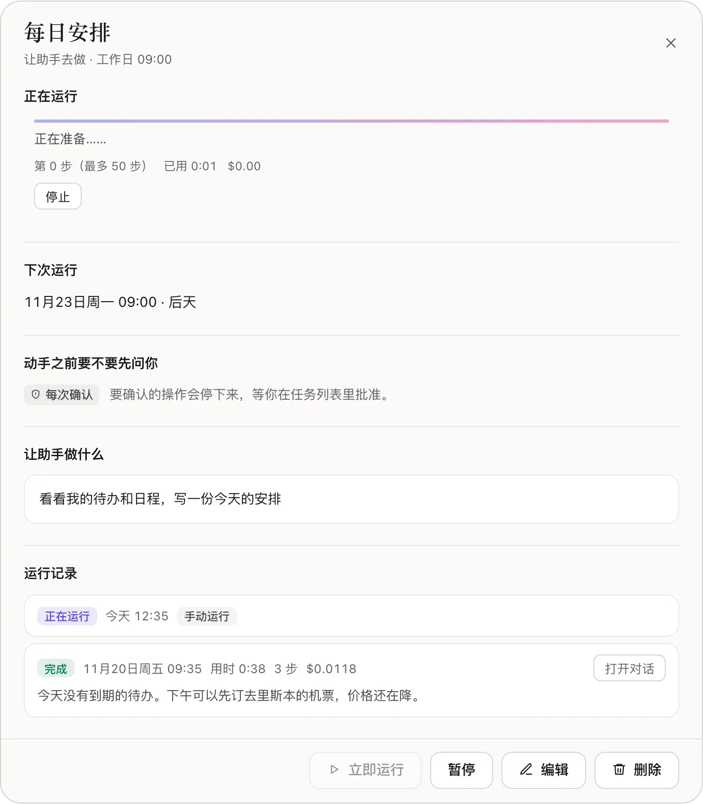

[English](../en/scheduled-tasks.md) | **简体中文**

[智狐](../../README.zh-CN.md) › [文档](../../README.zh-CN.md#文档) › 定时任务和重复任务

# 定时任务和重复任务

对助手说"每天早上 9 点提醒我喝水"或者"每个工作日 9 点看看我的待办，写一份今天的安排"，或者在网页界面里自己添加。
任务有两种：

| 种类 | 到时间之后 | 费用 |
|---|---|---|
| 提醒（reminder） | 页面上弹出一条提醒，写着任务的名称和内容。不调用模型 | 不花钱 |
| 让助手去做（agent） | 助手自己执行任务的指令，就像你把它当成一条消息发过来一样：调用模型，使用工具 | 每次运行都要花 API 费用，和平常的一轮对话一样 |

时间表都按你电脑的本地时间：某个日期和时间只运行一次、每天、每周选定的几天、每月的某一天（31 号在小月里落到最后一天）、
每隔多少分钟（5 分钟到 7 天，从创建或者上一次运行的时刻算起）。夏令时按日历处理："每天 9 点"始终是墙上的 9 点；
春天拨快时被跳过的那个时刻，顺延到跳过之后运行；秋天拨回时走两遍的那个时刻，只运行一次。
保存之前，表单上会先列出接下来的三次运行时间。

让助手去做的任务是这样运行的：

- **和你的对话同时进行。** 你正在聊天时到了时间的任务马上开始；它跑的时候你照常发消息、换模型、打开会话，
  好几个任务也可以一起跑。每次运行都有自己的 shell，停下一个任务只结束它自己的命令，对话里的"停止"也碰不到任务。
  最多同时跑三个，再多的排队等着（显示"排队中"），前面的跑完一个就开始。换模型、改任务的设置，只影响以后的运行。
- **不动你正在进行的对话。** 每次运行都从空的历史开始，用的是它开始那一刻设置里选中的那家模型，跑完存成一段普通的会话，
  标题是任务名加时间（比如"每日安排 · 2026-11-21 09:00"）。它出现在会话栏里，标着来自定时任务，
  可以打开、重放、搜索，也可以接着聊。
- **要不要问你，每个任务自己定。** 编辑任务时，"让助手去做"的任务可以选和对话里一样的四档：**每次确认**（默认）、
  **自动允许只读命令**、**自动允许改文件**、**全部自动允许**；选最后一档时会提醒你：任务多半在没人看着的时候运行。不是"每次确认"的任务，
  列表里那一行会带一个小标签，任务详情里也写着它是哪一档。还要你批准的操作，任务会停下来等你答复：
  正在等的确认显示在任务那里，可以允许或者拒绝，这期间你照常聊天。没问你就做了的那几步，进度里和存下来的会话里都标着"自动允许"。
  对话里选的那一档管不到任务；助手替你添加的任务一律是"每次确认"，只有你自己能改。
- **沙箱也是每个任务自己定。** 在确认方式下面，"命令的沙箱"可以选 **跟随设置**（默认）、**关**、**只在工作目录里**、
  **工作目录 + 联网**（见[命令的沙箱](sandbox-and-hooks.md#命令的沙箱命令只碰得到该碰的地方)）。最后用上的那一档在这台电脑上用不了的话，
  编辑器里写着这个任务的命令会被拒绝执行。选了"全部自动允许"的任务，命令被沙箱挡住时不能请你放行：没人会来回答。
  助手替你添加的任务一律跟随设置。
- **能看到进度，能停下。** 任务运行时能看到它在做什么（思考、写回答、调用哪个工具）、调用了几次模型、
  到目前为止花了多少钱、调用过哪些工具。"停止"和对话里的"停止"一样，这次运行正在运行的命令也会一起结束；
  还在排队等的那一次直接取消。好几个任务一起跑的时候，页面顶上那条提示会数一数（"定时任务：2 个在运行、1 个在等你确认"），
  点一下打开任务列表，停在第一个等你的任务上。
- **错过了就补一次。** 到时间时智狐没有开着（或者电脑在睡眠），下一次智狐看到时补跑一次，不管错过了几次都只补一次。
  这次运行标着"补跑"，记着错过了几次，也会告诉助手原定是什么时候。
- **每次运行都有记录。** 每个任务保留最近 20 次运行：开始和结束的时间、结果、调用了几次模型、估算费用、
  最后回答的开头，失败时还有原因。不设花费上限。

  

**定时任务只在网页界面（`uv run harness --web`）或者服务器模式（`uv run harness serve`）开着的时候运行。**
终端界面不运行它们；在终端里也可以让助手添加或删除任务，等下次网页界面或者服务器模式开着时运行。"立即运行"会马上运行一次，不改变原来的时间表。助手替你添加或删除"让助手去做"的任务时，
会先问你，因为这个任务以后会自己花钱；提醒不用问。

## 定时任务：没人看着的时候怎么运行

一个定时任务就是存下来的一条指令加一个时间表（[harness/tasks.py](../../harness/tasks.py)）。运行它用的还是同一个循环，
只有三件事另外处理（[harness/webui/scheduler.py](../../harness/webui/scheduler.py)）：

1. **什么时候。** 调度线程睡到下一个任务该运行的时候，但一次最多睡 30 秒，这样改了系统时间、电脑从睡眠中醒来，
   都能很快发现；任务一有变化也会把它叫醒。下一次的时刻是按本地时间在日历上算出来的，而不是加上 24 小时，
   所以夏令时前后"每天 9 点"仍然是墙上的 9 点。每个任务的下一次时刻存在 `data/tasks.json` 里，
   下次启动时发现它已经过去了，就知道错过了。
2. **同时进行。** 任务不拿你对话用的任何一把锁：它跑的时候你照常聊天、换模型、打开会话，几个任务也可以一起跑。
   能这样做，是因为凡是"会被停下"的东西，每次运行都有自己的一份（`App.unattended_agent`）：自己的 shell，
   停下一次运行只结束它自己的命令，对话里的"停止"碰不到任务；自己的 MCP 调用（每次运行的工具快照把调用记在它自己名下，
   "停止"只取消它自己的）；自己的浏览器标签页（这次运行结束时关掉）；自己的事件日志和确认。共用的只有存在磁盘上的东西（待办、任务、记忆、会话、工作目录里的文件），
   它们各自有锁，每次改动一口气做完，两边同时改也不会互相冲掉。同时最多跑 `MAX_PARALLEL_TASKS` 个
   （3 个，在 [config.py](../../harness/config.py) 里），再多的排队，显示"排队中"，有空位就开始。同一个任务不会同时跑两次。
3. **没人看着。** 每次运行用一个单独的 `Agent`，适配层是新建的，历史是空的，事件也记在它自己的日志里
   （另一个不推给页面的 `WebUI`），所以它写不进你正在看的那段对话。它用的权限是一份按*这个任务自己的那一档*设好的副本
   （`Permissions.unattended(mode)`），不是你在对话里选的那一档。走到需要批准的一步时，循环和平常一样停在 `confirm` 上等，
   这个正在等的确认放进页面的状态里，你可以在任务那里答复它。

进度和别的东西一样，通过同一个 `state` 事件送到页面上：文字逐字输出时最多每秒四次，开始运行、停下来等你批准、
运行结束时马上发一次。被停下的运行照样给每个工具调用补上结果（还是 `Agent._run_tools` 里的那个 `finally`），
所以它存下来的会话和别的会话一样可以接着聊。
