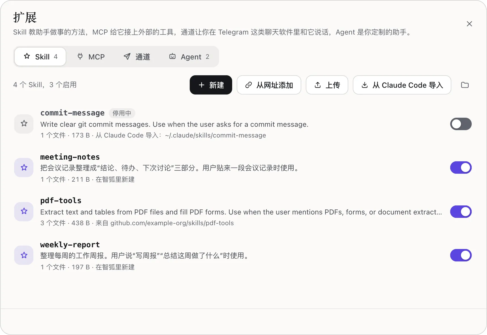

[English](../en/web-ui.md) | **简体中文**

[智狐](../../README.zh-CN.md) › [文档](../../README.zh-CN.md#文档) › 网页界面

# 网页界面

先讲页面上的每一样东西，后面几节讲页面是怎么做的：几段对话同时进行、页面背后的事件流、Markdown、联网回答的来源和三种界面语言。

```bash
uv run harness --web
```

程序会在本机启动一个小型服务器，并在浏览器里打开聊天页面。页面上有：

- 会话栏（左侧）：所有会话按时间分组列出，点一下就能打开接着聊。鼠标移到一段会话上会出现三个按钮：
  在访达中显示（直接定位到这段会话在你电脑上的文件）、重命名、删除。
  每一轮对话结束时自动保存，不需要手动操作。左上角的按钮可以把它收起来；
  最下面那一行点一下，会打开保存会话的文件夹。
- 几段对话同时进行：回复正在写、或者确认卡片正等着你的时候，照样可以点别的会话、点"新对话"接着干活，原来那段在后台接着跑。
  它在会话栏上的那一行标着在做什么：正在进行、等你确认（最显眼，左边一道暖色的竖条）、出错了、有新回复（你不在的时候跑完了，打开就去掉）。
  鼠标移到正在跑的那一行上，"在访达中显示"前面多一个"停下这一段"；改名、删除要等它跑完。后台那一段停下来问你时，
  页面顶上出现一条提示（点它就过去、在那里答复），页面上也说一声；页面在后台的话还会弹系统通知，和你正看着的那一段一样。
  打开它就能看到到现在为止的全部内容，回复接着往下写。最多同时三段在跑；三段都在跑时再发一条，会告诉你先等一等或者停下一段。
- 搜索（会话栏顶部，快捷键 ⌘F 或 Ctrl+F；⌘K、Ctrl+K 也可以。光标已经在搜索框里时再按一次 ⌘F，
  就是浏览器自带的"在页面里查找"）：在所有保存过的会话里找，标题和内容都找，不要求一字不差；中文也能用拼音找
  （`baogao` 或 `bao gao` 找"报告"，`zbmb` 找标题是"周报模板"的会话）。多个关键词用空格隔开。结果里会显示命中的那段文字，点开（或按回车打开第一条）后页面直接滚到那个位置。
- 空白页：还没有内容时，问候语、输入框和几个可以直接点的例子摆在页面中间。
- 对话区：回复逐字显示，并按 Markdown 画出来：标题、粗体斜体、列表和任务列表、引用、表格（太宽时在自己的框里
  横向滚动）、代码块（标着语言，有简单的着色和"复制代码"按钮）。链接在新标签页里打开；图片不加载，只显示说明文字和网址。
  模型的思考过程可以点开查看；每次工具调用是一张卡片，点开能看到参数和结果，浏览器和操作电脑的每一步还带着一张小截图，点开看大图；鼠标移到助手的回复上会出现"复制"按钮，
  复制的是这条回复的 Markdown 原文。往上翻看旧内容时，新内容不会把你拽回底部。
  联网搜索以后写的回答带着来源：每句被引用的话后面有一个小小的编号（鼠标停在上面、或者用键盘移到它上面，会浮出网站、
  网页标题和被引的原文；点它在新标签页里打开那个网页），回答下面列出"资料来源"。这时"复制"会把编号写成 `[1]`，
  末尾附上标题和网址（见[联网回答的来源](#联网回答的来源)）。
- 确认卡片：助手要写文件或执行命令时出现，带"允许"和"拒绝"两个按钮。拒绝时可以顺便写一句原因。
- 系统通知：你切到别的窗口时，智狐停下来等你点"允许"、一轮回复完了、出错了，都会弹一个系统通知（等你确认的那条写明是什么操作，
  回复完了的那条带着回复的开头）。点通知就回到页面，停在那张确认卡片或那条回复上，让它亮一下。页面就在眼前时不弹；
  刷新页面、打开旧会话时重放出来的也不弹；同一个智狐开在两个标签页里，你正看着其中一个时，另一个也不弹。
  标签页的标题前会多一个圆点（等你确认时写着"● 等你确认 ·"），图标右上角多一个小点（等你确认、出错时是红的）；
  装成应用的，程序坞或任务栏上的图标也带一个点。回到页面就清掉。定时任务的提醒、超出预算也走同一套通知。
  **怎么打开**：开关默认是开着的，但浏览器要先允许。打开**设置 → 系统通知**，点"允许通知"，再在浏览器弹出的询问里选"允许"
  （浏览器只在你点了什么之后才肯问，所以页面不会自己弹出询问；任务列表里的"开启系统通知"问的是同一件事）。
  不小心点了"拦截"的话，页面没法再问：Chrome、Edge、Firefox 点地址栏左边的网站图标，把"通知"改成"允许"；
  Safari 在"设置 → 网站 → 通知"里改；改好以后刷新页面。系统也要允许这个浏览器弹通知：macOS 在"系统设置 → 通知"，
  Windows 在"设置 → 系统 → 通知"，Linux 在桌面的通知设置里；专注模式（勿扰）开着时也看不到。允许以后可以点"发一条试试"。
  不想要了，在同一个地方关掉开关（只记在这个浏览器里）；标签页上的标记不用浏览器允许，也不受这个开关影响。
- 编辑和重新生成：鼠标移到你的最后一条消息上，左边会出现"编辑"（输入框是空的时候按 ↑ 也行）。消息原地变成一个输入框，
  附件也在，可以一个个去掉；Enter 把改过的消息当作新的一轮发出去，Esc 或"取消"在丢掉改动之前先提醒一次。
  最后一个回答下面有"重新生成"：用一模一样的那条消息再问一次模型；这一轮没有回答（出错了、被你停下了）时，
  "重新生成"单独放在最后。这一轮做过可能改动了电脑的事（执行命令、改文件、调用 MCP 工具、操作整台电脑、在浏览器里点击或输入），
  会先把这些事列出来问你一次：倒回去的只是对话，做过的事不会撤销。只有最后一轮能编辑、重新生成
  （为什么，见[编辑最后一条消息、重新生成](conversations.md#编辑最后一条消息重新生成)）。这一轮改过文件的话，同一张卡片上可以勾上"同时撤回这一轮改的文件"。
- 分叉：想从前面某一轮换个方向，就在那一轮上点"分叉"：回答下面紧挨着"复制"的那个带着这一轮，你的消息左边悬停出现的那个截到它之前、
  把消息放回输入框。原来那段不动，新的一段马上打开，顶上一行能点回原会话（见[从某一轮分叉](conversations.md#从某一轮分叉)）。
- 运行记录：最后一个回答下面那排按钮里写着"这一轮用了多久、花了多少"，点开是一张瀑布图：这一轮调用了几次模型、
  用了哪些工具、每一步从什么时候到什么时候、等你确认等了多久、多少 token、多少钱（见[看懂一轮对话：运行记录](architecture.md#看懂一轮对话运行记录)）。
- 改过的文件：文件工具改过文件的那一轮，末尾有一行"改了 N 个文件"，右边的"撤回"一下撤回整轮；点开看每个文件，点文件名看一行一行的预览，
  可以一个个撤回、重做。文件在这一轮之后又被改过，就在原地说清楚，等你点"仍然撤回"。执行命令改动的文件没法自动撤回
  （见[撤回一轮改的文件](conversations.md#撤回一轮改的文件)）。
- 输入框：Enter 发送，Shift+Enter 换行。助手工作时，发送按钮变成"停止"，可以打断正在进行的回复，
  正在运行的命令也会一起结束。它马上生效，模型还在想、在写一个很长的工具调用、还没开始回答的时候也一样：
  智狐直接断开和模型的连接，服务商那边也就不再接着生成。输入框下面一直显示本次运行的估算费用。
- 附件：点输入框左边的回形针选文件，或者把文件拖到页面上，截图可以直接在输入框里粘贴（⌘V / Ctrl+V）。
  发送前，附件以小卡片的样子排在输入框上方，可以删掉某一个；一条消息最多 10 个，只带附件、不写字也能发。
  各家模型的接口只收几种图片、PDF 和文字，别的格式要先转换：

  | 文件 | 发出去的是什么 | Claude | GPT | Gemini | DeepSeek |
  |---|---|:-:|:-:|:-:|:-:|
  | PNG、JPEG、WebP | 图片本身。长边超过 2576 像素的先在浏览器里缩小，单张最大约 7 MB | ✅ | ✅ | ✅ | ❌ |
  | GIF、BMP、AVIF、HEIC、TIFF | 在浏览器里重新存成 PNG 或 JPEG（GIF 取第一帧）。HEIC 和 TIFF 要浏览器打得开才行，比如 Safari | ✅ | ✅ | ✅ | ❌ |
  | SVG | 画成 PNG。当前的模型看不了图的话，把 SVG 的源码当文字发 | ✅ | ✅ | ✅ | ✅ 发源码 |
  | PDF（最大 25 MB，不能有密码） | PDF 本身：文字和页面上的图都看得到 | ✅ | ✅ | ❌ | ❌ |
  | Word、Excel、PowerPoint（.docx、.xlsx、.pptx，最大 25 MB） | 智狐取出来的文字：Word 保留标题、列表和表格；Excel 每张工作表一节，格子之间用制表符隔开，日期还原成日期；PowerPoint 按播放顺序一张一张，带演讲者备注。图片和排版没有了，也会告诉模型这一点 | ✅ | ✅ | ✅ | ✅ |
  | 文本和代码（最多 40 万字） | 文字。认得 UTF-8、UTF-16 和 GBK 编码；扩展名不认识的，看内容是文字也收 | ✅ | ✅ | ✅ | ✅ |

  别的文件（压缩包、音频视频、.doc 这类旧版 Office、Pages、WPS、设了密码的文件）加的时候就会退回，并说明可以怎么转换。
  当前的模型收不了的附件，加的时候就会提示，并说可以换成哪几家。GPT 和 Gemini 两列是对照官方文档写的，用本地的假服务器测过，
  没有用真实的密钥测过。附件存在这段会话里，打开旧会话时缩略图还在。点对话里的任何一个附件，都会在下面"多媒体"一条说的查看器里打开。
- 多媒体（会话栏里"会话""任务"后面的第三个标签）：所有会话里发过的截图、图片、PDF、Word / Excel / PowerPoint
  和文本文件，最新的在前，按天分组。图片排成正方形的缩略图方格，文件一行一个，写着类型、大小和所在的会话。
  可以按种类筛选（按钮上是每一类的个数），按文件名和会话标题搜索，往下翻会接着读。刚发出去的附件马上就出现在这里。
  鼠标移到一项上，出现"在访达中显示""定位到会话""下载"三个按钮。
  点开是查看器（对话里的缩略图点开也是它）：用按钮、⌘/Ctrl 加 + − 0、触控板捏合或 ⌘/Ctrl 加滚轮放大缩小；
  放大以后拖动（或者滚动）来移动；双击在"适合屏幕"和"原始大小"之间切换；←/→ 在当前筛选的结果里（从对话里点开的，
  在这条消息的附件里）前后翻，手机上可以左右划。查看器里可以复制图片、下载原件、在访达中显示，或者"定位到会话"：
  打开那段会话（正在进行一轮的时候不行），滚到那个附件上，让它亮一下。文本和代码用等宽字体显示，可以复制。
  PDF 和 Office 文件显示一张说明卡片和下载按钮：页面的安全策略不允许嵌入 PDF，下载以后用系统自带的阅读器看。
  原件存在 `data/media/` 里，所以 Word、Excel、PowerPoint 留下的是原文件，不只是取出的文字。有多媒体库之前发的附件，
  从会话的对话历史里找回来（图片、PDF、文本）；旧的 Office 文件只剩当时取出的文字，多媒体里会注明。
  单个附件不能删除：它是对话记录的一部分。删除它所在的会话时，原件会一起删掉（别的会话也用到同一个文件的除外）。
- 换模型（顶栏中间写着当前模型的那个按钮，比如"Claude (Anthropic) · claude-opus-5-5"，快捷键 ⌘. 或 Ctrl+.）：
  在按钮正下方弹出一个小面板，手机上改成从屏幕底下升起来。模型按家分组（Claude、GPT、Gemini、DeepSeek），每一家写着
  有没有设置密钥（只显示最后 4 位）；还没有密钥的那一家有一个"填写 API 密钥 →"，点了直接打开设置、停在这一家的密钥那一栏。
  每个模型写着名字、能做什么、价格，现在用的那个打着勾。能做什么由程序算好：能联网（只有 Claude，而且联网搜索要开着）、
  看得懂图片、能读 PDF、只认文字（DeepSeek）、分时段计价（DeepSeek）。价格是每百万 token 多少美元，输入 / 输出
  （分时段计价的，鼠标移到价格上能看到闲时的价），没有的写"没有价格"。每一家有一个同步按钮，重新取一次它的模型列表；
  模型多的时候顶上一直有一个搜索框，在列表里直接打字也是搜索。
  选同一家的模型马上就换，对话接着进行，结果写在面板里；选另一家的会开始一段新对话，现在这段已经聊过的话，
  面板先在原地问一句："换到 GPT 会开始一段新对话。现在这段已经保存，随时可以回来接着聊。"用 Agent 开始的对话，
  换模型不换角色，面板底下会写明。键盘：↑/↓（Home / End 到头尾）移动，回车换过去，直接打字就是搜索，
  Esc 收起面板、焦点回到按钮上（正在原地问的时候，Esc 先收起这一问），开着的时候 Tab 只在面板里转。
  快捷键没有用 ⌘⇧M / Ctrl+Shift+M：Chrome 用它打开切换个人资料的菜单，Firefox 用它打开响应式设计模式。
- 设置（右上角的齿轮，快捷键 ⌘, 或 Ctrl+,）：填写或删除各家的 API 密钥、同步每家可用的模型列表、
  填写模型的价格，以及**编辑提示词**（告诉助手"你是谁、怎么做事"的那段话）。编辑框里可以预览实际发给模型的内容，
  下面列着可以用的占位符（比如 `{name}`、`{workspace}`），发送之前换成实际的值，别的花括号原样保留。
  改过的版本存在 `data/prompt.md`（也可以直接打开这个文件改），从下一段新对话开始生效：一段对话里途中换提示词，
  Claude 的缓存会失效、之前的思考内容也通不过校验；还没开始聊的这一段会马上换上。"恢复默认"回到内置的版本，
  程序升级后想用新的内置提示词，也是点它。选模型不在这里："当前模型"一栏只写着现在用的是哪个，旁边一个"换模型"按钮
  打开换模型的面板。为什么分开：换模型是聊着天随手就做的事，填密钥、改提示词是偶尔才做的事，放在同一个入口里，
  想换个模型得先在一大页设置里找。最下面还有几栏：
  - 每月预算（美元，可以不填）：这个月的花费超过它时提醒你一次（页面上弹一句；页面在后台、又允许了系统通知的话，
    再弹一个系统通知），不会拦住任何操作。调高以后又超过了新的数，会再提醒一次；提醒过的会记下来，重启也不会重复。
    填的数比这个月已经花的还少，面板上当场就会说。
  - 系统通知：页面在后台时要不要弹系统通知、浏览器允许了没有、怎么允许（见上面的"系统通知"）。
  - 浏览器（默认关着）：让助手使用智狐自己的浏览器、要不要显示它的窗口、用哪个 Chrome，以及它的配置文件夹。
    见[浏览器](browser-and-computer-use.md#浏览器)。
  - 操作整台电脑（进阶，默认关着）：确认过风险以后让助手操作整台电脑；需要的权限、程序有没有；定时任务和聊天通道能不能用；
    不许碰的程序。见[操作整台电脑](browser-and-computer-use.md#操作整台电脑)。
  - 导出全部数据：把整个数据文件夹打成一个 zip 下载下来。导出前显示文件夹有多大，导出后显示压缩包有多大。
    旁边的"从备份恢复…"把这样的压缩包放回来：先看预览，再选覆盖或者合并；恢复之前自动备份现在的数据，现在的密钥留着。
    见[备份和恢复](data-and-privacy.md#备份和恢复)。
- 信息栏（右上角最右边的按钮展开或收起）：估算费用、四类 token 各占多少、未完成的待办、
  **智狐能做的事**（见下面的[智狐能做的事](#智狐能做的事功能清单)）。每调用一次模型就更新一次。费用卡片上"本次运行"的数字下面，是**今天**和**本月**一共花了多少
  （来自花费账本，重启不清零）、每月预算还剩多少；超过预算后会有一行红字（输入框下面的费用前面也会多一个红点）。
  点"花费明细"打开一个窗口：最近 30 天每天花了多少的柱状图（鼠标移上去、点一下，或者用左右方向键和 Home / End
  看某一天）、每个月的合计，以及按模型、按来源（对话还是定时任务）分开的数，可以选本月、最近 30 天或全部。
  没有价格的模型单独列出来，只有 token 数。点待办前面的圆圈就是完成；鼠标移上去，右边是和别的行一样的三个按钮
  （在访达中显示待办的文件、就地改内容和截止日期、删除前在原地确认）。定时任务的每一行、提示词的编辑框里，
  也有"在访达中显示"。
- 记忆（固定在会话栏顶部，后面是条数；点开是左右两栏的窗口：左边是列表，可以按名字搜，右边是选中的那一条；
  窄屏上一次只显示一边）：助手长期记忆里的每一个文件（`data/memories/`），写着所在的文件夹、大小和最后修改的时间。
  点一条可以看内容。鼠标移上去（或者用 Tab 移到它上面），右边会出现和会话行一样的三个按钮：
  "在访达中显示"会在文件管理器里选中这个文件；铅笔打开编辑，文件名和内容都能改（⌘Enter / Ctrl+Enter 保存，
  Esc 退出编辑，有没保存的修改会先提醒）；垃圾桶删除，删之前在原地确认一次。
  对话进行中不能改、不能删（助手可能正在改这一条）；你编辑的时候文件被别处改过了，保存前会先问要不要覆盖；
  太长读不全的、不是 UTF-8 的文件只能在文件夹里改。
  最下面的"在访达中打开记忆文件夹"（Linux 上是"打开记忆文件夹"）会在文件管理器里打开整个文件夹。
  列表自己会跟着变：助手在这一轮里记下的，这一轮还没结束就会出现；你在访达里改的、删的，切回这个页面时就会更新。
  助手工作时不能删，要等这一轮结束：它可能正在改的就是这一条。

<p align="center">
  
</p>

- 扩展 → Skill（右上角的拼图按钮）：装好的 Skill，每一个写着说明、有几个文件、从哪儿来的。
  每一行有一个开关，可以启用或停用；鼠标移上去（或者用 Tab 移到它上面），右边出现和会话行一样的三个按钮：
  "在访达中显示"（这个 Skill 的文件夹）、铅笔（编辑 SKILL.md，保存时检查 frontmatter；改了 name，文件夹也跟着改名；
  有没保存的修改会先提醒，和编辑记忆一样）、垃圾桶（删除，先在原地确认一次）。
  点一行打开它：说明和各项信息、让它用不了的问题，以及文件夹里的每一个文件，都能点开当纯文本看。列表上面是四个入口：
  - 新建：按表单写一个（名字、说明、做法），名字边打边检查。
  - 从网址添加：GitHub 上的文件夹或整个仓库的链接、一个 `SKILL.md` 的链接，或者 `.zip` / `.skill` 文件的链接。
    一个仓库里有好几个 Skill 时，由你挑装哪几个。
  - 上传：`.zip` 或 `.skill` 文件、一个 `SKILL.md`，或者整个文件夹；也可以直接拖进来。
  - 从其他工具导入：列出 Claude Code、Codex、Cursor、Gemini CLI、GitHub Copilot、共用的 `.agents/skills`
    和[别的支持的工具](extensions.md#从其他工具导入)里的 Skill，勾上要复制过来的。
  装之前都会先给你看一眼，并提醒你：Skill 里的说明会被助手照着做，只装你信任的来源。
  改动从下一条消息起生效。和编辑记忆一样，改、删、装 Skill 都要等这一轮对话结束。
- 扩展 → Agent（右上角的拼图按钮）：你定制的 Agent，每一个写着颜色、名字、说明、用哪个模型、能用几样工具。
  鼠标移上去（或者用 Tab 移到它上面），右边出现"用它开始新对话"和与会话行一样的三个按钮：
  "在访达中显示"（它的 `.md` 文件）、编辑、删除（在原地确认一次）。点一行打开它：模型、工具和它的设定。
  编辑有两种写法："表单"和"原文"（整个文件）；两者之间切换时由智狐换算（把表单写成文件、把文件读回表单），规矩只写在程序里一处。
  有没保存的修改会先提醒，和编辑记忆一样。列表上面是"新建""示例"（资料研究员、代码审查员、写作助手）和"从其他工具导入"；
  一个都还没有时，这一页讲清楚两种用法，并摆出这三个示例。改 Agent 不用等这一轮对话结束：正在进行的对话和子 Agent
  用的是开始时读到的那一份（见[自定义 Agent：子 Agent 和角色](extensions.md#自定义-agent子-agent-和角色)）。
- 用 Agent 开始对话："新对话"右边的小箭头点开是你的 Agent 列表（方向键、回车、Esc 都能用），选一个就用它当角色开始一段新对话。
  顶上的标题前面写着它的名字（点一下打开这个 Agent），左边会话列表里这一段带一个小标记。主助手把任务交给子 Agent 时，
  对话里出现一张"交给「某某」……"的卡片：写着它此刻在做什么（在想、在写、在调用哪个工具、等你确认），
  点开能看到它调用过的每个工具、按 Markdown 画出来的回答，以及用的模型、调用了几次、花了多少。
- 扩展 → MCP（右上角的拼图按钮）：智狐接入的 MCP 服务器，每一个写着状态（连接中、已连接、失败及原因和服务器最后说的一句、
  已停用）、有几个工具，还有一个启用开关。鼠标移上去（或者用 Tab 移到它上面），会出现"重启"和与会话行一样的三个按钮：
  "在访达中显示"（`data/mcp.json`）、编辑、删除（在原地确认一次）。点开一个服务器，能看到它是怎么连的、说的是哪一代协议、
  每一个工具和它的说明（每个工具都有一个"不用问"的开关），还有它的日志。"添加服务器"打开一张表单：本地程序
  （命令、每行一个参数、工作目录、环境变量）或者网址（加上 `Authorization` 这类请求头）。密钥填在密码框里，
  保存之后页面上只显示最后 4 位；编辑时留空表示不变。"粘贴 JSON"收从 Claude Desktop、Claude Code、Cursor、
  VS Code 的配置里复制来的内容；"从其他工具导入"列出 Claude Desktop、Claude Code、Cursor、VS Code、Codex、Gemini CLI、Goose
  和[别的支持的工具](extensions.md#从其他工具导入)里配好的服务器（只在你打开这一页时读），勾选要复制过来的；换写法时改了什么写在每一项上。改动从下一段新对话开始生效（原因见[MCP：别人写好的工具](extensions.md#mcp别人写好的工具)）。
- 扩展 → 钩子：你的[钩子](sandbox-and-hooks.md#你的钩子在固定的时刻运行你自己的脚本)。最上面清楚地写着：它们会用你账号的权限在这台电脑上运行命令。
  每一行写着事件、对哪些工具、命令（像令牌的部分遮住）和上一次跑得怎么样（结果和用时；智狐这次启动以来的），
  前面是启用开关和"试运行"，后面是和别处一样的"在访达中显示"（`data/hooks.json`）、编辑、删除（在原地确认一次）。
  "添加钩子"打开一张表单：名字、事件、对哪些工具（功能的小按钮，加上工具名或带 `*` 的通配）、程序和每行一个的参数、时限、
  钩子自己出错时怎么办、在哪些运行里生效（对话、定时任务、聊天通道）；有没保存的修改时离开之前先问。"试运行"显示钩子将收到的示例 JSON
  （可以先改），真的运行一次，告诉你退出码、输出，以及智狐会怎么办（"会拦下这次调用，模型看到的原因：……"）。
- 外观和动效（右上角的太阳/月亮按钮）：点开是一个小面板，上下两排。
  - 外观：默认是浅色，可以换成深色，或者跟随系统的深浅色。
  - 动效：默认跟随系统设置（macOS 是"系统设置 → 辅助功能 → 显示 → 减弱动态效果"，Windows 是
    "设置 → 辅助功能 → 视觉效果 → 动画效果"）。也可以直接在这里选"减少"（不播放滑动、淡入和闪烁，内容直接出现），
    或者"完整"（即使系统要求减少动画，这个页面也播放全部动画）。
  点面板外面、按 Esc 或者再点一下按钮就收起来。
- 语言（右上角的地球按钮）：中文、English、Español，在按钮下面弹出一个小面板，和外观、换模型是同一种（手机上从底下升起来）。
  每一项上面大字是这门语言用它自己的文字写的名字，谁都认得出自己的那一个；下面一行小字是用现在的界面语言写的名字
  （界面是中文时，English 下面写"英语"）。现在用的那一项小字写"当前语言"，并打一个细细的勾。底下一直完整地写着一句
  "换的是界面上的文字。助手用什么语言回答，取决于你用什么语言和它说话。"↑/↓ 移动，回车选，Esc 收起。
  换语言不刷新页面，正在进行的对话、滚动的位置、写了一半的消息都原样留着，界面上的文字在原地换掉。选择会保存下来，终端版也跟着用。

外观、动效、两边的栏是展开还是收起、系统通知的开关，这几样选择记在浏览器里，不在 `data/` 里。

换模型的规则：同一家之内换模型，对话可以接着进行；换到另一家会开始新对话，因为各家的对话格式不通用
（离开的那一段已经存好，在左边的列表里打开就能接着聊）。选好的模型会保存下来，下次启动（包括终端版）还是它。
用 Agent 开始的对话，换到哪个模型角色都不变。助手正在回复的时候也能打开换模型的面板看一看，但这时选了也不会换，面板里会说一声：等这一轮结束，或者点"停止"；
聊天通道正在这段会话里跑一轮的时候，连同一家之内也不能换：新的模型要存进同一个会话文件，两边会抢着写（见 [harness/claims.py](../../harness/claims.py)）。
"换过去会怎样"（接着聊、直接开始新的、先问一声）由程序在 [harness/model_catalog.py](../../harness/model_catalog.py) 里算，
和真正换模型的 `App.select_model` 是同一条规矩；页面只照着画，不自己判断，规矩就只写在一处。

**备用模型。** **设置 → 备用模型**里按顺序列着现在这一家的模型：你选的模型暂时用不了（过载、服务器出错、请求太频繁）时，
这一轮剩下的步骤改用它们。从下拉框里选一个就加上，箭头往前挪，× 去掉，每一下都马上存好。空着就是不用，默认就是空的。
见[模型暂时用不了：备用模型](models.md#模型暂时用不了备用模型)。

刷新页面不会丢失当前对话。关闭页面后程序仍在运行，回到终端按 Ctrl-C 才会退出；
如果这时助手正在回复，程序会先停下它、把这一轮存好（最多等 5 秒）再退出。
同一个数据目录同时只能开一个网页版：已经有一个在运行时，再启动会提示你去用已经打开的那个。
重新启动后看到的是一段新对话，之前的会话都在左侧的列表里。打开一段旧会话时，
会自动换回它当时用的那家模型，而且这个模型从此就是"选好的模型"：之后新开的对话、下次启动用的都是它，
直到你再换一个。助手正在回复的时候，不能打开、改名或删除会话，要等这一轮结束或者点"停止"。
会话的标题最长保留 40 个字。

可选参数：`--port 9000` 指定端口（不指定时用 8765，它被占用就自动换一个；指定的端口被占用则直接报错），`--no-browser` 不自动打开浏览器。

终端里显示的地址带有一段 `token`，它是这次运行的口令，每次启动都会换。不要把这个地址发给别人，
也不要把带地址栏的截图发到公开的地方：拿到它的人可以通过这个页面让助手在你的电脑上执行命令。
服务器只接受本机的连接。

**加个书签，或者放进程序坞。** 页面带着自己的图标和网页应用清单（manifest），标签页、书签和快捷方式上都是那只小狐狸。
在 Chrome 里点 **⋮ → 投放、保存和分享 → 创建快捷方式**，勾上 **在窗口中打开**（或者选同一个菜单里的"安装"）：
智狐就会在自己的窗口里打开，像别的应用一样待在程序坞（macOS）或任务栏里。macOS Sonoma 以后，程序坞里是一块奶油色圆角方块上的小狐狸。
书签和快捷方式记住的是整个地址，口令和端口都在里面，所以请从后台服务打开的页面去做（见[在后台一直运行](background-and-servers.md#在后台一直运行)）：
它的口令重启前后不变。在终端里开的 `harness --web` 每次启动都换一个口令，旧的快捷方式会打开"链接无效或已经过期"，
那就重新做一个，或者换成后台服务。

## 智狐能做的事：功能清单

信息栏里列的不是模型手里那些工具的内部名字（`todo_add`、`str_replace_based_edit_tool`、`mcp__files__echo`……），
而是**功能**：待办、定时任务、记忆、读写文件、执行命令、联网搜索和读网页、Skill、交给子 Agent、浏览器、操作整台电脑、
每个 MCP 服务器一行，还有把文件发回聊天。每一行写着：

- **这段对话能不能用**：在用；下一段对话（对话开始以后才在设置里打开的：一段对话的工具在它开始时定下，所以从下一段起生效）；
  关着（写着为什么，旁边一个按钮直接去对的地方：设置里"浏览器""操作整台电脑"那一节、扩展里 Skill / MCP / Agent 那一页，
  或者"开始新对话"）；这里用不了（只有 Claude 能联网搜索，别家的模型在那一行显示的是"读网页"；看不了图片的模型，比如 DeepSeek，用不了操作整台电脑；
  这台电脑上没有桌面可以操作；这段对话的角色没有放开它；发文件只在聊天通道里有；换个模型就能用的，旁边一个"换模型"按钮打开换模型的面板）。用不了的收在最下面。
- **在现在的确认方式下问不问你**：一个小标签（直接做、部分先问、先问你、每步都问），点开以后是一句话，比如
  "读工作目录里的文件直接做；改文件前会问你"，再加上每一类操作各自怎样。在清单顶上那一条换确认方式，标签跟着变。
  比如操作整台电脑那一行有三类（点鼠标、打字、按键；截图；危险的组合键）：选"每次确认"时标签是"先问你"；
  选了"全部自动允许"、或者这段对话里选过"不再问"时是"部分先问"，因为危险的组合键照样问。
- **在哪儿执行**：这台电脑上、Anthropic 的服务器上（联网搜索）、第三方的 MCP 服务器上（用 `web_fetch` 读网页是在这台电脑上，直接连那个网站）。
  打开了[沙箱](sandbox-and-hooks.md#命令的沙箱命令只碰得到该碰的地方)的话，"执行命令"那一行还写着命令在哪一档里运行；这台电脑上用不了沙箱时，
  用红字写着命令会被拒绝执行，旁边一个"沙箱"按钮直接打开设置里的那一节。
- **技术细节**（收着）：模型真正收到的工具名（Claude 的工具包算一个，比如 `browser_toolset_20260801`）。

状态从不只靠颜色：每个标签都有图标和字，图标块的样子也不一样（实心、虚线框、淡下去）。终端里的 `/tools` 打印的是同一份清单。

为什么这样做（[harness/capabilities.py](../../harness/capabilities.py) 和旁边的 `capabilities_*.py`）：这是唯一把工具对应到功能的地方，页面只照着它给的画。
"问不问你"也不是把规矩再抄一份：清单拿几个有代表性的操作（"改工作目录里的一个文件""`ls`""往密码框里输入"）
一个个去问 [permissions.py](../../harness/permissions.py)，和循环执行工具之前问的是同一个地方，规矩改了，清单自己跟着变。
认不出来的工具也照样列一行（用它自己的名字），不会因为不认识就藏起来。

## 几段对话同时进行

网页上可以让一段对话在后台接着跑，你去另一段里接着聊。每一段"活着的"对话是一个 **Session**
（[harness/webui/sessions.py](../../harness/webui/sessions.py)）：它自己的 `Agent`（自己的适配层和历史）、自己的 shell、浏览器标签页、
操作电脑的 session、自己名下的 MCP 调用、自己的事件日志（一个 `WebUI`）和一把锁。`App.chat` 是你正看着的那一段，
`App.agent`、`App.conversation` 这些都是它的，所以只读"当前这段对话"的代码一行都不用改；在后台接着跑的那一轮，
从头到尾只用它自己那一段的东西（[harness/webui/chat_api.py](../../harness/webui/chat_api.py)）。

- **换着看。** 你正看着的那一段在跑一轮时，你打开别的会话、开新对话、分叉，它留在名单里接着跑，给你看的换成新建的一段；
  它没在跑的话，就和以前一样直接换掉它的内容。打开一段正在后台跑的会话，就是换过去看它：页面收到一个 `reset`，
  这一段的日志从头重放（写了一半的回复、还在等你的确认卡片都在），之后实时的事件接着来，逐字输出从它停的地方接上。
  在后台跑完、存好盘的那一段从内存里拿掉，会话栏上留一个"有新回复"或"出错了"，你打开它时去掉。
- **锁。** 不再只有一把"对话锁"。每一段各有一把：发消息、重新生成、撤回这一轮改的文件、换模型、改名，拿的是*那一段*的锁，
  所以同一段会话不会同时跑两轮，别的会话照常能用。"哪几段活着、正看着哪一段"的改动（打开、新对话、分叉、删除）一个一个来。
  正在跑的那一轮可能正用着的全局的东西（改记忆、改 Skill、从备份恢复），要*每一段*都停着才做，拒绝时说清楚是哪几段在跑。
  几把锁谁先谁后，写在 `sessions.py` 开头。
- **哪些各管各的，哪些是共用的。** 确认卡片的编号是全局唯一的，你的答复只到在等它的那一段。"这段对话里截图 / 点击打字不再问"、
  浏览器里允许过的网站、"停止"、一轮改了哪些文件的记账、运行记录都是每段各一份。对话下面选的"要不要先问你"那一档是几段共用的一个设置；
  屏幕也只有一个：两段都要操作电脑时，后到的那一段会被告知屏幕正被占着，和定时任务一样。在后台跑的那一段也认领着它的会话，
  聊天通道这时写不进去。
- **上限。** 同时最多 `MAX_PARALLEL_CHATS` 段在跑（3 段，在 [config.py](../../harness/config.py) 里）；再发一条（或者重新生成）会被拒绝，
  说明原因，页面上也不发。定时任务和聊天通道不算在里面，它们各有各的规矩。和定时任务不一样的是：后台的这一段是你开始的、你随时能看的，
  用的是你在对话里选的那一档，要确认的等你答复，换过去就能看到它此刻的样子。
- **只有一条事件流。** 页面只读一条事件流，读的永远是你正看着的那一段；开着的几个标签页看到的都是同一段。
  几段的事件编号从同一个数往下排，每一段记着从第几号起成了"正看着的"：断线重连时报上来的是别的那一段的编号，
  就把这一段的日志整个重发一遍，不会只补后半截。退出时每一段都停下、等它们收尾、存好盘。

## 一个循环，两种界面

终端版和网页版用的也是同一个循环。循环只要求界面提供这几个方法：

| 方法 | 什么时候被调用 |
|---|---|
| `thinking` / `text` | 模型每生成一小段思考或回答 |
| `tool_call` / `tool_result` | 一个工具开始执行 / 执行完毕 |
| `confirm` | 需要用户点头，循环停在这里等答复 |
| `info` / `notice` | 有一句提示要告诉用户 |

终端版（`ui.py`）把这些调用直接变成屏幕上的文字，同时也交给一份和网页一样的事件日志，所以它的会话能存下来、在网页上打开
（见[会话是怎么保存和恢复的](conversations.md#会话是怎么保存和恢复的)）。网页版多绕一步，因为循环和浏览器不在同一个程序里：

```
agent 循环 ──调用──► WebUI ──事件──► 本地服务器 ──推送──► 浏览器里的页面
                    (webui/ui.py)   (webui/server.py)     (webui/page/)
```

`WebUI` 把每次调用记成一条"事件"存进日志，服务器把事件推送给浏览器，页面收到后画出对应的内容。
你在页面上点"允许"或"停止"，则是浏览器向服务器发一个请求，服务器再转告 `WebUI`。
页面自己不保存对话，所以刷新后服务器把日志重发一遍，页面就能照着重新画出来。

发给浏览器的页面是一个自给自足的 HTML：它的安全策略只运行带着一次性 `nonce` 的内联 `<script>` 和 `<style>`，
不加载任何外部的东西。但这不等于它得写成一个文件。页面的源码在 [harness/webui/page/](../../harness/webui/page/) 里，
一个文件只讲一件事：`index.html` 是骨架（标记，外加几行占位符），`styles/` 里是按界面的部分分开的样式
（`tokens.css`、`chat.css`、`memory.css`、`skills.css`……），`scripts/` 里是按小节分开的页面脚本
（`i18n.js`、`motion.js`、`memory.js`、`tasks.js`、`browser.js`……）。一节长到几百行以上，就按它自己的小节拆成几个
同一前缀的文件：`skills.js` 是 Skill 一页的总说明、共用的状态和小工具，后面接着 `skills-list.js`、`skills-detail.js`、
`skills-add.js`、`skills-review.js`（`agents-*`、`mcp-*`、`channels-*`、`tasks-*` 也一样）。[page/\_\_init\_\_.py](../../harness/webui/page/__init__.py)
里的清单按顺序列出这些块，服务器启动时把它们拼回同一个页面（演示每次刷新都重新拼）。顺序很要紧：样式里两条一样具体的规则，
后写的盖过先写的，所以 `reduce-motion.css` 排在最后；脚本的各块都放在同一个函数里、共用一个作用域，
所以大家都要用的 `t()`、`el()`、`play()`、`calm()` 排在前面。新加一块就是加一个文件、在清单里加一行；
文件漏列了或者列了两次，测试会失败。

拼好的页面有一百多万字节。浏览器说自己收 gzip 时，服务器把它压到三分之一左右（`config.py` 里的 `PAGE_GZIP_LEVEL`，
每打开一次大约十几毫秒），从手机、从别的电脑通过隧道打开时快得多。页面里有网页的口令，而 BREACH 这类压缩攻击
是往同一个回答里回显攻击者选的文字、看压缩后的长度怎么变，一点点猜出秘密。这一页一个字都不回显请求（只填 nonce、口令、
翻译表和 Markdown 渲染器），所以不受影响；`_send_page` 的注释里写着：以后要是往页面里填请求带来的内容，先重新想这一条。

应用图标是唯一一样由浏览器自己去取、不经过页面脚本的东西：判断这个页面能不能装成应用、做快捷方式的时候，它要读一份
网页应用清单，再下载清单里列出的图标。所以它们得是真的地址：`/manifest.webmanifest` 和 `/icons/<名字>`
（[harness/webui/manifest.py](../../harness/webui/manifest.py)）。两样都要带口令，和页面一样检查 Host 和 Origin。
图标的名字拿去查一张固定的名单（智狐自带的六张 PNG），从不拼成路径，所以请求里写什么都碰不到别的文件。
安全策略也只多放行了这几个地址：`manifest-src` 写的是清单自己的地址，`img-src` 在 `data:` 后面逐个写出这六张图的地址。
CSP 里带路径的来源只匹配那一个路径（`?` 后面的口令不算），比 `'self'` 窄。为什么图标也要放行：Chrome 下载清单里的图标时
同样按页面的 `img-src` 检查，不放行，它就说"找不到合适的图标"，装不成应用。清单的 `start_url` 带着口令，
从快捷方式一点就进到页面里；`id` 只是一个 `/`，换了口令，浏览器也还认得是同一个应用。几张 PNG 由无界面的 Chrome
从 [docs/assets/logo.svg](../assets/logo.svg) 画一次、提交进仓库（`uv run python tests/make_icons.py`，加上
`--preview 某个文件夹` 还会存一张对照图）：透明底的给标签页、书签和任务栏；maskable 的那张铺着奶油色的底，狐狸整个在中间的安全区里，
macOS Sonoma 以后的 Chrome 拿它当程序坞里的图标。应用窗口的标题栏是 `<meta name="theme-color">` 的颜色，它跟着你在页面里选的外观走，不跟系统走。

页面上的动画只给"此刻正在发生"的内容：新来的消息会浮现出来，而刷新页面、打开旧会话时重放出来的内容直接显示，
不会把几百条消息的入场动画挨个播一遍。页面怎么分辨这两种内容？服务器在补发完已有的事件之后，会多发一个名叫
`synced` 的标记，标记之后的才是实时的事件；打开旧会话时，则是从"清空页面"的事件到下一个"状态"事件之间算重放。

页面里所有会动的东西都只改两样属性：位置和缩放（`transform`）、透明度（`opacity`）。浏览器可以把这两样交给
专门的合成线程去做，不用重新排版，所以即使脚本正忙着处理模型不断吐出来的文字，动画也不会卡。

要减少动画的时候（系统开了"减少动态效果"，或者你在外观面板里选了"减少"），所有动画都会关掉，内容直接出现。
页面不是直接去查系统设置，而是在画出页面之前，把系统设置和你的选择合在一起算一次，结果写在 `<html data-motion>`
上，样式和脚本都只看这一处。这样你选的"完整"才能盖过系统设置，而且刷新页面时不会先播一段动画、再突然停下。
深浅色也是同样的做法（`<html data-theme>`）。

## 回复里的 Markdown 是怎么画的

模型喜欢用 Markdown 回答，代码、列表和表格画出来要好读得多。页面不能加载现成的 Markdown 库（它不加载任何外部资源，
离线也要能用），完整的库又有几千行，所以智狐自己写了一个小的：[harness/webui/markdown.js](../../harness/webui/markdown.js)。
它只做聊天回复里用得到的那部分：CommonMark 的大部分，加上 GitHub 的表格、任务列表和删除线。服务器发页面时把这个文件
原样填进页面，和页面自己的脚本用同一个一次性的 `nonce`，所以安全策略和原来一样严格。

**安全。** 渲染器从头到尾不拼接、也不解析 HTML。它先把文字解析成普通的对象（语法树），再用 `createElement`、
`createTextNode` 一个个建出元素，所以回复里的 `<script>`、`onerror=` 只会显示成文字。链接只认 `http`、`https`、`mailto`，
一律在新标签页里打开、带 `rel="noopener noreferrer"`；别的地址（`javascript:`、`data:`、`file:`、相对路径）按原文显示成文字。
图片一律不加载：只显示说明文字和网址，网址安全的话可以点开。

**为中文做的两处改动。** 段落里的单个换行就是换行（CommonMark 会把它当成空格；以前的回复是纯文本，靠换行排版，
中文句子之间也不该多出空格）。判断 `**` 能不能开始、结束加粗时，汉字和全角标点算作标点，否则中文里最常见的
`**注意：**这一点` 永远加粗不了。

**逐字输出。** 回复是一小段一小段到的，每来一段就把整段回复重新解析一遍，回复越长越慢。所以页面一帧最多画一次，
渲染器把文字分成两部分：已经"定稿"的块（它后面已经开始了一块新内容，而且新内容的第一行已经完整）画好之后再也不碰，
下次解析从它后面开始；只有最后一两块每次重新解析，和已经画好的对照，只重建变了的部分：还没写完的代码块把新来的字接在
后面，还在变长的长列表、长表格只重新解析最后一项、最后一行。最后一行要是只写了一个记号（`-`、`1.`、```` ``` ````、
网址还没写完的链接、可能是表头的那一行），先不画，等看得出它会变成什么再画，免得原始的记号在屏幕上一闪而过。
重放的旧内容（刷新页面、打开旧会话）直接按最终的样子画一次，不播动画。

搜索照样能用：搜索结果来自 Markdown 原文，命中的原文里夹着页面上看不到的记号（`**`、`` ` ``）时，页面先去掉这些记号
再去对；只在原文里有的命中（比如链接的网址）就滚到那条回复。终端界面照原样显示 Markdown 原文。

## 联网回答的来源

Claude 根据联网搜索回答时，API 在每一处引用的地方把回答切开，切成一串连着的 `text` 块，被引用的那一块带一个
`citations` 列表：网页的地址、标题、被引用的原文（最多 150 个字），还有一个要原样发回去的 `encrypted_index`。
流式输出时每一条引用是一个 `citations_delta`，SDK 把它们攒在那个块上，所以智狐在块结束时读它们
（[harness/providers/claude.py](../../harness/providers/claude.py)）。Anthropic 要求把回答给人看时带上原始来源，所以现在不再丢掉：

- **两份，有一份不动。** 对话历史（`messages`）里的块和 API 给的一模一样，`citations` 也在，下一次请求的开头一个字节都不差，
  缓存照样命中。给人看的那一份由 [harness/citations.py](../../harness/citations.py) 另外抄：只要 `http`、`https` 的地址，
  标题和原文洗过、截短；一段回答里同一个网页只编一个号，按第一次出现的先后编。
- **每一处引用一个事件。** 网页界面里，每一处被引用的文字后面紧跟一个 `cite` 事件：
  `{"type": "cite", "marks": [{"n": 1, "quote": "…"}], "sources": [{"n": 1, "url": "…", "title": "…", "site": "…"}]}`。
  `marks` 是这一处要标的编号；`sources` 只列这段回答里第一次出现的网页。编号由程序算好，页面只管画。
  事件跟着会话保存，以后打开旧会话，来源照样在。
- **怎么画。** 页面里回复的原文不动（搜索跳转和"复制"都用它），交给 Markdown 渲染器之前，在每一处引用的地方插一个私用的记号，
  渲染器认出它、请页面建出元素。记号跳过末尾的空格和换行，从不放进代码和链接文字里，所以不会弄坏代码块的围栏、
  也不会让表格多出一列。编号是样式画出来的，不是页面上的字：选中一句话复制、搜索这句话，都不会被几个数字打断。
- **"复制"** 复制的是纯文字：被引用的话后面写上 `[1]`，末尾附上每个来源的标题和完整网址，贴到别处也知道每句话出自哪里。
- **终端和聊天软件** 用文字表示同样的东西：被引用的话后面写上 `[1]`，最后列一小段"资料来源："，写着标题和网站
  （终端在下一行写上完整网址，聊天软件把标题做成链接）。聊天里太长的消息照常按平台的上限拆开。
- **以前存下的、被切碎的回答。** 修好"连着的文字块算同一段"之前，这些块每一块后面都跟着一个 `block_end`，所以存下来的会话
  重放时是一堆很小的段落（". Anuncia"、"," 各占一行，每段一个"复制"）。现在 `block_end` 只是让回复停一下：
  下一个事件还是文字的话，就是同一段；别的事件（工具调用、提示、你的下一条消息、这一轮结束）才让它结束。
  实时输出走的是同一段代码，所以 `pause_turn` 之后接着写完的回答，实时看和刷新以后看都一样。

GPT、Gemini、DeepSeek 没有联网搜索，它们的回答不会带来源（用 `web_fetch` 读过的网页也不会变成引用）。

## 界面是怎么做成三种语言的

界面上的每一句话都用中文写在它出现的地方，外面包一层 `t()`，这句中文同时就是翻译表里的"键"。
翻译表在 [harness/locales/](../../harness/locales/) 下，一种语言一个 JSON 文件，内容是 `{"中文原文": "译文"}`：

```python
t("已中断。")                                                        # 英文界面下是 "Stopped."
t("已换成 {provider} · {model}。对话继续。", provider="DeepSeek", model="deepseek-flash")
```

查不到译文的照原样显示中文，所以漏翻一句不会出错，只会在那一处露出中文。
[tests/test_i18n.py](../../tests/test_i18n.py) 会把页面和程序里所有交给 `t()` 的话找出来，检查每一句都有英文和西班牙语的译文、
`{provider}` 这类要填的空一个不少。新加了一句话却没有翻译，测试就会失败，并列出是哪几句。

网页和程序用的是同一份表：助手程序发出页面时把表塞进页面里，页面自己的话由页面翻译。
换语言时页面不刷新，因为每一句画在页面上的话都记着自己的原文，换语言时照着原文重新查一遍、就地换掉。
程序发给页面的话（确认卡片上的说明、各种提示）也一样：除了译好的文字，还带着原文和填进去的值，
所以已经显示出来的这些话也能跟着换，保存下来的会话以后换了语言再打开也是。

哪些不翻译：模型的回答（它用什么语言回答，取决于你用什么语言和它说话）、你说的话、会话的标题、
工具的输出（比如命令打印出来的内容）。工具的说明书和工具返回给模型的话也保持中文，那些是写给模型看的，它都读得懂。
品牌名"智狐"在三种语言里都不变。
